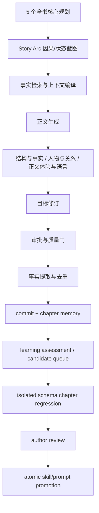

# Novel V2 小说创作工作流

> 当前活动契约：2026-08-04。本文以源码和当前 workflow 行为为准；历史 artifact、已完成旧审校记录和旧 reflection 数据只读保留，不被新运行消费；不兼容的活跃审核运行可直接终止并废弃未提交候选。
>
> 当前工具面：20（真值 `src/novel-v2/mcp/tool-metadata.ts` 的 `TOOL_COUNT`，由 `__tests__/mcp-tool-face-single-source.test.ts` 强制本文与各 skill 的声明一致）。下文按批次记录的历史增量（如"50→52"）是当时事实，现行值只看这一行与代码。2026-09-24 四批减法：撤 novel_project_list（REST `GET /v2/projects` 完整同源孪生，项目状态观测由 novel_project_inspect(view=catalog) 承载）。同日三批减法：撤 novel_project_create（走 REST/Web）；弧规划三入口合一（novel_story_arc_batch_start / novel_story_arc_orchestrate 并入 novel_story_arc_start 的 mode=batch / mode=orchestrated）；观测面三对合一（novel_catalog_get + novel_context_get → novel_project_inspect(view=catalog|context)、novel_artifact_get + novel_artifact_list → novel_artifact_query、novel_workflow_get + novel_workflow_list → novel_workflow_query）；审校双入口合一（novel_chapter_review_issue_add 并入 novel_chapter_review 的 issues）；决策面合一（novel_chapter_review_decision + novel_story_arc_decision → novel_workflow_decision 的 target=chapter-review|story-arc）。同日二批减法：一批撤 9 个零真实调用工具（novel_action_list、novel_run_complete、novel_receipt_get、novel_rule_target_get、novel_skill_get〔并入 novel_skill_query〕、novel_chapter_script_h3_submit、novel_memory_grooming_report、novel_chapter_recall_report、novel_model_dispatch）；二批撤 12 增 1——novel_review_submit 并入 novel_action_execute(review.submit)、rule 五个人工步骤（evidence_submit/foundation_evaluate/review_submit/promote/rollback）合并为 novel_rule_candidate_advance、novel_closed_loop_run 与 novel_chapter_script_h3 能力走 REST（`POST /v2/projects/:id/closed-loop`、`POST /v2/projects/:id/documents/:documentId/script-h3`）、novel_prompt_inspect 与 novel_invocation_list 能力走 REST 审计路由、novel_rule_candidate_get/novel_project_delete/novel_run_get 零或近零调用撤除。

运行数据卷、仓库更名后的恢复步骤、正式审校边界和质量 A/B 产物契约见 [data-recovery-quality-validation.md](./data-recovery-quality-validation.md)。混合开发模式使用稳定命名的 `creative_studio_novel_*` 卷；卷不存在时由 Compose 创建，不能通过切换到另一组卷来伪造空库。全 Docker profile 使用隔离的 `creative_studio_container_*` 卷，不连接混合模式当前数据。

## 1. 目标流程



Web、HTTP、MCP、CLI 都是可替换客户端。PostgreSQL 保存结构化真源，Temporal 持有 durable execution，正文对象通过对象存储保存，Qdrant 只承担可重建索引。

章节正式链路固定为：

review → revise → manuscriptApproval → extractFacts → approveFacts → commit → enrichCharacters

没有新的 reflection activity、reflection schema 或 reflection artifact 消费路径。旧 reflection 产物可以查看和审计，但不参与新 draft、review、revision 或 commit。

## 2. Foundation 全书规划

活动阶段只有五个：

| taskKey             | 职责                   |
| ------------------- | -------------------- |
| project-positioning | 项目定位、读者方向、核心承诺与作者边界  |
| architecture        | 全书结构、卷级层次、长期状态与收束方式  |
| characters          | 主要人物、动机、声部、知识边界与关系可能 |
| worldview           | 世界事实、规则、代价和可验证边界     |
| plot-design         | 长程主线、支线、信息释放、伏笔和终局策略 |

依赖关系：project-positioning → architecture / characters / worldview → plot-design。旧 relations、plot-threads、foreshadowing、timeline、story-control 不再生成独立 task；相关信息可作为上述五阶段 payload 的可选结构存在。

每个 Foundation artifact 保留 artifact id、fingerprint、source provenance、审核和作者确认状态。可选结构不转换为固定数量、逐章字段或每章质量门。生成失败、编辑、重生成和上游 stale 仍由原有 section 生命周期和审计记录管理。

provider 端 `foundationSchema` 只校验 `structuredData` 是 JSON 文本字符串，无法表达 task 级容器键（如 `architecture` / `worldview`）。`structuredData` 根形态采用平铺契约：对象型 task（project-positioning / architecture / worldview / plot-design / plot-threads / timeline / story-control）的根直接承载 task 数据，不再包一层与 task 同名的容器键；数组型 task（characters / relations / foreshadowings）的数据本质是数组，但 `structuredData` 根必须是对象，因此保留 `{ [collectionKey]: [...] }` 集合容器（provider 与解析层都要求根为对象）。`normalizeFoundationModelOutput(value, taskKey)` 在最低共享层做形态归一：对象型 task 根含 `dataRoot` 容器键（历史容器或模型遵守旧契约）时解包为平铺，已平铺则保持不变；数组型 task 保持集合容器。判定基于纯结构特征（dataRoot 键与 schema type），跨 provider/题材复用；根是其他 task 容器或内容确实缺失时不误解包，契约校验仍如实报告，避免掩盖内容问题。该归一化在生成与 external-mcp 物化两条路径同时生效，保证落库 artifact 始终是规范平铺形态，历史容器数据在读取侧（全书审计、书名读取）同样被解包。

### 2.1 角色身份与展示投影

Foundation `characters[]` 中的 `id` 是项目内规范人物 ID，`name` 是作者可读的展示名。`entities.id` 只保存稳定关联键，`entities.name` 与 `payload.displayName` 保存展示名；角色富化和关系写入必须先通过项目内身份映射解析规范 ID、中文/原文名称和实体 ID，不能把模型返回的稳定 ID直接当作展示名。已有 Foundation 映射优先于自然语言别名，未知的关系目标创建为 `pendingEnrichment=true` 的待补全实体，不推断或伪造正式角色名。知识工作台读取角色时合并 Foundation 基线与实体增量，展示名优先，规范 ID 只作为可追溯副信息。

### 2.2 全书架构审计与正文审校分层

全书架构审计发生在 Foundation 与 Story Arc 之间，审计对象是跨阶段结构数据，不是当前章节正文。`auditFullBookArchitecture` 只检查以下共享契约：

- architecture：每卷的入口状态、阶段压力、退出状态和承诺窗口；

- characters：重要人物的限制/恐惧、独立行动与选择代价；

- worldview：规则陈述、调用代价和不可越过的边界；可选资源/技术分配（resourcesAndTechnology）与价值/冲突（valuesAndConflicts）压力层；

- plot-design：人物终点引用、长线阶段责任/下一次推进和信息边界。

长线（longHorizonThreads）可携带可选的 `coupling`（与主线的耦合机制：改变人物选择/资源/认知/关系/世界规则之一）和 `mergePoint`/`exitPoint`/`transformPoint`（交汇/退出/转化条件）。缺方向、结局、阶段责任等必需契约仍产生 major；只缺耦合机制或生命周期条件的线产生 `long-horizon-thread-coupling-incomplete` warning，不阻断审批，旧数据不因缺少这些可选字段失效。`architecture.structureType` 是可选的 `linear | tree | network` 枚举，只描述结构与承诺的匹配理由，不作为质量门。

故事弧只持久化 `threadResponsibilities`，每条责任的 `threadRef` 同时承担剧情线引用和本弧的下一次可验证推进条件。不存在可独立维护的 `plotThreadRefs` 名单；暂缓的剧情线可以记录保持/观察责任，不把长线变成逐章兑现清单。

重基线 envelope 携带符合当前契约的 `approvedArc`、历史章节提交包和事实证据。章节冻结权威仍来自章节提交包、`chapterMemory` 和事实证据。缺少可验证责任的旧弧在迁移中标记为 stale，不能由运行时静默推断或投影为新契约，必须重新生成并审核故事弧。

审计报告以 `fullBookArchitecture` 独立返回，保留 volumeCount、estimatedChapterCount、characterCount、longHorizonThreadCount 和结构问题列表；缺少或为空的 architecture.volumes、characters.characters、worldview\.rules、plotStrategy.characterDestinations 或 plotStrategy.longHorizonThreads 会产生 major。卷级 `promiseWindows` 除数组存在性检查外，还做内容软诊断：条目缺少可解析引用（promiseRef/id/description）或阶段窗口（windowOrdinals/window/payoffWindow）时报告 `promise-window-ungrounded` warning，不阻断审批。它不读取正文质量分，也不要求每章出现事件、钩子、反转、主题、感情或幽默。`architecture/health.issues` 继续负责批次重叠、已提交剧情线和伏笔引用等硬完整性问题。

两类问题的处理入口不同：Foundation 契约缺失先修 Foundation 并使受影响故事弧 stale，再通过弧级 rebase 重新编译阶段计划。rebase 先严格校验新候选，再覆盖已提交章节的冻结蓝图；历史章节以 `revisionId` 或 `chapterMemory` 的生命周期身份识别为冻结权威，不依赖新旧 JSON 完全相等。只有当架构契约已经成立、问题仍具体表现为当前段落的场景因果、视角、人物行为或语言时，才进入 `chapterReviewWorkflow`。章节正文审校不能替代全书架构审计。

Foundation 审核（`foundation.book-plan` 执行点，`foundation-reviewer` 角色）在既有契约完整性、层级因果、多线耦合与不确定性检查之外，以目标读者视角加查十项基线（由 `review-gate` Skill 与 foundation-review prompt 共同承载）：承诺可兑现（卖点是可体验的冲突组合而非名词堆）、主题进入选择（主题落在人物利益/关系/责任/代价的具体选择上）、欲望-阻力-选择-代价闭环、配角独立欲望与关系网络、世界观规则改变人物可选集合（删掉设定名词后选择是否不变）、感情线靠行动累积而非宣言、重复与升级是否改变层级/意义/代价、读者不确定性是否有可推断证据、表层大众化（卷名/章节名/概念与术语命名面向大众读者，专业概念出现在表面时须转译且全篇同译名）、揭示物分层（核心创意与世界观真相是剧情揭示物而非开篇设定，规划区分世界表面事实/异常现象/底层真相，删除真相后开局仍须成立）。十项是检查方向与证据类型，不是必须全部成立的硬门：按当前 taskKey 的适用性选择，不适用项跳过，不因缺少某项扣分，只有缺失确实损害已承诺功能时才产出审核意见并驱动修订。审核仍不要求每章事件、钩子、反转、主题、感情或幽默，也不通过增加固定章节数量、固定爽点密度或强制感情线来修复问题。

规划级审核（Foundation 与 Story Arc）采用文本意见契约（`src/novel-v2/text-review.ts`）：通过时模型只输出单行 `PASSED`，不通过时输出可执行审核意见全文，意见本身即「不通过」信号；verdict 只保留 `passed`/`revise` 二值，不再有 `blocked`。设计依据：规划级审核产出本质是指导意见，强结构化枚举（维度分数、逐章校验账本、authorityChecks）依赖 provider 真正执行 strict json\_schema，第三方中转站可能忽略该字段导致模型自由发挥、修复循环仍失败；文本契约对任何 provider 零依赖。审核不通过时，意见作为重新生成的 `instruction` 回流（Foundation 经 `reviseWork` 写入 work item instruction 由 `buildFoundationPrompt` 消费；Story Arc 经 `buildStoryArcRevisionPrompt` 注入修订 prompt），learning 评估以同一意见为输入。解析基于结构特征（单行标记/围栏剥离），跨题材与模型复用。

## 3. Story Arc 与章节蓝图

Story Arc 按故事弧和批次滚动生成，不在开篇冻结整部长篇章节表。章节蓝图的活动字段是：

| 字段                    | 用途                               |
| --------------------- | -------------------------------- |
| index / title         | 叙事顺序和工作标题                        |
| narrativeFunction     | 当前章节的叙事功能，可为空或由模型选择              |
| povCharacterId        | POV 边界                           |
| stateTransition       | before、after、evidence，允许外部状态保持稳定 |
| scenes                | 当前执行场景                           |
| continuityConstraints | 冻结事实和连续性边界                       |
| unresolvedAtClose     | 章节结束后仍未解决的事项                     |

场景只保留 title、participants、situation、observableActions、opposition、decision、outcome、cost。opposition、decision、cost 允许为空；安静、关系、背景、等待、恢复、内省和余波章节不必被改造成冲突升级。

删除的章节级编辑字段包括 summary、chapterPurpose、readerExperience、thematicTreatment、romanceTreatment、humorTreatment、dramaticQuestion、emotionalMovement、stateDeltaBudget、narrativeScale、optionalBeats、setupRefs、payoffRefs、closingForce、freedom、participantStakes，以及旧版 goal/turn。041 迁移清理这些 JSONB 字段，新的生成、编辑和正文 prompt 只读取 `chapters.payload` 的 canonical blueprint。**残留读侧清理（2026-09-19）**：`recordNarrativeStateSnapshot` 的"未来才该兑现"一侧当时仍在读 `chapters.payload->>'payoffRefs'`——本文件已宣告该字段被剥离且无生产者，于是那条判据恒空、`prohibitedEarlyConsumption` 实际只剩弧退出状态（"读了自己文档里已删除的键"这类漂移靠两侧同文对账才看得见）。现改由兑现账本按 cutoff 分侧供给。

**分侧列语义（09-19 复核自纠，F4→F4′）**：首版收口把两侧都按 `foreshadowing.narrative_order` 分侧，而该列是**埋设章**序——兑现动作只写 `status='fulfilled'` 与 `payoff_revision_id`，埋设序在兑现时不变 ⇒ "埋设在前、兑现在未来"被误归进已兑现侧，正是该判据要挡的形态，且章节顺序推进时未来侧恒空（机制仍不现形，只是换了个失效原因）。兑现章序必须走 `payoff_revision_id→manuscript_revisions→manuscript_documents.narrative_order`；`payoffs` 表支（`revision_id` + `evidence->>'description'`）另覆盖"兑现记录在 payoffs、伏笔行仅有 payoff_revision_id 或缺席"的新数据形态，两支 UNION ALL 缺一支都有存量描述不可达。守卫 `foreshadowing-order.test.ts` 首条用例双支各配一条判别断言，反向对照两次实测判红（两支只留埋设序 ⇒ 未来侧断言红；剔 `payoffs` 支 ⇒ 旧存量侧断言红）。

Story Arc 审核只检查状态连续、场景因果、事实权威、章节功能与长篇位置是否相容：审核 prompt 要求按整弧与逐章清单完整覆盖（每章的状态连续、场景因果、章节功能、权威边界，整弧的阶段边界/窗口节奏/长篇层级），输出为文本意见而非结构化账本（见上文规划级审核文本契约）。它不要求每章新事件、外部压力、强钩子、反转、爽点、主题表达或不可逆变化；审核完整性不等于正文创作约束。

**规划端人物登记表与群像结构信号**（2026-09-16 全书审核确诊根因的系统端落点，`content-audit-20260916.md`）：126 章蓝图 44% 全部场景参与者≤1（正文对白占比从 6.7% 崩至 0.26%）与 povCharacterId 四形态漂移（char_chu_heng/char_chu/chu-heng/char_hu_cheng，POV 作用域记忆召回在漂移章节静默失效）共享同一根因——规划模型上下文从未有合法人物名册、也没有任何一面把"独处编排"变成看得见的数字。修复三接线：①`getStoryArcPlanningInput` 投影 entities 人物表（短 id=实体 URI 末段+显示名，上限 80 行）为 `arc-context-cast` required 段并在 `context()` 面渲染，povCharacterId 契约="只能填登记表 id 精确值、不附名称不截短不自造变体"；②纯函数 `inspectStoryArcEnsemble`（参与者按去重名≥2 判群像章、批次配额 ceil(n/3)、最长独处游程）——近 6 章窗口的独处游程并入 `serial-signals` 段（serialFunctionRuns 同型：只呈现描述性统计），章节蓝图生成契约注入群像配额指引（每批≥1/3 章两人同场互相施加代价、纯独处章每批≤1 且 planningRationale 声明"这章的静在与不在场的谁对话"；重基线面不注入，历史冻结），弧审核 prompt 注入本批确定统计与判定契约（配额未满足或游程≥4 且读者体验受损才报，个别功能静章不构成问题；同时核对 povCharacterId 命中登记表，变体按 major 报告给出正确 id）。边界声明：全部为统计与审核证据面，不是正文句式硬门、不判台词质量（对手戏的活人度仍归 character-reviewer）；静≠独——安静章两人同场依然合法。待排：既有 43 章漂移 payload 的一次性迁移、到期伏笔账回流规划面（overdueLedger）、逐弧兑付密度投影（见 content-audit §七 P1/P4/P5）。

**正文结构门扩三通道**（同批，warning 级不拦截）：`manuscript.meta-reference`（阿拉伯章序"第\d+章"——编排指令章号被复述进正文，全书命中 94/102/103/104）、`manuscript.latin-residue`（≥3 连拉丁字母，命中 35/104）、`manuscript.paragraph-fusion`（段长中位数≥200 的段制坍缩，fragmentation 的镜像病例，命中仅 88）。判据全部为码位/分布形态（汉字章序、正常段长反例零误伤），全书 120 章回放精确命中审校人肉清单且无额外波；阈值 TODO 进 output-policy 配置。与 `manuscript.syntactic-tic`（92e8f2d）同属"审校确诊→确定性通道"转化，人工整改清单见 `tmp/audit-a-26-60.md`、`tmp/audit-b-61-98.md`、`tmp/corpus-scan.csv`。

**到期伏笔账回流规划面（P1，轮 2）**：`getStoryArcPlanningInput` 计算 `dueLedger`——与 health 同一 `parsePayoffWindow` 谓词，chapter 窗口过期条目按 horizon 升序列 top-12（含描述与埋设章），埋设 40+ 章且窗口不可判定者计入"老化账"汇总不列明细（宁缺毋伪）；渲染为 required 段 `arc-context-due-ledger` 进规划/审核/修订三面。处置契约：每条到期账三选一（本弧兑现/分流改窗/分流放弃），不分担必须在 threadResponsibilities 登记保持责任与触发条件——**静默续期**（既不兑现也不登记）按线索责任缺失报告 major；不设"每弧必兑 N 笔"数值硬门（兑现密度是题材判断，只强制处置动作存在）。本书实测：73 条超界 + 60 条老化——账本第一次被规划者看见。同批 `payoffRhythm`（P5）：近 4 弧"定稿章数→兑付笔数"（payoffs 双 FK 面按兑付 revision 所在章归弧）注入 serial-signals 段，连续≥2 弧零兑付才出读者契约透支提示（真库读数弧 15-18=0/1/5/0，修正审核侧"账本全停摆"误读——断的是题材主线老账，不是全部兑付）。TODO(magic-value)：40 账龄/12 注入预算/4 弧窗口应配置化。

**收束形态轮换契约与计量克制度（2026-09-22，商业基准对照确诊）**：`commercial-benchmark-review-20260922.md` 确认章末仪式窗口命中 38/168 章（末句≤8 字 W=6 滑窗，集中 53-92/113-136/166-168）且半X 计量刻度 31 章 ≥8/章——两者都是**批级累积型口癖**，逐章判据测不到同形落点跨章可预测性（与群像游程同构），故契约放蓝图生成面：①章节蓝图生成契约注入"收束形态轮换契约"（每批 ≥1/3 章收束不落在『回到居所/静场清点/留白悬置』动作帧上，改外部小事件/他人动作/切在动作中间；动作帧可复用意象、表层句式必须变体；选形理由入 planningRationale；重基线面不注入，历史冻结），弧审核注入"收束形态分布检查"（连续 ≥3 章同动作帧且未声明理由才报，个别安静章静收束合法——语义判断归审核，不做句式黑名单）；②正文契约注入"计量克制度"（半+度量单位与息计数为**生成偏好**非硬预算——软预算指令曾实证拦不住〔ch120〕，确定性约束仍由 `manuscript.syntactic-tic` 门承担，戏剧装置用法豁免）与逐章收束轮换提醒。1A 回放验证（tmp/replay-payoff-rhythm.mts，真实通道 import `renderStoryArcPayoffRhythm`）：本书台账渲染出"已连续 3 弧零兑付"（弧 22-24，正对终局政治线悬空），零兑付弧 7/24 为常态分母、均 4 章一笔——印证"不设硬门只透支提示"设计，P5 无需扩建。存量治理（章末仪式 38 章窗口、51-80 死亡象限对白）按 `improvement-plan-20260922.md` 迭代 3 试点制推进，不在本轮。

**章长漂移信号（2E，2026-09-22；判据先测后建的两连证伪）**：商业基准确诊末段章长衰减（53 章 <2000 字、111-168 均章 2004-2054 vs 开篇 2817）。退役考古：`manuscript.length` 的退役**不是**"长度不是病"，而是长度约束已迁移至提交门 `length-under-target`（revision-policy.ts，对蓝图声明 targetWordCount 的 60% 兑现率，弧 7 ch49/弧 5 ch32 骨架稿实证）——绝对字数门不得复辟与之竞争。候选逐章判据被 168 章实测**两连证伪**：①"单章 <1800 且 < 前 6 章均长 ×0.85"命中 28 章且全书散布（含第 8/9/22 章等早期章）——局部短章在任何位置都呈"大跌幅"，合取收不住；②纯绝对 <1800 命中 31 章同样散布。落地形态改为与群像/回报节奏同构的**描述性统计信号**：`LENGTH_DRIFT_POLICY`（word-count.ts 叶子模块，window=6 / sparseFloor=1800，TODO 配置化）+ `getStoryArcPlanningInput` 查询近窗口定稿章 word_count（\p{L}\p{N} 口径）得 `lengthDrift`，经 serial-signals 段注入规划/审核两面并纳入该段指纹；`renderStoryArcLengthDrift` 仅在 sparseCount≥2 时出"不得系统性延续低声明"提示（单章低量如 ch167 有意压缩章不误报，回放实证）；弧审核加"内容稀疏检查"（'拆事件凑章数'语义判断，ch121 病例措辞；章长本身不是病，碎片化才是）；蓝图目标篇幅契约补"逐章达标 ≠ 全书密度合格"边界。真库回放：末窗（163-168）均 2298/1 章低量→只报统计；头窗（1-6）均 3180 零低量（tmp/replay-length-drift.mts）。

**人物引用归一 character-ref（P4，轮 2 确诊升级）**：漂移审核从"蓝图四变体"深挖为**跨面形态恒不匹配**——claims.knowledge_scope 存短 id 或显示名、chapter_memories.character_states 存显示名、relations.subject_id 存完整实体 URI，POV 章末状态钉挂因此全书从未命中、POV 关系召回恒空、漂移章节 claims 整章饿死（上下文断裂无声于任何报错）。最低共享层 `character-ref.ts`：登记表内任意形态→规范三形态（uri/shortId/name），解析序=精确→唯一 token 包含→唯一编辑距离≤2，歧义/未登记返回 undefined（不发明人物）。消费三面按登记表解析后比对（searchMemory facet、searchGraphMemory ANY(uri,shortId,raw)、pinned claims povCanonical 身份收敛）；写面两处自愈（projectStoryArcBundle 进 payload 前收敛短 id；规划上下文投人物登记表）。数据修复已应用并审计（fix-pov-refs：126/126 收敛；残留登记：scanPovResiduals 以 id 当人名的 hint 通道过度标记，待 display-name 接线）。**关系时效量纲契约（PL-1 量纲族第二例）**：`relations.valid_from` 语义=**叙事序**（读侧 `valid_from<=叙事cutoff` 与 narrativeRange.start 同量纲消费），character-enrichment 曾写 `Date.now()` 使正文来源关系检索恒假全灭——写侧改 `input.narrativeOrder`，量纲守卫测试断言值等于叙事序而非"是个数字"；数据修复 fix-relation-valid-from 已应用（198 行换算，8 行不可换算置 NULL 走规划候选通道）。端到端验证（ch123 真库）：POV 钉挂恢复、关系召回 0→96、词法 32。轮 3 收口三件：`scanPovResiduals` 消费面 POV id→显示名经登记表解析（此前 id 进不了白名单，视角人物内心戏会被误标"他人残留"）；"悬念续费"检查落弧审核 prompt **语义**面——全书 `unresolvedAtClose` 字面复用游程实测为 0（蓝图每轮重述未解项），无信号不建确定性检测器，同一未解问题换措辞不换账由审核器判定。**常驻服务代码版本可见性**：`code-revision.ts` 启动期读 git HEAD 短哈希，API/Worker/MCP 健康端点与 header 暴露 `codeRevision`，`dev-v2` 复用旧实例时对比 HEAD 打显式滞后警告（runtimeFingerprint 只哈希配置身份、代码改了它不变——"修复已合入但静默不生效" failure class 的机制端补刀；unknown 只警告不拒启，是探针不是部署门禁）。

弧规划的 **manual 人工门带作者修订反馈通道**（弧6 实践批，2026-09-12）：`reviewPolicy=manual` 下工作流审核完成后进入 `manual-review-required` 门；审核 verdict=revise 时 `approveStoryArc` 被前置门禁正当拒绝（"审核尚未通过"），此时作者/外部编排者通过 `novel_workflow_decision(target=story-arc)`（MCP，2026-09-24 三批起章节门与弧门同工具双门分发）或 REST `story-arcs/:arcId/approve` 携带 `decision=revise + feedback` 把修订指令送进等待中的门——`storyArcApproved` 信号解析 decision 键（无该键的旧载荷=批准，零回归），manual 分支在 approve 与 gateDecision 任一到达前挂起；revise 走与 auto 分支同序的 reviseBundle→project(edited, actor=web-author)→重审→再入门，作者指令与审核意见**合并**进 opinion（审核器已发现的问题不因作者指令丢失），门循环无次数上限（作者驱动，每次重审消耗真实审核成本，与 auto 的 maxRetries 语义不同）。入口分工：MCP/REST 的 approve 只发信号、由工作流醒后单一落库（历史 REST 先落库再信号的顺序在两弧实践中未触发冲突，但双写面保留在工作流一处）。已知缝隙（登记未修）：外部编排输入持久化在 run payload 后不可修订，弧蓝图与编排文本口径分叉时审核器会按"编排 vs 蓝图"冲突反复报（本轮第3条即此型），当前以 plotNotes 登记偏差绕过，编排修正案通道列为演进项。

**伏笔账本同章变体归并**（同批追加）：分流面首跑实测暴露 overdue 101 中约四成是同事件重措辞变体（锚点身份 PL-5③ 之前的老行退描述内容键，"树洞蓝光"六变体）——作者逐条对账扛不动噪声，故 migrate 尾 `repairForeshadowingLedgerDuplicates` 做确定性预处理：只并"同章 + 描述 bigram（去标点后）Dice ≥0.24"的保守面（阈值 2026-09 由运行库逐对分布带重校准：同事件变体带 0.25-0.41，首个真·不同叙事时刻 0.21），keeper=桶内字典序首行（账表无时间戳，内容派生 id 稳定），变体 `status='merged'` + `mergedInto` 指回（非破坏，open 消费面出局），描述进 keeper.mergedFrom、keywords/possiblePayoffs 并集；跨章同文与同章异事件双向不并，复跑零改动。归并后剩下的才是真债，进 `novel_foreshadowing_triage` 作者三选一。阈值 TODO 可配置（措辞漂移率随模型变，须重校准）。

2026-09-19 判据面收口（product-audit-20260910 §五复测）：分桶键此前只按 `narrative_order`，扫描面也无项目约束——两个项目的"同一章号"会进同一桶，在 0.24 传递闭包下即跨项目归并（实测当前只有一个项目携带伏笔账，属潜伏缺陷；同类全局修复面逐条扫描过，其余均按行键控、无跨项目比较语义，故不连带改动）。同轮把 `narrative_order IS NULL` 的无锚点行并入独立桶：检测面（`getArchitectureHealth`）跨全表按 Dice≥0.85 聚簇而修复面看不见这类行，判据不对称使实存残留的 1 簇（两条规划期同事件行，0.92）结构性不可达。刻意保留：跨章同文仍不归并——不同章的相同描述是两次埋设事件而非重复登记，由 warning 交作者判断。

**伏笔账本作者分流面**（弧6 收口实践抓出的工具缺口，2026-09-12）：架构健康的 `foreshadowing-overdue` 告警从 B 期起就指示"兑现/改写窗口/放弃"三选一，但系统只提供兑现通道（正文 payoffs 账驱动），后两者全库无入口——告警在指挥作者做不存在的操作。补最小分流面：MCP `novel_foreshadowing_list`（三态视图 + overdue 判定与 health 同一谓词 `parsePayoffWindow.horizonOrder`）与 `novel_foreshadowing_triage`（abandon：status 翻 `abandoned`，全部 open 消费面〔规划注入/审校上下文/health/账本查询按 status='open' 过滤〕自然出局、数据与埋设账不删；rewrite-window：只重写 payload.expectedPayoffWindow 为结构化 `{scope:'chapter',from,to}`，重抽取合并 `existing || incoming` 语义保证改写不被后续措辞漂移覆写）。两者都强制 reason（审计 `foreshadowing.triaged.*` outbox 事件）、逐条幂等 skip 不炸整批、仅 open 可分流。工具面 50→52（该批增量为当时事实；09-17 独立短剧浏览器化移除 10 个工具后为 49；09-19 回述对照只读诊断 +1，现行值见文首声明）。集成测试接线教训同批收口：`postgresAvailable ? describe : describe.skip` 在收集期求值恒 skip——真库块在数据库可用的开发机上从未跑过（本批 itDb 运行期 ctx.skip 修复后，两条旧 happy-path 立刻暴露 premise 必填漂移与断言错误，DB 套件禁空过纪律的又一实证）。

弧规划由 `story-arc-design` Skill 提供设计契约（execution points：arc.plan / arc.review / arc.revision / chapter.blueprint），把弧视为"一个读者问题被逐级回答并升级"的叙事单元而非章节状态序列。五项设计契约：问题阶梯（主线推进弧的核心读者问题在 development 中逐级被回答并升级）、压力类型轮换（连续同类压力必须升级规模、代价或牵连）、场景因果链（场景 outcome 成为下一场景 situation 的触发条件；不推动外部因果的场景必须承担关系温度/理解修正/余波承载或独立体验功能，否则视为赘余）、安静章功能（无外部事件章节必须让读者获得可感知的新东西——关系温度变化/风险判断改变/物品易主/理解修正/情绪确认/余波承载之一；确认规则的陈述若改变角色后续选择或风险判断即算功能）、不可逆出口（推进型弧 exitState 相对 entryState 至少一项不可逆变化；铺垫/过渡弧出口可稳定但须说明静态功能）。弧审核另加读者回报检查：本弧 entryState/objective 承诺的体验（解决问题、关系升温、世界揭秘、认知落差、情绪确认）是否在 exitState 与 development 中真正交付；弧结束时读者只经历过程而无解决、成长、理解、情绪或新问题中的任何回报时报告为节奏问题，安静弧的回报可以是理解修正或关系温度。这些契约是弧级检查方向与证据类型，不是必须全部成立的硬门：安静、关系、背景、铺垫和余波弧与行动弧同样合法，只要功能有可感知证据；只有契约缺失且确实损害本弧承诺功能时才按 major 报告。规划 prompt 同步承载同一契约的压缩表述；章节级 quiet chapter 仍可通过关系温度、理解、信息分布、情绪或余波完成功能，不必被改造成冲突升级。

**外部编排模式（模式 B）**：故事弧规划另有外部编排入口 `novel_story_arc_start(mode=orchestrated)`（原独立工具 `novel_story_arc_orchestrate`，2026-09-24 三批并入），由外部大模型或用户提供剧情编排（plotOutline：objective 必填，其余为弧级设计意图——entryState/centralConflict/development/resolution/exitState/threadResponsibilities/expectedChapterCount/phases/chapterHints/plotNotes），系统负责完善：把编排作为 `arc-context-plot-outline` required section 注入 arc.plan / chapter.blueprint / arc.review / arc.revision 执行点，对照冻结事实与叙事状态账本做事实梳理，补全场景因果、章节状态转换、连续性约束与责任承接，再走正式弧审核 → 修订闭环。编排是设计意图基线，权威低于已定稿事实、叙事状态账本与作者边界：冲突时以事实为准，不得为了贴合编排虚构事实、提前消费后续答案或改写人物知识边界；空编排（只有 objective）被拒绝，提示改用普通模式。编排输入持久化在 `workflow_runs.payload.plotOutline`（`arcs.payload` 在项目蓝图投影时会被 bundle.arc 覆盖，不能作为编排持久化位置），并写入蓝图 artifact structuredData 提供 provenance；后续批次与审校通过 `getStoryArcPlanningInput(projectId, arcId)` 按弧精确读取同一份编排。外部任务降级路径在 contextRefs 中携带 outlineJson，物化时写回 artifact。编排含 threadResponsibilities 时沿用 threadRef/responsibility/nextAdvance 契约，未解析引用仍按提交边界阻止批准。

**伏笔归属按线程显式认领（PL-5④ 判据收口，2026-09-19）**：`foreshadowing.thread_id` 是单值列，旧写入判据"本弧恰好一条线程责任才把本弧引用的开放伏笔绑过去"在真实数据上恒不命中——实测 24 条弧的 threadResponsibilities 全部并行 4-7 条线 ⇒ 可绑弧 0 条、全表 thread_id 绑定 0 行（写入口存在但结构性惰性，见 product-audit-20260910 §五）。根因是契约没有归属表达而非接线缺失，故新增 `threadResponsibilities[].foreshadowingRefs`：线程自己声明本弧承担哪几条伏笔，取值必须是**弧级 foreshadowingRefs 中已出现的引用**（纯函数 `planThreadForeshadowingBindings` 判账内认领，认领引用先经本弧同一次 raw→canonical 映射翻译，不引入第二套解析真源；账外认领按 blocking 回流 planner，多线认领同一伏笔不猜承担者、写进审计 `story-arc.references-normalized` 的 `threadBindingAmbiguous` 留痕）。字段为可选：旧弧与无认领输出零回归，单线程弧保留原兜底语义（仅在无任何认领时生效，避免旧启发式覆写声明）。生成面 schema 里该字段进 `required` 不是设计偏好而是 `assertNativeJsonSchema` 的硬约束（原生结构化面禁止对象出现未列入 required 的 property，`native-schema.test.ts` 抓到并纠正了最初的可选写法），"本条线不承担伏笔"以空数组表达，解析面仍按可选处理。五面同批登记：契约类型、外部编排解析与模型输出面解析、生成面 JSON schema、`novel_story_arc_orchestrate` 工具 schema、编排技能文档（教训：spec/工具/技能不同批登记=机制无人使用）。**部署代价如实登记**：生成面响应 schema 变化会改该阶段 prompt 指纹，从而给在飞的外部弧规划任务换幂等键——落位窗口应选在无在飞弧规划任务时；437 条存量 open 未绑仍需作者语义分流（无机械绑定键：文本等值命中 0、plot_threads 仅 7 条、伏笔 payload 无线程键，机械回填=伪造）。

审核 pass 之间相互隔离，并受 `NOVEL_ARC_REVIEW_PASS_TIMEOUT_MS` 的单 pass 超时预算约束（默认 120000ms；TODO：迁入持久化模型路由合同）。单个 provider、视角或结构结果失败时记录丢弃视角元数据；若仍有完整审核结果则继续聚合，只有零个完整结果才失败。已有 blueprint 的失败弧按批次状态自动恢复，`awaiting-review` 批次的语义统一为"引用当前蓝图的批次"（`source_artifact_id = blueprint_artifact_id`，与 `prepareStoryArcReviewRetry` 前置条件一致）：存在引用当前蓝图的 `awaiting-review` 批次时通过正式 retry 状态转换重新进入审核（重审原蓝图，不重新生成）；无引用当前蓝图的 `awaiting-review` 批次（批次已 approved，或批次引用旧蓝图属过期残留）时通过 `prepareStoryArcRebase` 恢复为 `awaiting-review` 并保留蓝图，由入口的 rebase 判定（无待审批次 + 覆盖已提交章节）进入冻结历史 rebase 路径。两类恢复前置条件精确互补，修复了 failed 弧 + approved 批次永久死锁及批次引用错位使 retry/rebase 双双拒绝的死锁边角；`prepareStoryArcRebase` 只负责把 failed 弧恢复为 `awaiting-review`（审计 `story-arc.review-recovered`，recovery=rebase-prepare），无已提交章节时入口的 rebase 判定为 false，工作流实际对旧蓝图做普通复审（修订仅在审核失败时触发，蓝图保留），真正 rebase 决策记录在 workflow run payload 的 rebase 字段。MCP 通过 `novel_story_arc_review` 暴露统一恢复入口，客户端不能用“启动下一故事弧”替代失败弧恢复。若当前弧已有前批次定稿章节但还存在待审核的后续批次，审核只针对该新增批次走普通审核路径；只有没有待审核批次且审核对象确实覆盖已提交章节时，才进入冻结历史 rebase，避免把前批次位置误套到后续批次。

rebase 重基线时，已定稿（committed）章节的蓝图严格对齐已提交版本、只修正 index；planned 章节（只有已批准的未来蓝图、尚无正文）允许以模型新生成内容为准更新标题/场景/证据等读者可见字段，但 `unresolvedAtClose` 必须保留自已批准蓝图，防止修订悄悄改变跨章承诺，`validateStoryArcRebaseBundle` 仍要求该章节有 plannedBlueprint。MCP 模式下 rebase 自动 approve，因此已批准 planned 章节的读者可见字段可被重基线静默改写；这是"宏观规划变更后重基线"的既定语义，作者若已认可旧蓝图内容需在重基线前显式保留。重基线的**逐章对应硬契约在生成面承载**（2026-09-11，arc2 重生成首跑失败根因）：`buildStoryArcChaptersPrompt` 与修订面在 rebaseTarget 存在时显式注入"chapters 数量必须等于目标章数、序号按目标 `globalOrder` 完整覆盖、不得只输出单章或窗口子集；历史已定稿章节仍须各返回一条对应条目（内容由系统按冻结蓝图保真）"——此前该契约只存在于 validator 与已死的 `buildStoryArcRebasePrompt`（仅测试引用、从未进生产路径），模型按"下一批次"语义输出单章被校验拒绝，属文档-代码盲区实证。

**阶段归属数据绑定（PL-6）**：章节"所属阶段"投影只认 `phases[].chapterOrdinals`（弧内 1-based 落籍序号，1..expectedChapterCount 连续覆盖、互不重叠），旧"按阶段数等分章节区间"的算术推断已删除——批量是合法模式，等分对不等长阶段系统性出错且不可诊断。绑定契约的承重面（审核 D3/N5 对齐实形）：`storyArcPlanBatchSchema.arc`（弧结构段，batch 首跑）与 `storyArcBundleSchema.arc`（修订/external 面）的 phases 项 required `chapterOrdinals`；`storyArcChaptersOutputSchema` 只含 chapters、无弧对象不涉及绑定。生成面契约（prompt 指令"不重叠、不遗漏、连续覆盖"）之下另有**校验面兜底**：`validateStoryArcPlanContracts` 对存在绑定的弧强制互斥、≤expectedChapterCount、全量覆盖（部分绑定=半真源比不绑更糟，拒绝；全不绑=旧弧形态，放行给 health），双向测试覆盖。弧有阶段但全部未绑定时架构体检报 `phase-binding-missing` warning（不阻断，指引 rebase 或回写）。存量回填走作者回写通道：`tmp/apply-arc-phase-bindings.ts` 式幂等脚本，带全覆盖/互斥/标题锚点漂移三重守卫，审计 action `story-arc.phase-ordinals-backfill`（本项目 4 弧 14/14 阶段已绑定）。

故事弧规划、审核和下一批次入口在同一项目/故事弧范围内持有 PostgreSQL advisory lock，锁覆盖状态检查、workflow\_runs 登记和 Temporal 启动，避免重复请求绕过状态检查并产生并行工作流。入口在状态变更或 Temporal 启动失败时把已登记运行标记为 failed，并通过正式恢复状态转换回收 generating 故事弧或 generating 批次；锁只保护 admission，不替代工作流自身的状态机。放弃故事弧也在同一锁内读取活动运行，先持久化弧的 abandoned 状态，再取消对应 Temporal workflow、标记运行 cancelled 并过期其外部模型任务；取消失败只保留警告，不阻塞故事弧的本地放弃。

已批准且仍在执行的故事弧按批次继续规划；MCP `novel_story_arc_start(mode=batch)`（原独立工具 `novel_story_arc_batch_start`，2026-09-24 三批并入）先通过 `prepareNextStoryArcBatch` 分配不重叠的下一章节区间，再复用同一套故事弧规划、审核、修订和提交工作流。**批次窗口是系统分配事实，生成侧无裁量权**（弧 5 实践根因修复，2026-09-12）：窗口 = 弧内剩余未规划章数按 `MAX_STORY_ARC_BATCH_WINDOW`（16，与重基线窗口上限、chapterHints 上限同源收敛）截断——纯函数 `storyArcBatchWindow/assertStoryArcBatchWindow` 最低共享层承载，三面接线：章节段 prompt 注入"窗口由系统定为 N 章、完整覆盖序号 X..Y"（正常批次分支，与重基线契约互不泄漏）、内部生成与外部物化两路提交守卫（章数≠窗口即拒绝进审核）、修订面保持候选窗口章数不变量；expected 缺失的旧弧返回窗口 0 ⇒ 契约与守卫双跳过（零回归）。根因实证：弧 5 首跑模型把"保留后续发展的空间"读作"本批只出 1 章"（7 章弧静默坍缩，弧 1-4 全弧一批是既有惯例，无任何机制拦截）；同场现形的还有 `prepareNextStoryArcBatch` 完成门槛的**量纲错配**（拿批次的全局 end_chapter_index 对照弧内 expectedChapterCount——弧 1 恰好从 1 起编号蒙混过关，此后每个多章弧必误报"已达到预计章节数"，PL-1 同型错误在推进面的又一实例；改为弧内已投影章数对期望）。若模型服务失败，调用方必须以 `retryFailed=true` 走同一工具的正式重试状态转换；`prepareStoryArcBatchRetry` 只恢复没有章节投影的最近失败批次，并保留失败原因和重试审计，不创建伪造的后续批次。它不绕过当前弧的 `exitState`、已定稿章节冻结和批次完整性校验，也不允许客户端直接伪造下一批章节蓝图。**批次 `complete` 旗与窗口同族收口（2026-09-12 弧5 实践批）**：它曾同为模型自报值——弧 1 满覆盖却存 false（完成判定只剩维度守卫兜底），弧 5 重编排批存量 false 而派生应为 true；`projectStoryArcBundle` 投影时在 `expectedChapterCount` 存在的一侧忽略自报、按"投影后弧内不同章序数 ≥ expected"覆写（expected 缺失旧弧保留自报，不发明事实），migrate 尾 `repairStoryArcBatchCompleteFlags` 对每弧末批双向回补（漏报 false→true、谎报 true→false、无声明弧不动、幂等）。该旗是弧完成谓词（PL-1）的高优先分支与 `prepareNextStoryArcBatch` 短路输入，系统可推导的事实不得留在生成侧裁量权里。**读侧同契约**（2026-09-12 弧6 恢复环实证）：artifact 里的 batch 坐标是模型自报 echo（新弧常写局部 1 基），历史 artifact 带病回读会让重基线守卫与投影对账各信一边——`loadStoryArcBundleArtifact` 读到引用批次行（sourceArtifactId 精确匹配；单批弧唯一兜底）时以批次行的 `batchIndex/startChapterIndex/complete` 覆写 bundle.batch，多批次无匹配不猜、无批次行（首次生成未投影）原样放行。failed 弧恢复的 rebase 判定同步纠偏：spec 定义"覆盖**已提交**章节"此前被代码弱化成"挂过 document_id"，批次 approved+章节全 planned（投影出文档、零正文活动）的弧被误标 rebase，修订物化撞"保持原批次位置"守卫自锁；谓词改 `documentId && status!=='planned'`（弧 completed 分支不变）。

故事弧模型 activity 的 Temporal 重试上限为 1，因为一次 activity 内的 gateway 已按 routing snapshot 完成候选切换和失败审计；activity 级重复会再次消耗全部候选并掩盖“路由耗尽”的终态。失败批次不会自动伪造新窗口，作者/客户端必须通过 `retryFailed=true` 显式恢复，确保重试有边界且可追溯。

审核 prompt 还对相邻章节的持续状态做通用反向核对：物件、伤势、资源、关系、知识和限制的身份变化必须有可验证的丢失、转移、消耗、恢复或新证据。对未知物质、装置、痕迹或局部反应，湿度、颜色、气味、声音、光亮或接触变化只能支持当下现象，不能单凭一次反应推出用途、成分、机制或功能；越过这条边界的蓝图主张必须在审核意见中明确指出并要求修订保留未知状态。故事弧按批次滚动审核；未完成批次不要求当前章节证明未来 `exitState`，弧级审核检查的是当前窗口与阶段边界、长线责任和后续空间是否相容。审核完整性（逐章覆盖、证据边界、确定性升级防越界）由审核 prompt 的检查清单要求模型逐项覆盖，不再以机器账本强制；审核意见中的问题必须引用实际蓝图字段或章节证据，并在修订中最小化修复。它是弧级状态契约，不是正文句式黑名单，也不将每个名词变成逐章必填项。

## 4. 上下文编译

ChapterPlanningContext 只保存：

- 当前章节执行合同和 artifact 引用；

- 当前章节状态边界、场景执行材料和连续性约束；

- 相邻章节的 narrativeFunction 与状态边界；

- fingerprint、source provenance 和必要的事实投影。

它不保存完整宏观规划 payload。正文阶段通过 memory claims 获取冻结事实，不通过蓝图重复注入世界观、主题和人物标签。draft、review、revision 共用 renderChapterExecutionContract，避免三套 prompt 对同一蓝图各自解释。

章节工作区的 `chapter_production_specs` 只保存作者明确输入的 `chapter_goal`；蓝图、来源 artifact 和指纹统一从 `chapters.payload` 及其来源 artifact 投影。`NarrativeStateSnapshot` 只保存弧阶段、开放线程、伏笔、承诺、兑现节点和提前消费边界；summary、keyEvents、characterStates 只由 `ChapterMemory` 持有。开放伏笔记录可携带 readerQuestion、possiblePayoffs、meaningDelta、cost 四个可选规划字段（缺失按未指定处理，不作为逐章必填），供故事弧把兑现方向与代价作为可排序候选；这些字段来自 fact-extraction 的结构化提取，属于设计态而非叙事事实。

NarrativeRhythmEntry 只保留 documentId、revisionId、narrativeOrder、title、narrativeFunction。summary、keyEvents、emotionalArc、主题字段和 issue families 不再作为章节节奏输入。

跨章序列证据（`SerialContextSnapshot`，`MemoryBundle.serialContext`）把最近 N=6 章的结构化统计投影给 draft/review/revision/learning，弥补单章审核结构上看不见跨章模式的问题（状态等幅重述、连续同功能章节、物件/主题跨度）。它由 `getSerialContextSnapshot` 确定性计算（无 LLM），只输出描述性统计信号，不输出短语黑名单："角色状态跨度"来自各章最新 `ChapterMemory.characterStates`，"连续同类功能"来自 `chapters.payload.narrativeFunction` 的连续游程（≥3），"物件/主题跨度"来自 memory\_claims 中出现在 ≥2 个窗口章节的 subject\_refs。"母题还是疲劳"的判断（重复必须改变层级/意义/代价）由 reviewer 依正文证据作出；窗口与游程阈值为魔法值，标注 TODO 可配置意图。该投影与 narrative rhythm 同级（priority=normal，可被预算淘汰），不影响事实可靠性边界。快照另含 `openPromises`（2026-09-07 补入）：项目开放承诺/期限账本（status=open，LEFT JOIN source revision → document 取建立章叙事序，孤儿修订如实标 null，LIMIT 40、按建立章排序），不随窗口截断——期限类事实的建立章可能远早于窗口起点。机制根因：期限/承诺类事实在其建立章之前出现（跨章时序矛盾）是单章三审的结构盲区，投影后 draft/review/revision 可对照「引用不得早于建立章、时限与条件不得与陈述矛盾、已兑现承诺不以未决语气出现」；渲染层同样给出对照指令而非硬禁令。**目标章解析的单一口径（2026-09-19）**：`getSerialContextSnapshot` 的 target 必须满足与 `buildNarrativeRhythmSnapshotQuery` 同形的条件（`chapters` 行在场 + `document.status='final'` + 已挂 `current_revision_id`），否则绑任何不满足的 documentId 都是"查询成功、0 行、字段静默缺席"——`novel_context_get` 的序列证据增强块正是拿 `max(narrative_order)` 却传 `documentId=""` 而恒缺（空项目上的 smoke 测试看不出差别，因为无章时字段缺席本就合法）。现统一走 `repository.getLatestFinalChapterTarget`，解析到目标却拿不到快照时**必须**记入 `enhancementErrors`（可见降级，不许静默缺字段）；该只读面与生成链路共用 `application/serial-context-assets.ts` 的 `withAssetSpans`（同一账本生产者 + 同一次指纹重算），缺对象存储时如实记"未做资产数量扫描"而不是给空账本。**账本生产者的消费面补全（09-19 复核轮 F1→F1′）**：上一条只接了 `novel_context_get`，而 MCP 侧还有第五个序列证据消费面 `novel_memory_query`——它直取 `repository.getSerialContextSnapshot`，于是 `assetSpans` 恒空，而它的 compact 摘要里偏偏有一个 `assetSpanCount` 字段（读得到字段名、读不到账；与 F1 同族，只是这次露在计数面上）。现两面统一走 `serialContextWithAssets`（`withAssetSpans` 的调用门面）：`objects` 缺失这一形态也归入返回值里的 `degradation`，不再由各调用点各自判一次 `ctx.objects ? … : …`（漏判即静默空账），降级键沿用 `enhancementErrors`。断言面：`mcp-readonly-smoke.test.ts` 在同一份两章 fixture 上比两面的 `assetSpanCount` 同账，并断言无对象存储时 `memory_query` 也记降级；把 `attached.snapshot` 改回 `serialContextLoaded` 实测判红。注意 `assetSpans` 的判据是"同一实体 ≥2 章"（`groupAssetSpans` 与 subjectSpans 同口径），单章窗口恒空是设计行为——测试必须给足窗口，否则断的是判据而不是接线。**判据本身单源（09-19 复核轮 #23）**：上一条说"target 必须与 rhythm 查询同形"，但同形仍靠两段 SQL 里的巧合同文维持（其中三处还是换行分写的，逐行匹配对那种形态天然失明）。现判据是导出片段 `PROJECTABLE_FINAL_DOCUMENT_SQL`（`d.status='final' AND d.current_revision_id IS NOT NULL`，`d` 为 `manuscript_documents` 别名），九处 SQL 内插共用；锁在 `postgres-repository.test.ts`：折叠空白后该字面量在仓储里**只允许出现一次**（常量定义处），且解析侧与投影侧的输出 SQL 都含该判据。
**可数资产数量账本（2026-09-08，`asset-ledger.ts`）**：`SerialContextSnapshot.assetSpans` 对窗口各章正文做确定性扫描（数字词/指代词+量词+名词的正则，零模型调用），同一实体在 ≥2 章被提及数量时生成逐章对照信号——实证根因：可数资产数量在各章间漂移（ch1 结尾两块灵石、ch2 开头单数；云纹草 ch13 一株、ch14 回述两株），读者可直接追踪而审校上下文没有对照输入。分组键取名词尾 2 字（中心语后置：下品灵石→灵石），展示取组内最短形态；模糊量词（几/些）与回指形态（那块）登记为 null 不参与精确对照。渲染层给出对照指令：同实体数量应连续一致、获得/消耗/被夺须有交代、无交代的增减报连续性问题。边界：只做提及登记不做状态解算（不推理存量加减）；名词边界无分词（修饰形态可能吞尾字，hints 级可接受，TODO P2 接入分词）。**生产者归属修正（2026-09-19）**：扫描原先只挂在 `retrieveMemoryForReview` 一处，而 repository 侧 `assetSpans` 恒为 `[]`（它没有对象存储访问权）——于是 draft/revision 两面拿到"有序列证据、无资产对照"的快照，`renderSerialContext` 的资产行判据恒假：渲染点四处都在、数据只到一处；旧测试手工构造 `assetSpans` 属"夹具照实现的假设写"，故断链期间照绿。现把扫描下沉为 `loadSerialContext` 的固有步骤（draft/review/revision/learning 四面同一生产者），并按 `application/serial-context-fingerprint.ts` 的**共用算式**重算指纹——回填改内容必须改指纹，否则 `provenanceRefs` 与 memory bundle 指纹漏记账本、两份不同输入可共用同一 bundle 指纹（外部任务的"输入指纹一致才交付"不变式正建在该值上）；无资产或扫描失败时输入不变⇒指纹与修复前逐字节相同，不给历史项目制造漂移。守卫：`serial-context-asset-producer.test.ts` 五向（账本到 draft 面并渲染出对照行、回填后指纹重算、取文失败降级且指纹不半更新、无提及则指纹不变、repository 已带账本不重复扫描）+ `serial-context-db.test.ts` 锁住两侧同算式；撤除回填即红（已实测）。失败仍降级为无资产对照，不阻塞任何一面。

上下文编译仍保留 required/normal/critical 优先级、输入预算、manifest、prompt fingerprint、source artifact id、Skill provenance 和可审计排除记录。事实、人物知识边界、当前 POV、起始状态、结束状态和场景因果是可靠性边界；文学偏好不转成必填字段。记忆选择区分两层：叙事状态账本和 required facet 是当前阶段的硬上下文，开放伏笔/承诺是可排序候选；它们仍可被检索和回收，但不会因为“开放”就全部挤占 pinned 预算或把局部正文变成清单执行。

**方向驱动事实检索注入（2026-09-29，improvement-plan-fact-injection-20260922 迭代 1，`fact-retrieval.ts`）**：三类跨章硬矛盾（020 账册日期 / 021 交易条款 / 024 玉牌归属）的共同根因是相关冻结断言在预算竞价中落选、未被注入本章上下文，模型凭记忆重写。修复在检索侧把"本章要写什么方向"翻译成强制注入：`buildFactRetrievalPlan` 从**结构化源**（蓝图场景 `participants` 实体经中心语后置尾 2 字归并 + 弧 `threadResponsibilities.threadRef`）派生定向 facet，`retrieveMemory` 对 drafting/revision 用这些 facet 调 `searchMemory`，命中经 cutoff/生命周期过滤、按 score 降序封顶（`MAX_DIRECTION_PINNED_TOTAL=24`）后以 `pinnedClaims` 注入 `buildMemoryBundle`——即使预算竞价落选也强制在场；`reason="direction-pinned"` 作为注入审计标记（迭代 3 的 manifest 可见性挂点）。draft prompt 把 direction-pinned claim 分轨为独立的「本章方向冻结事实」段（priority=required）并配对照指令（不得改写数值/归属/时间），不与普通 ranked-fill 冻结事实混列、不重复注入。**护栏与注入同步上线（原迭代 3 限域前移）**：pinned 超预算在 `buildMemoryBundle` 是硬 throw（不能静默丢弃 pinned 内容），因此派生实体集合有硬上限（`MAX_DIRECTION_ENTITIES=12`，超出截断记 `enhancementWarnings`），线程引用同样封顶（`MAX_DIRECTION_THREADS=8`）且不设 required（线程缺席不得触发 required-facet 硬失败）。泛化红线：facet 只从结构化字段派生，`chapter_goal` 自由文本仅用于人工"该章应带哪些事实"清单的吻合度核对，不作派生主源；禁止把正文偶然出现的词扩成检索主题。失败一律降级为无方向强注，不阻塞检索主链；弧规划上下文读取用 `allowHistorical=true` 只读，不替代工作流侧的新鲜度门。回归面：`fact-injection-verification.test.ts` 双向（归并/截断告警/线程不 required/封顶审计标记；pinned 低分在场且高分 ranked-fill 被预算淘汰、pinned 超预算硬 throw、draft prompt 分轨与安静章零强注）。

文风契约（`style_contracts` 表）是书级、可版本的叙述声音约束：十二维滑杆（POV、叙述距离、时间方式、句式节奏、词汇层级、感官重心、比喻密度、对白比例、留白程度、叙述态度、计量表达多样性、章末收束方式）以 JSONB 按版本保存，同一项目至多一个 `active` 版本。draft/review/revision 通过 retrieveMemory 读取 active 契约，作为 `style` facet 的可排序候选注入（ranked-fill，可被预算淘汰，不冻结）。契约是 prose-reviewer 与写作者的对照参考基线，不强制每章逐维满足，也不把任何取值变成质量门；缺失维度按未指定处理，旧项目无契约时静默降级。

Story Arc 的规划输入使用结构化反馈投影，而不是把 narrative state 原样 JSON 倾倒给模型。投影包括开放剧情线 payload、开放伏笔/承诺的规范 ID、最近定稿章节状态和与规划/连续性/因果相关的 RuntimeLearning underlyingMechanism、affectedInputClass、边界。模型输出契约不再包含 `authorIntent`、`thematicQuestions` 或 `phases[].exitCondition`；`authorIntent` 只作为请求上下文参与规划。review/revision 使用独立的 context sections，并在 manifest 中记录 `narrativeCutoff`、来源 artifact/revision、section fingerprint 和总 fingerprint；旧 planning 数据标为 legacy provenance。反馈只提示共享机制风险，已定稿事实、叙事账本和作者边界仍具有更高权威，开放线索也不等于本批次必须兑现的事件。

模型请求的结构化契约由 gateway transport 统一投影：Responses 使用 `text.format`，Chat Completions 使用 `response_format.json_schema`。发送前的 native schema 预检拒绝 optional properties、动态或空 object、`additionalProperties: true` 及 `anyOf/allOf/oneOf` 等不稳定组合关键字；失败分类为 schema incompatibility，只切换下一个原生候选。Schema 不再注入 prompt，所有返回仍经过同一 AJV、业务语义校验和修复循环。故事弧规划拆为 arc+batch 与 chapters 两个原生请求，只有两段均完成并通过业务校验后才组装并创建 artifact；draft、review、revision 统一使用 `StagePromptPackage`，三个 reviewer 并行启动。

调用链契约（2026-09-07 机制调整）：候选链只承载 API provider 候选，外部 MCP 不再是调用位置（设置页）的可选执行者，而是所有文本/结构化调用链的隐式链尾兜底——显式 API 候选全部失败（含传输失败、空响应、schema/业务校验失败）或链为空时，gateway 在虚拟兜底位（`candidateIndex = candidates.length`）执行路由级预算检查并记录 `waiting-external` 调用留痕，抛出 `ExternalMcpRequiredError` 交由 activity 物化为可认领的外部模型任务（`externalTask` 的 candidateIndex 即兜底位）。历史运行快照中冻结的显式外部候选按原语义在原候选位执行，在途工作流不受影响；新配置（含设置页保存）不允许再写入显式 external-mcp 候选，载入时剥离并等价于空链。空候选链即「未配置 API 模型、全部由外部 MCP 兜底」（初始配置形态）。权衡与边界：原 `exhaustedRouteError` 快速失败语义移除，无外部 worker 认领时任务保持 waiting-external 而非 workflow failed——这是「兜底优先于快速失败」的既定取舍；`memory.embed / memory.rerank` 向量链路没有外部任务物化路径（外部产出无法承载向量），兜底不适用，候选耗尽后按原样失败。**同步链路的兜底语义（2026-09-07）**：进程内同步调用（创意短剧、章节剧本直出等 REST 直返路径）没有外部任务物化通道，`ExternalMcpRequiredError` 冒泡时经 `syncExternalMcpHttpStatus` 映射为 503 Service Unavailable（含义=候选全部失败且可行动：补充 API 候选或由外部编排者走 `*_submit` 双轨），不再以裸 500（系统内部错误语义）暴露给调用方。

网关修复循环（repair）在修复轮抬温重发（`REPAIR_TEMPERATURE=0.7`，首轮保持请求方默认）：根因是确定性 provider（temperature=0 或路由默认低温）在修复轮原样重发同一 prompt 时逐字节复现同一非法输出，修复循环退化为空转并消耗预算——抬温打破确定性，对所有 purpose 通用。结构化校验失败诊断区分「JSON 无法解析」与「Schema 校验失败」：解析候选（全文 / 围栏块 / 平衡对象）全部无法 parse 时，报告首个解析错误（含 position 与附近原文），不再用 AJV 对 undefined 校验得出的缺字段错误掩盖输出结构性断裂的真实失败模式。

`model_invocations` 同时保存 provider input/output tokens 与 provider 返回的 cached input tokens（若供应商提供）；没有 provider 用量时仍保留估算值并标记 `usage_source`，不把估算值伪装成真实计费数据。每次调用还保存 `config_revision`，章节审校和故事弧工作流都在进入模型阶段前冻结 `routingSnapshot.id` 并写入运行 payload；因此可以区分“当前配置”与已启动运行使用的“历史路由快照”。路由解析优先使用显式 purpose（如 `review.structure`），再回退到同前缀通配路由（如 `review.*`），最后才回退到 `*`；设置页必须显示解析来源和快照短 ID。provider 能力探测会临时固定单个 provider，只证明该 provider 的传输/协议契约，不代表真实候选链的顺序或 fallback 结果。候选链表示有序尝试计划，实际 provider/model 必须以调用审计为准；一次成功请求或最终失败前，网关可能已经按候选序号逐个留下失败记录。每次失败调用还保存 `provider_label`、`error_category` 和截断后的 `error_message`，总览通过 `/v2/projects/:projectId/model-invocation-errors?limit=50` 展示该项目最近 50 条失败，按 `created_at DESC,id DESC` 排序；工作流页通过 `/v2/runs/:workflowId/model-invocations` 展示该次运行的实际 provider/model/protocol、候选序号、状态和路由快照短 ID，不再从当前配置反推历史请求。`workflowId` 是数据库/Temporal 工作流标识，Temporal `runId` 只是一次执行尝试，不能混用；历史记录若没有响应正文，只显示“历史记录未保存 provider 返回正文”的明确占位说明。**估算↔provider 比值报表（E5，2026-09-11）**：估算器是预算与段落淘汰的决策依据，其系统性偏差必须可见。观测根因：`context_manifests` 仅 25 份对 1,523 次调用——上下文收据只在蓝图主链路落库，评审/修订/抽取等高频 purpose 的上下文膨胀完全不可见。`context-manifest-sampling.ts` 按 `NOVEL_CONTEXT_MANIFEST_SAMPLING`（默认 0.05；0=关闭、1=全量）对调用做**确定性哈希抽样**（sha256(purpose:promptFingerprint) 前 8 hex 阈值判定——同一 prompt 重放同一决策，purpose 入哈希使各膨胀面按 purpose 独立），命中时幂等物化 manifest 并回填 `prompt_executions.context_manifest_id`（migration 087 加列）；manifest JSONB 本就逐次随行留痕，采样只决定"规范化可 JOIN 面"的写入量，未命中不丢数据、物化失败不阻塞留痕主链路。执行位置（审核 N1 下沉）：判定与物化住在 **`repository.recordPromptExecution` 本体**——留痕表写入与采样决策天然同函数，REST 外部任务 submit 直连等一切消费面自动同源，不存在"某进程漏接 wrapper 即绕过"的接线漂移面；model-runtime 只把 gateway recorder 回调接到 `(execution, objects) => recordPromptExecution`，objects 缺失时整个 prompt_executions 留痕在 createRuntimeModelGateway 处为 undefined=no-op，api/worker/mcp 三消费面必须同参构造——MCP server 曾漏传 objectStore 致该进程调用完全无 prompt 留痕，2026-09-11 已对齐。`getEstimatedVsProviderRatio({sinceDays})` 聚合估算>0 且 provider 有上报的调用，按 (purpose, model) 输出 provider 实测/估算比值的 p50/p95/min/max 与 `manifest_linked_calls`（比率用实测定口径，估算文本长度只是比较分母）；**非测量用量剔除**（2026-09-12，运行库实证；判据经复验泛化）：与同一请求的独立估算偏离两个数量级以上（`provider_input*100 < estimated`）的行判为非测量——占位 1/1（glm 系文本 purpose 整批实测且 cached 列 NULL，非缓存差值语义）与"只报增量/未展开缓存"（provider=20 对 est=90000）等协议形态同带，真实分词器口径差异只在数倍内，不误伤真·小调用与真·低比值测量；伪测量混入会把 p50 拉塌到 1e-4，恰摧毁报表目的。被剔行经 `artifactCalls` 透明计数不静默丢账，占比本身是 provider 上报质量的观测面；聚合方法是 repository 只读契约，展示位（REST/报表页）待运维需求再挂。运行库首跑实证该报表的暴露能力：memory.embed/rerank p50≈1.04/1.52（估算口径正常），而 glm-5.3 responses 协议的全部文本 purpose p50≈0——provider 对完成调用回**占位 1/1 usage**（响应体本身完整），属 provider 侧上报缺陷，报表是当前唯一使其可见的通道；消费比值分布时须按 model×purpose 甄别上报可信密度。**估算器单一真源（E5 收尾，2026-09-19）**：报表分母自身此前是**多口径**的——同一个 token 量纲有 7 份实现（flat `ceil(length/2)` 5 处：cognition 本地函数、stage-context `estimateStageTokens`、model-gateway 调用前预算闸×2、activities 记忆选择收据；CJK 感知的留痕估算 1 处；`src/lib/model-capabilities` 硬上限闸的悲观估算 1 处），于是 `selectionReceipts[].tokenCost` 由两条路径按不同公式写入（一处带 `\n` 分隔一处不带），`estimated_input_tokens` 一列混装两种系数——报表会把"两处估算本来不一样"误读成"provider 上报异常"。现收敛为 `src/novel-v2/token-estimate.ts` 的**一份实现 + 具名 basis**（`AUDIT` 0.75/4 已被 provider 实测校准，`BUDGET` 0.5/2 与 `computeTokenBudget` 阶梯及各 purpose `maxInputTokens` 共同标定；第三条 `HARD_GATE` 1.1/4 已于 09-20 随其唯一消费方撤除，见下）。**刻意未合并口径**：预算常数是贴着 flat 估算的历史分布调出来的，只换估算不换常数会作废该轮标定、让边界章节批量抛 `context-budget-exceeded`；合并前置条件是在一次真实长篇运行里同时留两口径的估算值并用 provider 实测校准偏差比，再整批重标常数。守卫：`token-estimate.test.ts` 双向锁定两条口径与合并前实现逐样本数值等价（换口径即红）、折算式与口径常数只允许出现在单一真源、留痕侧与预算闸各挂对口径（写反即红）、两条收据路径的 `tokenCost` 同式。已知残留：预算闸拒绝行仍按 BUDGET 口径写该列（判据与报错须引用同一个数），这类行无 provider 上报故被报表的 `provider_input_tokens IS NOT NULL` 天然排除，但按 `usage_source='estimated'` 汇总用量时须再按 status 过滤。另注（**09-20 处置已落地**）：`assertModelContextLimit`/`estimateTextTokens`/`resolveModelContextWindow`/`estimateNovelTokens` 此前全仓零调用点（只有 `recordModelContextWindow` 被 `src/lib/api.ts` 写入，其读取方已不存在 ⇒ 那个 Map 是只写 sink），该硬上限闸事实上未接线——现整模块 `src/lib/model-capabilities.ts` 删除（含 api.ts 里那段只为写 Map 存在的 `listChatModels` 遍历），随之 `HARD_GATE_TOKEN_BASIS` 失去唯一消费方一并撤除，"必带资料不被截断"的保证仍由 stage-context / cognition / model-gateway 三处显式抛错承担；同一批撤掉零引用的 `@huggingface/transformers` 依赖（超分走 `onnxruntime-web`，huggingface.co 只是模型下载 URL，锁文件净减 29 个包）。**口径合并的取证尝试与结论（2026-09-19）**：本想直接用运行库存量数据校准 AUDIT/BUDGET 两口径（省掉一次新增长篇运行），跑 426 行"同一请求既有 provider 实测又带 context manifest"的三元组后被**证伪**：`provider/audit` p50=1.321（p95=1.399）、`provider/budget` p50=1.233（p95=1.714），而 `audit/budget` p50=0.895 且按 purpose 在 0.57–1.87 间摆——若两数覆盖同一段文本，中文为主的载荷上 `audit/budget` 应接近 1.5。原因结构性：manifest 的 `estimatedInputTokens` 是 system+schema+装配 sections（BUDGET 口径），网关的 `estimated_input_tokens` 是 system+transportPrompt（AUDIT 口径），**两个估算来自不同字符串**，比值被文本覆盖差支配而非口径差。据此不做任何常数重标（无干净判据），改为补上缺失的观测面：`PromptContextManifest.estimatedInputTokensAuditBasis` 与 `estimatedInputTokens` 逐部分同形、只换折算系数（同一段装配文本两口径并记，JSONB 无需迁移），其比值才是口径因子；provider 实测经 `prompt_fingerprint` 关联即成三元组。该字段**不进 manifest 指纹**（订正本条早先"入指纹"的说法，2026-09-19）：它是同一段装配文本的派生观测而非改变送检内容的输入事实；更要紧的是 `activities.ts` 的 `inputFingerprint` 会把 `promptContext.fingerprint` 与 `contextRefs.contextManifestId` 一起哈希进外部任务的幂等键与主键，让纯观测字段参与指纹等于在部署时给在途运行换任务 id（同一任务被重复物化，或交付时判"输入指纹不匹配"——后者正是 model-task slice 锁住的那条不变式）。历史 manifest 缺键按可选处理。`stage-context.test.ts` 双向锁：fingerprint 恰等于"去掉 id/fingerprint/createdAt 与该派生字段"后的规范化哈希，把该字段并回去即改变哈希（两向都断）。守卫：`stage-context.test.ts` 双向锁（中文载荷 audit>budget、拉丁载荷 audit<budget），`token-estimate.test.ts` 由"文件级禁用审计口径"升级为**逐字段绑定**（三处判据 usableTokens/requiredInputTokens/estimatedInputTokens 必须走预算口径，只有观测字段走审计口径，写反即红）。副产物观测结论：文本类 purpose 在"provider 上报可信"子集上系统性低估约 32%（`provider/audit` p50 1.32），与 glm responses 协议回占位 1/1 的那批不在此子集内（已按 `provider_input_tokens>100` 与非测量带剔除）。**重标预算常数的判据取证与判否（2026-09-19，运行库全量、只读，按报表原生粒度 purpose×model 重跑）**：想用存量 provider 上报直接标定，四条独立理由判否。① **测到的样本与被标定的常数不相干**——`estimated_input_tokens>0 且 provider 有上报` 的 11,752 行里可测带只 4,434 行，其中 `memory.embed` 4,139 行（93%）、加 `memory.rerank` 110 行即 95.8%；而两条 BUDGET 预算闸只挂在文本 `invoke` 路径（`model-gateway.ts` 两处 `estimatedInputTokens = estimateBudgetTokens(`），向量链路不经该判据，`computeTokenBudget` 阶梯同样只管章节装配。② **真正消费常数的文本 purpose 恰好处处测不到**：可测率 `review.arc` 96/241（最高）、`writing.draft` 15/296、`writing.revision` 5/852、`learning.assess` 15/861、`review.structure` 5/790、`facts.extract` 3/1,318，其余 purpose 为 0——整批落占位 usage，n 不足以支撑任何系数。③ **已有测量在方向上反对重标**：`memory.embed`（bge-m3）p50 1.026、p95 1.284，逐月 0.987/0.972/1.043 稳定，说明 AUDIT 口径对 CJK 向量文本已近真值，按全局比值上调会把已校准的一侧改坏。④ **rerank 的偏差形态不是乘性系数**：p50 随请求体量衰减（>20k 1.762、8k–20k 2.198、≤3k 3.499；3k–8k 带 6.379 系 n=9 噪声），且按 provider 分流（"硅基rerank" 3.026 对 null 1.756）——机制是 provider 侧按文档重复计入 query，而估算只覆盖整份 body 一次；自由度在**请求形状（文档数 × query）**不在常数上，未来若要修须给 rerank 请求形状建模而非调系数。结论：**本批不动任何常数**，等 `estimatedInputTokensAuditBasis` 的双口径样本与文本 purpose 的可测上报一同积累后再判（同 product-audit §八 E5 行）。附带**读数规则**：`provider_input_tokens>100` 只是那次 426 行三元组取证的筛选条件，**不属** `getEstimatedVsProviderRatio` 的判据；加上它会把 `memory.embed` 的 p50 从 1.026 抬到 1.22，因为短输入的定长开销占比高——任何按体量修剪样本的消费方都会读到系统性偏高的比值，跨报表比对须先对齐筛选集。
事实抽取的模型契约顶层只返回 `facts` 与 `narrativeElements`；事实对象的 `value` 始终是字符串，数字、布尔值和 JSON 通过规范化 JSON 文本传输，再由应用层按 `object.kind` 解码。`ChapterMemory` 与角色富化继续使用独立流程，章节状态快照不再复制摘要、事件和角色状态。模型路由耗尽错误同时登记 `NonRetryableModelTransportError` 与其可能的 Temporal 序列化类型 `ModelTransportError`，确保运行进入失败/人工可见状态而不是长时间停留在 `running`。

开放伏笔/承诺的账本去重在共享层 `narrative-elements.ts` 完成，分两层：写入层 `recordNarrativeElements` 的元素 ID 为**纯内容派生键**（伏笔=规范化描述的哈希，承诺=规范化"承诺者+受诺者+陈述"的哈希，12 hex），同一伏笔/承诺跨修订重提取时复用同一行，由 ON CONFLICT 合并——只更新 payload，`planted_revision_id`/`source_revision_id` 保留首次埋设来源，`narrative_order` 用 COALESCE 保留首次登记值；此前 ID 含来源 artifact ID，导致每个新修订都生成新行、开放账本膨胀。读取层 `getOpenForeshadowingAndPromises` 对存量重复行按规范化文本去重（保留最早一条，查询已按叙事顺序排序），历史数据无需迁移即让记忆注入与弧规划看到干净账本。边界（刻意不覆盖）：LLM 对同一观察的同义改写描述不参与机械去重（无法可靠判定语义等价），由弧规划的事实梳理与人工审核处理；规范化后为空的条目不去重，交由上游校验。

**人物身份注册表共享契约与事实指纹统一（2026-09-09，记忆治理审计 `memory-governance-audit-20260909.md`）**：此前人物身份解析只服务 character-enrichment 路径，fact-extraction 的 subject.id 由模型即兴生成（显示名/拼音转写/自造 ID 并存），同一人物多种主体键使 identity 槽位、跨章去重与所有按主体键过滤的消费方（知识边界、图检索、资产对照）失明；同时 character-enrichment 与 fact-extraction 两条管道对同一章正文重复提取"谁知道什么"，前者声明无 identityHash 且谓词体系独立，存储层与检索层去重全部失效。修复在最低共享层：① `buildFactExtractionPrompt` 注入规范人物名册（canonicalId｜显示名，与 enrichment 同源 `loadCharacterIdentityRegistry`），要求已注册人物必须用规范 ID；② 提取结果（内部与 external-mcp 物化、chapter-state-rebuild 三条路径一致）在指纹计算与批内去重**之前**经同一身份索引归一——仅精确命中别名（canonicalId/displayName/entityId/实体名）才重写为规范 ID，未命中键原样保留，不在机械层发明第三种键形态或猜测语义等价（同义改写交由外部事实梳理审核）；③ character-enrichment 知识声明改用与 fact-extraction 同构的 `factIdentityHash`/`factValueHash`，`character-knows` 纳入"知晓"谓词别名集，双管道对同一"谁知道什么"落入同一 identity 槽位，检索层 `value:` 合并键恢复跨管道对账能力（contentHash 保留原算法作写入幂等键）。降级边界：注册表读取失败时提取退回无归一模式（仅影响新行键一致性，不产生错误数据）。

**Foundation 投影代际退役（2026-09-09）**：`recordFoundationClaim` 取代 Foundation 投影的直写 `recordMemoryClaims`（内部生成、external-mcp 物化、`ensureFoundationMemoryClaims` 回填三处同契约）：同一 taskKey 只有最新 foundation artifact 的投影按 active 落库并 supersedes 其余 active 同槽位投影；更早代际的缺失回填按 staged 落库只作审计。supersedes 退役由既有检索机制消费（`searchMemory` SQL 的 NOT EXISTS 过滤、Qdrant 检索过滤 + upsertClaims 删除被退役点），历史行保留。存量治理由 `scripts/novel-v2-memory-governance-backfill.ts` 完成（dry-run 默认，`--apply` 写回）：subject_refs 别名归一、knowledge 声明 identity/value 指纹回填、Foundation 代际退役、**别名实体归并**（payload 并入规范行 + `mergedInto` 标记退役，与运行时同用 `mergeRetiredEntityPayload`），幂等可重跑。配套 `getFactExtractionContext` 新增同主体同谓词历史槽位聚合（累计条数 + 最近值，槽位数魔法值标注 TODO 可配置）与明细截断提示——LIMIT 200 近期明细对更早历史不再静默盲区，截断时明确指示模型对不可判历史输出 new 而非猜测 duplicate。

**双管道职责收敛·方案 A（2026-09-09）**：角色知识/信息边界（"谁知道什么"类认知事实）单一来源 = character-enrichment（按人物 `knowledgeScope={characterId}` 落库，承载 POV 知识边界过滤）；fact-extraction 提取规则移除"角色知识变化"类目、不再输出"知晓"类认知事实，物件获得/位置/伤势等状态事实仍按"持有/位于/状态变化"正常提取。这消除了两条管道对同一章正文重复提取认知事实的语义重叠区（实测同章 `知晓×character-knows` 共现 194 对的来源），去重需求归零；`character-knows`→"知晓"谓词别名保留，使两类历史数据在同一身份槽位可对账。边界：无对白/心理描写的沉默角色的认知通常已按可观察行为事实提取；POV 过滤消费方依赖 enrichment 通道的 characterId 作用域。

**实体归并对账与检索槽位配额（2026-09-09）**：① `persistCharacterEnrichment` 主体回写时，把身份索引映射到同一规范身份的别名实体行（早期以显示名建行的 pendingEnrichment 行）payload 并入规范行（声部历史拼接去重、动机兜底，`mergeRetiredEntityPayload`）并标记 `payload.mergedInto` 退役——行保留满足 relations 外键与审计，但身份索引（`buildCharacterIdentityIndex` 跳过 retired 行）、知识工作台实体读取、H3 角色基线等所有消费方均不可见。② `buildMemoryBundle` ranked-fill 增加**同 identity 槽位配额**（每 identityHash 最多 3 条入选，魔法值标注 TODO 可配置）：pinned/required 先于配额占位不受阻断，同槽位超出部分按 `identity-slot-quota` 原因排除——防止单一槽位（如主角"知晓"账本）以数量垄断记忆预算。

**勘误与收口（2026-09-19，product-audit-20260910 §五第 4 项）**：上述配额在产线上一次都没有触发过——400 份真实 `prompt_executions.context_manifest` 里 `identity-slot-quota` 计数为 0，而同期 ranked-fill 回执 38,905 条、budget 排除 7,270 条；库里主角"知晓"槽位单槽就有 951 条检索可见声明。根因不在配额逻辑（它有单元测试），而在**读出路径丢字段**：`searchMemory` 的词法命中是手写字面量投影，未映射 `identity_hash`/`value_hash`，而配额与"同槽位同值判重"都以 `identityHash` 为键 ⇒ 词法轨召回的声明一律绕过配额与值级判重；融合层合并同 id 时只保留先到那轨的字段，于是"有没有指纹"变成召回顺序的函数（语义轨从索引 payload 全量还原，是带指纹的；旧索引载荷则两者都缺）。修复两处：词法命中投影补 `identityHash`/`valueHash`（`postgres-repository.ts` 单一 claim→hit 投影点），融合合并按"任一带得到就用"保留指纹（`fusion-memory.ts`）。回归面按失败类别而非按用例设计：`memory-visibility.test.ts` 走**真实 Postgres 检索读出路径**断言指纹外带并且第 4 条同槽位声明以 `identity-slot-quota` 排除；`fusion-memory.test.ts` 锁"语义轨载荷缺指纹时由另一轨补上"。两处各自撤除均判红。教训与本文档既有"修复声明的验证必须覆盖全部消费路径"同源，且多一层：**只在消费侧写单测（测试自己造好关键字段）等于没有测过接线**——配额类机制的回归必须从真实读路径进。

**状态类槽位的槽位内时效排序（2026-10-13，`state-audit-20261013.md` §3）**：上一段修好的是"配额有没有生效"，这一段修的是"生效后入选的是不是当前值"。根因：槽位配额在 `ordered` 上按全局 `compareCandidates`（authority → score → confidence → token 数 → id）取前 N 条，而**替换型状态的旧值通常权威更高**——早期章节经过精修，其库存/位置快照多为 `approved`，当前章的新取值由 fact-extraction 产出为 `derived`，于是排序把旧值稳定排在当前值之前。运行库实证：`char_chu_heng` 的"持有"槽 165 条 active 全是逐章库存快照（第1章两块下品灵石 / 第3章仅一块劣质灵石 / 第5章任务玉简与小铲 / 第164–167章存形录夹层与空纸），给足预算跑真实 `buildMemoryBundle`，修复前 3 个名额落在 ch27/ch97/ch31 的 approved 旧快照（床底暗格丹药、门框内侧私人记号、两夜震颤草纸），修复后落在 ch167/ch165/ch164 的当前库存。分类由 `isStateLikePredicate`（`src/novel-v2/fact-extraction/fingerprint.ts`，与 `canonicalizeFactPredicate` 同源，故"拥有"/"身处"等别名同样命中）给出，覆盖规范谓词 持有 / 位于 / 状态变化；重排函数 `orderStateLikeSlotsByRecency`（`src/novel-v2/cognition.ts`）在 `buildMemoryBundle` 去重排序之后、配额之前作用于 `ordered`。**实现刻意取"槽位占位重填"而非"改全局比较器"**：保留该槽位在 `ordered` 中占据的位置集合，只把这批位置按 `narrativeRange.start` 降序重新分配给槽位成员，跨槽位名次完全不变；不写"同槽位比叙事位置、跨槽位比 authority"的比较器，是因为该关系不满足严格弱序（A、B 同槽且 A 新，B、C 同槽且 B 新，而 A、C 跨槽时可能反向），`Array.sort` 在非传递比较器下次序不可预测。**边界（刻意不覆盖）**：只认 `PRESET_PREDICATE_ALIASES` 的规范谓词，项目自定谓词（身份/状态/使用策略/约定…）是开放词表，用固定清单枚举等于把个案固化成规则，未归类即保持既有排序行为；"知晓"累积（知道 A 与知道 B 并存）、"给予"是离散历史事件（第23/27章交付、第34/41/49章递交），均不重排；无 `narrativeRange.start` 的成员按最旧处理（拿不到叙事位置就不抢占位）。验证双向：`v2-cognition.test.ts` 新增状态类入选最新值、累积型仍 authority 优先、别名与无位置边界三例，撤除重排后前两处判红而累积型对照两向皆绿（证明不是同义反复）。**未覆盖范围**：端到端效果还受伏笔份额约束——第168章 98K 记忆预算中 425 条开放伏笔占约 71%，事实层入选仅 2 条（§2 发现 A），该份额治理另案。

**开放伏笔注入按静默账过滤（2026-10-13，`state-audit-20261013.md` §4.5）**：上一段留的"另案"就是这一段。根因不在伏笔本身而在**注入形态**：`activities.ts` 的 `retrieveMemory` 把**每一条** open 伏笔无条件映射成 `MemoryHit`，并硬编码 `score: 1.0` / `semanticRank: 1.0`（承诺同形），而 `compareCandidates` 先比 authority、再比 score，于是这批"人造满分"条目稳定压在真实检索命中之上。运行库实证（第167章 manifest：cutoff 167 / 预算 98,000 / 实耗 97,999 / `truncationReason=budget`）：included 470 条中伏笔 425 条 = **69,845 token（71.3%）**，事实层 `memory:` 只入选 2 条 = 1,002 token；被 `budget` 排除的 44 条里 32 条是 chapter-memory/memory/graph（分数 0.148–0.170，全是被挤掉的真事实）。增长曲线：伏笔 token 从第1章 214 涨到第167章 69,845（327×），事实层在第60章见顶约 16.6K 后塌到约 1.5K。该形态 2026-09-10 的 product-audit 已实测记录（foundation 投影 885 次 vs 真章节事实 26 次），此后涨约 6×，从未修复。修法：把"哪些伏笔该强注"交给已在库的确定性信号——线索静默账 `summarizeDormancy`（`src/novel-v2/narrative-dormancy.ts`）把每条 open 伏笔判为 running / silent / never-mentioned / unmeasurable，本通道只取后三类（新增 `DormancyLedger.atRiskIds`，在模块内就地汇总，调用方不重算分类）；running 交给检索与预算竞价。同时把注入项的 `score`/`semanticRank` 从人造 1.0 降为 0：它们不是检索命中、没有相关度证据，在 ranked-fill 里排到证据排序的候选之后，绝不抢在真事实之前占预算。**接线缺口一并修**：`loadNarrativeDormancy` 的记忆化键原为 `projectId`，而定稿集推进后静默账必变——上一章算出的"末次提及"会被复用到全书结束；改为 `${projectId}:${currentOrder}`，并把缓存判定移到取定稿集之后（失败不写哨兵：失败多在取定稿集之前、拿不到键，且抖动不该固化成"无账"）。**边界（刻意不覆盖）**：静默账不可得时**不注入任何伏笔**（无判定即全量注入正是被修的缺陷，只 warn）；承诺不按静默过滤（静默账只登记伏笔的触发关键词，承诺没有可比信号；全库 open 承诺 15 条 / 约 1K token，不构成风险）；仍不引入 per-source 预算份额或百分比阈值（信号驱动，无魔法比例）。线索连续性有独立兜底：`chapter-memory` 是 drafting 的 required facet，每章记忆带 `unresolvedThreads`，20 章 rollup 再汇总一次（上限 80 条），故注入项被预算淘汰不等于线索丢失。验证：真实数据端到端跑生产 `retrieveMemory`（`tmp/state-audit/verify-injection-e2e.mts`，第168章 drafting / cutoff 167）——注入集与"生产静默账 atRisk ∩ cutoff 内候选"**完全相等**（79 条，越权 0、漏注 0；注意账的 `currentOrder` 取全量定稿章 168 而非 cutoff 167，按 167 复算会得 6 条假漏注），伏笔 token 从 69,845 降到 12,138（71.3% → 12.4%，5.75×）；单测 `foreshadowing-injection-dormancy.test.ts` 三例（running 不进 / 注入项 score 0 / 无账不注入）加 `narrative-dormancy.test.ts` 的 `atRiskIds` 守恒例，撤除过滤后第一例判红。**与方向强注的交互（联合验证时探明）**：`retrieveMemory` 会先用**同一 provider** 跑方向检索并把命中当 `pinnedClaims`，而 `select()` 对 pinned 也计入槽位（`src/novel-v2/cognition.ts:308-311`：pinned/required 先占位，同槽后续条目为其让位）。故方向强注钉住某个状态类槽位时，该槽位配额已被 pinned 占满，上一段（状态类槽位时效排序）的重排对该槽位不再生效——这是"硬上下文优先"的既有设计，不是缺陷，但界定了时效排序的生效范围。**A+B 联合端到端验证**（`tmp/state-audit/verify-combined-ab.mts`，第 168 章 drafting，把"持有"槽 165 条真实断言经 provider 喂入）：bundle 共 102 条 / 33,903 token（34.6% of 98K，`truncationReason=none`）——伏笔 79 条 / 12,138、`pinned-narrative-state` 5 条 / 20,714、承诺 15 条 / 1,009、"持有"槽经配额入选最新 3 条（ch167/165/164）。记忆段由此前"顶穿预算"（97,999/98,000）变为 34.6% 占用，余量 64,097 token 大于此前被 `budget` 排除的 45,124 token，故那 44 条落选候选现在全部进得来。

**主体键归一与未命中侧实体登记（2026-10-13，`state-audit-20261013.md` §3.6 选项 a）**：上上段的"已知召回边界"（`normalizeFactSubjectId` 只归一主体、不归一谓词）之外还有一个更硬的漏报源——**主体键本身碎片化**。`src/novel-v2/fact-extraction/prompt.ts:62` 早已向模型承诺"名册之外的人物以正文原名作 subject.id，由系统登记为待补全实体"，但出口只兑现了名册的那一半：`normalizeFactSubjectId` 命中注册表才重写，未命中键原样落库且从不登记。运行库实证：active 2096 条断言共 171 个不同 subject 键，**仅 38 个能命中身份注册表**；主角自己的两条互斥死因分属 `char_chu_heng` 与 `chu_heng` 两个 identity 槽，于是 2026-09-29 的确定性矛盾核验与 §3.5 的槽位时效重排**双双看不见这对硬矛盾**。修法两半：(1) **键等价阶梯**（`src/novel-v2/fact-extraction/index.ts:198-232` 的 `SubjectKeyIndex`/`buildSubjectKeyIndex`/`resolveCanonicalSubjectId`）——精确别名之外增加 NFKC+去空白+`-`/`_`+大小写折叠的等价，以及 `char_x`/`char-x` 与裸名 `x` 的等价（该等价来自注册表自身的规范 ID 去前缀形态，不是猜测）；(2) **未命中侧登记**（同文件 `:260-289` 收集 `UnregisteredSubject`，`src/novel-v2/postgres-repository.ts` 的 `registerPendingSubjects` 落库）——写入形态与 character-enrichment 的"关系目标实体"占位（`character-enrichment/index.ts:379-389`）完全同构：`kind='character'` + `payload.pendingEnrichment=true` + `ON CONFLICT(id) DO NOTHING`。**为此新增一个判别位**：原 `entity` 同时覆盖"人物名、地点名"（`fact-extraction/prompt.ts:56`），无法据以决定该不该登记，而运行库未命中的键里恰有大量地点物件（`杂役区存形录` 15、`补发房` 11、`玉牌` 5、`门框` 5、`老槐树` 2），登记它们会让其混进角色名册与知识工作台；故 `prompts/schemas.ts:105` 的 subject.kind enum 增 `character`，`fact-extraction/prompt.ts:55-56` 要求人物一律用 `character`、地点物件用 `entity`/`scene`，**只登记 `character`**。判别位随后被折叠出指纹（`fact-extraction/fingerprint.ts` 的 `normalizeSubjectKind` 把 `character`→`entity`），否则新旧数据会因 kind 写法不同再分槽——判别位只服务登记决策，不参与身份哈希。**为何必须 `kind='character'` 落库**：所有生产加载器都按它过滤（`character-enrichment/index.ts:65`、`postgres-repository.ts` 的 `:933`/`:2323`/`:3125`/`:4311`、`application/chapter-script-h3.ts:793`），用别的 kind 登记等于登记了也解析不到。`status` 由 `pendingEnrichment` 决定，故这些行不进 prompt 的规范名册（名册只列 `status='identified'`），也不会被当作已富化角色消费。内部提取与外部 MCP 物化两条路径共用（`temporal/activities.ts` 的 `:1085` 与 `:1113` 段），登记失败只 warn、不阻塞事实落库。**真实数据验证**（`tmp/state-audit/verify-subject-normalization.mts`，只读）：真实注册表 56 实体 + 5 Foundation 角色 ⇒ 171 个 active subject 键的解析命中 38 → 39，新增的正是 `chu_heng → char_chu_heng`（4 条断言）。**刻意不覆盖**：拼音/近义/模糊匹配（`qi` ≡ `齐姓人` 属语义判定，见 §5.5）；非 `character` kind（project/outline/thread/foreshadowing/timeline 各有自己的表与键空间，relation 由 relations 表承载，scene 归 §5.4 非人物主体注册 P2）。**存量遗留**：本次只对**新提取**生效——132 个未命中键里 124 个（232 条断言）属可登记命名空间，但它们是按旧契约（`entity` 兼指人物与地点）提取的，**无法区分人物与地点**，机械登记会把地点物件写进角色名册；而 fact-extraction 工件不保存提取输出（`artifacts.payload` 只有 `{sourceArtifactId}`），故存量回填要么重跑提取、要么由外部事实梳理裁决，属另案；`char_qi`/`char_fan_zhu_shi`/`char_zhou_xiong_shi` 这类"看似规范但注册表没有"的键登记后会与既有中文名实体（`齐姓人`/`繁主事`/`周师兄`）并存为两个实体，消歧需语义判断。

**外部事实梳理审核通道（2026-09-09，`memory-grooming.ts` + MCP `novel_memory_grooming_report`）**：只读诊断投影——把 active、未被 supersedes 退役、非 rejected 且有谓词的声明按（规范化主体 × 规范谓词）身份槽位分组（Foundation 投影 predicate 为空不参与），组内以字符二元组 Dice 系数（纯 TS，不依赖 pg_trgm 等环境扩展）给出近重复候选对排序。外部编排 LLM 作为**事实梳理审核者**消费报告：通过时单行 `PASSED`，不通过时输出可执行梳理意见（哪对是语义重复应 supersedes、哪对是状态演化应保留为 update、哪对是误提取应 rejected），意见经作者确认后走既有 claim 生命周期——机械层不做语义等价判定，不提供绕过质量门的直接改库工具。阈值与分组上限为魔法值，标注 TODO 可配置意图。**2026-09-24 撤除记录**：该 MCP 工具自上线以来零真实调用，随工具面减法移出（50→41）；槽位分组/候选排序机制一并下线，模块只保留仍被检索排序消费的 `textBigramDice`。事实重复的治理由候选队列（novel_fact_candidate_queue/decide）与既有 claim 生命周期承担。

**"重复提取只累积不退役"的初判被实测推翻（2026-10-13，`state-audit-20261013.md` §3.4 与 §7 第 3 项）**：审计初稿据"372 个 fact-extraction 工件对应 168 章（约 2.2 次/章）"推断提取侧重复运行只累积旧行，并援引"`supersedes` 边仅 62 条"作为退役不足的旁证。复测推翻这层判断，且推翻了旁证的机制归属——**退役不走 `supersedes` 边，而是删除 `memory_claim_sources` 行**（投影 `CLAIM_PROJECTION_SET_SQL` 由"是否存在 active source"派生 `lifecycle_status`，故 source 行一删，claim 即回落到 `staged`）。四条判据：① 372 个 fact-extraction 工件中 **203 个已无任何 source**，即它们正是被退役的工件；② **active fact-extraction 代际 >1 的文档全书仅 1 个**（第 1 章，3 代）；③ 2005 条 active source 中 611 条 `revision_id` 早于文档当前 revision，按工件 kind 分解为 fact-extraction 326 / revision 191 / draft 94，属**合法溯源**而非累积——文档在提取之后又经润色时，断言仍是最新认知，`memory_claim_sources.revision_id` 记的是提取出处；④ 第 1 章的例外有明确来历：rev 1 与 rev 2 的 source 在退役代码生效前（2026-08-07，项目创建次日）被孤立，而退役语句是 revision 作用域的 `DELETE FROM memory_claim_sources WHERE project_id=$1 AND document_id=$2 AND revision_id=$3`（`postgres-repository.ts:7692-7701`，`$3 = previousRevisionId`），只扫紧邻前一个 revision，更早的孤儿永不复查。**整块退役还被 `if (input.factArtifactId)` 守卫**（同文件 `:7682`），生产侧传的是 `input.factArtifact?.id`（`temporal/activities.ts:1227`），故润色/定向修订类提交（无新提取）既不激活也不退役——这是正确行为（没有新代际可激活），也解释了第 1 章当前 revision（rev 68）为何不携带任何 active source。**结论：不构成系统性缺陷，不做代码改动，也不做"每文档只留最新代际"的一刀切清扫**——最新代际并非旧代际的超集（第 1 章 rev 1 代的 `身份`、rev 2 代的 `环境`/`身体状态` 在新代际中无逐条对应），盲目退役会丢事实；正确治理仍是语义合并，即本段上一条所述的外部事实梳理边界。残余：第 1 章 2 个被取代代际共 11 条断言仍 active，属有界历史残留，无正确性影响。

**情感契约承载核对（D5，2026-09-19）**：`positioning.emotionalContract` 此前只作为常驻提示行进入每章 draft prompt（"情感契约：…"），弧尺度上从不核对"有没有哪一章被指派交付它"——契约可以是全书无人兑现的口号。落地不新增可由模型随口填写的字段：章节蓝图的 `narrativeFunction` 本身就是一次规划期指派，缺的只是核对，故 `auditEmotionalContractCarriage`（`story-arc-integrity.ts`）对既有事实做确定性判定——承载章 = 章功能 ∈ {payoff, aftermath}（`EMOTIONAL_CONTRACT_CARRIER_FUNCTIONS`，显式选择而非"全部非过渡章"兜底，且有接线锁要求它是规范枚举的子集），整弧无承载章则报 `emotional-carrier-missing` warning。刻意不检查三种输入：整书未声明契约、作者显式 `notApplicable`（合法退出不是漏写）、弧尚无投影章节（未开写不是违约）；只报 warning 不立硬门（安静弧合法，硬门会把它们判死）。**取值位置是踩出来的**：只认 `structuredData.emotionalContract`（foundation 契约校验与 `validateNotApplicableAnnotation` 都读这里）；首版按 section payload 顶层键取值，运行库实测该键在顶层**不存在**（实形在 `structuredData` 与 `creativeBrief` 两处），于是判据在真实项目上静默空转，而照实现同形自造夹具的测试照样全绿——修正后同一份真实数据立刻现形 3 条（24 弧中 3 弧无承载章，21 弧正常，非满屏噪声）。教训入档：**夹具照库内实形写，不照实现的假设写**；新判据上线前必须在运行库跑一遍看现形分布。回归面双向（无承载报、有 payoff/aftermath 不报、章功能缺失按"未指定"仍报、未声明/空弧不报）+ 真实 health 消费面（种实形载荷→报警→改一章章功能→消警）。

**回述对照只读诊断（D2 收口，2026-09-19）**：审计 §四 19 的"回述一致性 diff"要求对"他想起 / 那日 / 上次"类句子逐条比对被引章原文，但三审只做本章内部互证，跨章回述漂移（云纹草五章五说的同类形态）没有判据面。落地形态选在**只读诊断 + 外部编排消费**（与 `memory-grooming` 同一先例），而不是把语义判定塞进生成链路：`recall-anchors.ts` 纯函数抽回述句（触发词表是汉语时间/记忆指示**功能词**，不含题材词与专名，测试用现代口语样本反证泛化）→ 在近窗各章句子库里按 `narrativeTextKey` + 字符二元组 Dice（与记忆梳理共用同一相似度层，不再造轮子）取降序候选 → MCP 工具 `novel_chapter_recall_report` 输出"回述句 ↔ 章号 + 原句 + 相似度"。边界三条写进代码注释与工具描述：**不设相似度阈值替人筛掉候选**（未做语料校准的阈值只会把判据变成随机行为；零相似度是噪声故不输出）、**逐字复述保留**（相似度 1.0 是跨章复读的最强信号，故被检章自身不得当近窗章传入）、**空候选≠"回述无据"**（也可能超出对照窗，结论归审校者与作者）。工具面 49→50 由 `mcp-tool-face-single-source.test.ts` 强制五处声明同批对齐（代码、注册表分组头、两份 spec、三份 skill 声明）；正文在对象存储、章正文经 `getChapterContentRefsByOrders` 取回，单章不可得只跳过不猜。刻意未做：把对照注入 draft/review/revision 的 prompt（需新 activity + `patched()` 回放守卫 + 指纹变更，接线点已在审计文档记档，属可延后第二步）。**2026-09-24 撤除记录**：该 MCP 工具自上线以来零真实调用，随工具面减法移出（50→41），`recall-anchors.ts` 纯函数与其测试一并下线；回述漂移的判定由三审与作者意见通道承担。

真实正文验证（`tmp/audit/text/` 的 21 章导出件，离线跑同一套函数）：来源章指向正确（"每一步都让他想起昨夜灵气撞开经脉的那套走法"→ 首位候选即写那套走法的第 2 章），但两点据此改了设计——① **词表去掉"之前"**：它是前瞻性连接词高发用法（"要在被人抓住之前把自己洗清"被误判回述），假阳性直接消耗审校注意力，回述语义其余 18 词已覆盖，双向测试固定该负例；② 实测相似度带集中在 **0.05–0.21**（跨章改写从不接近 1），这正是"不设阈值"的实证依据——任何看似合理的门槛（如 0.3）都会把真实候选全量筛空。生产链路（对象存储）未跑：本机无 `NOVEL_OBJECT_BACKEND` 配置，工具在缺正文时明确报错而非猜测。

### 架构体检与引用边界

`GET /v2/projects/:projectId/architecture/health` 是只读诊断入口。它汇总 Foundation 批准状态、故事弧批次区间、章节定稿状态，以及剧情线/伏笔引用的规范 ID、兼容别名、未知项和歧义项；同时返回独立的 `fullBookArchitecture` 结构审计。章节 `planned` 表示蓝图尚未关联正文，或已关联但正文仍为 planned；`orphaned` 只表示无故事弧、关联正文不存在，或已批准故事弧仍缺正文。审批前故事弧下的正常蓝图不计为 orphaned。诊断不会改变正文或章节蓝图。

章节生命周期有两个持久化投影，但权威只有一处：`manuscript_documents.status='final'` 且存在 `current_revision_id` 表示正文已经定稿；`chapters.status` 是故事弧查询和规划索引使用的反规范化标记。正文 commit、手工保存、版本恢复都必须在同一事务中把关联 `chapters.status` 回填为 `final`；故事弧重基线不得让受保护的已定稿章节回退为 `planned`。人工稿审批门的 `manual-review-required` payload 由 `buildChapterGatePayload`（application 层纯函数，workflow 文件 vitest 不可驱动）统一构造：**reasonCode 直通 lifecycle 真值**（targeted-manuscript-approval/memory-coverage-incomplete…，仅缺失时回落 quality-gate-not-passed），**stage 显式覆写为 manuscript-approval**（run payload 为 merge 语义，不声明会残留上一 progress 阶段名）；初版把 targeted-manuscript-approval 改写成 quality-gate-not-passed 的"统一看板口径"已废除——那会让四维全绿 4.83 的等批稿显示为质量门未过，误导外部编排者（弧5 ch29 实证）。读取 Story Arc 时还要从关联 manuscript 投影出 `final`，作为历史脏数据和失败重基线的防御性兜底。迁移 `037_chapter_status_projection.sql` 修复章节状态不一致，迁移 `039_story_arc_completion_projection.sql` 修复“最后批次已完成且所有章节已定稿、但故事弧仍为 active”的生命周期投影，迁移 `040_story_arc_completion_projection_failed_attempts.sql` 进一步处理后续失败尝试覆盖已批准完成批次的情况；完成判定必须排除未关联或无当前 revision 的章节，并允许最后批准批次的 `endChapterIndex` 已覆盖 `expectedChapterCount` 时修正模型遗漏的 `complete=false`。生成入口以 `manuscript_documents` 的正文状态决定是否可生成，不能仅依据蓝图状态；MCP、HTTP `/v2/intents` 与 `novelIntentWorkflow` 统一调用 `assertChapterGenerationAllowed`，定稿章节必须转入 `chapterReviewWorkflow`，不得创建新的生成工作流。

历史 schema 收敛由 append-only migration 完成：可验证的旧 artifact 映射为 `review` 或 `chapter-blueprint`，无法判定的记录失效；旧活动 workflow 标记为 `needs-restart`，缺少责任契约的故事弧标记为 `stale`。运行时的 `normalize-references` 只处理当前 `threadResponsibilities` 和伏笔规范引用，遇到已删除的 `plotThreadRefs` 直接拒绝，不再提供旧字段兼容读取。

批次区间和明确的剧情线/伏笔引用属于提交边界：新批次不得与活动批次重叠，`failed` 历史批次不占用活动区间；故事弧批准时必须同时满足 Foundation.required 的阶段批准、`fullBookArchitecture` 无 blocker/major、明确引用解析为当前项目对象，未知或歧义引用都必须先通过规范化/作者消解。未解析引用不能以警告状态进入已批准故事弧，但这不把逐章兑现变成必填字段。章节功能、场景数量、篇幅和钩子仍属于作者创作空间。

故事弧引用审批和批次修复都以持久化状态为准：`approveStoryArc` 按 blocking integrity issue 拒绝未解析引用；`reconcile-batches` 只处理活动批次之间、后者没有章节归属的历史重叠。一个空重叠批次被标记 failed 后，后续区间继续与最后一个仍存活的活动区间比较；已有章节的重叠保留为作者可见阻塞问题。

## 5. 正文生成

正文 prompt 的硬边界只有：

1. 只输出正文；
2. 遵守冻结事实、当前 POV 和人物知识边界；
3. 完成当前章节的因果、场景和状态合同；
4. 不输出作者说明、审核意见、指令回显或元注释；
5. 在体验自然完成的位置收束。

**篇幅欠量 commit 门**（弧7 ch49 与弧5 ch32 成对实证）：reject→重出路径两次产出 1.4k 字骨架稿且三审全绿静默定稿——审校面对叙事质量敏感、对**计划兑现**失明（prose 契约明令"不用字数判定"，正确分工但留下空档）。目标字数是系统可推导事实：`evaluateCommitGate` 新增 length 输入，`plainTextLength < 0.6 × 有效目标` 时 qualityFailure=`length-under-target` 拦进人工门（拦而不杀，作者可批准留痕）。**有效目标与写作契约同一源**：章蓝图 `targetWordCount` 优先、缺省回落 `DEFAULT_TARGET_WORD_COUNT`（draft prompt 对模型播报的同一个数，门与指引一本账）；未加载规划上下文（如纯 review 流）不检查。**两个"同一"现已是同一表达式**（09-19 复核轮 F6′）：量纲判据收进 `word-count.ts:normalizeTargetWordCount`（此前 `chapterBlueprintFromRow`/`parseStoryArcBundle`/`getChapterTargetWordCount` 三处各内联一份），回落收进 `effectiveTargetWordCount`（此前 workflows 三处门输入 + 两处 prompt 播报各写一份 `?? DEFAULT`）；"有无蓝图"提交面改用与 lifecycle 的 planningContext 同形的 `chapters JOIN arcs` 判据，否则同一章在一个面施门、另一个面不施。守卫：`postgres-repository.test.ts` 三形（无蓝图→不施 / 有蓝图未声明→回落默认 / 声明→原值取整）+ 判据同形锁 + 全仓反向锁（内联回落与内联量纲判据再现即红，剥注释行）；撤除单源实测判红。gate payload 的 reasonCode 真值优先链同步扩为 `commitBlocked.reasonCode > qualityFailure > structuralFailure > 泛化回落`（buildChapterGatePayload，双向回归）。

**提交面的两道缺口与补法（2026-09-19 复核轮）**：① **篇幅门当时只在 chapter-lifecycle 三面生效**——`CommitService.commit()` 调 `evaluateCommitGate` 时不传第 5 参，生产提交面因此从不施该门（实测运行库上 32 章声明了目标篇幅的定稿章有 9 章低于 60% 线，1133/2600≈44%、1251/2400≈52%，都在门存在之前落库，说明这不是假想漏洞）。现由提交服务**自取**目标（新 `repository.getChapterTargetWordCount`，归一规则与 `chapterBlueprintFromRow` 同一条）而不是要调用方申报：申报制正是"少一个调用点就漏一道门"的成因；读不到目标即不施门（门不替系统发明目标），读取失败降级为跳过并 warn（不把提交打死）。`commitAuthorApproved` 刻意仍不施——"拦而不杀、作者可批准"是该门既定语义。② **提交链路的账本投影既非原子又无人读**：`recordNarrativeElements` 以默认 `connection=this.pool` 被调用时是 7 条 autocommit 语句，`payoffs` 插入与 `promises.status='fulfilled'` 翻转分属两条 ⇒ 中途失败留下"已兑现账在、承诺仍开放"的可二次兑现账本；捕获后写进的 `projection_failures` 全仓**没有任何 SELECT 消费者**（无 health 面、无重放器），于是提示语里的"可重放"等于永久静默丢账。修法是默认面自管一个事务（调用方已持事务传 client 时不嵌套，沿用其边界），并把 pending 失败接进 `getArchitectureHealth`：新增 issue 码 `projection-failure-pending` 与 `projectionFailures: {pending, oldestAt, details}` 面——**先让账可见，重放通道作为独立一步**（按 payload 重建投影需要一个真正消费它的运维入口，不在观测面里偷做写入）。守卫：`commit-face-guards.test.ts` 用假连接（本仓既有做法）断言 BEGIN/COMMIT/ROLLBACK 序与"传 client 不嵌套"，并三向断言篇幅门（有目标必拦、无目标不施、读失败降级）；`story-arc-integrity.test.ts` 真库双向（入账即可见、账清即消）。两处撤除反向对照均实测判红。

**篇幅契约的写作侧半段（2026-10-13，`state-audit-20261013.md` §7 第 4 项）**：上一段①修的是**执法侧**（提交服务自取目标），但同一目标在**写作侧**另有半段长期缺失——`chapterBlueprintFromRow` 一度不读 `payload.targetWordCount`，导致 `chapter_planning_contexts` 存量 **226 行无一携带该字段**（实测：按章对齐 `gate_sees = 2400/3200/3000/2800/2600` 而 `writer_sees = NULL`）。于是写作契约播报的是回落值 `DEFAULT_TARGET_WORD_COUNT = 3500`（措辞为"建议性目标…不设硬性上限"），而提交门按**声明值**的 60% 执法（声明 2600 只要求 ≥1560）——**写作侧被要求 3500、执法侧按 1560 验收**，低声明因此可自我授权短章，与 §2 实测的 120-159 章衰减带（均长 2293 vs 开篇 3125）一致。这就是 `ai-taint-diagnosis-20260917.md` F1/§四-3 命名的"同一目标三个数"（编排者手写 2600 / 写作契约 3500 / 门执法 2100）。上游映射已于 2026-09-17 修复（`chapterBlueprintFromRow` 读 payload，`:4896` 的 planning context 构造复用该函数），故**当前代码**两侧读同一个数；168 章成稿于修复前，属历史数据（重新起草会写带目标的新行，`id` 为执行蓝图 id 不复用旧行）。**本轮补的是守卫缺口**：修复的写作侧半段此前无回归测试（`prompts.test.ts` 只覆盖 schema 与 arc 侧、`postgres-repository.test.ts:67` 只覆盖映射），`chapter-draft.ts:111` 改读别处或重新内联回落值都会静默退回错位。新增 `length-contract-single-source.test.ts`（3 例：声明 2600 时播报 2600 且不得同时出现 3500；无蓝图回落 3500；写作契约与执行合同同数），并把 `chapter-draft.ts:111` 改成传 `undefined` 做反向对照——正向例实测判红，恢复后复绿。**未裁决**：蓝图 `targetWordCount` 的 schema 边界仅 `minimum: 500`（`prompts/story-arc.ts:77`），无项目级下限；反系统性低声明只有劝告式条款（`story-arc.ts:227`/`:478`）与描述性统计（`sparseCount >= 2` 才提示），没有任何机制度量声明值本身。

**声明侧篇幅下限（2026-10-13，`state-audit-20261013.md` §7 第 4 项；作者裁决选项 A）**：上一段补的是守卫，本段修的是**声明值本身**——`targetWordCount` 的 schema 边界仅 `minimum: 500`，无任何项目级下限，于是"声明一个较低目标"反而把提交门的欠量下限一并下移：门按 `MIN_LENGTH_RATIO`(0.6) × 声明执法，未声明章回落 `DEFAULT_TARGET_WORD_COUNT`(3500) ⇒ 门限 2100，而声明 2400 ⇒ 门限 1440，即**声明比不声明更宽松**。落地形态（不取经验值，由项目已有两常量推导）：`LENGTH_DECLARATION_POLICY.floor = ceil(sparseFloor / MIN_LENGTH_RATIO)` = `ceil(1800/0.6)` = **3000 字**（`word-count.ts`），语义判据是"声明目标不得低到让门限跌破项目自己的稀疏线"。单源整理：`MIN_LENGTH_RATIO` 由 `temporal/revision-policy.ts` 局部常量上移到 `word-count.ts`（该叶子模块是长度类常量的既有归处，且 `revision-policy` 的导入链含 `application/*`，Temporal bundle 只允许无 node 依赖的纯导入链——比率留在那里，推导就只能写成注释魔数）。两个落点：**生成面**（`prompts/story-arc.ts` 目标篇幅契约播报下限数值与推导，规划模型可据此合规）与**审核面**（`inspectLengthDeclarations` 确定性统计 + `buildStoryArcReviewPrompt` 渲染：已声明章中过半低于下限即按 major 报告并指认章号；未过半只记信号并显式声明"不据此判 revise"——避免把审美阈值退化成硬门；未声明章不计入占比，因回落系统默认值本身即项目标准）。**刻意不覆盖**：这是声明侧判据而非新的正文门，不与 `length-under-target` 竞争；已定稿章节不回溯（属重写工作，需作者单独裁决）；schema 结构下限仍 500（结构护栏与语义判断分层）。真库复算（`tmp/state-audit/verify-declaration-floor.mts`，只读）：24 个弧中 **6 个**会被判系统性低声明且全落在 132-168 章（`候验`138-140、`网的上游`132、`不半`141-147、`做局`148-153、`落位`155-161、`谁先说话`162-168），**修复前为 0 个**——逐章都合法，批级下调在审核面不可见。双向测试 `length-declaration-floor.test.ts`（6 例）；回归捕获：把 `systematic` 判据改为恒假后 2 例判红，恢复后复绿。

**复核轮自纠（09-19，F3→F3′）**：上述②的收口只做了 `recordNarrativeElements`，姊妹投影 `recordNarrativeStateSnapshot` 仍以默认面逐条 autocommit 写"快照行 + outbox + 来源行"，半提交形态与①同类却漏网——现同一包装（默认面自管事务，传入 client 沿用边界），并由 `commit-face-guards.test.ts` 的接线锁把"全仓只有这两处自管事务"固定下来（多出第三条 autocommit 账本投影即红）。两条连带修正：① 该方法体原本是 `Promise.all` 并发五读，跑在单条 PoolClient 上属 pg 已废弃形态（pg@9 直接抛），默认面自管事务后这条路径变成常态 ⇒ 五条读改串行；② `pending` 计数原本取 `rows.length`，而明细按 `HEALTH_PROJECTION_FAILURE_PAGE`（20，最旧优先）分页 ⇒ 页被当成账，超 20 条静默截断且被隐藏的最陈旧卡死账正是待修对象，改用 `COUNT(*) OVER()` 取整账真数（守卫插 21 条断言 `pending===21 && details.length===20`）。**2026-09-20 收口那条"已登记未修"**：`getChapterPlanningContext` 现接 `connection`，读与写同面（连带 `listCurrentFoundationArtifacts`/`getArtifact` 各加默认面参数，其余调用点不变）。取证比原登记更严重一层：该方法不只读，体内还有三处 `planning_status='stale'` 的**写**，走独立连接时只要调用方事务已锁住该弧行，就是在等自己会话持有的锁——把标记退回 `this.pool` 的反向对照实测**挂到超时**（自死锁），不是断言失败。代价两条如实记：① 同面之后一条 SQL 级错误会连带中止调用方事务（旧写法不会），但两条路径的投影失败都由调用方记进 `projection_failures`，症状不丢；② 调用方回滚 ⇒ stale 标记一起消失，它由重算派生、下一次读会再标，不需持久化。方法体原本 `Promise.all` 并发两读也改串行（可能与其余读共用同一 PoolClient）。**当前数据面这个口径差不可现形**：持事务那条路径（`applyCommittedChapterStateRebuild`）在调用它之前只写 promises/foreshadowing/payoffs/快照/记忆行，不落在这条读的输入表上 ⇒ 本次修的是边界正确性与死锁面，不是已观测缺陷（别当 bugfix 记账）。回归三条见 `planning-context-connection.test.ts`（读侧双向、stale 同面三态、源面锁 `this.pool` 只许出现一次）。

**计长口径修复（2026-09-16，ch151/ch165 贴线放行根因）**：门最初接收的是 raw `draft.text.length`（含空白、换行与全部标点），而结构门自检与人工验收按**可见字数**计——实测同章 raw 比可见字数高 10-20%（r22 样本：raw 2742 / 去白 2626 / 仅字母数字 2384），60% 底线因此在 raw 口径下被虚高满足。修复=**单源计量**：`chapter-lifecycle` 三处 commitGate 调用改传 `countNovelCharacters(draft.text)`（`src/novel-v2/word-count.ts` 叶子纯模块，与 `DEFAULT_TARGET_WORD_COUNT` 同住、Temporal workflow bundle 安全；该模块的契约即"字母与数字计入，标点/空白/符号不计"）。校准证据（新增用例，`__tests__/chapter-lifecycle.test.ts`）：raw 2500 字符但可见仅 1000 字 → `length-under-target` 拦截（原缺陷形态）；可见 2100 字 → 放行。**接线锁**（同文件）：lifecycle 必须从 `../word-count` 取值、三个调用点全部使用 `countNovelCharacters(draft.text)`，并禁止 `plainTextLength: draft.text.length` 回潮——口径分裂一旦复发，短稿会重新静默过门。注意与结构门内部 `novelCharacterCount`（段落融合/重复块等启发式的量纲）**刻意不同**，两者不可互换。

正文不包含固定字数、3000 字目标、最小段落数、篇幅等级、固定钩子、强制反转、强制新鲜贡献、持续施压规则，以及主题、感情线、幽默或卖点的逐章检查。章节长度由当前功能、过程展开和自然收束决定。

## 6. 三类章节审校

| role               | identity    | 执行点                       | 职责                                             |
| ------------------ | ----------- | ------------------------- | ---------------------------------------------- |
| structure-reviewer | internal    | chapter.review\.structure | 结构、事实、因果、世界规则、人物知识边界                           |
| character-reviewer | independent | chapter.review\.character | 人物能动性、关系、对白和情感变化                               |
| prose-reviewer     | independent | chapter.review\.prose     | 场景体验、语言、节奏、具体性、情绪和幽默；识别专业化/制度化/理论化抽象表达替代现场感的情况 |

schema 只要求：

```text
verdict
score: 0-5
issues[]
```

issue 保留 severity、title、description、excerpt/evidence、revisionRanges、rule、suggestion，以及可选 paragraph/sourceId。审核记录保留模型提供的审校说明，不再把 excerpt/evidence 与当前正文做逐字匹配或作为丢弃条件；当前 artifact fingerprint 和最小修改范围仍用于审计与修订边界。不强制 rewriteExample，不强制 14 维度逐项评分。

REVIEW\_COVERAGE 只作为内部完整性映射，覆盖 D1 世界观、D2 故事性、D3 群像、D4 感情线、D5 幽默；这些维度不是模型必须逐项填充的输出字段。

三个 reviewer 的职责在注入「跨章序列证据」（`serial-context` section）时扩展跨章机制检查，但只报告有序列证据与正文共同支持的问题，不把单个安静章、单次状态保持或母题式重复当作问题：structure-reviewer 检查连续同类功能章节（≥3）是否缺少压力推进或回报，以及同一状态/物件跨章以相近措辞重述且无恶化/愈合/消耗/转移等可观察增量时的状态重述；character-reviewer 检查同一配角连续多章仅以功能声部出现（无独立欲望、关系、秘密、工作或代价增量）时的群像单薄；prose-reviewer 把技术认知删除测试扩展为跨章重复命名——同一抽象命名（技术/制度比喻）跨章重复出现且本次未承担新选择/新因果/新世界观信息时报告，不因单个陌生术语重复报告。这些检查是机制描述，不嵌任何词表、角色名或题材样本。

commit gate 仍要求三个 reviewer 针对当前 artifact，三个 verdict 均 passed，结构检查通过，不存在 blocker/major，且满足总体分数和局部 reviewer 分数守卫。局部退化上限与整体改善阈值用于质量回退保护，不用于规定文学内容。

审校 issue 落库时对 evidence 做正文包含性软校验（`isEvidencePresentInText`）：evidence 在正文零命中（按省略号分段取最长连续片段匹配；省略号形态覆盖 U+2026 与 ASCII 点号）时，在 dimension 字段附 `evidence-unverified` 机器标记；不删除 issue、不改变指纹，供人工决策识别审校模型对指令示例词/修订前文本的回显误报。作者来源 issue 不做该校验。标记基于被审 artifact 自身的正文计算：内部审校路径传候选正文、外部 MCP 审校路径从被审 artifact 的 objectKey 解析正文、commit 后刷新快照时传提交正文。快照刷新是 DELETE 后全量重插，标记随每次刷新按当前正文重算；存储不可用（外部路径降级）或调用方未提供正文的刷新（如 backfill 只补建缺失快照、不触碰已有快照）不会保留既有标记——该降级仅影响软标记，不影响 issue 本身与指纹。

**Evidence 闭环校验与批准机器核验清单（2026-09-08，`targeted-machine-check`）**：targeted 修订的 issue 证据在三个时点做机器核对，把「该删的删了吗」从人因核对变为机器信号——实证根因：ch15 互斥结局（旧结局段落在修订窗口外残留）通过了三轮评审与作者批准，「逐行 diff 无删改」在合同变更场景下恰恰是失败信号；ch6×5 与 ch2 期限条目则证明陈旧意见会在消费时复活已修复的矛盾。① **消费时**（`loadTargetedReviewIssues`）：传入当前正文，evidence 零命中的 issue 在 description 追加 `[evidence-stale]` 标记（不改变状态——是否忽略由编辑者决定，但标记随修订窗口进入提示与审批链路）；② **解决时**（修订完成后、进入审批门禁前）：对每个 directed issue 按 `buildTargetedIssueMachineCheck` 核对「evidence 是否仍留在候选正文」（仍是 → `evidenceStillPresent=true`，疑似未修或改错位置——ch6 首轮候选放置错误即可由本项拦截）；③ **批准门禁**：`summarizeTargetedMachineChecks` 汇总为 `targetedMachineCheck`（ok + 逐 issue 的 revisionRanges/标记）随 `manual-review-required` payload 落库，批准者对机器结论签字，语义质量仍走评审。边界：只做包含性软核对，不判定语义是否修对；suggestion 是给修订模型的指令语气、字面不出现在正文中，故不做短语匹配（实测指令措辞与成文措辞天然不同，短语匹配恒假）；机器清单是核对辅助不是替换判断。

**POV 同类残留扫描与批量规范化维护通道（2026-09-08，P2）
**文笔纪律 skill 升级（prose-craft v1.4.0，2026-09-08）**：弧 3 顺序阅读暴露三类三审未覆盖的品味失败——同章同义比喻堆叠（棋盘/账册/棋局连环重命名同一认知）、章尾收束叙事距离漂移（连续短句宣告同一结论/滑入概括议论）、对手戏群像回声（随从全员只对主角反应）。三项机制已写入 prose-craft 的 drafting/review/revision 三段 promptSections（同认知单比喻、章尾三选一钩子/余波/状态落点+删三段检验期待、具名角色独立可观察反应），并同步 novel-writing CRAFT.md §7.2/7.3.1/7.3.2 方法论条目。skill 经 novel:skills:sync 落库（version 1.4.0）后由运行时自动注入。配套实证修复：ch2 复述 3→1+物件间隔、ch8 术语统一+概率性判断、ch18 账册去重+随从独立反应、ch20 叶颤双锚点（方位+时序）。**：targeted 修订完成时，对候选正文按「非视角人物名 + 内心标记词（功能词表）」同句共现列候选清单（scanPovResiduals，povResiduals 随审批 payload 交付，≤5 条）——修一漏一的同类位置在批准前可见（ch6『疯狗』体感句实证：登记窗口外残留直至下一轮才发现）；命中为 hints 级不阻断，边界：视角人物内心描写合法、共现不等于违例，由批准者复核。全章性机械变换（引号规范化、内嵌标题行清理）走 scripts/novel-v2-style-normalize.ts 维护工具：确定性变换 → 作者修订稿（proposedText）→ 串行 full review → 确定性变换自动批准（纯标点/标题行无语义变化）——实证：targeted 窗口无法承载全章变换（两次候选均只转窗口附近），并行提交撞基线必须逐章串行。

**Evidence 闭环校验与批准机器核验清单（2026-09-08，`targeted-machine-check`）**：targeted 修订的 issue 证据在三个时点做机器核对，把「该删的删了吗」从人因核对变为机器信号——实证根因：ch15 互斥结局（旧结局段落在修订窗口外残留）通过了三轮评审与作者批准，「逐行 diff 无删改」在合同变更场景下恰恰是失败信号；ch6×5 与 ch2 期限条目则证明陈旧意见会在消费时复活已修复的矛盾。① **消费时**（`loadTargetedReviewIssues`）：传入当前正文，evidence 零命中的 issue 在 description 追加 `[evidence-stale]` 标记（不改变状态——是否忽略由编辑者决定，但标记随修订窗口进入提示与审批链路）；② **解决时**（修订完成后、进入审批门禁前）：对每个 directed issue 按 `buildTargetedIssueMachineCheck` 核对「evidence 是否仍留在候选正文」（仍是 → `evidenceStillPresent=true`，疑似未修或改错位置——ch6 首轮候选放置错误即可由本项拦截）；③ **批准门禁**：`summarizeTargetedMachineChecks` 汇总为 `targetedMachineCheck`（ok + 逐 issue 的 revisionRanges/标记）随 `manual-review-required` payload 落库，批准者对机器结论签字，语义质量仍走评审。边界：只做包含性软核对，不判定语义是否修对；suggestion 是给修订模型的指令语气、字面不出现在正文中，故不做短语匹配（实测指令措辞与成文措辞天然不同，短语匹配恒假）；机器清单是核对辅助不是替换判断。

章节审校启动受项目级串行约束：同项目其他章节存在活跃 chapter-review 工作流时拒绝启动（并发审校会因前一个工作流 commit 提升项目基线导致本工作流提交失败）；preflight 返回 `projectActiveReviewWorkflowId` 供调用方识别。

审校快照的 `verdict` 是三审聚合的 **reviewer 判定**，作者决定是另一个独立事实（`approval_evidence` 表）：定向修订作者批准覆盖后 verdict 保留原判（可能是 revise），两者并存不冲突。为防消费方把「reviewer 判 revise」误读为「仍有未解决问题」，项目详情与章节工作区投影按当前修订内容哈希对齐 `approval_evidence`，暴露 `authorDecision`（approve/revise/reject/abandon，按 created_at 取最新；无作者表态时为空）；工作台在 verdict=revise 且 authorDecision=approve 时以覆盖标记呈现（「分数✓」+ tooltip）。verdict 语义本身不被作者批准改写——审校记录与作者裁决分轨留痕。

**回填快照的修订归属（09-19 复核轮 F7′）**：`chapter_review_snapshots.revision_id` 此前只有实时评审路径（调用方显式传 `revisionId`）落真值，而启动回填 `backfillCurrentChapterReviewSnapshots` 走不传参的分支 ⇒ 回填账的 `revision_id` 恒 null，同名字段在两条生产路径下两种形态（追溯"这份快照对应哪一修订"只能靠 `reviewed_content_hash` 反查）。修法在最低共享层：`refreshChapterReviewSnapshotTx` 的"未显式给修订"分支本就要读文档当前修订比对内容哈希，同一查询顺带取回 `current_revision_id` 作为归属，实时路径取值不变。这条缺陷是**补齐测试方向**才掉出来的：F7 给 5 条启动写路径配三向判据时，快照回填只测了"已在场不重复物化"（判据的反面），缺"真修一次"正向——只测反面时，回填永远修不好任何东西也能全绿。同批把两处"重放零变更"的判据从"再读一次值"升级为 `xmin` 行版本（同值重写读起来一样，只有行版本能证明没被再碰）。

**评审面档位（E4 changeScope，2026-09-11）**：intent 可选 `changeScope: mechanical-format | local-text | narrative`（缺省 narrative=现行为全量三审，零回归），经 preflight 归一并投影到蓝图，`reviewExecutionsForScope`（`application/review-concurrency.ts`）据此**收窄评审角色面**：两个收窄档（mechanical-format 与 local-text）当前**共享同一裁剪集——只裁 character-reviewer，保留 structure+prose**（机械格式与局部改写不改变人物行为/关系/动机面，人物审受影响最小；structure 仍跑以拦截"局部改动伤及全局结构"，prose 正是这两档的主改动面）。两档语义**独立声明**（格式档=标点/错别字/排版、局部档=段落内文本改写），共享裁剪集是当下的实现交叠而非定义合并——未来任一档语义扩展可单独调整。门禁语义（审核 O4 精确化）：**机械门禁任何档不绕过**（结构校验、blocker 拒收、verdict 记录全量执行），变化的只是"期望 reviewer 集合"与评审执行面同源。反向恢复零迁移：不带 changeScope 即回全量三审。语义守卫：changeScope 只对 drafting/revision 任务类有意义，规划/复盘等非正文 taskClass 携带非 narrative 在 `createPreflightPlan` 纯函数层直接拒绝（最低共享面=REST/MCP/workflow 全入口经此归一，审核 N6 自 activities 下沉；双向测试锁两向）。入口枚举校验面：REST `/v2/intents` 与 MCP `novel_chapter_generate`（changeScope 参数所在工具）同界校验，共用 `CHAPTER_CHANGE_SCOPES` 单一真源。评审快照聚合同源（审核 S1 修复）：`refreshChapterReviewSnapshotTx` 的 complete 判定按档收窄——subject 查询经 workflow_run → `execution_blueprints`（blueprintId 直连或 intent_id 反查两条通道）取该 run 的 changeScope 传入 `aggregateChapterReviews`；此前恒按全量三审判完整，窄档章节（两审即完整）快照永远不落，E4 在快照面静默失效。根因实证：98 条 chapter-review 中 29 条黑话降噪 + 8 条引号/错别字 + 6 条 dedupe 类机械微修也走全量三审+事实抽取+学习评估（≈8–10 次调用/章），4.77 轮/章均值被人工噪声主导、自动收敛信号被稀释。

## 7. 修订、事实与学习

修订以审核 issue 和 `revisionRanges` 为入口，只改变问题机制相关范围；`revisionRanges.start/end` 统一表示从 1 开始的正文段落编号，不接受字符或 token 偏移。issue 不因 excerpt/evidence 无法与正文逐字匹配而删除或跳过；无法形成安全局部窗口时按既有策略转为整章修订或报告契约错误。定向修订只执行一次，不自动把完整审核中的同机制问题扩展进作者选定范围；作者 issue 支持 `revisionRanges` 多段落数组（`paragraph` 与 `revisionRanges` 二选一），同机制多处必须一次覆盖全部位置，避免只修首段导致同一问题反复残留。章节规划的 `unresolvedAtClose` 是冻结未解边界，局部修订不得删除、回答或合并其中的问题，只能在保留未解状态的前提下具象化表达。修订契约允许保留人物的专业认知声部，但当抽象术语连续替代身体、环境或即时判断时，要求把重复解释收束为可观察依据，不通过同义术语替换制造表面修复。`sanitizeRevisionOutput` 使用代码围栏、标题行、冒号前缀等结构特征清理元注释，不使用 prompt 短语黑名单；它只折叠相邻的完全重复段落，保留非连续复沓和有实际变化的重复，避免误伤正常修辞。窗口应用层（`applyRevisionWindows`）额外做替换边界重复检测：修订模型把相邻原文段落复制进替换文本时（整段完全重复，或"前邻段全文 + 追加"的前缀复制），在应用窗口时剔除，防止修订拼接产生硬重复段。

章节执行合同版本 `reader-grounded-v1` 将规划器内部分析与写作者执行材料分离。场景蓝图可选的 `planningRationale` 在完整蓝图和规划上下文读取投影中保留，但不进入正文 draft、prose review 或 revision；执行投影只包含处境、可观察行动、阻力、选择、结果和代价。三处章节 prompt 共用读者复原契约：技术认知不能成为当前动作的唯一主语、原因或结果；同一局部节拍中重复命名同一体验的标签应删去多余部分；删掉技术句后事实、选择和因果都不变时，不保留它。身体危机和动作场景先让必要的身体或物理反应成立，再让技术判断服务下一步选择。该边界不使用术语、句长或抽象词数量判定失败。`ReviewIssue.readerReconstruction` 保存 `impact`、缺失证据类型和 blocked question；它不参与 issue 身份指纹，历史 issue 缺少该字段时按 null 处理并继承既有状态。

当同一轮修订可以定位到多个彼此分离的安全窗口时，内部 API 路径使用一次 `targetedRevisionBatchSchema` 结构化调用，把冻结事实、章节规划、Skill 和修订契约作为共享上下文只注入一次；每个窗口仍独立保留前后邻段、审核证据和原章段号。单窗口继续使用局部文本调用；批量上下文无法通过现有输入预算，或批量结果缺失、越界、重复、漏项、空修改时回退到逐窗口调用。外部 MCP 使用相同 schema 和业务校验，只有完整结果通过后才创建 artifact，避免 token 优化改变修订边界。

commit 前仍执行事实提取和 novelty 去重。commit 使用当前 artifact、revision 和 source provenance 更新正文、事实和 chapter memory。成功章节只在 commit/enrich 后生成一次 RuntimeLearningAssessment；质量门失败的终态尝试可保留一次失败证据，事实审批挂起不创建候选。若同一 assessment 因模型重试或 execution-point 校验回退为 `no-shared-learning`，仅清理其仍处于 `proposed` 的未审核候选；已进入 evidencing/reviewing 或已晋升的候选保留审计轨迹，避免 assessment 与候选状态分叉。propose-improvement 必须记录 underlyingMechanism、affectedInputClass、边界和回归风险。

learning 评估输入在每章 commit 后聚合跨章模式（持续模式证据），不只分析当前章 issue：`getRecentReviewIssueClusters` 按 rule/title 聚类近 N=6 章的章节审核 issue（同规则类出现 ≥2 章即构成持续模式），并注入 `serialContext` 序列信号。`serialContext` 查询的 documentId 必须由调用方透传（章节生成取 `intent.target.id`，章节审校取 `params.documentId`），不能使用 artifact 的 taskId——taskId 形如 `blueprint:<intent-uuid>:draft`，与 `chapters.document_id` 永不匹配，会导致序列信号恒空；documentId 缺失时跳过查询而不是发起必然为空的查询。决策规则扩展：同 rule 类近 N 章出现 ≥2 次，或连续同类功能章节缺少压力推进时，即使当前章无 blocker/major 也触发 propose-improvement 评估；单章偶发且序列信号无持续证据则 no-shared-learning。状态/主题跨度（characterSpans/subjectSpans）只作为有 issue 时的持续模式证据注入 prompt，不参与零 issue 触发——它们只是"同一角色/物件在窗口内出现 ≥2 章"的在场统计，POV 主角与核心物件在长篇中段必然满足，作为触发信号会让零 issue 短路径恒真失效。连续低行动/观察型章节密度类问题，failingLayer 优先定位到 story-arc planning 层，candidate 指向规划类 skill 的 planning 执行点（或规划相关 system-prompt），而不是只修 drafting——根因在规划批准了被动功能序列，正文修订只能事后补救。

伏笔/承诺兑现优先使用 fact-extraction 提取阶段可见的 `matchedForeshadowingIds` / `matchedPromiseId` 精确关联。兼容旧输出时，关键词或承诺者只在恰好命中一个仍开放、且处于叙事截止点之前的对象时自动兑现；多候选只保留未关联记录，不猜测关闭对象。这样既保留旧 artifact 的可读性，也避免同名角色或共享关键词造成错误回收。

**事实矛盾确定性核验（2026-09-29，improvement-plan-fact-injection-20260922 迭代 2，`fact-extraction/classify.ts`）**：supersedes 只在 LLM 声明 `novelty=update` 且谓词属值槽时填充——LLM 把"改写冻结事实"误声明为 `novelty=new` 时（020/021/024 的漏网通道），同槽异值矛盾会以低风险 derived 静默入库并进入检索面。修复在分类层做零模型调用的确定性对账：`getFactExtractionContext` 新增 `valueHashById`（冻结 claim id → value_hash），`classifyFactRisk` 对值槽谓词（与 FM-1 同一语义边界）做"同 `subject|predicate` 键命中冻结表 + 新取值指纹与全部已知冻结取值不同 + 未携带 supersedes"判定，命中即 `fact-contradiction`：强制 high risk + `authority=candidate`，复用既有"冲突须人工裁决"晋升门（candidate 不进检索面，见 memory-visibility 的 VISIBLE_CLAIM_AUTHORITIES），在 `approveFacts` 前由作者显式裁决（确认合法演化补 supersedes，或草稿误改回修）。边界（刻意不覆盖）：事件累积型谓词（状态变化/知晓/给予等）同槽多值合法，交由 asset-ledger 对照与三审；同值（指纹相同）归去重不报；冻结取值未知（其他管道写入 value_hash 缺失）保持沉默——宁可少报，与 classify 的安全偏置同向。核验结果随 `ExtractFactsResult.verification.contradictions` 上浮，activity 层落 `factArtifact.structuredData.verification` 并 warn 留痕，不静默；提取（内部 / external-mcp 物化 / 章节状态重建）三条路径同参覆盖。已知召回边界：`normalizeFactSubjectId` 归一主体不归一谓词，谓词粒度漂移会漏报——缓解靠提取 prompt 谓词词表约束与漏报分布监控，不引入模糊匹配。（**2026-10-13 补充**：主体侧另有"键碎片化"漏报源，其键等价阶梯与未命中侧登记见上方"主体键归一与未命中侧实体登记"段；该段落地后，本文所依赖的"同槽"判据对 `char_x`/`char-x`/裸名/大小写与分隔符变体已能正确合槽，但**存量**断言中的中文名键与自造 `char_*` 键仍未登记，漏报在该范围内继续存在。）回归面：`fact-injection-verification.test.ts` 双向（021/024 形态命中强制 candidate；合法 update 填充 supersedes 不报、同值不报、事件谓词不报、取值未知不报、新键不报）。

Learning assessment 与 skill iteration 是两个不同的边界：assessment 只分析机制并创建 `craft_rule_candidate`，不直接改正式 skill，也不自动运行 `runSkillIteration`。项目级 learning 查询同时返回 assessment、来源章节、候选目标和候选状态；看板的“经验沉淀”属于 commit 后沉淀区，不增加创作阶段。

skill iteration 的触发门禁与 learning 打通：存在 blocker/major issue，或 learning assessment 判定 `propose-improvement`（含仅由跨章模式触发、当前章无 blocker/major 的情况）时都会运行迭代；两者都没有时跳过。这样 learning 提出的改进不会停在候选队列，跨章模式聚合的 propose-improvement 能实际进入 skill 迭代。

候选状态按 `proposed → evidencing → reviewing → promoted / rolled-back / rejected` 流转。`afterText` 的 JSON 对象被视为 execution-point patch，历史普通文本兼容映射为 drafting；新 learning 候选必须从目标 Skill 声明的 execution point 中选择与失败层相符且会实际执行的 key。实验隔离库和正式晋升都把 patch 合并到现有 `prompt_sections`，不会删除未被 patch 覆盖的执行点。`system-prompt` 仍使用完整文本，rollback 使用候选保存的完整 beforeText。`POST /v2/projects/:projectId/craft-rule-candidates/:candidateId/experiment`（也兼容 body `operation=experiment`）从当前正式快照创建独立 Postgres schema；原失败章节由候选的 learning assessment provenance 唯一反查，调用方只能选择异构章节。before/after 分别调用正式章节生命周期，候选通过条件是其具体规则文本指纹出现在 prompt execution 的已包含 Skill section 中，而不是只出现 proposed Skill 版本号；原失败章节和异构章节都通过后才可作者审核。作者审核通过后才允许原子更新 `skill_definitions` 或 `prompt_templates`，晋升在事务内锁定并校验目标版本，rollback 只允许恢复仍保持晋升版本的目标；目标版本漂移、规则未进入实际执行点、回归失败或作者拒绝均保持正式版本不变并留下证据。

章节实验复用 `executeChapterReviewExperiment` 及正式 review → revise → manuscriptApproval → extractFacts → approveFacts → commit → enrichCharacters 链路，不调用独立离线修订器。已进入审核或晋升流程的历史候选保留；与回退为 `no-shared-learning` 的 assessment 绑定且仍未审核的孤儿候选直接丢弃。没有章节实际消费点的 `system-prompt` 候选必须先补齐消费点，不能用基础任务评分冒充章节回归。

## 8. 已定稿章节重审

已定稿章节重审入口仍是 chapterReviewWorkflow，从 review 阶段半截启动并复用正式 review → revise → manuscriptApproval → extractFacts → approveFacts → commit → enrichCharacters activity。入口要求 document.status=final、无活跃 workflow 和历史 blueprint artifact；正文包装为 draft artifact，复用历史 blueprint structuredData 的兼容部分，但新审核只读取当前执行合同。该入口用于正文局部不完美，不用于修复卷级状态、长线责任、人物终点或世界规则边界；后者必须回到 Foundation 审计和 Story Arc rebase。

### 8.1 短剧剧本提示词派生（chapter.script 执行点，只读辅助产物）

短剧剧本派生入口是对已 commit final 正文的只读派生 REST 端点 `POST /v2/projects/:projectId/documents/:documentId/script-h3`（body: `instruction?`；原 MCP 工具 novel_chapter_script_h3 已于 2026-09-24 撤除，近零调用）（不走 Temporal 工作流、不进正文质量门）：把章节改写为 MiniMax H3 全参考模式（Ref2VA）短剧分镜剧本提示词——按场景节拍拆分为多个 10-15 秒片段，每片段一条自包含六段结构提示词（subject\_definitions / summary / retention\_analysis / detailed\_description / overall\_soundscape / non\_diegetic\_music），片段内可含多镜头；顶层 characters 提供外观基线，各片段 subjectDefinitions 复用同一外形描述保证跨片段角色一致。指引层来自 `chapter.script` 执行点的运行时 Skill（workspace 模式读 `skills/novel-v2/h3-video-prompt.yaml` v1.9.2，database 模式读 `skill_definitions` 行，迁移 043 播种、044/045/046 记录了 library 抽象试验与回滚、048 升 v1.1.0、049 升 v1.3.0、051 升 v1.4.0、052 升 v1.4.1、053 升 v1.4.2、054 升 v1.4.3、055 升 v1.4.4、056 升 v1.5.0、057 升 v1.5.1、058 升 v1.5.2、059 升 v1.5.3、060 升 v1.5.4、061 升 v1.6.0、062 升 v1.6.1、063 升 v1.6.2、064 升 v1.6.3，现行契约（contractVersion 12）以 v1.6.3 为最后契约变更版本；065 升 v1.6.4、066 升 v1.6.5、067 升 v1.6.6、068 升 v1.6.7、069 升 v1.6.8、070 升 v1.6.9 均为纯文本修订（反原型默认态加强 / 展示型契约加固 / 反原型支点美学崇高闸门 / 天光裂缝通用震撼钉根因消除），契约语义不变、contractVersion 不递增；071 升 v1.7.0——short.script 分段契约增补「不限时长」模式编排指引（chapter.script 不变，见 8.2 不限时长模式段）；072 升 v1.7.1——剧作层纯文本修订（两执行点同契约：情绪节点补压抑→释放回路与释放类型轮换、出口钩子五型轮换与「钩子即承诺」回应规则、重大反转三处伏笔前中后段分布与单伏笔降级、对手压力三问（动机/实力/节制）与不虚构压力来源边界）；073 升 v1.7.2——剧作层体量适配修正（用户反馈 072 把系列级装置无差别套进短体量：本项目短剧产物为 10-180s 单支竖屏短视频，默认 30s≈2-3 片段——short.script 情绪闭环 ≤5 片段收敛为「开场即冲突→一次主释放→最强钩子收尾」、删除多轮压抑→释放/类型轮换/三伏笔分布强制，chapter.script 剧集剧作层按 ≥6/3-5/≤2 片段三档缩放并删除「更强威胁登场暗示」，跨片段钩子承诺回应规则保留），；074 升 v1.7.3——两执行点任务行追加定位句（用户定位校准：短剧创作不创作故事——chapter.script 定位为「镜头艺术转译」，剧作层是开画/进画面/切点的取舍叠加层；short.script 定位为「几十秒短镜头不需要连贯剧情」，默认以震撼画面与镜头美学组织、创意写明冲突时仅作画面张力呈现不展开情节），不新增硬性装置、契约语义不变、contractVersion 不递增；075 升 v1.7.4——冲击场面细节契约条目编辑残留去重（v1.6.x 改写「以人为尺」句时旧句尾未替换干净，同一句「让主体占据并主导画框…主体自己要先够震撼」之后残留旧版半截句，两执行点各一处；仅删残留句尾、其余内容逐字节不变，契约语义不变、contractVersion 不递增）；076 升 v1.8.0——两执行点新增「片段时间预算分配」契约（根因：实测语音主导型产物 13s 片段塞 139 字台词≈31s 口播、同片另有多段 12-14s 完全无语音，10-13s 段切 4 镜单镜 2-3s 叠加口播超载——节拍承载/镜头切分/语音口播三层共享同一个 10-15s 时间池，却无任何一层在管池内分配；契约三层：节拍层——单段以一个主节拍为主一般 1-3 节拍，超载拆段或压缩并入相邻段；镜头层——单镜平均预算=段时长/镜头数，10-15s 段以 2-3 镜为常态，长台词优先连续运镜承载；语音层口播守恒——中文约 4-5 字/秒、英文约 2.5-3 词/秒折算口播时长，段内台词总口播时长不得超过段时长并留约两成给动作反应与画面呼吸，超预算压缩台词（保留信息点与因果语义）或移交相邻段，整段无台词须是画面自足设计不得静默空转；结构观察层同步新增语音口播预算提示级观察——`computeCinematicHints` 按中英文平均语速折算段内台词口播时长，超出段时长进 cinematicHints 供人工复核不阻断；指引层演进、contractVersion 不递增；077 升 v1.8.1——语音预算按句自检指引（迁移 076 的修订，两执行点同步。根因：v1.8.0 语音层只给语速折算规则，但 LLM 流式生成时没有字数计数器、无法按字自检，按秒折算只是软倾向——实测复现「片段 3 台词口播估算 14.7s 超出片段时长 13s」。变更：① skill 语音层补「以句为单位自检」——一句台词约 2-4 秒、段内台词句数不超过「段时长 ÷ 3 秒」，并明确告知模型按句计数才是可执行自检；② 代码侧 staged-script-generation 两阶段批次任务行为每段注入可执行预算「语音预算：台词合计 ≤N 字（≈M 句台词）」（N=段时长×4 字/s、M=段时长÷3s 取整保守口径）——折算依赖规划阶段定死的每段时长，属 skill 不掌握的运行时事实由代码计算；单次路径 prompt 组装不变，契约语义不变、contractVersion 不递增；078 升 v1.8.2——时长分配优先原则（用户校准核心目的：给镜头和语音留足时长预算——076/077 的机制是"先定时长再填内容、事后提示"的上限约束，留足要求分配发生在撰写之前。变更：① skill 两执行点片段时间预算分配契约补总原则「分配优先」——先估算节拍口播量（一句台词约 2-4 秒）与镜头动作量（一个完整动作与运镜约 3-5 秒）把节拍分到装得下它的段，对白密集与宏大场面取 12-15s、纯画面节拍可 10-12s；② staged-script-generation 两阶段规划 prompt 注入同源 SHORT_SCRIPT_PLAN_ALLOCATION_GUIDE——规划阶段是时长分配决策点，指引须在决策点生效；③ 结构观察层补两个"留足"方向提示级观察——单镜平均 <3s（镜头没分到足时，一镜到底不受限）、承载 dialogue 节拍的片段完全无台词（语音没分到足时，展示型天然低台词属合法形态）；零阻断契约不变、contractVersion 不递增）；079 升 v1.9.0——short.script 新增「吸引力设计契约」（承诺单一主吸引引擎 awe 震撼/humor 搞笑/conflict 剧情 + 一处预期→反转 + 唯一记忆镜头，输出为顶层 creativeStrategy 三字段，见 8.2 契约 v10 段）与「喜剧机制契约」（错位三型、一本正经、setup→payoff 三步一断、包袱落镜头+冷面反应帧、音画错位）；两执行点反原型支点从「必须是巨构」泛化为「单一、有清晰剪影、可辨识的视觉/空间载体」（awe 载体五族：巨构/天体/巨形生灵/自然现象/空间法则；humor 为承载错位的具体器物/空间/仪式），并删除契约内具象示例（「倒悬的万丈巨钟」系自教母题——v1.6.8 起产物逐字照抄示例，brainstorm 亦反复塌缩回该形态；prompt 示例回归通用叙事模式）；剧作层契约头声明仅主引擎 conflict 时约束对抗性装置；震撼强度契约补引擎边界条（humor 的 punchline 镜头不再叠加尺度对比句与高反差光效事件）。chapter.script 侧仅支点句泛化与示例去具体，契约语义不变、contractVersion 不递增（skill 版本入幂等指纹，章节旧产物自然失效重生成一次）；short 侧配套 SHORT_SCRIPT_CONTRACT_VERSION v9→v10；080 升 v1.9.1——吸引力设计契约「承诺主引擎」选型判据修正（真实链路验证回归发现：悬疑反转型创意因题材含超自然元素被误归 awe；判据从「创意表面含什么」改为「创意主要靠什么让观众看完」，明确解谜/反转型的目标与阻碍可以是规则或未知本身、无需具名敌手——泛化表述不绑定题材；schema 与契约语义不变，SHORT_SCRIPT_CONTRACT_VERSION 不递增，skill 版本入指纹自然失效重生成）；081 升 v1.9.2——两执行点整片风格句契约纯文本修订（用户反馈：产物每段都描述长宽比 9:16。根因链：① 指引层把「画幅与焦段」列为风格句必含项且示例锚定「竖屏 9:16 广角」，模型照抄；② 两阶段生成的 styleLine 在规划阶段一次写好、批次 prompt 要求每段 detailedDescription 以其开头逐字复用，一次锚定即全片每段复读同一比例；③ 画幅由生成参数决定，提示词里的比例数字与「竖屏/横屏」字样不改变成片画面，只复述容器规格并占掉段内最稀缺的阅读时间。修订：必含项「画幅与焦段」改为「焦段与镜头感」（广角透视形变 / 长焦空间压缩 / 微距浅景深），介质质感、光影体系、色彩基调、时代感四项不变；新增禁止行「画幅与朝向不进风格句，也不进任何字段」，同时写明竖画幅取向的替代承载（竖向层次 / 上缘垂落前景 / 纵向引导线 / 机位高低），禁止行本身不复述任何比例数字示例（沿 v1.9.0「契约文本自教母题」教训——写进指引的具象示例会被产物逐字复制）。配套：两阶段规划 styleLine 行同步声明不写画幅；`.agents/skills/short-drama-writing` 的 SKILL.md 风格句段、quality-checklist 自检项、cinematography §2.1 标题与口径同步（竖画幅构图教学保留，改为「按画幅构图，不声明画幅」）；两执行点守护测试双向锚定（正向 token「画幅与朝向不进风格句」+ 反向断言指引文本不含 9:16/16:9/2.39:1）。schema 与契约语义不变，contractVersion 12 与 SHORT_SCRIPT_CONTRACT_VERSION 10 均不递增，skill 版本入幂等指纹使旧产物失效重生成一次）。skill 当前为 v1.9.2——v1.4.1 给出切点精确格式示例并显式化标签逐段定义规则，配套解析层双写法兼容与风格类时序降级，见 8.2 切点时序契约段；v1.4.2 片段时长上限放宽至 15s、描述语言放开中文（H3 对中文提示词兼容）、新增冲击场面细节契约；v1.4.3 片段时长按信息密度取值，宏大/战斗片段取上沿；v1.4.4 区间收紧 10-15s 并叠加创意意图忠实性契约（见 contractVersion 9 段）；v1.5.0 新增震撼强度契约（见 contractVersion 10 段）；v1.5.1 纯文本修订——动态张力慢镜语义澄清（强度来自镜头内速度对比，蓄力缓推/冲击慢动作仍可用，禁令仅针对高光镜头全程匀速）与冲击细节/震撼强度两契约去重分工（细节契约=内容层参照与后果，强度契约=镜头句法层对比句，见 contractVersion 10 段；产物格式不变，contractVersion 不递增）；v1.5.2 纯文本修订——subjectDefinitions 补"纯环境奇观不豁免标签体系"指引（环境/建筑/自然现象同为合法引用单元，无人物时必须定义 `<Subject N>` 环境主体标签并在 summary/retentionAnalysis/detailedDescription 用标签引用保持跨镜头一致，禁止只写主体清单不建标签，见 contractVersion 10 段）；v1.5.3 纯文本修订——新增一镜到底（长镜头）优先契约：空间连续的运动（穿越/飞行/下坠/深入/升维）与展示型空间巡游优先用单个长镜头承载（一个片段可为单独的 \[Shot 1]，镜头持续全程 10-15 秒不切，镜头内多阶段运镜描述连续推进），切点只留给景别/视角的必需跳变（见 contractVersion 10 段）；该执行点未加入 TASK\_CLASS\_POINTS，只有显式声明它的 skill 会挂载，正文类 drafting 技能不会误入。模型调用走 purpose `writing.script`（structured 能力），输出经 JSON Schema 强制后进入零阻断组装（见下方零阻断契约段）；六段按固定顺序由代码确定性组装为最终 promptText。人物事实输入取自 characters 规划阶段与实体注册表。**剧情覆盖契约（v3）**：生成前按定稿正文字数推导片段数下限（`deriveMinSegments`，CJK 字符数 / 350 向上取整，夹在 6-20 之间，常数带 TODO 可配置标注）。模型先输出顶层 `plotBeats` 穷举剧情节拍（kind=event/dialogue/memory/setup/hook/decision，summary 必须写出节拍携带的具体信息点），片段用 `beatIds` 声明承载关系。**零阻断组装契约（2026-08-31，用户指令：产物不做任何校验，直接显示）**：`normalizeChapterScriptOutput` 对模型输出做零阻断组装——原阻断级（H3 语义必需项：正文引用悬空标签、\[Shot N] 标记缺失/编号断续、`<d>` 标签不配对、Video/Audio 独立条目、durationSeconds 超区间）与提示级观察（节拍未被承载、beatIds 引用错误或为空、memory/setup/hook 承载段缺台词/闪回/屏幕文字呈现手段、覆盖下限不足、title 超长、字段为空、summary 任务前缀缺失、对白缺语言标注、共享主体重复定义、新增编号断续、定义未使用）全部降级为 hints 进 cinematicHints 供人工复核，不回灌 repair、不阻止组装落库；plotBeats 缺失或全无效时容错为空数组继续展示；durationSeconds 非法回退区间中点 `FALLBACK_SEGMENT_SECONDS=12`、越界夹回界内（容错收敛而非拒绝）；仅当 segments 完全缺失/为空/全部非对象时失败（无产物可显示）。演进根因：弱校验器（阻断+提示分级）时代仍有语义必需项阻断把可展示产物整批拒掉（先是展示型创意被呈现手段硬校验阻塞至全链失败，弱化后仍有悬空标签/时序类阻断整批拒产物），质量约束收敛回 prompt/skill 指引层，结构问题交人工复核。**影视镜头语言契约（contractVersion 4，方法论沉淀自** **`.agents/skills/short-drama-writing/`）**：运行时 skill `h3-video-prompt` 升级 v1.1.0（迁移 048），在 chapter.script 执行点注入导演层指引——每 `[Shot N]` 四要素（景别 ECU→EWS + 角度 + H3 三维度运镜 + 光线氛围与空气元素；**v11 起扩为六要素**——新增构图设计与色彩设计，见下方 contractVersion 11 段）、片段节奏范式（establishing → build → climax close-up → exit；每片段一峰一刹车，节奏词表 setup/establish/prepare/impact/brake/settle）、signature shot 递进范式（光效升级 → 高能瞬间 → 物理冲击反应 → 余韵收束；引导不强制）、题材视觉特效具体化（世界观可视元素按颜色/强度/运动/位置写为可拍画面，跨片段同一视觉系统）、整片风格句。**cinematicHints 提示级观察（不阻断）**：做切点时序观察（开场镜头携带时间戳、缺切点、切点超时长、非递增）、语音口播预算观察（段内台词口播估算超出段时长——台词是按时间轴播放的音频而非免费标注，按中文约 4-5 字/秒折算，超出即物理不可交付，v1.8.0 起新增）与结构观察；**镜头四要素（景别/角度/运镜/光线氛围）覆盖检测已移除**——描述语言放开中文后（v1.4.2）英文术语词表无法覆盖中文镜头描述（中文"大远景主观俯视角/中景弧形环绕"被英文词表判为缺失），误报率高、价值低，保留时序、语音口播预算与结构观察；观察结果在 record / API / MCP / 前端弹窗以 warning 列出。agent-facing 方法论文档（SKILL.md + cinematography/adaptation-principles/quality-checklist 三 references）供外部编排 LLM 与人审查使用；与 h3-prompt-writing（输出格式语法）互补分层。产物以 kind=chapter-script 落 artifacts（structuredData 记录本次 minSegments、plotBeats 与 contractVersion），幂等键绑定 documentId+revision 内容哈希+契约版本+共享定义哈希+skill 版本串，契约或 skill 升级自动使同源旧产物失效重生成；Web 前端在章节工作台提供「剧本提示词」弹窗入口（GET 读既有 / POST 同步生成，片段以横向 Tabs 切换查看）；agent 层方法论参考 `.agents/skills/h3-prompt-writing`。

**剧集剧作层契约（contractVersion 5）**：运行时 skill `h3-video-prompt` 升级 v1.3.0（迁移 049），在 chapter.script 执行点追加剧集层剧作指引——开场即冲突（第 1 片段首镜头落在冲突现场或临界点，3 秒内出现钩子形态，核心冲突/对立双方/即时目标前 10 秒可见可闻，铺垫性开场视为失败）、情绪节点节奏（每 2-4 片段一个节点，前 1/3 完成第一次小反转，连续 3 片段无节点视为节奏断裂）、片段出口即钩子（切在揭示/接触/决定瞬间而非落定后）、对白密度（每句确认身份/点燃冲突/陈述后果）、反转须有前置呈现、每集核心人物三角。剧作层问题属提示层契约，零阻断组装下不回灌 repair（见 8.1 零阻断组装契约段）。方法论沉淀于 `.agents/skills/short-drama-writing/references/dramaturgy.md`。

**描述体量契约（contractVersion 6，迁移 051，skill v1.4.0）**：根因是旧 schema 只设描述下限（summary 20 / detailedDescription 80 字符）且 skill 未给体量目标，模型贴下限交付概要化产物，无法支撑视频生成。修复分两层：① schema 描述字段下限抬升（summary≥40、detailedDescription≥600、retentionAnalysis/overallSoundscape≥20 字符，作为硬门兜底触发 repair）；② 运行时 skill v1.4.0 在 chapter.script 与 short.script 两执行点注入字段级体量要求——宁详勿简原则（视频生成器只能依据文字复原画面，凡未写出的细节在成片中不存在）、detailedDescription 每片段约 350-500 英文词（Ref2VA 指南体量）、每个 \[Shot N] 六要素写全（v11 起含构图设计与色彩设计）、summary 点名主体与动作变化、retentionAnalysis 逐标签说明保留的具体内容、overallSoundscape 分层写环境声与动作声、subjectDefinitions 人物定义行写全外观基线。契约升级使同源旧产物指纹失效，重新生成即按新体量标准。

**时长与语言契约（contractVersion 7，迁移 053，skill v1.4.2；时长分布见 contractVersion 8）**：用户需求三项——① 片段时长上限 10s→15s（`MAX_SEGMENT_SECONDS=15`，H3 单片段可承载更长镜头叙事；short.script 分段下限推导随之按 15s 重算）；② 冲击场面细节契约：宏大场景必须有规模参照（纵深层次/数量级/比例对比/大气透视），战斗与冲击必须有物理反馈（碎裂飞溅/位移形变/受力方反应/能量交锋接触面），震撼来自尺度对比与后果具体性——根因是无细节的"宏大"叙述生成结果平淡；③ 描述字段语言放开中文（H3 对中文提示词兼容；对白、歌词与画面文字保留原文语言的既有规则不变，appearanceEn 字段名保留但内容可中文）。同源旧产物指纹失效重生成。

**片段时长分布契约（contractVersion 8，迁移 054，skill v1.4.3）**：根因是 v7 只给区间（5-15s），模型把区间理解为均匀中值——实测 30s 目标交付 \[8,7,9]，冲击场面画面无法充分展开。v1.4.3 在两执行点明确时长按信息密度取值：宏大场面、战斗交锋与冲击性瞬间取区间上沿（约 12-15s），只有快节奏对话交锋与短促反应镜头才用短片段（5-8s），禁止整体贴下限；两侧任务 prompt 同步注入同款分布指引。同源旧产物指纹失效重生成。

**时长区间收紧与创意意图忠实性契约（contractVersion 9，迁移 055，skill v1.4.4）**：用户需求两项——① 片段时长区间统一收紧为 10-15s（`MIN_SEGMENT_SECONDS` 5→10，`MAX_SEGMENT_SECONDS` 15 不变；short.script 分段数上限推导随之按最短单段 10s 重算——180s 目标上限 36→18 段）；② 创意意图忠实性（short.script 专属）：先判定创意类型——创意文本描述人物对抗/危机/目标追求/事件冲突 → 剧情型；只描述场景、世界观、氛围或视觉奇观 → 展示型。展示型按视觉展示模式组织节拍（空间巡游/规模递进/光影氛围变化，节奏感来自视角与规模的递进，出口落在最强视觉冲击），**禁止自行注入追击、打斗、追兵、敌人、危机等对抗事件**（除非创意文本本身写明）；冲突导向剧作契约（开场即冲突等）与 memory/setup/hook 显式呈现手段仅对剧情型生效，展示型的 setup 节拍以画面本身呈现（奇观即信息）。根因：实测「展示修仙界山河」的展示型创意被无条件套进冲突模板，产出追兵/迎敌剧情。任务 prompt 同步注入类型判定段。同源旧产物指纹失效重生成。

**震撼强度契约（contractVersion 10，迁移 056，skill v1.5.0）**：根因是 v9 产物（含展示型奇观短剧）细节充分但生成画面仍平淡——**震撼缺失源于镜头缺强度，而非细节不足**：实测产物运镜全程 slow/gentle（无爆发点）、无尺度对比句（宏大只靠空旷广角）、光效温和（无高反差/逆光剪影/强光柱）、无镜头冲击。v1.5.0 在两执行点新增震撼强度契约（宏大/冲击/展示镜头必须执行的强度层，跨题材可复用）：① 单镜主视觉焦点（一镜只设一个主焦点，其余降级为层次——一镜多焦点稀释成平淡中景，数量堆不出震撼）；② 动态张力（高光镜头先静默蓄力再爆发性释放——冲镜/爆裂/骤升/急坠，禁止全程匀速慢镜；强度动词 violent/burst/explode/detonate/erupt/plunge/lunge/slam/snap 配幅度与速度，如 explosive rush-in、detonating slow-motion shockwave）；③ 尺度对比句（宏大震撼的核心语法：凡写宏/巨大必须给对比句，渺小参照物被压成光点/针尖/细线并与巨物同框）；④ 光效反差（震撼瞬间用逆光剪影/强体积光柱/明暗爆发，光效是主动事件——刺穿/爆开/吞没，而非静止状态）；⑤ 冲击的时间感（慢动作冲击波扩散/碎屑飞溅轨迹/扬尘翻卷，非静止后果）；⑥ 展示型奇观同契约（展示型不做战斗，强度词落自然现象与环境运动——云海暴力翻涌、穿云/升维瞬间光效与运镜爆发、渺小飞行物与巨型建筑同框、大气巨变）。配套：SCRIPT\_CONTRACT\_VERSION v9→v10、SHORT\_SCRIPT\_CONTRACT\_VERSION v6→v7，旧产物指纹失效重生成。**v1.5.1 修订（迁移 057，纯文本不改契约语义，contractVersion 不递增）**：② 动态张力补慢镜语义澄清——强度来自镜头内速度的对比变化（蓄力慢→爆发快→冲击慢动作），蓄力阶段的缓推慢镜与冲击时刻的慢动作冲击波仍可用，禁令仅针对高光镜头全程匀速无变化（根因：v1.5.0"禁止全程匀速慢镜"可能被模型误读为全局禁慢镜，反而削弱蓄力/冲击时间感）；③ 与冲击场面细节契约去重分工——细节契约负责内容层（画面里有什么规模参照与冲击后果），尺度对比句负责镜头句法层（如何把参照写成"渺小被压成光点"的对比句），两契约互引不重复（根因：两段相邻重复强调会稀释模型注意力）。**v1.5.2 修订（迁移 058，纯文本不改契约语义，contractVersion 不递增）**：subjectDefinitions 补"纯环境奇观不豁免标签体系"指引——环境/建筑/自然现象同为合法引用单元，无人物时必须定义 `<Subject N>` 环境主体标签并在 summary/retentionAnalysis/detailedDescription 用标签引用保持跨镜头一致，禁止只写主体清单不建标签（根因：实测无人物产物 subjectDefinitions 直接写中文主体清单、放弃标签体系，破坏 Ref2VA 引用链，环境主体跨镜头一致性只能靠文字、生成画面可能漂移）。**v1.5.3 修订（迁移 059，纯文本不改契约语义，contractVersion 不递增）**：新增一镜到底（长镜头）优先契约——空间连续的运动（穿越/飞行/下坠/深入/升维）与展示型空间巡游优先用单个长镜头承载：一个片段可以是单独的 \[Shot 1]，镜头持续全程 10-15 秒不切，镜头内用多阶段运镜描述连续的空间推进（如 POV 扎穿云层 → 云裂露出仙山 → 继续俯冲穿入山门），H3 支持长 duration 单镜头；切点只留给景别/视角的必需跳变（如 POV 切到特写），连续的空间推进不切；一镜到底与震撼强度契约兼容（镜头内仍执行蓄力→爆发速度对比、尺度对比句与光效反差）（根因：实测展示型"穿越视角"创意被硬切成 4-5 个 shot，POV 穿云→山体显现→进入这类连续运动被切成多段，杀死一气呵成的沉浸感；模型缺"单镜头可承载整段穿越"的心智模型，导演层契约把 \[Shot N] 当基本组织单位诱导逐段切镜）。**v1.5.4 修订（迁移 060，纯文本不改契约语义，contractVersion 不递增）**：新增核心意象保真与概念展开契约（通用机制，不针对特定题材/意象）——① 概念展开：创意/正文中的专有概念（文化特有的驾驭/飞行/移动方式、器物用法、礼仪、职业、术语）对视频生成器是不可解析的名词，必须在 subjectDefinitions 与 detailedDescription 中展开为该概念在其文化语境中的标准物理呈现（身体姿态、接触点、相对位置、构图关系），不得替换为字面直译或近似动作（如"驾驭物飞行"不得默认写成手持该物）；② 核心意象不得降级：点名的核心意象（标志性移动方式、点名景观、标志性场面）必须占据主要篇幅与视觉焦点，氛围元素只作过渡衬托，整条短剧过半时长看不到点名核心意象视为违约；③ 点名景观的地理具体性：点名景观必须展开为该类型的典型地理形态（山河=连绵山系+江河水系的地理全景），不得套用题材通用模板场景（悬浮仙山/空中楼阁）顶替（根因：实测"御剑飞行+山河奇观"创意两次生成分别得到"骑乘者眼高 POV"与"双手抓剑柄"两种互相矛盾的御剑呈现、整条过半时长耗在云层之上山河只露远景——专有概念未被展开为标准物理形态、核心意象被氛围元素稀释，生成端自由脑补导致核心创意被静默替换）。配套：两侧任务 prompt 的边界条款同步补充意象保真语义；章节侧幂等键纳入 skill 版本串（与 short.script 同机制，skill 更新后同源旧产物自动失效重生成）。

**画面设计层契约（contractVersion 11，迁移 061，skill v1.6.0）**：根因是 v10 加了震撼强度契约后生成画面**仍平平无奇**——震撼强度契约的四个变量（动态、尺度、光效、冲击）全部位于**事件层面**（镜头里发生了什么动作），而"画面平淡"是**画面层面**的问题（画框里怎么安排、色彩怎么设计）。全库关键词检索命中：色彩 0、配色 0、主色 0、影调 0、画框 0、引导线 0、景深 0、视觉母题 0——画面设计层此前完全缺失；而**居中构图**与**无色彩设计**恰是视频生成模型的默认出片态，故事件层面的强度再高，成品仍滑回默认平庸态。v1.6.0 在两执行点做三项变更：① **镜头四要素扩为六要素**——新增「构图设计」（主体在画框的位置（居中须有理由：威压/孤立/对峙）、前景遮挡框、引导线、前中背景层次分割、负空间用途、对称或刻意失衡）与「色彩设计」（每场一个主色 + 一个强调色、承载强调色的元素、与主色的对比或呼应关系、色彩随情绪与时空转场）；② **反平庸默认态清单**——裸中景（居中/无前景/无引导线/无层次）、均匀平光、中性画面（无主色与强调色关系）、全程匀速运镜，逐镜自检命中即重写（点名禁止模型默认态，而非只描述理想态）；③ **开场风格句升级**为可复原的具体参照（画幅与焦段 / 介质质感 / 光影体系 / 色彩基调；其中**画幅项已由 v1.9.2 移出必含项并明文禁写**——styleLine 逐字复用到每段会把一个比例放大成全片复读，见 8.1 迁移链 081 条目），"live-action cinematic"一类泛词不再构成风格句。**配套减负（同批次，根因：规则过载）**：代码侧 prompt（`chapter-script-h3.ts` / `short-script-h3.ts`）此前与 skill 指引重复 27%（8-gram 实测，剧作段与体量段逐条重述），12 个契约块 44 条顶层条目挤占注意力预算，长指引被模型做**词汇层合规**（把 big 换成 colossal、给动词加 violent）而非真正执行——删除全部重复段，代码侧只保留 skill 不掌握的运行时事实（节拍映射、共享主体、时长预算、边界），契约语义单点落在 skill 层；两侧测试改为**双向守护**（断言代码侧不再包含 + 断言 skill 侧仍然包含），防止契约迁出后被静默删除。配套 SCRIPT\_CONTRACT\_VERSION v10→v11、SHORT\_SCRIPT\_CONTRACT\_VERSION v7→v8，旧产物指纹失效重生成；skill 体系为 fail-fast（无可用 skill 抛错、required skill 缺记忆抛错），契约单点化不存在静默降级路径。

**画面设计层契约细化（contractVersion 12，迁移 062，skill v1.6.1）**：根因是 v1.6.0（contractVersion 11）落实六要素后画面「不廉价但不够高级」——用户实测 v8 仙侠天庭产物给出三项批评：① 天光刺目廉价（v1.6.0 光效反差段写"强体积光柱/明暗爆发"、强度契约写 violent/burst/explode 类动词，模型逐字照抄成 blinding god-ray 纯白刺眼）；② 快速运镜出戏（v1.6.0 动态张力把"爆发"定义为 explosive/detonating，展示型奇观里也猛拽急甩）；③ 建筑缺乏震撼（v1.6.0 宏大场景只要求"小人对比巨物"、未逼模型设计建筑本身）。三者均非随机方差，而是 v1.6.0 契约文字直接诱导——须契约层修而非单条产物打补丁。v1.6.1 在两执行点做三处修订：① 光效反差：禁止硬爆白天光，体积光/god-ray 须透薄雾柔化漫透（删 blinding 诱导词）；② 动态张力：加沉浸护栏，禁无铺垫猛拽/急甩/瞬切（whiplash/snap），展示型优先缓慢庄严连续运动（majestic/graceful/sweeping），"爆发"=受控势能释放；③ 宏大场景：增「建筑本身的崇高感」——垂直拔升/无尽重复韵律/超验尺度/标志轮廓/细节密度，建筑须主导画框（注：此"建筑"主体限定于 v1.6.3 泛化为「主体自身」，见下段）。配套 SCRIPT_CONTRACT_VERSION v11→v12、SHORT_SCRIPT_CONTRACT_VERSION v8→v9，旧产物指纹失效重生成；dev 环境（NOVEL_SKILL_SOURCE=workspace）自动读取，生产走 062 迁移。

**画面设计层契约通用性修正（迁移 063，skill v1.6.2）**：根因是 v1.6.1 的「宏大场景」条款把仙侠具名实体（南天门/琼台/玉阶/祭幡/盘龙/匾额/飞檐）当成"建筑崇高感"的范本嵌入，违反 AGENTS.md 泛化优先（prompt 示例不得嵌入特定题材/场景），且两执行点条款已不一致（chapter 含南天门、short 删了却保留其余仙侠词）。v1.6.2 删除仙侠具名示例，改用题材中立的建筑崇高感范本（垂直拔升/无尽重复韵律/超验尺度/标志轮廓/细节密度），并统一两执行点为同一段清洗后文本。仅升 skill 版本（契约语义未变，SCRIPT/SHORT 契约版本不递增），旧产物随 skillVersionPart 变更而失效重生成。

**画面设计层契约通用性修正（迁移 064，skill v1.6.3）**：根因是 v1.6.2 仍把"震撼奇观"窄化为"建筑奇观"（"建筑须被设计得令人敬畏"、设备清单全是建筑构件），属更深层的过拟合——用户指出奇观主体应由需求决定（参天巨树/山体/星体/巨型造物皆可作为震撼主体），应让 LLM 据需求发挥想象设计相称形态。v1.6.3 将条款头「建筑本身的崇高感」改为「主体自身的崇高感」，明确"主体由创意/正文需求决定、不默认套某一种、让模型发挥想象而非套模板"，并将崇高感设备清单改为跨主体通用（主体向画框顶端拔升、结构/枝干/列柱/层叠向消失点延展、主体某部分比常见物体大出数个量级、仅凭剪影辨识的独特形态、纹理/浮雕/发光/挂饰/纹样），"让主体占据画框"不再限定建筑。仅升 skill 版本，契约语义仍是"宏大奇观须自身崇高"，SCRIPT/SHORT 契约版本不递增。

**反原型默认态（迁移 065，skill v1.6.4）**：根因是画面设计层契约（v11/v12）只解决了"怎么拍"的摄影默认态（居中/平光/中性色/匀速），从未触及"拍什么"的概念/原型默认态——给定"天庭场景"这类强视觉定式题材，模型会自动还原该题材"最容易被想到的视觉"，产出"正确但毫无记忆点"的通用模板。v1.6.4 在两执行点反平庸默认态之后新增「概念原创性 / 反原型默认态」条款：要求先列出该题材最易被想到的 2-3 种视觉并刻意避开，从核心情绪与视觉目标出发设计有辨识度的非原型形态（反转尺度/替换材质/重组空间/独特符号四手法），目标为"可被一眼认出是哪一个具体实例"。仅升 skill 版本，契约语义扩展为"宏大奇观须自身崇高 + 须非原型"，SCRIPT/SHORT 契约版本不递增。但 v1.6.4 经 xianxia brief 实测仍收敛到原型（floating oriental palaces / white jade pillars / golden roofs / Tianmen，仅语言转英文）——软指令"列出并避开"在与"忠实创意"本能竞争时落败，无法打破最强文化 prior，证明泛化原型 brief 本身封顶原创天花板，软约束不足。

**反原型默认态加强·强制标志性视觉支点（迁移 066，skill v1.6.5）**：针对 v1.6.4 软约束失效，将反原型条款末尾加强为硬约束——"当创意只点名一个泛化原型、未给具体角度时，必须主动发明一个具体、非显而易见的视觉概念作为本片'标志性视觉支点'，重构该设定的根本物理/材质/空间逻辑之一，并以 detailed_description 首句显式写明、全片围绕它展开；可被替换为任意模型通用[原型]产物的结果即为失败"。仅升 skill 版本，契约语义不变，SCRIPT/SHORT 契约版本不递增。但 v1.6.5 经同一 xianxia brief 实测仍产出 textbook 天庭图标（悬浮仙岛/玉柱金顶/石阶）——诊断进一步收敛：模型把"题材名（天庭）"与"该题材最常见视觉符号（南天门/玉柱金顶）"混为一谈，按"忠实创意"本能直接还原默认符号集；仅靠"须发明支点"的硬指令仍不足以让它先做"题材 vs 符号"的剥离，软/硬指令两次实证均失败。

**反原型默认态再加强·题材/符号分层 + 视觉支点推导（迁移 067，skill v1.6.6）**：根因（实证两次失败后的最终定位）：反原型指令失败不是因为不够"硬"，而是因为没教模型区分"要保留可辨识度的题材名"与"要避开的常见视觉符号"，且没要求它在写任何镜头前先 commit 一个具体支点。v1.6.6 把反原型条款重写为"判死线 + 写镜头前的视觉支点推导三步"：① 区分两层——题材名（如"天庭"）须保留可辨识度，该题材最常见 2-3 种视觉符号才是要回避的默认态（由模型按本创意推断，不作主体）；② 写任何镜头前必须——先一句话写清本创意核心情绪/视觉目标（情绪而非符号）、列出本题材最易被套用的符号标"回避"、commit 一个具体可命名非显而易见的"标志性视觉支点"（非常规材质/几何/空间载体承载情绪目标，重构物理/材质/空间逻辑之一，须能一句话讲清形态而非泛称）；③ subjectDefinitions 与该片 detailed_description 首句必须以该支点为主体、全片围绕它，回避符号仅作极次要背景。判死：主体可替换为任意模型通用产物即失败。另明确：创意点名的载体（如"建筑"）是预期方向非唯一解，可用更独特载体替代反而更贴合"避免平庸"。仅升 skill 版本，契约语义不变，SCRIPT/SHORT 契约版本不递增。v1.6.6 经同一 xianxia brief 实测成功打破原型——产出"倒悬钟阵·天庭"（千万枚 200 米倒悬青铜巨钟纵列成遮天回廊、散修如尘埃穿行其间），仍属东方仙侠且保留宏大尺度与渺小人物对比，但形态独一无二、非通用模板可替代。结论：概念原创性的有效抓手是"题材/符号分层 + 强制写前支点推导"，而非单纯"要求原创"或"要求避开"。

**展示型契约加固（迁移 068，skill v1.6.7）**：根因（实证于 v1.6.6 xianxia 产物 d84f8153）：v1.6.6 成功打破南天门原型，却把一条纯展示型 brief（只看奇观+尺度对比）偷偷写成剧情型——summary 出现"master's dying words / bell corridor trial"、两句 (S1) 画外音（师尊遗训、千息一雷得到尽头）、"press forward into the corridor"目标。这违反创意意图忠实性契约（展示型禁止注入对抗事件/危机/目标追求，判定优先级高于剧作契约），偏离 brief 意图（人是尺度参照非主角），并在叙事层重新引入套路（逝去师尊+试炼+抵达尽头）——用 skill 自身判死线检验：场景不可替换（通过），叙事层（散修+遗言+试炼）可替换为通用产物（失败）。诊断三层：① LLM 有"每支短片都需主角+目标"的强先验，展示型判定未压过该先验；② v1.6.6 反原型施压"要独特/memorable"，模型把"独特"表达成叙事转折而非视觉形态；③ 展示型禁止清单（追击/打斗/追兵/敌人/危机/坠落遇险）未显式列"角色目标/试炼/遗言/背景故事"，模型钻空子塞入。v1.6.7 在两执行点同契约做两处修订：① 反原型条款末追加——支点必须是视觉/空间形态（材质/几何/结构/符号），不是角色/台词/剧情转折；展示型尤其禁止"加故事/任务/遗言"制造独特感，独特感只来自视觉支点形态；展示型的人（如有）仅是尺度参照。② short.script 创意意图忠实性条款扩展禁止清单（追加角色目标/试炼/遗言/背景故事/任务/倒计时压力），明确"展示型中若出现人仅是尺度参照（无对白/无目标/无背景故事）不是主角"、反原型支点定义为视觉/空间载体、展示型靠视觉支点形态打破原型不靠加故事，并追加判死线（成品含角色目标/试炼/遗言/危机而创意为展示型 → 整段重写）。仅升 skill 版本，契约语义仍是"展示型禁剧情型要素 + 宏大奇观须自身崇高 + 须非原型"，SCRIPT/SHORT 契约版本不递增。v1.6.7 经同一 xianxia brief 实测通过——产出"万钟天穹"（千万口倒悬青铜巨钟熔接成天庭穹顶回廊、巨钟高逾山岳、向地平线无尽延展），人仅作"全片唯一的人物尺度参照"无声攀爬，零画外音/零任务/零遗言，且模型显式写出"回避金色琉璃宫殿、龙柱大殿、成群仙人祥云三种天庭题材默认符号"——反原型与展示型两契约同时生效；出口落在"此人要登到何处"的视觉悬念钩子上（展示型允许的视觉冲击钩子，非冲突钩子）。结论：反原型支点必须被显式约束为"视觉形态而非叙事"，否则"要独特"的压力会被模型转译为加故事；展示型类型判定须用显式禁止清单+判死线才能压过模型的叙事先验。

**反原型支点美学崇高闸门（迁移 069，skill v1.6.8）**：根因（用户审美批判，实证于 v1.6.7 产物 d05dbcbd）：v1.6.6/1.6.7 打破了南天门原型、且修复了展示型叙事注入，但产物"万钟天穹/倒悬钟阵"（千万枚倒悬青铜巨钟密密麻麻堆满天）被用户判"完全没有震撼感"。诊断（关键元教训）：整轮优化循环只用了两个代理指标（打破原型 + 类型合规）当"够好"判据，**从未判断视觉本身的审美质量**；反原型条款奖励"非显而易见/重构物理逻辑"，模型把"独特"理解成"怪+密"而非"优雅+崇高"，且条款只要求支点"具体/可命名/非显而易见"、从未约束它须"单一可辨识形态 + 留白"——以致"密密麻麻的X堆满天"在条款下合法甚至被鼓励，且违反 skill 自身"标志性正侧轮廓（仅凭剪影即可辨识）"原则（满屏同质单元无单一可辨认轮廓，是纹理噪声不是纪念碑）。v1.6.8 在反原型条款③的支点定义处追加"美学崇高闸门"：支点必须是**单一、可辨识、有清晰剪影的巨构**，而非大量相同单元密密麻麻堆满画面；震撼来自"一个主导形态 + 辽阔负空间"的尺度对照，不来自数量堆砌（"满屏 identical 单元"是 clutter 不是 monument，违反标志性正侧轮廓原则）；若用重复元素须向消失点有呼吸感地韵律延展、留白充足，不得拥挤铺满；明确支点"不得是密密麻麻堆满的同类单元"，并把示例从"倒悬的巨钟阵列构成的回廊"改为"一口倒悬的万丈巨钟、钟腹裂开一线天光、人影悬于钟口下的虚空"（单一可辨识巨构 + 负空间）。仅升 skill 版本，契约语义仍是"展示型禁剧情型要素 + 宏大奇观须自身崇高 + 须非原型 + 须单一可辨识巨构带负空间"，SCRIPT/SHORT 契约版本不递增。v1.6.8 经同一 xianxia brief 实测：产出"倒悬的万丈巨钟形态主殿、钟腹裂开一线天光、主体向画框顶端拔升不交代尽头"，列柱"向地平线无尽重复延展成韵律"（有呼吸感的韵律而非拥挤铺满），白衣人"悬浮在虚空之中"、丁达尔光柱穿云隙（负空间回来），渺小白点→巨构压迫下的孤独剪影（尺度对比强）；不再有满屏同质铜钟。诚实观察：模型几乎照搬了 skill 示例的"倒悬的万丈巨钟、钟腹裂开一线天光"形态——证明闸门生效（把模型从堆阵列推向单一形态+留白），但示例引导力偏强，后续不同 brief 应泛化出各自形态、须观察是否照搬。结论：评估创意/视觉 skill 不能只盯代理指标（原创性/类型合规），必须补一道**审美质量判死**（单一可辨识形态 + 负空间 + 有序浩瀚），否则"非原型+零剧情"的产物仍可能难看。

**天光裂缝通用震撼钉根因消除（迁移 070，skill v1.6.9）**：根因（用户追问"为什么老是出现裂开一线天光的镜头，是提示词的原因吗？"）：v1.6.8 产物（a9ebfe39）仍高频出现"钟腹裂开一线天光 / 体积光柱穿透"镜头，验证是**提示词层原因**而非随机方差，根因两重——① 示例引导力偏强：v1.6.8 为示范"单一可辨识巨构"把示例直接写成"一口倒悬的万丈巨钟、钟腹裂开一线天光"，v1.6.8 产物几乎逐字照搬该示例（"倒悬的万丈巨钟、钟腹裂开一线天光"），属模型复制 skill 示例而非据本创意发明形态；② 结构性诱导：震撼强度契约（contractVersion 10）写"强体积光柱/明暗爆发、光效是主动事件"，v1.6.1 改"体积光须透薄雾柔化"仍保留 god-ray 光柱作为默认震撼手段，"裂开一道天光"成了模型的通用"震撼钉"（awe nail），与用户原始"南天门/天光"批评同源、与反原型支点机制脱钩。v1.6.9 两执行点同契约：① 示例从"钟腹裂开一线天光"改为"钟腹内悬浮着缩微天宫、钟壁流淌星河纹、人影悬于钟口下的虚空"（去掉天光，把震撼机制内嵌到支点自身的材质/空间逻辑——巨钟内部别有洞天）；② 反原型判死线追加——本片标志性震撼瞬间须从支点自身的物理/材质/空间逻辑生长，不得每次都回退到"天光裂缝/体积光柱穿透"这类通用"震撼钉"，若全片震撼只靠"一道光裂开"这种通用手段，判失败回到③重设支点机制。仅升 skill 版本 1.6.8→1.6.9，契约版本不递增。v1.6.9 同 brief 实测（d194b8b8-…0352）：产出「倒悬巨钟」（单一万丈巨钟、钟壁星河纹、钟腹内悬浮缩微天宫、POV 钻入钟腹露出倒悬微缩宫阙），**零"天光裂缝"**，震撼来自"巨构内部别有洞天"的概念内在 macro-micro 反转，非通用光束；展示型合规未退化。诚实观察（未解决项）：模型仍高度复制示例（v1.6.8 抄"天光版"、v1.6.9 抄"缩微天宫版"），证明**示例引导力偏强**是跨版本系统性风险；若多 brief 实证持续照搬，需在支点推导三步处加"不得照搬示例、须据本创意重新发明形态"硬约束（待用户定）。结论：天光裂缝是"模型默认震撼钉 + 示例逐字抄 + 光柱契约"三重叠加产物，消除须从示例与契约两端同时下手；代理指标（原创/类型合规/美学闸门/单一巨构）全过后仍可能出"通用震撼钉"，须补"震撼机制须内生于支点"判死。

**项目级共享定义预设（作者手动编辑）**：作者经前端弹窗（或 `GET/PUT /v2/projects/:id/script-h3/subject-preset`）以 `<Subject N>` 行格式预设共享 subject\_definitions（表 `chapter_script_subject_presets`，迁移 047；空文本=无共享，回退现状）。生成时预设文本注入 prompt 并附带复用规则：共享主体以同编号直接引用、禁止重写/改述，片段 `subjectDefinitions` 只写新增主体且编号从共享最大编号 +1 起连续递增，无新增主体时返回空串（该片段省略 subject\_definitions 区块，五段交付）；共享库以独立块随产物导出（`buildSharedSubjectLibraryText`，前端「复制共享定义库」）。校验：片段不得重复定义共享主体（编号 ≤ 共享 maxLabel 拒绝）、新增编号断续拒绝、引用标签定义集 = 共享 ∪ 本段新增。幂等键绑定 定稿内容 + 共享定义文本哈希——修改预设后「重新生成」即按新定义重生，产物 structuredData 快照当时的 `sharedSubjectsText`。该预设管理仅经 REST/前端（MCP 不暴露编辑入口），外部编排生成时读取同一份项目级预设。

**创意短剧不限时长模式（skill v1.7.0，迁移 071，durationMode 输入维度）**：用户需求——短剧创作增加「不限制时间」的选择，不限时长时由大模型依据核心创意自行编排总时长与片段数。实现为新增输入维度 `durationMode`（fixed 默认 / auto）而非契约版本递增：fixed 路径的 prompt、schema 与指纹逐字节不变（递增会让全部既有产物无谓失效重生成）；auto 模式下 schema 段数下限放开为 1、上限为段数硬顶 `AUTO_DURATION_SEGMENT_CAP=36`（沿用 180s ÷ 最短单段 10s 推导口径，auto 产物输出 token 上界与 fixed 180s 目标一致，不需放宽 32k 输出预算），任务 prompt 时长段改为「先选体量再拆片段，不为省事砍节拍也不为凑长注水」，总时长窗口观察跳过（无外部目标即无偏离，仅保留段数硬顶观察）；产物 `targetDurationSeconds` 回填模型交付的实际总时长（sum of durationSeconds），`durationMode` 随 payload 落库，读取层按该字段恢复语义（旧行缺省 fixed 兼容）；幂等键时长槽位用 `shortScriptDurationKey`（fixed=目标数值 / auto="auto" 占位）隔离两种模式。skill v1.7.0 仅修订 short.script 分段契约（双模式表述：有预算服从预算；「不限时长」先选体量再拆片段、体量与创意信息量相称），chapter.script 不变；070 保持不可变历史。外部提交双轨 `novel_short_script_h3_submit` 同步支持 `durationMode`。

### 8.2 创意短剧脚本（short.script 执行点，独立辅助产物）

`novel_short_script_h3` 【已于 2026-09-17 随浏览器化移除，见本节末 09-17 更正条目；现行入口是单个 stateless 端点 `POST /v2/short-script-h3`，入参 idea / instruction / durationMode / targetDurationSeconds / projectId / materialRefs / avoidMotifs】从一个核心创意生成短剧脚本（如抖音短视频），**契约 v2 起完全独立于小说项目，v3 起叠加描述体量契约，v4 起片段时长上限 15s、描述语言放开中文并叠加冲击场面细节契约，v5 起片段时长按信息密度分布（宏大/战斗片段取上沿 12-15s，见 8.1 contractVersion 8 段），v6 起区间收紧 10-15s 并叠加创意意图忠实性契约（展示型创意按视觉展示模式组织，禁止自行注入对抗事件，见 8.1 contractVersion 9 段），v7 起叠加震撼强度契约（宏大/冲击/展示镜头必执行强度层——单镜主焦点/动态张力/尺度对比句/光效反差/冲击时间感，见 8.1 contractVersion 10 段；旧产物指纹失效重生成），**v8 起叠加画面设计层契约（构图设计/色彩设计/反平庸默认态，见 8.1 contractVersion 11 段；旧产物指纹失效重生成）；v9 起叠加画面设计层细化（天光柔化/运镜沉浸护栏/主体自身的崇高感，见 8.1 contractVersion 12 段；旧产物指纹失效重生成），**v10 起叠加吸引力设计契约（顶层 `creativeStrategy` 必填：主引擎 hookType=awe/humor/conflict 三选一 + 一处预期→反转 subversion + 唯一记忆镜头 signatureMoment，节拍非铺垫即引爆、末段切在记忆镜头；生成时注入近期已产出短剧核心创意作跨作品反同质回避清单；旧产物指纹失效重生成）**；`durationMode`（skill v1.7.0 同批新增输入维度，非契约版本递增——fixed 路径的 prompt、schema 与指纹逐字节不变，递增会让全部既有产物无谓失效重生成）两档：fixed（默认）= 固定目标时长；auto = 不限时长，总时长与片段数由大模型依据核心创意自行编排。auto 模式细节：节拍覆盖完整优先于时长配额——创意需要多少节拍就交付多少片段，只受段数硬顶 `AUTO_DURATION_SEGMENT_CAP=36` 与单段 10-15s 区间约束（硬顶沿用 180s ÷ 最短单段 10s 的推导口径，auto 产物输出 token 上界与 fixed 180s 目标一致，不需放宽 32k 输出预算）；schema 段数下限放开为 1、上限为硬顶；prompt 时长段改为「先选体量再拆片段，不为省事砍节拍也不为凑长注水」；总时长窗口观察不适用——无外部目标即无偏离，仅保留段数硬顶观察。产物 `targetDurationSeconds` 在 auto 下回填模型交付的实际总时长（sum of durationSeconds），`durationMode` 随 payload 落库，读取层按该字段恢复语义（旧行缺省 fixed 兼容）；幂等键时长槽位用 `shortScriptDurationKey`（fixed=目标数值 / auto="auto" 占位）隔离两种模式——同一创意的固定 30s 产物与不限时长产物互不复用。外部提交双轨 `novel_short_script_h3_submit` 同步支持 `durationMode`（auto 跳过总时长窗口观察，指纹时长槽位同规则）。

**两阶段生成（staged generation，2026-09-07）**：单次生成的段数上界随预算增长后（fixed ≥70s、auto 恒为硬顶 36），单次大输出逼近模型输出预算且质量随段数摊薄——`usesShortScriptStagedGeneration(maxSegments)`（阈值 `SHORT_SCRIPT_SINGLE_SHOT_SEGMENT_LIMIT=6`）为真时改走两阶段：① **规划阶段**（purpose `writing.script`，`short-script-h3-plan` schema，`SHORT_SCRIPT_PLAN_MAX_TOKENS` 小输出）只产出 styleLine、plotBeats、characters 与 segmentPlan 骨架（每段仅 beatIds + durationSeconds，段数须落在预算上下限内）；② **批次撰写**：`sliceShortScriptBatchRanges` 把全片 segmentPlan 按 `SHORT_SCRIPT_SEGMENTS_PER_BATCH=2` 段切成连续区间，每批以 `buildShortScriptBatchSchema(batchPlan.length)`（本批段数与规划严格一致，批次不得增删改划分）撰写完整六段内容，批间携带前批尾部摘要（`ShortScriptPreviousSegment`）保接续。批大小=2 的实测依据（2026-09-08）：4 段批单批生成时长方差 54-190s，中转链路（Cloudflare）在 ~190s 返回 524 且抬温重试同批大小无法自愈（反例 short-script:b6d22de0 实测），2 段批单批输出减半稳落窗口内，残余风险与自适应降批列为演进项。审计留痕按阶段拆分 taskId（`:plan` → `:segments:0` → `:segments:1`），同一 workflowRunId 可逐批回读模型调用；批次失败重试与 `ExternalMcpRequiredError` 物化沿用网关既有候选链语义。规划与批次共享 `staged-script-generation.ts` 的契约文本块（覆盖/呈现/体量/边界/时长预算行，与单次生成逐字一致——机制只改输出组织方式，不改内容契约），fixed ≤60s 的单次路径行为完全不变。**：不依赖任何章节定稿，也不依赖项目存在（不走 Temporal 工作流、不进正文质量门）。输入约束：`idea` ≥10 字符且须写清谁/何处/什么（人物冲突或场景奇观均可，类型判定决定后续剧作模式）；`targetDurationSeconds` 10-180s（默认 30s，超界收敛到边界而非拒绝；仅 durationMode=fixed 时生效；`MAX_SHORT_SCRIPT_SEGMENTS=36` 为硬顶，区间 10-15s 下 fixed 实际段数上限按最短单段 10s 推导——180s 目标为 18 段，常数带 TODO 可配置标注）；`projectId` 可选——缺省为独立短剧（不查询 novel\_projects），填写时产物关联该作品作衍生短剧（loadProjectTitle 校验存在性，填错仍报 404 语义）。时长契约：片段数下限按目标时长推导（`deriveShortScriptMinSegments`，全部按最长单段 15s 承载仍需的段数；auto 模式无目标时长，下限为 1、上限为段数硬顶），各片段 10-15s，总时长窗口（目标 ±10s，`SHORT_SCRIPT_TOTAL_DURATION_TOLERANCE_SECONDS=10`，窗口吸收模型近似分配）在零阻断契约下只作为 prompt 预算约束与人工复核观察（`observeShortScriptTotalDuration`，偏离进 cinematicHints），不再抛错或回灌 repair；auto 模式无外部目标时长，窗口观察跳过。指引层来自 `short.script` 执行点的 `h3-video-prompt@1.9.2`（与 chapter.script 共享导演层六要素、剧作层契约、描述体量契约、冲击场面细节契约、时长分布契约、震撼强度契约、一镜到底优先契约与核心意象保真/概念展开契约/反原型支点，另含创意模式专属指引：节拍为设计而非穷举、末段切在钩子/记忆镜头上、吸引力设计契约与喜剧机制契约——其中剧作层冲突导向规则（开场即冲突等）仅对主引擎 conflict 生效，humor 引擎禁注入对抗事件；创意意图忠实性契约见 8.1 contractVersion 9 段、震撼强度契约见 8.1 contractVersion 10 段；任务 prompt 同步注入描述体量与时长分布要求与 creativeStrategy 输出形态要求）；该执行点与 chapter.script 一样未加入 TASK\_CLASS\_POINTS，只有显式声明它的 skill 会挂载。模型调用复用 chapter-script-h3 的结构化管线（purpose `writing.script`、六段确定性组装、零阻断组装与 cinematicHints 观察，见 8.1 零阻断组装契约段）。**切点时序契约（2026-08-31 起）**：切点解析按最近邻配对兼容双写法（后缀式 `[Shot N] At MM:SS.mmm` 为 skill v1.4.1 指定的规范写法，前缀式 `At MM:SS.mmm cut to [Shot N]` 为兼容变体——真实生成验证发现 provider 稳定采用前缀式，旧解析器将其错配给前一镜头产生伪错误并连锁污染节拍覆盖校验）；时序问题（开场镜头带时间戳、缺切点、切点超时长、非递增）与语义类问题（\[Shot N] 标记缺失、镜头编号不连续、引用标签未定义、对白标记不配对）在零阻断契约下全部只进 cinematicHints 供人工复核，不阻断生成、不回灌 repair——依据是 H3 生成器对切点风格差异兼容性好，且硬校验会把可展示产物整批拒掉；剧情覆盖契约按创意模式调整——plotBeats 为设计节拍而非正文穷举，无 memory/setup 类闪回强制呈现约束。**存储（契约 v2）**：产物落独立表 `short_scripts`（迁移 050，`project_id` 可空外键 ON DELETE SET NULL，`source_fingerprint` 唯一索引 + 项目过滤部分索引；artifacts 中 kind=short-script 的历史行一次性复制入新表后保留作审计，不删除不重写），payload 记录 idea、instruction、targetDurationSeconds、plotBeats 与 SHORT\_SCRIPT\_CONTRACT\_VERSION（v2 = 独立存储契约）；幂等键绑定作用域（projectId 缺省为 `independent` 占位，与关联模式隔离防跨模式复用）+idea+instruction+目标时长+契约版本+skill 版本串，改创意、换作用域、升契约或更新 skill 自动重生成。REST 对应项目无关端点 `GET/POST /v2/short-script-h3`（GET 无参读最新、`?scriptId=` 读指定产物；POST 生成，202=新建/200=幂等复用）、`GET /v2/short-script-h3/:scriptId`（详情）、`DELETE /v2/short-script-h3/:scriptId`（删除产物行并同步清理对象存储中的产物文本；对象清理失败不回滚行删除，残留对象属孤儿由审计任务回收；不存在时 404，删除语义幂等）与 `GET /v2/short-script-h3/list`（`?projectId=` 可选按作品过滤，缺省列出全部含独立短剧）；项目级旧端点 `GET/POST /v2/projects/:id/short-script-h3` 与 `/list` 保留兼容（改读新表并校验项目归属，GET 兼容 `?artifactId=` 旧参数）；前端 novelApi 提供 fetchShortScript / generateShortScript / fetchShortScriptList / deleteShortScript。**前端入口（剧本创作板块）**：左侧主导航独立「剧本创作」板块（与小说创作平级，路由 `/script-studio`，页面 ScriptStudio + 面板 ScriptStudioPanel）：顶部「关联作品」选择器可选——未选择即独立短剧模式（历史列表显示全部短剧），选择后为该作品的衍生短剧（列表按作品过滤，选择记忆 localStorage，清除回到独立模式）；创作表单（创意 + 可选指令 + 目标时长滑杆 10-180s）位于页面顶部；下方为「历史侧栏 + 详情主区」双栏布局——左栏为历史剧本摘要卡片（点击加载完整产物，卡片旁删除按钮带 Popconfirm 确认，窄屏退化为上下堆叠），右栏详情区顶部为核心创意卡片（展示完整创意与改编指令，支持一键复制创意文本），下方为六段式片段 Tabs；小说创作内部不再有剧本子视图，章节派生入口仍在章节工作台「剧本提示词」弹窗。**真实生成验证**：`npx tsx scripts/novel-v2-script-validate.ts [--project <id>（章节路径必填，创意路径可选关联）] [--document <docId>] [--idea <创意>] [--duration N] [--json <路径>]` 以真实 LLM 跑双路径生成（创意路径缺省 --project 即独立模式），产出指标报告（repair 触发率 / cinematicHints 密度 / 时长窗口命中；产物内容的 LLM 评审已于 2026-09-03 按用户指令删除，质量以生成指标与人工复核为准）；该脚本是剧本层调优的证据基础。方法论与输出语法分层同 8.1。

**吸引力设计契约与跨作品反同质（契约 v10，skill v1.9.0/080→v1.9.1，迁移 079/080）**：根因（用户反馈）：独立短剧内容缺创意与新意——开放命题下模型塌缩到题材默认母题（且 skill v1.6.8 的具象示例「倒悬巨钟」被后续产物与 brainstorm 逐字复制，契约文本自身成为教母题），产物"正确但无记忆点"、跨作品换皮重复。诊断：创意指引只有"质量规范"（怎么拍好）没有"吸引力设计"（观众为什么留下），且系统无跨作品记忆。修复分三层（schema 层强制 > prompt 恳求）：① **指引层**：skill 1.9.0 两执行点反原型支点泛化（视觉/空间载体五族）+ 删除具象示例，short.script 新增吸引力设计契约与喜剧机制契约（细则见 8.1 迁移链 079 条目与 `.agents/skills/short-drama-writing/references/attention-hooks.md`）；1.9.1（真实链路验证回归修正）把主引擎选型判据从"创意表面含什么题材元素"改为"创意主要靠什么让观众看完"——悬疑/反转型的目标与阻碍可以是规则或未知本身（无需具名敌手），超自然设定仅作背景时不得据此误选 awe；② **schema 层**：单次与两阶段 plan 的 native json_schema 顶层新增必填 `creativeStrategy{hookType(enum awe/humor/conflict), subversion, signatureMoment}`（`buildCreativeStrategySchema`，子树两阶段共享），把"承诺引擎"从软建议变结构硬门；两阶段规划段先出承诺、批次 prompt 以 formatShortScriptStrategyLine 注入"已承诺不可偏离"；③ **反同质注入**：`generateShortScriptH3` 在应用层内读近期产物（`listShortScripts` limit `SHORT_SCRIPT_AVOID_MOTIF_LIMIT=12`，收敛在应用层使 MCP/REST/脚本入口一致生效），剔除与当前 idea 相同条目的核心创意清单注入 plan/单次 prompt 与 brainstorm（`buildShortScriptAvoidMotifLine`，"跨作品反同质"回避清单——差异化要求非内容禁用；同质判定交给模型，代码不维护固定短语黑名单）。零阻断语义保持：`normalizeCreativeStrategy` 对缺失/非法只进 cinematicHints「创意策略」提示、不阻断落库（缺失不提示——外部旧轨产物无该字段属合法）；回避清单不进幂等指纹（历史推移不应让同一输入反复失效）。brainstorm（`novel_short_script_h3_brainstorm`）同步升级：system 去题材硬编码、候选 schema 增 `hookType` 枚举（非法标签兜底收敛 awe，兜底理由见代码注释）、count≥3 要求至少两候选分属不同引擎、注入回避清单。落库与读取：payload 顶层 `creativeStrategy`（record / REST 详情 / MCP 返回回显）；外部双轨 submit 接受可选 `creativeStrategy` 且计入 ext 内容指纹（`cs` 字段——策略不同即不同产物）。幂等影响：`SHORT_SCRIPT_CONTRACT_VERSION` v9→v10 使全部短剧旧产物指纹失效；skill 1.9.0 亦使章节旧产物一次性失效（正常 skill 演进语义）。

**短剧创作台：公用素材库 + 多剧情容器（2026-09-17，postgres 方案已废弃——存储决策被下文「浏览器本地存储」更正取代）**：原方案曾设计短剧创作台容器（`short_drama_workspaces` + `short_drama_materials`，迁移 090）让每个创作台拥有公用参考图片素材库、同一创作台内支持多部剧情（`short_scripts` 行）复用选中素材——`short_scripts` 追加 `workspace_id`（ON DELETE SET NULL）+ `material_refs`（JSONB 快照 `[{materialId, objectUrl, description, subjectTag}]`，自包含，删改素材不影响历史剧情），素材注入为提示词级（`buildShortScriptMaterialLine`，`<Subject N>` 参考帧，不升 `SHORT_SCRIPT_CONTRACT_VERSION`），`ws:`/`mat:` 段**条件性**纳入幂等指纹（无创作台且无素材时退化为 legacy 格式，防存量独立剧情旧行失效重生成）、跨创作台同素材因 `ws:` 差异互不复用。曾配套：REST `/v2/short-drama-workspaces/**`（GET/POST、`:id` GET/DELETE、`:id/materials` GET/POST base64、`:id/materials/:materialId` GET/PATCH/DELETE、`:id/materials/:materialId/image` 二进制短缓存）、MCP 7 工具（`novel_short_drama_workspace_create/list/get/delete`、`novel_short_drama_material_add/list/delete`）、`novel_short_script_h3`/`_submit` 可选 `workspaceId`+`materialRefs`、素材图片二进制对象通道（`putData/getData`）、素材体积上限 `MATERIAL_MAX_BYTES=5MB`（TODO 标运营参数级要全部废弃）。该 postgres 落库方案已被 2026-09-17「独立短剧板块改浏览器本地存储」更正取代：独立短剧（含创作台/素材/剧本）不再落库、改存浏览器 IndexedDB，上述 REST 端点与 7 个 MCP 工具均移除，素材二进制通道随之无消费方（对象存储门面上的 `putData`/`getData` 两个通用方法本身仍在，只是再无人调用）、`material_refs` 改为前端快照，`short_scripts`/`short_drama_*` 表与迁移 050/090 曾"保留但不再写入"，已由迁移 093 整表删除（含 `short_scripts` 的 13 行存量，作者裁决数据放弃、不作 schema 回退），细则见下段更正契约。**2026-09-19 存储现状更新**：上述三张服务端表（`short_drama_workspaces`/`short_drama_materials`/`short_scripts`）已由迁移 093 DROP，`short_scripts` 的 13 行存量按作者裁决连数据一起清除、不导档。本节文字保留为设计历史，不再是现行契约；现行事实只有一条——独立短剧的全部数据在浏览器 IndexedDB（`ymcp-short-drama-db` 的 workspaces/materials/scripts 三个 store），生成走无状态 `POST /v2/short-script-h3`，服务端零持久化。

**更正：独立短剧板块改浏览器本地存储（2026-09-17，取代上文 8.2 相关 DB 契约）**：独立短剧（不含小说派生章节 short.script）不再落 Postgres；创作台（`short_drama_workspaces`）、公用素材（含 Blob 图片）、剧本记录全部存浏览器 IndexedDB（`src/lib/shortDramaStore.ts`，DB `ymcp-short-drama-db`，store：workspaces / materials / scripts）。生成仍走后端**单个 stateless 端点 `POST /v2/short-script-h3`**（提示词装配/LLM 网关不变，但不落库、不复读 DB 幂等——`generateShortScriptH3` deps 收窄为 model/skillProvider），产物由前端存本地并**按本地幂等键 localKey（computeShortDramaLocalKey）去重**；素材与回避清单（avoidMotifs）由前端直传（素材从 IDB Blob 解析为 `<Subject N>` 参考帧）。已移除的 REST：`GET/DELETE /v2/short-script-h3/:id`、`/list`、项目级 short-script 端点、`/v2/short-drama-workspaces/**`。已移除的 MCP 工具：`novel_short_script_h3`、`novel_short_script_h3_brainstorm`、`novel_short_script_h3_submit`、`novel_short_drama_workspace_create/list/get/delete`、`novel_short_drama_material_add/list/delete`。数据库存量独立短剧/创作台/素材按「放弃存量」处理，浏览器端从头开始。**本地存储排序不变式（2026-09-19）**：`shortDramaStore` 的列表必须是全序——写入时间戳由 `nextLocalStamp()` 单调递增（Date.now 只有毫秒分辨率，同毫秒连建会并列，排序随之退化为随机 UUID 主键序，实测五连建得到 `t5,t4,t1,t2,t3`），且三个 list 在时间戳相等时一律以记录 id 作平局判据（创作台/素材/剧本各一处），否则“最新在前”不成立且顺序既不稳定也不可断言；`short_scripts`/`short_drama_*` 表与迁移 050/090 保留但不再写入（数据放弃，不作 schema 回退）。小说派生章节短剧（chapter.script，DB artifacts）完全不变。**2026-09-19 存储现状更新**：上述三张服务端表（`short_drama_workspaces`/`short_drama_materials`/`short_scripts`）已由迁移 093 DROP，`short_scripts` 的 13 行存量按作者裁决连数据一起清除、不导档。本节文字保留为设计历史，不再是现行契约；现行事实只有一条——独立短剧的全部数据在浏览器 IndexedDB（`ymcp-short-drama-db` 的 workspaces/materials/scripts 三个 store），生成走无状态 `POST /v2/short-script-h3`，服务端零持久化。

**仓储消费面切线表（slice 第一步，2026-09-19）**：拆 `NovelPostgresRepository` 之前先做度量，结果改写了这一项的做法：**34 个文件把整个仓储类当依赖，其中只有 1 个用了本仓自己的 `Pick<NovelPostgresRepository, …>` 接缝写法，而 8 个文件用到的全部是 `repository.pool`**——它们要的是"一条 SQL 通道"，却要了整个 god-object 的类型面。结论是 `pool` 为 public 时把类切成 slices 不降低任何耦合（原始 SQL 消费方从来不需要领域方法），所以第一刀不是搬代码而是**把真实需求写成类型**：新增 `repository-capabilities.ts`（13 条具名能力 = `Pick<…>`，另加"连接面"独立类别；该类别当时叫 `RepositoryQueryClient = Pick<NovelPostgresRepository, "pool">`，已被下文改道为结构类型 `QueryClient`），20 个消费方的注解由整类换成所属能力，构造侧照旧传完整 repository ⇒ **零运行时改动**，tsc 就是清单完整性的判据。度量过程被编译器教育了一次：能力清单必须包含**传递出去的需求**（`model-runtime` 把 repository 交给网关构造器的 `EmbeddingCachePort`、`command-router`/`bootstrap` 把它继续传给 work-item 与连接面消费方），漏项当场编译不过。一个文件被判定为**不可收窄**：`evaluation/craft-rule-experiment.ts` 把 repository 交给 `createExperimentWorkspace`，而后者是返回具体类的工厂——收窄被调方返回值会饿死它的其他消费方，故本轮保持宽依赖并在能力表注释里记账（拆分的顺序约束由此显式：**先收叶子，后收工厂**）。护栏 `repository-capabilities.test.ts` 五条：连接面文件不得出现任何 `repository.<method>(` 调用、已收窄文件不得再声明整类、连接面类别只允许 `pool`（该条现由下文的结构类型锁接管）、单条能力 ≤14 成员（再大就不是 slice 而是第二个 god-object）、每条能力必须有消费方且消费方不得就地内联 `Pick` 造第二份清单；前两条已用临时越界实测咬合。下一刀的前置：`pool` 收口（把 raw-SQL 消费方改为显式接收 `Pool` 或仓储提供的受控查询入口），否则任何物理拆分都只是名义拆分。**该前置的实测与改道（2026-09-19）**：逐个改签名的波及面先量了再动——这 7 个"只要连接"的模块的导出入口在仓外共 **268 处调用**（含约百处测试造桩），不成比例，故不做批量改签名；改为**结构解耦**：`RepositoryQueryClient = Pick<NovelPostgresRepository, "pool">` 换成不从仓储派生的 `interface QueryClient { readonly pool: Pool }`。差别在于 `Pick<..., "pool">` 仍把这 7 个文件在类型上钉在 god-object 上（`pool` 形态将来一变——换受控查询入口或收为私有——268 处要一起动），结构类型则把需求写成匿名形状，传完整 repository 由结构化类型自动满足 ⇒ **29 个注解点改完、268 个调用点零改动**，`tsc` 双项目通过即证明这批文件的完整需求就是"一个 Pool"。真正的终点（把 `pool` 从仓储公开面收掉）仍需先定出受控查询入口的形态，属独立决策项，不在这次顺手做。护栏新增双向锁：`QueryClient` 必须是结构类型且代码本体（不含注释）出现 `Pick<NovelPostgresRepository, "pool">` 即红——负向锁只看代码本体的这条纪律，与此前 092 迁移守卫上踩过的"注释里解释为什么不用某写法被误判"同源，已复用同一做法。

**第一片物理 slice 落地（2026-09-19）**：`workflow_runs` 的受控读写搬到 `src/novel-v2/repository/workflow-run-slice.ts`（`put` / `updateStatus` / `resumeFromHumanGate` / `getByTemporalId` / `listProjectRuns` + 私有的 refusal 归因与事件面），仓储侧改为持有并按名字委托，**公开面与 SQL 文本逐字不变、消费方零改动**（`postgres-repository.ts` 7,787 → 7,734 行；含 slice 与 shared 后总行数 7,881，**比拆之前多 94 行**——收益是边界与可独立测试，不是 LOC 变小，别把这一刀读成"代码变少了"）。切片线由上一条的度量决定：run 写入面同时出现在作品简介 / 章节命名 / 故事弧三个工作流能力清单里，重复出现的方法集就是边界。两条实现约束：① `iso` / `WorkflowRunRow` / `workflowFromRow` 提到 `repository/shared.ts`，否则 slice↔仓储形成循环 import（这些映射被仓储内另外 9 / 16 处使用，不能留在原地让 slice 回头取）；② slice **懒建**（`private get workflowRuns()`）而非构造期注入——本仓的 SQL 形状测试用 `Object.create(prototype)` + 覆写 `pool` 造桩，构造期捕获 `this.pool` 会让那条路数静默失效（拆片后第一次跑全量就是这样暴露的）。安全前提已核：`this.pool` 每实例只在构造函数赋值一次，`forSchema` 另建新实例。**拆片收益当场兑现**：`workflow-run-slice.test.ts` 用假连接 + outbox 记录器直接断言守卫 SQL、refusal 留痕、事件顺序与"无 stage 不产 progress"——这些此前只能靠 DB 集成面间接覆盖，DB 不可用时整组静默失效；负向对照（关掉 refusal 判定）DB 面与假连接面同时变红。接线锁相应升级：`UPDATE workflow_runs SET status` 的三写入者计数改为**跨 slice 与仓储两文件合扫**（仓储侧固定 1 条=对账、slice 侧固定 2 条），并新增反向锁"仓储内不得再留第二份状态 SQL"。本片刻意不含：`reconcileStaleWorkflowRuns`（跨域清名下外部任务）、审批 claim/release（一次事务动 `approval_evidence`+`artifacts`+`reviews`+`workflow_runs` 四张表，见下文"跨片编排"判定）、`listRunArtifacts`/`listRunReviews`（读别的表，只是按 run 过滤）——等各自切片线出现再搬。

**第二片：外部模型任务与租约（2026-09-19）**：`model_tasks` + `task_attempts` 的 12 个方法整体搬入 `repository/model-task-slice.ts`（create / list / get / claim / heartbeat / submit / fail / 私有 reopenExpired / expire / expireForWorkflow / upsertAttempt / recordSignal），两张表的 row 类型与 mapper 本来就**只**被这簇使用，故本片无需再往 `shared.ts` 提东西（只把 `OutboxWriter` 从第一片挪到 shared，避免 slice↔slice 依赖）。选择依据延续上一条的纪律：这是度量到的最干净一片——**生产写入面里这两张表的 SQL 只有这一个家**（全仓复查：除 slice 外仅剩 `lease-integrity.test.ts` 故意直插违规行以证明 086 的 CHECK 会拒，那是 fixture 不是写入者，以及迁移 DDL），而它承载的正是最易被跨域写入破坏的不变式（migration 086 的 `claimed/running ⇒ lease_owner 非空` CHECK、088 的 FK 服从实际写入面、"只对无人认领的任务打 expired 留痕"）。拆分后锁：`INSERT/UPDATE model_tasks` 与 `INSERT/UPDATE task_attempts` 在 `postgres-repository.ts` 中出现 0 次、在 slice 中各自存在，仓储侧只剩 `return this.modelTasks.xxx(input)` 委托。假连接单测 14 条覆盖不变式（非 pending 不得领取并回滚、领取走行锁且 attempt 带 `model_task_id`、心跳要求活租约且属当前执行者、重复交付幂等原样返回、输入指纹不匹配即拒并 ROLLBACK、交付需"任务在+指纹对+租约活"三证、结果缺 text/value 拒绝落库、expire 逐行留 `model-task.expired` 且 `expired:true` 在 payload 而非 SQL 文本、批量 expireForWorkflow 只报总量不补事件、signal→attempt 状态六向映射、每次读先跑 reopen）；关掉领取门禁的负向对照使该条变红后已还原。规模：`postgres-repository.ts` 7,734 → 7,642 行（自拆分起共 -145），repository/ 三文件 343 行。测试基线：124 files / 1135 tests 全绿。

**第三片：调用留痕与观测面（2026-09-19）**：`model_invocations` / `prompt_executions` / `context_manifests` / `embedding_cache` 四张只增观测表的 12 个方法（337 行）整体搬入 `repository/telemetry-slice.ts`。这片是**度量选出来的、不是看着像**：分析显示簇内除 `this.pool` 外零协作者（唯一内部调用指向同片 `putPromptContextManifest`）、不落 outbox、也不需要往 `shared.ts` 提任何映射。反向例证同样来自度量：审批链路（`claimApprovalEvidence` 等）一次事务动 `approval_evidence`+`artifacts`+`reviews`+`workflow_runs` 四张表——那是**跨片编排而非一片**，硬拆只会把别处的表拖进观测片，故审批不列为下一片候选。拆分用脚本做（按方法 span 逐字搬运 + 自动生成 import + 逐个方法生成同签名委托），避免手抄 SQL 的转写风险；tsc 在此处的价值被验证了一次——路径深度写错（`./x` 未改 `../x`）时，`Cannot find module` 会级联成一堆 `Parameter 'row' implicitly any` 与 `unknown[]` 赋值错，看清因果后先修路径，级联噪音自消（残留真错只有 2 条：随消费者一起搬走的 `embeddingFingerprint` / 采样函数 import）。归属锁 `telemetry-slice.test.ts` 四条：四张表的写 SQL 只允许在 slice（仓储侧例外**按方法名点名**——`cleanupExpiredPromptExecutions` 要同时动 content_blobs/snapshots、`deleteProject` 是级联删除、`putCognition` 一次落整组认知包，三者本就是跨片编排；不接受整文件放行，新加一处直写即红，已用临时方法实测咬合并还原）、12 个入口全部只剩委托、懒建 getter 在位、采样判据仍走 `context-manifest-sampling` 单源。锁本身遵新纪律：只扫代码本体（注释里提表名既会假红也会掩盖真漂移），且 `/g` 正则的 `.test()` 会推进 `lastIndex`，两处扫描各用独立实例。规模：`postgres-repository.ts` 7,787 → 7,358 行（三片共减 429 行），`repository/` 四文件 711 行。对 #8 的意义：双口径三元组要读的就是这批表，报表与留痕读写自此有了单一归属地。测试基线：125 files / 1139 tests 全绿。

**剩余可拆性的度量结论（2026-09-19，防止把 #6 做成无限 refactor）**：三片之后再按"写入表闭包"选片，结果不支持继续搬。两个独立判据都跑了：① 连通闭包——把每个方法写过的表当作边做并查集，**即使剔掉事件/审计汇（`outbox_events`、`audit_records`、`projection_failures`、`runtime_services`、`creative_run_events`、`idempotency_keys`、`retrieval_runs`、`schema_migrations`）**，剩下的域状态写入仍是**单一连通块：72 个方法 / 46 张表**（不剔汇时 80 / 50）——原因不是度量噪音，而是提交链路本就一次事务横跨"文档→修订→产物→认知声明→事实→章节记忆→叙事状态→弧→批次→卷/书"，这是设计如此，不是可切分的偶然耦合；② 自洽度——除 `appendOutbox` 外不调用本类其它方法、且只写少量表的"轻耦合法"共 54 个（该计数另剔了 `content_blobs`），按表族聚类后最大的几组里，`memory_claims`（6 个方法，看着最像一片）实测**有 10 个写入者**，不是表闭包：搬出去只会把同一张表的写入分散到两个文件，直接违反本仓自己定的"每张表的写 SQL 只有一个家"锁纪律（前三片各自满足该锁才被搬）。真正表闭的剩余家族只剩 `memory_gate_states`(3 写入者) / `style_contracts`(2) / `runtime_configuration`(2) / `candidate_bundles`(1) / `chapter_script_subject_presets`(1)，逐个开文件都是噪声级别；把不同领域打包成一个"杂项片"则是为拆而拆。故本轮**不再新增物理片**，`repository/` 停在四文件 732 行、仓储 7,555 行（09-19 复核轮在 F3′/F4′/F6′/F5′ 四处收口后重测；上一记数字是拆分当时点的 711 / 7,358，行数会随守卫继续移动，别把它当常数引用）。结论要留成判据而非印象：**这个类还能被拆，但拆的前提是先改提交事务的边界（把一次跨 10 张表的原子提交改成多步 + 补偿，或按表引入写入代理），那是行为设计变更，不是重构**；在它发生之前，`repository-capabilities.ts` 的 13 条具名能力 + 结构类型 `QueryClient` 就是这个 god-object 唯一诚实的边界表达（消费方需要什么已被类型固定并有锁守护）。另记一条独立可做的收口项：`pool` 仍为 public（8 个 raw-SQL 消费方），改成受控查询入口的形态是设计决策，先量得 268 调用点的波及面（见上文），需要单独拍。

## 9. 兼容与审计

- 旧 Foundation task、旧章节字段、旧 dimensionScores 和旧 reflection artifact 可作为审计历史保留；旧 review 记录不作为新运行输入，不为不兼容的活跃 Temporal history 提供回放兼容，直接终止并将 workflow\_runs 标记为 abandoned；

- 新 API、repository、workflow 和 active task 列表只生成五阶段、三 reviewer 的活动结构；

- 数据迁移不重写历史正文或已完成审核证据；不兼容的活动审核运行可丢弃其未提交候选，但不得删除或覆盖 manuscript\_documents.current\_revision\_id 指向的定稿；

- artifact、revision、fingerprint、source provenance、结构 schema、证据和 workflow gate 始终保留；

- architecture health、批次区间审计和引用解析只增加可追溯诊断，不把软创作偏好升级为硬门；

- 任何 prompt 示例都必须描述通用叙事机制，不得以标题、角色、章节号或特定短语作为产品契约。

## 10. 维护清单

- 修改 Foundation 阶段、ChapterBlueprint、ScenarioProfile、Skill execution point、reviewer role、commit gate、fact extraction、learning assessment、craft-rule candidate 或 promotion contract 时，先同步协议、workflow、prompt、schema 和相关审计文档，再运行 lint、focused tests、doctor 与 smoke。

## 11. 运行环境与数据一致性契约

唯一标准启动命令是 `pnpm dev`：先等待 PostgreSQL、Temporal、Temporal UI、MinIO、Qdrant，再等待迁移审计、API `/ready`、Worker `/ready`、MCP 健康端点（`GET :7654/`），最后启动 Vite。API、Worker、MCP、Vite、doctor 和迁移脚本都从统一运行时配置读取绝对项目根、迁移目录、模型配置路径、数据库、对象存储、Qdrant、Temporal namespace、Task Queue 和端口。由 `pnpm dev` 启动的 API、Worker、MCP、Vite 纳入进程内监督自愈（`scripts/stack-supervisor.ts`）：子进程退出后按指数退避自动重启，连续快速崩溃触发熔断停止重启（决策规则与阈值依据、边界见 `src/novel-v2/stack-restart-policy.ts` 头注释）；外部启动的实例只按运行时指纹复用、崩溃不自动重启。替代了已删除的计划任务端口探测 watchdog（交互会话必然闪控制台窗、对启动即崩溃进程无条件永远重启——契约原则：自愈不得依赖会弹窗影响用户体验的 CLI 窗口）。默认 Task Queue 为 `creative-studio-novel-v2`（弧10 治理实证：同机另一老迭代检出共享 Temporal default 命名空间时，双方 worker 同 poll 旧队列名 `novel-v2` 会互相劫持任务——本仓活动被异代码执行、activity 挂死撞 StartToClose；队列隔离后同名恢复 run 从 30 分钟挂死变 2 分钟完成。`TEMPORAL_TASK_QUEUE` 覆盖口保留，跨检出隔离由各自默认值承担）。

小说创作 MCP 服务器（`scripts/novel-v2-mcp-server.mjs`）默认走 stdio，兼容 OpenCode `type=local`；`--http [port]` 切换为 Streamable HTTP 常驻模式（默认 `NOVEL_MCP_HTTP_PORT`/7654，GET 用于健康检查并携带运行时指纹头/字段——与 API/Worker 同一复用检测契约，POST /mcp 是协议端点）；`--http` 常驻模式由 `pnpm dev` 统一编排并监督自愈。npm 入口 `pnpm novel:mcp:v2`（`npm run novel:mcp:v2`）、`pnpm novel:mcp:v2:http`（`npm run novel:mcp:v2:http`），进程启动即通过 `loadRuntimeEnv` 把 `.env.example`（基线）+ `.env.local`（覆盖）+ 外层 shell（最高）合并注入 `process.env`，因此无论由 npm 脚本、OpenCode 直接 spawn（`opencode.json` 内 `mcp.novel-v2` 指向同一入口）还是命令行直连，运行时配置（DATABASE\_URL、TEMPORAL\_ADDRESS、模型 API key、NOVEL\_\*）都一致，不依赖外层 shell 预注入。模型 key 不在 `.env*` 明文时仍回退到 `config/model-providers.local.yaml` 的运行时覆盖。MCP 依赖 PostgreSQL、Temporal、MinIO、Qdrant 已就绪（由 `pnpm dev` 或 `docker compose -f docker-compose.v2.yml` 拉起），同类并发 MCP 进程会各自持有连接与 Temporal 客户端；本章节审核互斥等业务约束不受多客户端影响。

当前开发数据边界固定为 PostgreSQL 真源、MinIO/S3 正文对象、Qdrant 可重建索引、IndexedDB/localStorage 视觉工具/MCP 历史/界面偏好。工作流从 active 转为 terminal 后，Web 统一失效项目、运行列表、章节 workspace、正文、artifact、review、fact 和 learning 查询；活动运行统一轮询，终态执行一次完整读模型刷新。API/Worker/MCP 健康响应和请求响应头提供非敏感 runtime fingerprint，用于发现浏览器、API、Worker、数据库和对象存储不属于同一实例。

数据库迁移文件是已应用 SQL 的不可变历史。`pnpm novel:v2:migrations audit` 只读检查缺失、未知、重复/退休别名和 checksum 漂移；正常启动遇到未知历史或 checksum 漂移直接停止。当前数据库保留历史 `014_migrate_v1_skills.sql` 别名，`020_foreshadowing_narrative_order.sql` 只通过显式兼容性校验后归档当前 checksum。

遥测与事件归属（迁移 083）：`model_tasks`、`model_invocations`、`prompt_executions`、`outbox_events` 携带可空 `project_id` 列并对 `novel_projects` 建 ON DELETE CASCADE 外键；写入路径在插入时从所属运行（id 或 Temporal id 两种形态）或事件 payload 的 `projectId` 派生归属，无法归属的行（如 memory.embed）保持 NULL 并由保留策略管理。`deleteProject` 先按运行引用清除 NULL 归属行再删运行；类别守卫测试要求每张带 `project_id` 的基表要么级联外键、要么显式登记豁免。**豁免集现为空**（09-19 随 093 删表收口）：此前唯一两条是 `short_scripts` 与 `short_drama_workspaces` 的 ON DELETE SET NULL——它们是"创作台可独立于小说项目存在"这一旧服务端方案的遗留，方案废弃后豁免便无宿主；新增豁免必须在测试里写理由，且理由要能被同一条 SQL 判据独立检验（带 project_id 且非级联），不接受只写"特殊设计"。**本条那句"由保留策略管理"在 09-20 之前是不实的**：全仓没有任何按时间的清理（`prune|retention|DELETE FROM <遥测表>` 零命中），该说的其实是"由人工裁决后删"；同日落地的 `pruneOutboxEvents` 只覆盖 `outbox_events`，遥测三表的保留策略仍未建（登记为待办，勿再当作既有机制引用）。

**域事件账本的面与保留（迁移 094，2026-09-20 作者裁决）**：`outbox_events` 名字承诺的是"待投递 outbox"，实测它从来没有投递方——`published_at` 非空行 **0 / 21,807**、全仓代码零引用（写侧读侧都没有），它的真实身份是**域事件账本**：REST 用 `listRunOutbox` 按 id 游标轮询本 run 的事件，学习闭环用 `NOT EXISTS` 判"这条候选的停滞通报是否已发过"。094 因此做三件事：① 删 `published_at` 与 `outbox_unpublished`（后者谓词恒真 ⇒ 与 `outbox_events_pkey` 同键重复，纯写放大；删序必须先索引后列，反序 DDL 报错）；② 补 `(aggregate_type, aggregate_id)` 复合索引——这不是预防性优化，是两条真实读的执行计划实测要它（`listRunOutbox` Seq Scan 滤掉 21,803/21,807 行、18.4ms/4,961 buffers；停滞去重 Seq Scan 2.8ms/1,514 buffers 且外挂在 22 次 Anti Join 的 Materialize 上），该 REST 轮询面此前随账本线性变慢；③ 表注释把"无外部投递方"钉进 schema，替代代价过高的整表更名（更名要动 10 处 SQL、`EXPERIMENT_RUNTIME_TABLES` 与在跑沙箱的克隆表名，收益只有名字——§E7 当年给的"更名 domain_events"这一半留在注释里，等真正需要时再做）。保留策略 `OUTBOX_RETENTION_DAYS=90` 挂在 `migrate()` 尾，**分批删**（一条语句删到底会长时间持大量行锁，093 已实测过锁堆爆的形态 53200）；关键不变式是它**同时**是停滞扫描的上界（同一个常数、绑定参数下传）：被扫候选的 `updated_at` 不早于保留线 ⇒ 任何能为它去重的事件都还在账上。少了这条上界，清完旧事件的第二天同一个停滞候选会被**再通报一次**——`outbox-retention.test.ts` 撤掉上界实测判红，另三条反向对照（清理判据恒假、两侧各写字面量天数）也各自判红。当前现形差为零：可扫候选 23 条中 `updated_at` 早于 90 天线的 0 条，加界不改变今天的扫描结果，只是让清理可以安全开跑。随本项删掉零调用方的 `listOutbox`（通用项目级事件流，从无消费面；有 REST 消费者的是 `listRunOutbox`）。

Skill 投影溯源不变量（迁移 082）：只有携带溯源的 `skill_definitions` 行可以 enabled——`source_ref` 指向 workspace manifest（`skills/**.yaml`）或声明式数据库种子（`database:*`）。`source_ref IS NULL` 的 V1 时代遗留与测试行被结构性禁用（不按 skill id 列举）；`pnpm novel:skills:check` 的反向卫生门（`skill-hygiene.ts`）对 enabled 且无溯源（SKILL_UNSOURCED）或不属于 workspace manifest 且非数据库种子（SKILL_ORPHANED）的行持续报错，防止新残留静默进入 database 模式 bundle。**新建库自举（2026-09-11）**：082 按溯源停用 v1 遗留后，database 消费面（学习闭环 promote、实验/评估执行）隐含要求"库里已有 v2 技能"，此前只靠人工 `novel:skills:sync` 维持——测试库重建暴露该隐环境依赖（evaluation 集成套件整批空跑后真跑即挂）。`migrate()` 尾部 `seedWorkspaceSkills` 幂等同步 workspace yaml 种子进库：与 sync 同一 SK-2 单一真源护栏（DB 版本高于种子=已晋升，绝不回滚；同版/落后/缺行按种子 upsert），技能目录不存在（纯 SQL 部署）时警告跳过不抛错；刻意不读 `NOVEL_SKILL_ROOT`（那是 SK-2 晋升/测试的显式隔离通道），启动种子恒跟仓库规范目录。

遗留 facts 表收口：事实断言的唯一真源是 `memory_claims`（审批治理、退役可见）。`facts`/`fact_sources` 不再作为任何 knowledge kind 出现在 repository 类型、REST 路由或资料工作台；两表已由迁移 095 撤表（0 行、零读写方）。commit 回滚路径里那句“仅清历史残留行”的 `DELETE FROM facts/fact_sources` 同批移除——撤表后留着它，一次正常回滚会因 `relation "facts" does not exist` 直接失败，比它想清理的残留更糟。**死表清除（2026-09-19 登记，同日经作者裁决由迁移 093 执行）**：判据不是"看着像没人用"，而是剥掉注释行与"实验清理清单"字面量数组后，`src`/`scripts`/`web`/`admin` 全仓对表名零命中（既无生产者也无消费者）。清点出 8 张：`short_drama_workspaces`/`short_drama_materials`（090，服务端方案废弃）、`short_scripts`（050，13 行存量，裁决连数据删、不导档）、`character_knowledge`（v1 人物知识边界，现由 `memory_claims.knowledgeScope` 承担）、`skill_versions`/`skill_bindings`（v1 技能轨，现由 `skill_definitions` + 运行时 skill 执行点承担）、`memory_snapshots`/`usage_ledger`（v1 遗留）。三处判据陷阱本次实测各踩到一次：① 只在清理清单里出现不等于有消费方，但**整文件排除**会把同文件另有真 SQL 的活表（`experiment_workspaces`）误判成死表；② 按裸表名计数会误伤"解释为什么它被删"的正当引用（`migrations.test.ts` 就断言着 `DROP TABLE IF EXISTS payoff_curve`），故复活锁改按"SQL 动词 + 表名"判；③ 迁移头注释里的示例 SQL 文本会被同一派生解析读成真建表语句（凭空多出一张表 `x`），须先剥 SQL 注释。**DROP 被实验沙箱挡住是本轮最意外的发现**：`createExperimentWorkspace`（克隆由 `createShadowTables` 执行，头注释旧称 `createExperimentSchema` 已不存在）用 `LIKE public.x INCLUDING ALL` 克隆整套运行表，id 默认值照抄表达式、按未限定名解析到 public 的序列（克隆 schema 内不另建序列）⇒ 任何沙箱副本都让父表的 DROP 报 2BP01；ymcp 更有 11 个 `experiment_*` schema 在 `experiment_workspaces` 里零登记（该表 0 行，而代码只按登记表寻址 ⇒ 永不可达的 720 张克隆表 / 6,176 列，其中 1,865 列带默认值、63 列是 public 序列的 `nextval` 默认值）。093 因此只做一件有界的事：先把这些表**归属的序列**解绑（`OWNED BY NONE`，语句数 = 归属序列数，与沙箱个数无关），再 `DROP TABLE` 且刻意不带 CASCADE（未预料的依赖应当炸响回滚）；沙箱副本与解绑后的序列都原样留着。两种"看着更彻底"的写法都被真库否证，且都是本轮实测：遍历各沙箱改默认值/删克隆表 ⇒ 单事务内关系锁打爆共享锁表（SQLSTATE 53200）；`DROP SCHEMA … CASCADE` 清"登记表现状里查不到的孤儿沙箱"⇒ 同样炸锁，更要命的是**登记行晚于 schema 插入**，迁移恰好落在窗口内就会把在飞实验整库删掉（首版即如此，全量跑时在测试库的两个瞬时空壳上判红后才改法）。孤儿沙箱另立运维项：只能由知道在飞状态的应用侧按清单清，不在迁移里赌。**2026-09-20 该运维项落成观测面**（`listOrphanExperimentSchemas` + `isOrphanExperimentSchemaResidue`，由 `novel:v2:doctor` 的 `experiment-sandbox` 检查打印，只报不删、不改退出码）：判据是"实验 schema 前缀 ∧ 登记表无 `status<>'deleted'` 行"，`deleted` 行等同不可达（`getExperimentWorkspace` 对它返回 null）；规模随清单给出（ymcp 实测 11 个 / 720 张克隆表 / 6,176 列）。年龄不需新列——四个实验 id 生成器都把 `Date.now()` 嵌进 schema 名，故按名内时间戳判"是否可能还在创建窗口内"（`ORPHAN_SCHEMA_INFLIGHT_GRACE_MS`，登记行晚于 schema 插入 ⇒ 无宽限必误报）。另有一条**已登记的生成器未修**：`deleteProject` 靠 `experiment_workspaces.project_id` 的 `ON DELETE CASCADE` 抹掉登记行，而 schema 不受外键管控 ⇒ 删项目即产孤儿沙箱；把它改成"删项目时顺带 DROP SCHEMA"等于在通用删除路径里塞批量 CASCADE DDL（与上面被否证的写法同一风险），故仍停在观测面。配套改动：`EXPERIMENT_RUNTIME_TABLES` 移除 8 个名字（留着会在每次建实验工作区时抛"V2 runtime schema 不完整"），归属测试的豁免集从手写 `payoff_curve` 改为按迁移文本派生（CREATE 入、后发 DROP 出）。范围外：public 另有约 69 张非本仓迁移建的表（LiteLLM 等共用同库的外部应用对象），一律不碰。

**死表第二批（迁移 095，2026-09-20 作者裁决"死表删除"）**：判据仍是"零读写方"而不是"零行"——同一条扫描（`scripts/evidence/dead-table-sweep.cjs`，沿用 093 的三条纪律：派存活表前剥 SQL 注释、代码引用按 **SQL 动词 + 表名** 计数、不整文件排除）跑下来 73 张存活表里只有四张零命中：`facts`/`fact_sources`（v1 事实账，真源早迁到 `memory_claims`+`memory_claim_sources`，两库均 0 行）、`quality_gates`（v1 质量门表；v2 的质量门是代码里的 `qualityGates` 契约与 `evaluateCommitGate`，另有 `skill_definitions.quality_gates` 列同名不同物）、`skills`（v1 技能表；v2 由带溯源不变量的 `skill_definitions` 与运行时执行点投影承担）。**反例同样重要**：`timeline_events` 也 0 行，但它有真写入者与读取者——资料工作台的通用知识面 `upsertKnowledgeRecord` / `listKnowledgeRecords`（`kind==='timeline'` 分支，两法在 `postgres-repository.ts` 内各持一条该表 SQL，另有回滚路径的 `DELETE FROM timeline_events`），只是本部署还没产出时间线事件——0 行不等于死表，故不动。与 093 的关键差异是取证出来的：这四张表**没有任何归属序列**（`pg_depend` 里 deptype='a' 指向它们的序列为空），所以"沙箱副本默认值钉住 public 序列 ⇒ DROP 报 2BP01"那条链在此不存在，093 的 `OWNED BY NONE` 解绑步骤既不需要也不该照搬；入向外键只有 `fact_sources.fact_id → facts.id` 一条，同批删且先子后父。DROP 仍不带 CASCADE。配套耦合（093 实测过的坑）：`EXPERIMENT_RUNTIME_TABLES` 去掉这四个名字，否则每次建实验工作区都抛"V2 runtime schema 不完整"；`scripts/repair-story-arc-order.ts` 去掉对 `facts` 的章序修正。

**僵尸外部任务的收口（2026-09-20）**：`model_tasks` 里"无人可交付"的行有两个层面。① **生成器**：此前**没有任何一处**在 run 进终态时清它名下的未交付任务——`reconcileStaleWorkflowRuns` 只挑非终态 run 收编并顺手清，而经人工取消或正常 `completed` 进终态的 run 永不进那个候选集，其 `pending` 任务就永久挂着被编排者队列反复领到（实测 `ymcp` 3 条：2 条挂 cancelled、1 条挂 completed）。修法是把这个动作挂到 `workflow_runs.status` 的唯一共用出口 `WorkflowRunSlice.announceStatus`（终态即经注入回调过期任务，任务表 SQL 仍归 model-task 片），而不是在各个调用点补——申报制正是本仓反复踩过的"少一个调用点就漏一道治理"。② **存量**：`expireOrphanedModelTasks()` 挂 `migrate()` 尾收编历史行，判据只选出待收编的键、写入仍走 `expireForWorkflow`（不重写第二份 SQL），幂等重放为 no-op。③ **键形态**：`model_tasks.workflow_run_id` 与 `task_attempts` 一样存在 id 形态与 `temporal_workflow_id` 形态并存（088 就是被这个实形逼着改 FK 指向的），收编方手里常只有其中一种，故 `expireForWorkflow` 改为两形态互认；只认一种时的漏收编有专门用例。刻意**不做**的：不把这个过期塞进 reconcile 的启动路径，也不自动收编超窗 `running` 的 run——"对账是运维决策频率"是本仓已记录的设计（Temporal retention 内机器无从核对引擎真相），运行库现有 2 条 6-7 天未动的 `running`（`novel-intent-4ca40b66…`、`novel-intent-dbe69c08…`）留给你按 maintenance 端点或重驱动处置。守卫：`workflow-run-slice.test.ts` 假连接三向（completed/failed 过期、门态与 running 不过期）、`lease-integrity.test.ts` 真库三条（终态挂钩端到端、migrate 尾收编含"在飞 run 的任务不动 + 重放 no-op"、跨键形态收编 + 别 run 不受牵连）；三条反向对照（撤挂钩 / 退回单键形态 / 判据不排除终态）逐一实测判红。

**只写不读的两本账撤除（迁移 096，2026-09-20 作者裁决"作用都很小就移除"）**：判据从 093/095 的"零读写方"再收窄一档，专指**有真实写入但整仓无人回读**的账（`scripts/evidence/ledger-readers.cjs` 按 SQL 动词计数）。`commit_records`（001 起，实测 348 行 / 1,312 kB）与 `workflow_run_summaries`（022 起，32 行）都只有 `INSERT`：提交账的 `result` 与紧邻的 `idempotency_keys(...,result)` 是同一个对象字面量（幂等重放读后者），晋升路径那份又与五行后写进 `promotion_receipts.result` 的对象逐键相同，其余键各有权威面（`manuscript_revisions`/`outbox_events`），而它把激活 claim 整对象抄进 JSONB 的做法使它成为会漂移的第二真源（内嵌 2,280 条 claim，仅 1,102 条今天仍在 `memory_claims`）；run 摘要的"细节已删、只剩摘要"前提实测从未成立（32/32 宿主 run 仍在，`model_invocations` 不在删除清单），且 SUM 的是不可信上游遥测（见 product-audit §E5/§E8）。代码侧同批删除两处 `INSERT`、摘要的 4 条 COUNT/SUM 预计算，以及那段**只为摘要 INSERT 不撞 23503** 而存在的 `document_id` 存在性预检；`EXPERIMENT_RUNTIME_TABLES` 去掉两个名字。同批**不撤**的一本：`memory_gate_states` 同样零 SELECT，但它的读就是写语句自己的 `INSERT … ON CONFLICT DO UPDATE … RETURNING`，`blocked` 由该返回值当场决定并交给 activity——按"零 SELECT"判它属于 095 那条"0 行≠死表"的同型误判；该表真正无人回读的是 `rebuild_requested_at`（删弧的 Qdrant 清理失败时落下"索引已脏"标记，却无任何 sweeper/UI 会再看见）与 `last_workflow_id`，登记为待办而非删除。不可逆面：两表有真实存量（348 + 32 行），与 093/095 的 0 行删除不同，本次是连历史一起撤。**部署时序前提（本类撤面迁移共同）**：`migrate()` 由**新代码在启动时**跑，撤面要与"不再写该对象"的那份代码同批生效——若旧进程还活着（半停服、多实例、蓝绿没切干净），它持有的仍是往已不存在的对象写的那句 SQL，届时炸的不是启动而是某条业务路径抛 `relation/column does not exist`（表级最坏落点就是提交事务：`INSERT INTO commit_records` 每次提交都执行）。本仓对"撤面须让在飞的旧东西显式作废"已有先例：迁移 041 做 schema 减法时把在跑 run 标 `needs-restart`；表/列级同理但主语是进程代码，故落成观测面（见下）。094/095/096 已于 **2026-09-21T01:17Z 由应用自身 `migrate()` 落到 `ymcp`**（`schema_migrations` 三条 applied_at 同秒 ⇒ 同一次启动），当时在跑的是 `88a0161`（已无这些写入面），顺序天然安全。**记忆与旧记录会过期**：本轮曾按压缩摘要里的"现役 `1741dea`"下过一句"现役进程仍写被撤表"的判词，现测现役 `codeRevision=88a0161`，该判词已撤回。

**`memory_gate_states` 的两个无人回读列（迁移 097，2026-09-20 作者裁决"撤掉"）**：表本身与计数器保留（理由见上一条"同批不撤的一本"）。撤的是 `last_workflow_id`（只写、连 RETURNING 都不带，且 outbox 的 `memory-gate.blocked` 事件 payload 里已有同一份 run id）与 `rebuild_requested_at`（`requestMemoryRebuild` 置、`completeMemoryRebuild` 清，无任何一处按它选行：正常重建是同一 HTTP 请求内置了又清，状态从不出进程边界）。**如实代价**：删弧时 Qdrant 清理失败那条路径（`novel-v2-api.ts`）原本靠这个列落下"索引已脏、待重建"的跨请求交接位，撤列后该状态不再持久化，作者侧只剩一次性 warning 字符串——该可见性已于 2026-09-21 以更好的形态补回：不再靠一个无人回读的布尔列，而是 doctor 的 `memory-index-drift` 直接对账两边点集（见下）。存量先测得：`ymcp` 1 行、`last_workflow_id` 有值 1、`rebuild_requested_at` 有值 0；`ymcp_test` 0 行；两列皆可空、无默认、不在任何索引里。同批登记但**不做**：`memory_gate_states_degraded` 偏指索引（谓词非恒真、只是全表零 SELECT ⇒ 没有查询能用它）属"建读者 or 撤索引"的单独裁决，不与列裁决混做。

**撤面对账观测面（`novel:v2:doctor` 的 `dropped-face-writers`，2026-09-21）**：把上面那条时序前提从"部署手册里的顺序假设"变成常态可核对的一张对账单。判据在 `src/novel-v2/migration-face-writers.ts`（纯函数，便于双向单测）：`parseDroppedFaces` 从**已应用**的迁移文本派生被撤的表与列（先剥 SQL 注释——093/095/096 头注释里的示例 `DROP TABLE`/`CREATE TABLE x` 会被读成语句）；doctor 取 api/worker `/ready` 报的 `codeRevision`，先 `git grep -l` 粗筛候选文件（注释也算，宁多勿漏），再 `git show <rev>:<file>` 取正文逐字面量精判，最后打印"哪个在跑进程仍写哪个已撤对象"。**判定单位是字符串字面量而非行**：表要挂着写介词（`INSERT INTO`/`UPDATE`/`DELETE FROM`）才算，列还要同一条 SQL 里出现宿主表——否则 041 撤的 `blueprint` 会被满仓的 `ch.payload AS blueprint` 别名与 `chapter-blueprint` 字样淹掉（首版就是这样，8 条噪声里 0 条真相），`information_schema` 式的"证明它已缺席"守卫同理不算。只报不改退出码（与 `experiment-sandbox` 同形态），git 取不到才算检查失败。**实测判据现形**：对 `ymcp`（097 未应用）干净；把 doctor 指向 `ymcp_test`（097 已应用）时对 `88a0161` 精确报出三处 `memory_gate_states.last_workflow_id:764` / `rebuild_requested_at:810,821`——正是本次改动删掉的那三句 SQL，说明它抓的是真缺口而不是常量表。守卫在 `migrations.test.ts` 的新 describe 三条（真实迁移派生 + 写入者精判双向 + 现况自证：本仓运行时代码零命中，`__tests__` 刻意排除以免自己定罪自己）；反向对照一条：把两个被撤列写回门 SQL ⇒ "现况自证"判红。

**执行留痕的载荷寿命与记忆索引漂移（2026-09-21）**：`prompt_executions` 的 `expires_at` 从一开始就是"**载荷**到期、**收据**留存"的语义——迁移 028 的全部动作就是把 `prompt_object_key` 改成可空，好让到期后能把键置 NULL、把对象存储里的 prompt/response 正文收走。但清理漏算了同一张表里的第三样载荷：**内联 `context_manifest`**。实测 `ymcp` 9,243 行全部带 30 天到期时间、4,861 行已过期，而这列未压缩合计 184 MB（表 89 MB，是全库最大的一张），也就是"到期"在体积维度上从未真正发生过。`cleanupExpiredPromptExecutions` 现在同批置 NULL 三样载荷，行本身与 purpose/状态/指纹/耗时留着——`listPromptExecutions` 按 run 列留痕、比值报表按 `prompt_fingerprint` EXISTS 关联 manifest 都读这些收据；**刻意不删行**（删行等于顺手改数据寿命，那需要单独裁决）。两处顺序/口径约束：引用集必须在置 NULL **之前**取（同一 prompt 的幂等重放共用 content-addressed 键，先动键再问"谁还引用"会把仍活在用的对象误报成孤儿并被调用方删掉）；报表的 `sinceDays` 缺省值与写入侧的保留天数同源 `promptExecutionRetentionDays()`，避免"30"各写一份，同时**不做窗口夹紧**（行与 `context_manifest_id` 活得比载荷久，请求更长窗口不是读不到）。另登记一处不实面：027 的 DDL 默认值 `now() + interval '30 days'` 是同一约定的第三处出现，改这里要动已应用迁移的 checksum，故留在原地由应用侧显式传值覆盖。**本轮刻意不做**的另两项：`model_invocations`（13,861 行 / 9 MB）与 `context_manifests`（405 行 / 12 MB）都没有到期列，其唯一全表读者 `listModelUsage` 是**无窗口的全时段聚合**——在没有窗口可断言的前提下给它们设保留线，只会把报表总数悄悄改小，属"制造不可见漂移"而非收口，故只登记不实现。

记忆侧的 doctor 观测面 `memory-index-drift`（判据在 `src/novel-v2/memory-index-drift.ts`，doctor 只取数打印）：按项目比较"该有哪些点 = 检索可见声明 + 章记忆"（与 `POST /v2/projects/:id/memory/rebuild` 的灌入组成同源；全库计数 `countIndexableMemoryClaims` 改为对它求和，可见性谓词由此只剩一份）与 Qdrant 按 `projectId` 过滤的**点 id 集合**。

**比较单位是集合，不是条数**（这条是本仓对自己的观测面做的纠错）：首版按条数比，`ymcp` 首跑给出 `expected=2180 / indexed=2131` 即报"欠灌 49、不脏"。集合级复测（`tmp/memory-index-setdiff.ts`）的真形是**缺 76 条 + 索引里另有 27 个不该存在的陈旧点**——49 只是两者相减。基数掩盖集合不是精度损失而是判据方向错：只要补灌速度与删除失败速度相当，按条数的检查会一路报绿，而那 27 个点正在把已退役内容当现行事实召回。现判据两向各自具名：`extraPointIds` 非空才判"脏索引"（陈旧点的后果是"读到假的"），`missingRowIds` 只列出判"欠灌"（后果是"读不到"，且写入与索引间有正常异步窗口）。只报不修：重建会重灌全部向量并触发 embedding 调用，不该由体检顺手做。

**幻影点的后果已经收口（2026-09-21）**：`ymcp` 那 27 个陈旧点的成因分类是"已被可见杀手退役"22 个 + "行已 staged"5 个——即库里早已不可见、点却留着（写侧的删点只发生在 `upsertClaims` 携带 supersedes 边的那一刻，事后改边/转态/删行都不回索引）。此前语义检索只在**应用层**拿命中集自身的 `payload.supersedes` 互相屏蔽，杀手不与受害者同时进 top-64 就失效，而 payload 里的 `lifecycleStatus`/`authority` 又是索引时刻的副本（`claim.lifecycleStatus ?? "active"` 还会替缺字段的行撒谎）。现在召回后回库问一次存活集（`filterIndexableMemoryRowIds`，谓词与 `retrievalVisibleClaimsSql` 同源），不在库内可见集的点直接丢弃，那套 payload 近似随之撤除（同一契约不留两处口径）。问不到存活集即抛错、由融合层按轨降级，绝不静默放行陈旧事实。**代价带尺子**（`ymcp` 只读实测）：语义轨每次检索多一条按 id 的库内查询，64 个候选 id 下 12–14ms、310 条 shared buffer 全命中，形态是 `Nested Loop Anti Join`（按项目数 killer 行做 `id = ANY(supersedes)`，本项目 2,180 行 ⇒ 7.5 万次 join filter）——即**随项目声明数线性**，量级到 2 万行会成 ~120ms/次；`memory_claims.supersedes` 无 GIN 索引，若那条线到了就该补（同一谓词也服务 `searchMemory`，不是本面独占的成本）。另外 payload 里那三个字段退化为纯加速预筛：它只会**少召回**不会多召回（点标 `candidate` 而行已 `approved` 才会藏住现行事实），三条候选审批路径（REST 单条 / activity 批量 / MCP）都在翻状态后回写点，实测 `ymcp` 这一向 0 条——会造成它的只有回写失败，而那正是 §九 登记的"失败只 warn"写侧缺口。写侧的同步缺口（76 条从未进索引：episodic 50 + 章记忆 24 + hierarchical 2）只由观测面暴露，不在本轮补机制——它是"谁在写失败时只 warn"的账，见 product-audit §九。

**Seed 通道与系统伪项目（2026-09-11，审核 S2/S3 修复）**：`migrate()` 尾 `seedWorkspaceSkills` 把 workspace `skills/novel-v2/*.yaml` 幂等 upsert 进 `skill_definitions`（经 `upsertKnowledgeRecord`，source_ref=workspace 文件路径），保证 database 运行面在任何部署后立即可解析当前 seed。该通道此前的两处结构性代价已治理：① **值短路**——skills 分支的 `ON CONFLICT DO UPDATE` 带全列 `IS DISTINCT FROM` WHERE，行内容全等时 rowCount=0 ⇒ 不翻 `updated_at`、**不写 audit_records/outbox**（幂等必须对副作用成立；否则每次启动灌一轮无效审计，并把依赖 hygiene 审计重放的扫描面同步放大）；② **伪项目治理**——seed 写入需要 `audit_records.project_id` FK 锚，故存在系统项目行 `runtime-skill-seed`（标题"运行时 Skill 种子"）：仅在缺失时创建（不再每次 migrate bump），metadata 打标 `systemKind:"runtime-skill-seed"`（含存量自愈），`listProjects` 以 `metadata->>'systemKind'` 为通用排除谓词——作者项目面（REST/MCP/工作台）不再出现该行，未来任何系统基础设施项目同标记自动豁免。观测/重放面的索引配套见 migration 089（`audit_records(action)`、`prompt_executions(prompt_fingerprint) WHERE context_manifest_id IS NOT NULL`）。`facts`/`fact_sources` 不再作为任何 knowledge kind 出现在 repository 类型、REST 路由或资料工作台；两表已由迁移 095 撤表（0 行、零读写方）。commit 回滚路径里那句“仅清历史残留行”的 `DELETE FROM facts/fact_sources` 同批移除——撤表后留着它，一次正常回滚会因 `relation "facts" does not exist` 直接失败，比它想清理的残留更糟。

声明检索可见性不变量（`src/novel-v2/memory-visibility.ts`，product-audit-20260910 FM-1）：一条 claim 检索可见 = `lifecycle_status='active'` 且 `authority ∈ {approved, author, derived}` 且未被**检索可见的**杀手行经 `supersedes` 退役。只有检索可见的声明才有资格退役其他声明——candidate/rejected 杀手是惰性的，候选获批时其退役边自动生效、被拒时被退役行自动复活；退役是查询期派生值，不回写数据。所有装配/检索/梳理/索引路径（searchMemory、listIndexableMemoryClaims、listKnowledgeRecords、getFactExtractionContext 目标侧、Qdrant 服务端预筛 + 召回后的 `filterIndexableMemoryRowIds` 存活判定、upsert 的 supersededIds 删点、grooming 杀手侧）必须复用该模块的 SQL 片段或 TS 谓词，禁止手写变体。语义轨的特别之处：它读的是点 payload 里那份**索引时刻的副本**，谓词在库侧变化而副本不变，故它必须在召回后回库问一次可见集（2026-09-21 收口；此前那一步只有"杀手同窗命中才互相屏蔽"的近似）。supersedes 写入侧配套门控：值槽谓词白名单（`fact-extraction/classify.ts` isValueSlotPredicate）之外的谓词（事件累积类）update 不携带 supersedes，未列入白名单是安全的默认。

Foundation 创作契约投影（FM-6/PL-3）：每个 taskKey 的批准规划在 `memory_claims` 中是**段级单例**——id 固定为 `foundation:<projectId>:<taskKey>`（`foundationClaimId`），重规划原位覆盖（replaceExistingById），旧 per-artifact 代际行被单例的 `supersedes` 收编为查询期退役的归档行；历史原文只存 `artifacts` 表。`migrate()` 尾部 `repairFoundationClaimSingletons` 幂等收敛存量。书名派生真源同面收口（FM-6 延伸，2026-09-11）：`books.title` 收口为 `novel_projects.title` 的投影——books 行历史上只在项目初建时写一次快照，重批书名后永滞旧值（books 是 story_arcs 的 FK 锚且 title 无读消费方，属纯投影面）；派生写面在 `approveProjectPlanSection` 同步刷新，migrate 尾 `repairBookTitleProjections` 幂等收口存量（`IS DISTINCT FROM` 判据，重复执行零变更）。正文/修订/审校三处上下文渲染把单例行从"冻结事实"计数与列表中剥离，合并呈现为独立的只读 **创作契约** 段（priority normal：超预算时降级而非硬失败；正文事实与契约冲突时以正文事实为准），事实提取上下文同样排除 foundation 行，避免规划投影被当作正文派生事实重复裁决。

事实候选队列一等公民（FM-2）：MCP 新增 `novel_fact_candidate_queue`（只读积压面板：按叙事位置分组的 pending 数、最老账龄、占可见事实比例、样例行、staged 残骸计数）与 `novel_fact_candidate_decide`（批量裁决 approve/reject，单条已处理返回 skipped 保持整批幂等，决定落库后 best-effort 同步 Qdrant——向量失败不影响 PostgreSQL 权威，响应带 vectorSyncError）。compileExecutionBlueprint 接受候选积压 facet 并写入 `blueprint.memoryGate.candidateBacklog`（pending/oldestPendingDays/alert，阈值 `NOVEL_V2_CANDIDATE_BACKLOG_ALERT` 默认 10）；REST `fact-candidates/:claimId/decision` 与 MCP 工具共享同一向量同步契约。chapter-state-rebuild 尾部 `reconcileStagedClaimDebris`：与既有可见 active 行精确同文（content_hash 相同）的 staged 残骸物理清理（残骸从未参与检索，仅降噪），模糊近重复仍由 grooming 报告 + 裁决通道处理。

弧引用契约（PL-2）：`normalizeStoryArcReferences` 不再对未解析引用静默物化对象（影子行根因）——未解析引用收集为 blocking 错误回流 planner（错误文本即可执行审核意见）；新建对象唯一通道是引用值显式 `new:<名称>`/`新建:<名称>` 前缀，物化行打 `explicitNew` 标记且原始表达登记为别名。共享层（`story-arc-integrity.ts`）承担结构净化：复合串 `"<id> <显示名>"` 内嵌恰好一个已知 id token 时自愈为该 id（多 id 命中仍判歧义）；`弧3：`/`Arc 2:`/`3、` 等前导序号标签形态剥离（不误吃中文序号标题与小数）；`findEmbeddedInternalIdentifiers` 按通用形态（`kind:` 前缀、≥12 位 hex、`ch\d+`）检测创作文本内嵌机器记号。弧规划 prompt 呈现面 id 与名称分行、引用字段契约入规则；schema 对 threadRef/foreshadowingRefs 加形态 pattern（冒号 id 后不得拖尾文本）。架构体检（getArchitectureHealth）把引用解析分类为 `resolvedExisting`/`resolvedNewlyCreated`（新造对象不再被"自我审批"永久失明），并输出 `embedded-identifier` blocking issue；`migrate()` 尾部 `repairStoryArcReferenceHygiene` 幂等收敛存量影子（title token 命中唯一其他对象 id → 弧引用重定向 + 重复合并 + 影子行删除），无把握形态留给 health 人工处理。2026-09-11 升级为**历史重放**：影子行删除后单看当前库会失明（弧引用仍指向已消失的影子），故合并 `audit_records`（action `story-arc.reference-hygiene`）历史影子集与当轮活动影子，逐个**传递解析**影子链（影子→影子→真实对象；链断裂/成环/终点无实体时该影子不改写不删除，留给 health 可见）；重定向仅发生在引用 token ∈ 当前对象 ∪ 可解析影子；审计行只在真有 shadow 或改写时写入（payload 含 `replayRedirectedArcs`）。实证（生产审计账目，审核归因修正）：账本登记两级链 `85845c2c→fce92edd→90d9ada9`（影子→影子→真身），最新一轮重放事件的 `replayRedirectedArcs=[4c256c40]` 即弧 4 的悬空引用（threadRef 落在已删影子 fce92edd 上）靠历史映射收敛回真身——只走一跳会再次落空；回归测试 story-arc-integrity 覆盖链式端到端 + 三反例（成环不动、无主影子不猜、历史重放修悬空）。重放面历史扫描依赖 `audit_records(action)` 索引（migration 089），且 seed 幂等短路（见 §11 Skill 投影面）消除了每次 migrate 的无效审计 churn。已定稿创作文本的内嵌机器记号不做自动拍平（语义属作者面），由一次性回写通道处理：`tmp/fix-arc-narrative-identifiers.ts` 幂等执行作者手改文本（审计 action `story-arc.narrative-identifier-rewrite`，actor `author-retro-hygiene-<date>`），本项目 arc3/arc4 六处清零、六字段扫描面复扫 0 命中。

弧完成量纲（PL-1）：完成判定单一真源 `arcCompletionPredicateSql`——**弧内落籍章数**（chapters 表 arc_id 计数）对照 `expectedChapterCount`，或人工批次 `payload.complete=true`（优先级更高）；commit 转移与 migrate repair 共用该谓词，禁止用全局章序与弧内期望比较（量纲错配曾把"期望 15 实际规划 8"的弧静默截断标记 completed）。commit 完成转移写 `story-arc.completion-reconciled` 审计；审批入口（approveStoryArc）拒绝"末个待审批次 complete=true 但期望≠已落籍章数"的一致性声明；health 对 completed 弧量纲不符报 `completion-count-mismatch` blocking。

伏笔账本（PL-5）：兑现**单入口**——`payoffs` 泛化为 promise/foreshadowing 互斥目标的统一兑现账（CHECK `payoffs_exactly_one_target`），伏笔 fulfilled 必须与账行同事务写入（084 迁移回填历史"只翻 status"行，回滚按 revision_id 天然清账）。登记**锚点身份**：extraction 输出含 `anchor`（承载伏笔的正文载体短词≤30字），行 id=`(document, normalized anchor)`（`foreshadowingLedgerId`），锚点缺失/句子形态退回描述内容键；同键归并=最早埋设保留+keywords/possiblePayoffs 有序并集+被吸收描述进 mergedFrom；跨文档同锚点刻意不并（词面同≠同一伏笔，近重复交 health 可见）。兑现窗口**双侧结构化**：写侧 schema `{scope,chapters|volume|book|unbounded; count|from|to|note 可空}`（strict 契约可选=可空联合、properties 全 required），读侧 `parsePayoffWindow` 统一新旧形态（解析不出归 unknown 不猜）、投影面 `formatPayoffWindow` 渲染短语文本（下游零感知）。normalize 时弧唯一线程对其引用伏笔共现回填 `thread_id`（多线弧不猜）。health 输出 `foreshadowingLedger` 计数块（overdue/unbound/fulfilledWithoutPayoff/arcOrphan/duplicateClusters）：无账兑现 blocking、超期/近同文簇（字符二元组 Dice≥0.85 保守聚簇）/弧孤儿 warning。**084 一次性回填的持久化补账（2026-09-11）**：084 之后仍出现过"status='fulfilled' 但无 payoff 行"（只翻 status 的旁路写入），故 `migrate()` 尾部 `repairForeshadowingPayoffLedger` 以 084 同一谓词幂等回补（要求 payoff_revision_id 存在且 revision 行可解析，evidence 标 `{backfilled:true,source:'fulfilled-status-only'}` 显式区分机器回补与管线正写，ON CONFLICT 重跑 no-op；回归测试双向守卫：锚定行补齐/无锚定行零伪造）。无 payoff 锚点的历史"已兑现"是数据事实错误而非缺账，回写通道 `tmp/revert-anchorless-fulfilled.ts` 做作者回退（fulfilled→open，审计 action `foreshadowing.anchorless-fulfilled-revert` 携带逐行正文考古依据）。

Foundation 契约强制（PL-8）：`validateFoundationTaskContract` 的 Ajv validator 此前 compile 后从未调用（schema 层校验自落地起为死代码）——修复后 exact 键/类型校验真实生效，批准路径（approveProjectPlanSection）强制跑契约并拒带病批准，批准时落 `contractVersion` 指纹（`foundationContractFingerprint`，契约内容哈希，无手写版本）。共享归一层做**记法级**迁移：`hiddenInformation→hidden`/`notDesignedYet→notDesigned`、裸字符串秘密成员→`{claim}` 对象、卷序 `"V1"/"卷2"/"第3卷"`→整数；真内容缺陷（列表键装错容器等）刻意不自动拍平——由 health `stale-foundation-contract`（实时校验判定）暴露给重审。作者秘密对象化投影：弧规划与蓝图上下文注入"未揭示作者秘密"required 段（plot-design `informationBoundaries.hidden` 派生），弧审核含通用"秘密边界检查"（消费须显式揭示安排，泄漏报 major）。

正文可指认门（PL-4）：enrichment 关系写入只有当两端人物的可指称名（显示名/注册名/登记别名，滤机器标识与单字噪声，`humanMentionNamesFor` 自身份索引派生）命中本章正文才绑 `valid_from` 入正文事实；任一端未出场则关系以 `valid_from=NULL` 落"规划候选"通道（stub entity 带 `planningCandidate` 标记），`searchGraphMemory` 排除"抽取来源且未绑正文位置"行、人工/legacy 关系不受影响，候选经 listRelations 可见供人工裁决——阻断"模型把泛指描述投射到规划专名"产生的零出场人物正文来源关系（调用方无正文证据时保守放行）。名册注入对未命中角色显式标注【未出场】。关系谓词受控：`RELATION_PREDICATE_WORDS`（跨题材人类关系词，单一真源）进 schema pattern，写入侧 `normalizeRelationPredicate` 兜底归 `其他:<标签>` 逃生通道（白名单外短词无损保留标签，句子形态归通用标签），"未知"类占位词不入枚举。存量追溯治理（2026-09-11 作者授权，B4）：可指认门上线前抽取的关系曾全量误绑 `valid_from`，`scripts/novel-v2-relation-retro-audit.ts` 以**运行时同一判定实现**（`humanMentionNamesFor`+`isCharacterMentionedIn`+`normalizeRelationPredicate`，零复刻第二套）追溯仅 enrichment 产物（`source_revision_id` 非空，人工/legacy 不属本面）：两端名未同时命中来源版本正文 ⇒ `valid_from` 置 NULL 降规划候选通道（与运行时写入形态一致），谓词按受控枚举归一；默认 dry-run，`--apply` 才写回，可整轮重放（写回以来源版本正文命中判据为准，非增量状态）。

蓝图执行点归位（SK-5）：故事弧 `chapters` 段（章节蓝图生成）消费 `chapter.blueprint` 执行点 bundle，弧结构段留 `arc.plan`，两段各自 resolve（external 降级 contextRefs.skillBundleId 用实际 bundle）；标题任务从 `chapter.blueprint` 迁至新增轻量执行点 `chapter.title`（只挂显式声明该点的 `chapter-naming` skill，**不进 TASK_CLASS_POINTS 类推导**——蓝图契约等重指引结构性地无法再被挂上命名任务）。skill-runtime"每执行点必有 required skill"守卫保证开点即配指引。

学习闭环真源与重合（SK-2）：候选创建按**合并语义**判重合——`isCraftRuleNoopChange`（afterText 解析成执行点 patch、merge 进当前目标 sections、逐段空白折叠等价且无新增段 ⇒ 无净变化）命中即自动落 `rejected` 候选行 + 系统 review `superseded-by-manual`（进台账，幂等 id 按规范化补丁形态哈希）；语义近义仍归审核/回归。同步方向护栏：`compareSkillVersions` 使 `skills sync` 拒绝旧 yaml seed 覆盖更高版本 DB 晋升行、`check` 将"DB 超前"分类为 promotion-ahead 提示回写 yaml（"promote 后 sync 即回滚"双真源竞态封堵）。workspace 运行模式下的晋升可见性缺口（读 yaml 不读 DB）以 promotion-ahead 显式提示承接，并在晋升后补**待审 yaml patch 通道**（2026-09-11，审计 C1 路线二；同日按审核 N2/N3/N4 修正实现与表述）：`craft-rule/skill-yaml-patch.ts` 的 `renderPromotedSkillYaml` 从 `skill_definitions` 晋升后当前行渲染目标技能完整 yaml（version 取晋升值）——**Document AST 原位 `set`**（yaml.parseDocument）：文档级与未触碰键的手写注释、排版原样保留，被替换键（如 promptSections）块内的旧注释随旧节点消失（值以晋升快照为准，注释不为陈旧内容辩护）；渲染是确定性的且**幂等不动点成立**（对输出再渲染 changed=false），seed 已同步时 `{skipped:already-in-seed}` 真实可达（回归测试覆盖该分支与回滚后重放形态）。与盘上 workspace seed 比对，有差异才在技能目录（`NOVEL_SKILL_ROOT` 可覆盖定位，默认 `skills/novel-v2`）写 sidecar **`<seed 文件名>.promoted.yaml`**（`.yml` seed 即 `x.yml.promoted.yaml`，gitignore 面）——**sidecar 而非直写**：保留"待审"收口点，编排方审阅后 `skills patch --apply` **直写落位**（sidecar 即完整目标文档，无文本合并启发式；seed 版本高于 sidecar 时拒绝防回退，`--force` 显式覆盖）并删工件，再 sync 时方向护栏自然放行；targetId 过格式白名单（挡路径注入形态，不合法记 `{skipped:unsafe-target-id}`）；无盘上 seed 记 `{skipped:no-workspace-seed}`；rollback 成功提交后失效未应用的本次 sidecar 工件（防已回滚内容再被 --apply 写进 seed；seed 若已应用则显式告警"seed 领先 DB，人工回写"——工作区写权刻意不在部署进程）。receipt payload 携带 `yamlPatch` 摘要（seedFile/sidecarFile/fromVersion/version）或 `yamlPatchError`（sidecar 失败不回滚晋升——晋升真源始终是 DB 行）。

**skills CLI 的读写面分离（2026-09-19，运行库实证的名读实写缺陷）**：`novel:skills:check` 与 `explain --target database` 此前先 `repository.migrate()` 再读库比对，而 `migrate()` 尾就是 `seedWorkspaceSkills`——**一个名为 check 的命令会把 workspace seed 写进 `skill_definitions`**。两处代价同时成立：① 观测面自毁——漂移比对发生在写入之后，`content-or-version-drift` 一支对"seed 领先"永不可达（实测：把某技能 seed 抬版本改文案后 check 恒 print `ok`，而比对前 60 秒库内该技能仍是旧版本），即报表意义上的"对齐"是命令自己造成的；② 副作用外溢——任何一次 check 都对运行库生效，与"promote 后 sync 即回滚"同源的那条方向护栏只挡住了 DB 领先，挡不住 check 的隐性写。修复在最低共享层：`scripts/novel-v2-skills.ts` 的 `loadDatabase`/`checkDatabase`/`explain`/`validateWorkspace` 一律不再 migrate（表缺失时由 pg 报错显式暴露，而非静默建库补种），写库只保留在 `sync` 一条路径；比对判据抽成 `skill-hygiene.ts` 的纯函数 `compareSkillProjections`（缺行→missing-in-database；DB 版本更高→promotion-ahead 不算漂移；其余版本或内容指纹不同→content-or-version-drift），CLI 不再自带一份漂移规则。守卫 `skill-drift.test.ts`：六向纯函数判据（含"seed 领先必判漂移"这条旧实现看不到的分支与"缺内容指纹仍同版本=漂移"）+ 源码锁"全文件 `.migrate()` 恰一次且位于 syncDatabase"+"观测命令体不含 migrate"+"漂移字面量不在 CLI 重写"。真跑验证：修复后连跑 check，`skill_definitions` 的 `max(updated_at)` 前后不变（47 行同样不变）＝写入面确已摘除；反向对照同时成立——临时把 seed 抬到 1.0.4 后 check 如实报 `content-or-version-drift`（workspace 1.0.4 对 database 1.0.3）并非零退出，正是旧实现永远走不到的那一支，恢复 seed 后复归 ok，且这两次运行同样没有改库。**发现路径如实登记**：本缺陷是在做 SK-4（foundation-planning 去题材化）时用 `novel:skills:check` 验证 seed 漂移时暴露的，而那次 check 已经把改过的 seed 写进了运行库（ymcp `skill_definitions.foundation-planning` → 1.0.3，01:30:35Z）——即本轮存在一次**未经授权的运行库写入**，由"check 是只读的"这一错误前提触发；写入内容随后被提交为代码，故库与码当前一致，但约束违背本身须记账。

**技能漂移进常态健康门（`novel:v2:doctor` 的 `skill-drift`，2026-10-13）**：上面那条读写面分离把 `check` 的隐性写摘掉了，但留下一个**可见性缺口**——seed 只在**服务启动**时 `migrate()` 尾被灌库（`seedWorkspaceSkills`），而观测命令按设计不得 migrate，于是"seed 已改、库没重灌、服务又没重启"三者同时成立时，漂移可以长期静默。本轮实测正是这个形态：`narrative-continuity` seed 由 `1983837`（2026-09-29）抬到 1.1.0，运行库仍是 1.0.2（`content-or-version-drift`），而唯一会报它的 `novel:skills:check` 没有任何自动化调用点（本仓无 CI 目录，doctor 也没有技能面），漂移因此静默了 13 天——且它与"服务没在跑"是同一个前提（本轮盘查时 API/Worker 均未启动，无 migrate 发生），即漂移在**最需要它被看见的场合**（没起服务）恰好最不容易被看见。修复只做观测不做写入：doctor 新增 `skill-drift` 检查，判据复用 `skill-hygiene.ts` 的 `compareSkillProjections`（同一判据不留第二份），workspace seed 与 `skill_definitions` 全表对账——该表主键是 `skill_id`、`listSkills(_projectId)` 的 projectId 参数本就忽略，故技能漂移与项目无关，检查不按项目分片；`drift` 非空判 `ok:false` 并把补救命令写进 detail，`promotionAhead`（学习闭环晋升领先）按上一条的方向护栏**不算漂移**。双向真跑：修前 `workspace 12 / database 12；漂移 0`；把 seed 临时抬到 1.1.1 后 doctor 报 `ok:false` 且具名 `narrative-continuity / content-or-version-drift`，还原后复归 `ok:true`（seed 文件 `git diff` 为空，确证测试无残留）。漂移本身已由 `pnpm novel:skills:sync --target database --project novel-spirit-code-rev-create-20260806-v1` 消除（`skippedStaleSeed: []`，即 seed 未试图覆盖任何晋升领先行），库内 `narrative-continuity` 1.1.0 / `updated_at` 2026-10-12T16:18:34Z。

**章名指引的执行点归位（2026-10-13，`state-audit-20261013.md` §7 第 4 项）**：上面 SK-5 把蓝图契约从"只被更名任务消费"改成"被故事弧生成消费"时，把命名 skill 留在了只有手动更名才走的那一侧——`chapter-naming` 只声明 `chapter.title`，而该执行点**没有任何自动触发者**（`chapterTitleWorkflow` 只由 UI「AI 更名」按钮发起，刻意不进 `TASK_CLASS_POINTS`）。三条实测：`workflow_runs` 无任何 `chapter-title` 类型运行；`outbox_events` 无 `chapter.title-generated`（`persistGeneratedChapterTitle` 从未被调用）；168 章标题全部由蓝图带出（`chapters.payload->>'title'` 与 `chapters.title` 逐行相等），而蓝图 schema 的 `chapters[].title` 只有 `minLength: 1`，项目自有的 `CHAPTER_TITLE_SCHEMA`（`minLength: 2` / `maxLength: 16` / 必含 CJK）只挂在更名路径上。⇒ **指引存在但执行点错，且唯一在跑的路径用了更弱的结构下限**（15 个章名 ≤2 字即其产物）。修法在最低共享层：`chapter-naming` 1.0.0→1.1.0 并声明 `chapter.blueprint`（新增同文本 promptSection；`chapter.title` 保留给更名路径，两处共用一段指引，不新写题材化规则），蓝图 schema 的 `title` 下限 `1 → 2` 对齐 `CHAPTER_TITLE_SCHEMA`。双向测试：SK-5/C5 用例扩展为同时断言 `chapter.blueprint` 上下文既含 `chapter-naming` skill 又含其指引文本，`native-schema.test.ts` 新增一例锁两处同下限；分别撤回上述两处改动，对应用例立即判红，恢复后全绿。边界（刻意不覆盖）：不回溯改写已定稿 15 个短章名（内容工作，需作者另案裁决）；不新增"标题长度"提交门——结构下限只留在 schema 层，避免把审美判断退化成硬门；不引入题材词表。

**SK-4 foundation-planning 去题材化（2026-09-19，Batch 3 最后一项工程项）**：审计 C4 判定成立且仍在位——共享 skill 里固化了"必须江湖化转译""技术概念以江湖词汇呈现"与三组示例译名（死循环→功法死症等），把某一题材的表层语域写成了通用契约，并与正文侧"技术认知可以构成人物声部"的许可正面冲突（蓝图侧无条件禁，正文侧有条件允）。修复按"机制结构保留、示例删、边界句互写"：`foundation-planning.yaml` 1.0.2→1.0.3，表层语域改为"由本作自定、属项目层材料，通用指引不指定它应该是哪一类词"；译名表保留'机制概念→读者可见译名'的表形与全篇同一译名要求，成对示例移交项目层；把禁令的作用域写明为"叙述者给世界贴标签的层面"，并把人物声口的取舍显式让给正文指引既有的条件句（`chapter.blueprint` 段新增边界句）。同源措辞在 `prompts/foundation-review.ts` 的 D1 审校条目一并去题材化（"江湖化转译"→"转入本作自定的表层译名"，并补"人物声部保留原词不算违规"）。**刻意不动 prose-craft**：其"技术认知可为声部"的条件句已存在，冲突是单向禁令造成的，规划侧收窄作用域即可消解；且 prose-craft 有排队候选按 before_text 匹配晋升，改其正文会让候选补丁错位。审计原文括注的"已有泛化候选可直提"经运行库核查**不成立**（非 rejected 候选中无一条 target_id 指向 foundation-planning 或含译名/江湖字样，命中 0），故该项只能走 seed 修订这条路。DB 侧生效仍需部署时 `novel:skills:sync`（本轮已由 check 的旧写入面意外完成落库，故 sync 不是待办；措辞真源仍以 yaml seed 为准）。

承接契约口径（SK-11）："章末未解"清单的唯一权威读法 `UNRESOLVED_THREADS_READING_CONTRACT` 挂在 draft/review/revision 三面共用的蓝图解释器 `renderChapterExecutionContract` 内（三面逐字同源，禁止第二载体复述）：未解清单是留给后续的冻结边界而非逐章必推清单，后续章以推进、保持、侧写或安静章/余波章消化都合法，安静章不触碰不构成违例；可报告的承接问题仅两类——本章蓝图声明承接责任而正文未承载、承接与冻结边界冲突（提前回答/抹平未知/改写悬置）。双向测试覆盖空清单场景（误伤高发面，声明不得挪进列表条件分支）。

候选聚合与关闭（SK-3）：learning prompt 注入未晋升候选队列摘要（pending 三态投影，机制截断成摘要），同机制改进必须输出 `candidate.aggregateToCandidateId` 引用既有候选——`recordLearning` 走聚合通道（`learning_source.aggregateAssessments` 去重追加 + `craft-rule.candidate-aggregated` 事件 + updated_at 重置停滞计时）不新建重复行；聚合目标被状态守卫拒绝（幻觉 id/已出队）时回退新建（证据宁可重复不可丢失）。关闭通道：`detectStaleCraftRuleCandidates` 在 learning 时顺带扫描"pending + 超 30 天 + 零证据"候选，发 `craft-rule.candidate-stale` outbox 事件（提醒不判定，同 memory-gate.blocked 模板语义；幂等=该 updated_at 后只发一次），三态积压计数并入 LearningPanel 项目总览。dedup 从"仅按 assessmentId"升级为机制级可见+引用聚合（C3 实测 17 条重复的根因封堵）。

MCP 只读面 smoke 契约（OR-E1/E6）：只读工具的 SQL 与 migration 一致性由 `mcp-readonly-smoke.test.ts` 结构性守护——按命名形态 `*_(get|list|query|inspect|queue|report)` 自动圈定烟测面（新工具零登记进入，历史坏工具的现役承载者〔如观测面合并不的 `novel_project_inspect`〕做反向守卫，写动作工具不得入面），fixture 项目上断言无 PostgreSQL schema 漂移错误（列/表/函数不存在、非法输入语法、类型不符），业务性 not-found 为合法诚实输出。观测面（现 `novel_project_inspect(view=context)`）两块增强独立降级且失败显式记入 `enhancementErrors[]`（增强字段可达性专项断言）；handlers 禁止裸 `catch {}`，全部降级留结构化 warn 日志。

调度可观测与外部链路自洽（OR-A1/A2/C1/B/D2）：**候选健康度**——`getRoutingCandidateHealth` 按 `(purpose,candidate_index,executor,profile,provider,model)` 窗口聚合，样本≥阈值且零成功判 `neverSucceeded`、失败等待墙钟为常规指标（REST `/v2/routing/candidate-health` + 设置页"从未成功建议摘除"横幅；只读诊断与挪路由运维分离，防配置腐烂）。**终态子类型**——`terminal-outcome.ts` 单一规则：**全部终态**（集合取自 `run-lifecycle.ts` 的词表：completed/failed/cancelled/abandoned/rejected）写 workflow_runs 必带 payload 固定键 `terminalOutcome`（status 枚举不动；业务失败出口显式标注如 `business-revision-exhausted`，其余按状态派生默认，非终态不注入=中间态不当结局）。**守卫事件双写**——`updateWorkflowRunStatus` 凡带 `payload.stage` 即落 outbox `workflow.progress.<stage>`（追加式守卫历史、无阶段白名单，新阶段零登记可审计；run payload 的 stage 保留后写覆盖展示位）。**外部租约自洽**——migration 086：task_attempts 显式 `model_task_id` 关联列 + CHECK "claimed/running 必有 owner"（workflow 业务 attempt 豁免）；claim/heartbeat/submit/fail/reopen 五路径 join 全走 model_task_id（与业务 task_id 语义解耦，claim→submit 全循环实测跑通）；migration 088 把 `task_attempts.workflow_run_id` 的 FK 目标由 `workflow_runs(id)` 改指 `temporal_workflow_id`（ON DELETE CASCADE）——外部任务链路的全部真实写入方（claimModelTask 复制 model_tasks、temporal/workflows 的 upsert、对账回收 join）写的都是 Temporal workflowId，旧 FK 与写入语义从未一致（010 注释"存业务 id"仅对 workflow 内部 attempt 成立），FK 必须服从实际写入面而非注释。**外部回退预算**——`MAX_EXTERNAL_FALLBACK_ADVANCES` 超时推进逐档计账，超限转 manual-review-required + 专属错误类且三处顶层 catch instanceof 保护不覆写 failed（Temporal 历史态与 DB 业务态分离）；waiting-external 超时发 `model-task.expired` 事件（幂等）。**周期对账**——`reconcileStaleWorkflowRuns(nowMs)`：running/accepted 超 6h、waiting-external 超 24h（Temporal retention 窗）收编 failed+reasonCode+`workflow.reconciled-abandoned` 事件并清名下外部任务；manual-review-required/paused 属等人的合法停驻态不收编；乐观守卫防覆写对账期间推进的状态；creative_runs 同语义镜像；触发 `/v2/maintenance/reconcile-runs`（频率是运维决策，无隐式调度器）。**嵌入幂等+归属**——migration 085 `embedding_cache`（PK=sha256(model+text)，model 入键=向量空间隔离正确性边界）经 gateway `EmbeddingCachePort` 短路重复 embed（全命中零 provider 调用、部分命中只嵌去重缺失集按实际模型回填、端口故障退化直连）；`ModelInvocationAudit.projectId` 显式归属 + COALESCE run 派生兜底。
**外部任务等待协议单一化（2026-09-19，编排层根因批）**：`waiting-external → condition(15 分钟) → expire → 回退` 此前在 `temporal/workflows.ts` 内有 7 份手写副本，分裂成两种回退语义（预算推进型：章节主循环 / creative run / 章节审校；候选推进型：弧规划·审核·修订 / 作品简介 / 书名 / 章节命名），且弧学习评估点（`runStoryArcLearning`）落在主 try 内又没有回退分支——一次外部任务无人认领就把**已投影入库的整弧 run** 打成 failed，属"业务性失败伪装基础设施失败"（与 terminal-outcome 同形）。机制现收在 `temporal/external-task-protocol.ts`：`ExternalTaskInbox` 负责 signal 落账判据、等待窗口与三态归一化（`resolved` / `unclaimed` / `rejected`），且**只对无人认领做 expire 关行留痕**——显式失败的 reason 已由 `failModelTask` 落库，再 expire 对任务行是空转（WHERE 只认 pending/claimed/running），却会给同任务下的死租约盖上 `expired:true`、把"干过活但干砸了"污名为"没人领"；`waitWithinBudget` 负责预算逐档推进与超限（先回调 onExhausted 落 `manual-review-required` 留痕，再抛 `ExternalFallbackBudgetExhaustedError`，保住外层 catch 不覆写 DB 态）；`MAX_EXTERNAL_FALLBACK_ADVANCES`、`ExternalFallbackBudgetExhaustedError`、`EXTERNAL_TASK_WAIT_WINDOW`（=15 minutes；窗口应随部署形态可调，列为可配置意图）同住该模块，workflows.ts 再导出以保住既有符号消费面。**约束**：模块只定义"等待与归一化"，**回退策略留在调用点**——同一工作流内不同阶段的正确出路本就不同（换下一候选 / 花一档预算 / 降级跳过），把策略塞进机制会造成跨阶段隐式语义漂移。**弧学习评估降级**由 `patched("story-arc-learning-degrade-v1")` 守护：新 run 非交付即 expire 留痕并跳过学习闭环（学习是定稿后的增值环节，不得反噬已定稿的弧），在途 run 保持原语义。可测性收益：condition 由调用方注入，协议因此首次可被单测直接执行——`external-fallback-budget.test.ts` 十条行为测试覆盖交付 / 超时 / 失败 / 预算逐档 / 耗尽留痕顺序 / **失败不耗预算（双向）** / 信号只消费一次；workflows.ts 侧降为接线锁（无本地 map 副本、无 `"15 minutes"` 字面量、7 个 inbox、3 个 `waitWithinBudget` + 5 个 `wait` 调用点、每个预算型工作流都有对应 catch）。
**活动重试策略表（2026-09-19）**：`proxyActivities` 的超时/重试/非重试错误清单此前以字面量内联在 4 个 workflow 函数里，分叉已造成实际危害——`creativeRunWorkflow` 那份缺 `nonRetryableErrorTypes`，模型传输错误因此被重试 3 次（候选链已耗尽的调用重试不会自愈，只拉长墙钟并重复物化外部任务），而章节主循环同一位置的注释本就写明"两种错误拼写都要列上，好让耗尽的路由落到持久失败态"。策略现收在 `temporal/activity-policy.ts`：`STANDARD_ACTIVITY_POLICY`（10 分钟 / 最多 3 次）与 `HEAVY_MODEL_ACTIVITY_POLICY`（30 分钟 / 1 次），两档都必须带 `NON_RETRYABLE_MODEL_ERROR_TYPES`。**分档依据是任务体量而非阶段特权**：弧的生成/审核/修订在单个 activity 内串行跑 arc plan + chapters 两次模型调用（10 分钟对长弧重基线不够，曾触发 StartToClose timeout 使弧卡在 failed），故放宽窗口并禁自我重试（重试等于把两次模型调用再跑一遍）。`activity-policy.test.ts` 锁两件事：任一档位缺非重试清单即红（反例=历史漏项形状），以及 workflows.ts 不得再出现 `startToCloseTimeout` / `maximumAttempts` / `nonRetryableErrorTypes` 字面量、4 个调用点全部取自策略表；`story-arc-workflow.test.ts` 相应从"扫字面量"升级为"断言策略值"（档位改数值时它会红，文本锁只会假绿）。新增档位须在本文件里加并说明它覆盖的任务体量，不允许在 workflow 就地凑一份。

**run 生命周期词表单源（2026-09-19）**：`workflow_runs.status` 此前只有 `status: string`（`WorkflowRunRecord` 与 `updateWorkflowRunStatus` 都是宽字符串），"哪些值是合法状态""某个状态算活跃 / 人工门 / 终态"三处各写一份：workflows 的写入调用、`putWorkflowRun` 初态、对账 SQL 的 `status IN ('running','accepted')`，以及 `terminal-outcome.ts` 自带的 `["completed","failed","cancelled"]`。词表分叉的实际代价已被这次收口抓到两处：① `abandoned`/`rejected` 是终态却不在 terminal-outcome 的集合里，这两类 run 落库时**没有 `terminalOutcome` 固定键**——恰在"作者放弃 / 作者拒绝"这两种最需要与基础设施失败区分的业务结局上审计失明（新增派生子类型 `abandoned-by-author`，`rejected` 复用既有 `business-review-rejected`）；② 对账的活跃态/等待态判据与词表无机械关联，新增状态必漏。现由 `run-lifecycle.ts` 单源：`WORKFLOW_RUN_STATUSES` 词表 + `TERMINAL_ / ACTIVE_ / HUMAN_GATE_` 三个分类集合 + 由集合派生的 SQL 清单（对账查询直接内插，不再手写状态串）；`updateWorkflowRunStatus` 参数与 `WorkflowRunRecord.status`、`activities.updateWorkflowStatus` 契约同时收窄到该联合，收窄后编译**零违规**（写入侧取值本就全在词表内，说明分叉发生在分类判据而非拼写）。读取侧不做静默改写也不抛错：运行库历史值可能超出词表，`toWorkflowRunStatus` 是唯一可搜索的 cast 点。**边界**：本轮只立词表与分类，**未立转移合法性表**——合法性需在真实历史 run 的状态序列上核对后再加，凭猜测拒写会把在途流程挡死；`run-lifecycle.test.ts` 的穷尽性断言（三分类两两不相交且并集恰等于词表）是它的前置：新增状态不归类即红（已用临时未归类状态实测咬合）。人工门族（manual-review-required / regression-validation-required / rebuild-requested）由该守卫显式断言"对账不收编"。**人工门 → running 的守卫回写（2026-09-19）**：词表收窄后复查发现，人工裁决链路（MCP `novel_workflow_decision(target=chapter-review)`，2026-09-24 三批前的独立工具为 `novel_chapter_review_decision`，与 REST `human-decision` / `tasks/:id/signal` 三处）在 `signal("humanSignal")` 之后无条件 `updateWorkflowRunStatus(workflowId, "running", …)`——信号一送达工作流即恢复自驱，reject/abandon 这类短路径可能在回写落地前已写完终态，于是成功的裁决把 `completed` 覆回 `running`，而工作流此后不再写自己的终态，该 run 只能等对账把"僵尸 running"收编成 `failed`（一次成功裁决最终以失败收场，且 payload 里的 `decision` 键会污染终态留痕）。修复不是把写序挪前（挪了也只是缩小窗口），而是把判据放进 UPDATE 的 `WHERE status IN (人工门族)`：`repository.resumeWorkflowRunFromHumanGate` 未命中即返回 undefined，状态权交还工作流这一个写入者，事件面（`workflow.<status>` + 带 stage 的 progress 双写）与漏斗共用同一 `announceWorkflowRunStatus`。`workflow_runs.status` 的写入者由此固定为三个（漏斗 / 带乐观守卫的对账 / 带门态守卫的回写），接线锁逐条要求各自带守卫；落库守卫测试双向覆盖（门态回写生效、终态不改状态也不并 payload），删守卫实测两处皆红。转移合法性表仍未立（前置条件见上），本条只是词表分类第一次被用作**写入判据**而不只是查询清单。**终态吸收守卫（2026-09-19，取证替代猜测）**：把 `outbox_events` 当迁移日志用——运行库 ymcp 的 513 个 run、3,725 条 `workflow.<status>` 事件去重成 12 条迁移边：accepted→running 517、running→manual-review-required 368、running→completed 362、**manual-review-required→running 354**（说明上一条那个守卫踩在热路径上）、running→abandoned 56、running→failed 55、running→rejected 24、manual-review-required→completed 8、running→cancelled 4、manual-review-required→failed 4、**failed→accepted 3、completed→accepted 1**（同一 intent 键控 workflowId 被重驱动，走 `putWorkflowRun` 的 intake 路径）。终态→`running` 之类"复活"在全部历史里**零观测**，即没有生产者路径依赖它。据此**只立拒写集**：状态漏斗 `updateWorkflowRunStatus` 的 UPDATE 加 `terminalOverwriteGuardSql`——终态→非终态且目标非 `accepted` 一律不命中（判据在 WHERE 内原子生效，非先读后判），终态→`accepted`（重驱动）与终态→终态（重申业务结局，审计/对账会重写终态行）照旧放行；非终态出发一律放开。**为什么不做完整合法表**：词表里 `waiting-external`/`regression-validation-required`/`rebuild-requested` 在该库零历史事件，以观测集为正集等于禁止一切未观测的合法首用，而写失败只会退化成静默 no-op——故拒写集方向才是安全的（零观测 + 无生产者）。守卫挡下时漏斗写一条 `workflow.transition-refused` 事件（from/to/rule）并返回 undefined，`diagnoseRefusedStatusUpdate` 只做事后归因不参与决策；"无观测即禁止"仅用于终态复活这一有正向理由（复活即 bug 形态）的集合，其余一律不禁止。守卫测试：TS 判据矩阵（终态×非终态除 accepted 全挡、非终态出发全放）+ SQL 片段与 TS 同集合 + 落库双向（复活被挡且 payload 不并、refusal 事件在、重申终态与重驱动放行）+ 接线锁（漏斗缺守卫即红、缺 refusal 留痕即红）；删守卫实测两处皆红。**写入者计数锁的换行失明与补齐（2026-09-19）**：上面"固定为三个"依赖对 `UPDATE workflow_runs SET status` 的同行正则，两条**多行模板串**写法的状态写入完全绕过它——① `getApprovalEvidence`（消费人工裁决时把 run 覆回 running 并清 `pendingHumanDecision`）**没有终态守卫**，正是上文"成功裁决把 completed 覆回 running"那个复活形态的第二个入口（漏斗侧修了，这一侧漏了）；② 弧强制删除把名下 run 写 `cancelled`（终态→终态的收编写，带 `cancelledBy` 动机键，刻意不借漏斗）。锁的判据改为"折叠空白后再匹配"，计数由 3 修正为 **5**（仓储 3：对账 / 裁决消费 / 弧强制删除；slice 2：漏斗 / 门态回写），并逐条要求各自守卫：裁决消费改用与漏斗同一条 `terminalOverwriteGuardSql`（同一 vocabulary，不另立第二份"谁能改状态"的规则），弧强制删除要求动机键在场；反向锁新增"仓储内不得出现 `SET status='running'` 内联字面量"。落库双向：终态 run 被裁决消费后仍为 `completed` 且裁决本身仍可读，门态 run 消费后恢复 `running` 且 `pendingHumanDecision` 被清；撤掉守卫实测两处同时判红。

**未结账口径与「活跃」脱钩（2026-10-13）**：上面那条词表收口只覆盖了**后端**的对账/写入判据；消费侧（前端 6 处、两个 application 模块、一处内联 SQL）仍各自手写「活跃态」成员集，实测给出 3 个不同答案，且每个答案都含**根本不是 run 状态**的幽灵成员（`pending` / `paused` / `received` / `succeeded` / `terminated` / `blocked`），同时 5 处漏掉 `regression-validation-required` 与 `rebuild-requested` 两个人工门态。根因不是漏抄，而是**两个概念撞了同一个名字**：`ACTIVE_WORKFLOW_RUN_STATUSES`（`["accepted","running"]`）是**对账口径**（超时即视为僵尸、由 reconcile 收编为 failed），而消费方要的是**轮询口径**（只要 run 还可能变就继续问，含 `waiting-external` 与三个人工门态）。修法不是把对账集合搬过去（那会让轮询在等待外部与人工门时全部停摆），而是给第二个概念一个名字并从单一真源派生：`run-lifecycle.ts` 新增 `OPEN_WORKFLOW_RUN_STATUSES`（由 `TERMINAL_WORKFLOW_RUN_STATUSES` 反选**派生**，不手写成员）、`isOpenWorkflowRunStatus(status)` 与 `OPEN_WORKFLOW_RUN_STATUSES_SQL`。判据是三段合取（词表内 && 非终态 && 非 `undefined`），**刻意不用 `!isTerminal(...)` 单条件**——那样任何未知字符串都判「未结账」，幽灵成员会继续被当作在飞的 run，恰是要修的缺陷形态；未知状态没有生命周期位置，判 false（停止轮询）比判 true（永远轮询）诚实且省资源。收编范围：`src/lib/novelApi.ts`（删 `isActiveStatus`/`isTerminalStatus`，4 处轮询与 2 处终态转换失效改判）、`NovelV2Studio.tsx`（删 `ACTIVE_STATUSES`，含下线 `|| status === "manual-review-required"` 那条只补了三分之一的补丁）、`NovelPipelineBoard.tsx`（删 `RUN_ACTIVE_STATUSES`，并把内联拒绝清单 `["completed","succeeded","abandoned",…,"terminated"]` 改为正向判据）、`ProjectPlanPanel.tsx`（4 处内联数组）、`book-synopsis-workflow.ts` 与 `chapter-title-workflow.ts`（同指纹去重判据）、`postgres-repository.ts:467/481`（弧并发门禁的两条内联 SQL 改插词表常量）。**行为变化**（同一根因的修正）：等待外部与三个人工门态不再让轮询停摆、不再从总览/检查器消失、不再被判为「已结束」而让去重失败起重复 run；其中 `regression-validation-required` / `rebuild-requested` 在运行库零历史事件，故属潜伏修正。**刻意不覆盖**：`FAILED_STATUSES` / `RUN_FAILURE_STATUSES` 等「终态里哪些算失败」属**第二个轴**，成员集与终态不等价（不含 `completed`），换用 `isTerminalWorkflowRunStatus` 会把成功的 run 判成失败，留作下一薄片。守卫：`run-lifecycle.test.ts` 新增双向行为锁（11 个词表成员逐一断言、幽灵状态全 false、`undefined`/空串 false）+ 源码签名锁（单一真源之外零字面量集合同时含 `accepted` 与 `waiting-external`，且旧标识符不得复活；`__tests__` 排除，因测试里写死成员是正当夹具）。反向对照两项均实测判红（判据恒 false、探针文件注入手写集）。spec（本地，不入库）：`.scratch/w1-run-status-open/spec.md`。

**失败 / 人工门 / 已结账三轴的判据收编（2026-10-13，同批第二片）**：上一片只收了「未结账」轴，复查发现同一批消费方里另有三轴仍各自手写。**失败轴** 5 处、值域三个版本且全部夹带幽灵成员：`NovelV2Studio.tsx:89` `FAILED_STATUSES`（含 `terminated`/`blocked`）、`NovelPipelineBoard.tsx:91` `RUN_FAILURE_STATUSES` 与 `:143`/`:502` 两条内联清单（含 `terminated`）、`NovelV2Projects.tsx:71` 正则（`/failed|rejected|rolled-back|blocked|cancelled|terminated/i`）。幽灵成员各有出处、都不是 run 状态：`blocked` 是**审校裁决**取值（`reviewVerdict`），`rolled-back`/`promoted` 是 **craft-rule 候选**状态（`craft-rule/index.ts:98`），`terminated`/`succeeded` 全仓无生产者。**人工门轴**：`isHumanGateWorkflowRunStatus`（3 个门）早已存在，而 `NovelV2Studio.tsx:186/:193/:211` 仍只比字符串 `"manual-review-required"` —— 另两个门不进"待审批"计数与优先事项列表。**已结账轴**：`NovelV2Studio.tsx:171` 手写 `["completed","failed"]`，漏 `cancelled`/`abandoned`/`rejected`，后果是章节更名在这些终态下**永不收尾**（`chapterTitleWorkflowId` 不被清空）。修法与上一片同构：`run-lifecycle.ts` 新增 `FAILED_WORKFLOW_RUN_STATUSES = ["failed","rejected","cancelled"]` 与 `isFailedWorkflowRunStatus`；另三轴直接改用既有的 `isHumanGateWorkflowRunStatus` / `isTerminalWorkflowRunStatus`。**成员判据刻意与终态不等价**：`completed` 是成功、`abandoned` 是作者主动放弃（deliberate 动作，不该被报成"运行异常"），而现有 5 处手写集**没有一处**把 `abandoned` 算失败——本片保留这个约定、不趁机改语义。**`NovelV2Projects.tsx:66` 的 `statusKind()` 整函数重写**（原为**正则子串**分类，最松的一份）：人工门 → 未结账 → 失败 → 终态 → idle。**可见修正**：`waiting-external` 的项目此前在项目列表显示"待启动"（其实在等外部模型执行者），现显示"运行中"；三个人工门此前只有 manual 显示"待审批"，现三者皆然；`abandoned` 此前"待启动"，现"已完成"。**刻意不覆盖**：「已完成」轴（`NovelPipelineBoard.tsx:226`/`:513` 与 `postgres-repository.ts:2023` 的 `"completed" | "succeeded"`）留作下一片——需先判清 `:2023` 那条 SQL 作用于 `model_tasks` 还是 `workflow_runs`，若属前者则它属另一个词表，不该并入。守卫：`run-lifecycle.test.ts` 加双向行为锁（成员 true、`completed`/`abandoned`/未结账侧/幽灵全 false）+ 源码签名锁（零手写失败集、零被引号包裹的 `terminated`、旧标识符不得复活）。**源码锁必须先剥注释**——本仓注释大量引用被删掉的手写集（`terminal-outcome.ts:35` 就记着"此处曾手写 `["completed","failed","cancelled"]`"），不剥注释会把"记录历史"误判成"又写了一份"（首跑即撞上这一条，已修）。反向对照两项实测判红（`abandoned` 混入成员集、探针文件注入手写集）。spec（本地，不入库）：`.scratch/w1-run-status-failed/spec.md`。

**成功终态轴收编 + 补出第四轴 `abandoned`（2026-10-13，同批第三片）**：最后一条手写轴是「这次 run 是不是成功结束」，4 处写成 `"completed" || "succeeded"`——`NovelPipelineBoard.tsx:225`（11 阶段全标 done）、`:512`（成功横幅）、`NovelV2Studio.tsx:172`（章节更名成功分支）、`postgres-repository.ts:2023`（`WHERE status IN ('completed','succeeded')`，章节诊断数据过期清理的资格判据；**上一片遗留的归属疑问已判清**：该查询是 `FROM workflow_runs`，属 run 词表，不是 `model_tasks`）。`succeeded` 全仓无生产者——它只在 `terminal-outcome.ts` 里作为**另一个词表的取值**出现（`TerminalOutcome` 的子类型），与 run 状态同名不同物，这正是它被误抄进 run 判据的来源。新增 `SUCCEEDED_WORKFLOW_RUN_STATUSES = ["completed"]` + `isSucceededWorkflowRunStatus` + `SUCCEEDED_WORKFLOW_RUN_STATUSES_SQL`。**本片行为变化为零**（四处有效成员集今天就是 `{completed}`），是纯语义收编——这一点与前三片不同，单列以证"判据收编"与"行为修正"是两件事。**实施中发现分类本身不完整**：新加的「四轴穷尽且互斥」锁首跑即红——`abandoned` 在「成功 / 失败 / 未结账」三轴里**谁都不认领**（落进 0 个桶）。它不是测试写错：`abandoned` 是终态但刻意既不算成功也不算失败（deliberate 的作者动作，`NovelPipelineBoard.tsx` 对它有独立分支"停在某一阶段"，`terminal-outcome.ts` 早已为它派生 `abandoned-by-author`）。于是补出第四轴 `ABANDONED_WORKFLOW_RUN_STATUSES = ["abandoned"]` + `isAbandonedWorkflowRunStatus`，并把 `NovelPipelineBoard.tsx:230` 的 `status === "abandoned"` 一并收编（第五处）。四轴并集恰等于词表、两两不相交，由 `run-lifecycle.test.ts` 锁定，与既有的「三分类穷尽性」同型：**新增状态不归类即红**。**刻意不覆盖**：`presentation.tsx:58` 的 `STATUS_META` 与 `:198` 的 `summaryMap` 里也有 `succeeded`/`received`，**不动**——它是**渲染表不是判据**，且 `statusMeta` 同时服务 `workflow_runs.status` 与 **`creative_runs.status`**（`CreativeRunPanel.tsx`，词表含 `pending`/`paused`，故表里那两个是正当成员），而 `run-lifecycle.ts` 的 `toWorkflowRunStatus` 明确记录运行库历史值可能超出词表、为旧拼写留标签可避免老行渲染成裸字符串。只加了一条注释写明该表的覆盖面与"判据一律从 `run-lifecycle.ts` 派生"的分工。守卫：双向行为锁（`completed` true、其余 10 个词表成员 false、9 个幽灵状态 false、`undefined`/空串 false）+ 四轴穷尽互斥锁 + 源码签名锁（零 `"completed", "succeeded"` 成对字面量）。反向对照两项实测判红（把 `abandoned` 混进成功终态、探针文件注入手写成功判据）。另修一处实施期自伤：两条新 SQL 常量起初写在集合声明**之前**，`asSqlList(...)` 在模块求值期执行而 `const` 不提升，TDZ 报错——已移到集合之后并把这条理由写进注释。**三片收完的净效果**：消费侧对 `workflow_runs.status` 的分类判据（未结账 / 失败 / 成功终态 / 作者放弃 / 人工门 / 已结账）全部从 `run-lifecycle.ts` 派生，`src/` 下零手写成员集。spec（本地，不入库）：`.scratch/w1-run-status-succeeded/spec.md`。

**novelApi 三级接口收到一级（2026-10-13，W1 主体）**：`src/lib/novelApi.ts` 曾把同一件事放出**三级**——40 个 hook（深）、5 个非 hook 普通函数（中）、裸 `novelFetch`（浅）。消费侧自选了浅的两级：**7 个文件、41 处调用**（`readJson` 别名 38 处 + 裸 `novelFetch` 3 处），其中 4 处其实已有可用 hook。后果是 react-query 的缓存、去重、失效全部作废，**失效被重新发明成 prop 回调**（`NovelV2Studio.tsx` 把 `onProjectTitleChanged`/`onApplied` 接到 `projectQ.refetch()`）；`novelKeys` 的 16 个 key 之外，**9 类资源一个 key 都没有**（plan / story-arcs / knowledge / creative-runs / snapshots / experiments / candidates / receipts / script-h3）。修法（用户裁决形状 A，不新增 36 个具名 hook——那会让导出面从 50 涨到约 86，与"深化"相反）：**两个原语 + 三张注册表**。① `novelKeys` 补齐 9 类资源，项目级一律挂在 `["novel","project",<id>]` 之下，于是 `novelScopes.project(id)` 一次前缀失效即覆盖整族（react-query 按前缀失效，不必逐 key 枚举）；② `novelPaths` 收读路径——只收命令（写）不收读路径的话，页面仍要自己拼 URL，收编会被下一处内联路径打穿；③ `novelCommands`（28 条）声明 method / path / body / headers / 失效面，调用点只给业务入参；④ 两个原语 `useNovelQuery(key, path, { enabled, pollWhile })` 与 `useNovelCommand(command)`，轮询间隔收成单一常量 `ACTIVE_RUN_POLL_MS = 3000`（同时消掉 10 处硬编码）；⑤ **唯一逃逸口改具名**：`McpToolGatewayPanel` 是通用 MCP 工具执行器、转发用户编辑的任意 args，给它套具名命令会毁掉用途——它要的不是裸 transport 而是一个有名字、有契约、对未知工具给出可执行报错的 `executeNovelTool(toolName, args)`（工具名→端点的映射属端点知识，从面板搬回本模块）；⑥ **`novelFetch` 收为模块私有**（不再 export），这是"收编不会退回去"的机械保证。**实施中发现并修掉的两处**：① **契约缺 header 字段**——`storyArcDelete` 在 `force` 时必须带 `x-force-delete: true`（且原实现无论 force 与否都发 body `{}`/`{force:true}`），而 `NovelCommand` 起初没有声明额外 header 的位置，于是强制删除会**静默退化成普通删除**，编译期与测试都看不见；已补 `headers?(input)` 并由 `storyArcDelete` 声明，body 也照原样恢复。② **`NovelCommand` 的 `path`/`body` 参数类型必须用方法语法**：方法声明在 `strictFunctionTypes` 下是双变的，于是 `path` 只声明它用到的字段（`{ projectId }`）、`body` 只声明它要发出去的字段（`{ instruction }`），两者不必写成同一个宽类型——否则 28 条命令全部编译不过。**一个意外但有力的证据**：迁移后 3 个面板的 SSR 冒烟测试立刻以 `No QueryClient set` 判红——因为面板此前各自 `novelFetch` + `useState`，**谁也不需要上下文**；迁到共享数据层后它们真实地依赖 `QueryClientProvider`。已抽出共享测试包装 `panel-providers.tsx`（而不是在每个测试里各贴一遍），让下一个新增的面板测试不会忘记它。守卫 `src/lib/__tests__/novel-api-seam.test.ts`（8 例）：裸 transport 不在导出面、页面零直连/零 `/v2/` 字面量/零手写 `refetchInterval`、两个原语确有消费方（防空转机制）、逃逸口唯一且调用方恰为 `McpToolGatewayPanel`、28 条命令字段形状、9 类资源 key 挂在项目前缀下、轮询常量为数。反向对照两项实测判红（把 `novelFetch` 改回 export、往页面注入 `/v2/` 字面量）。spec（本地，不入库）：`.scratch/w1-novel-api-seam/spec.md`。

**`model_tasks` / `task_attempts` 归属改按表划线（2026-10-13，W2）**：初版切片只把 `INSERT`/`UPDATE` 搬进 `repository/model-task-slice.ts`，守卫也只匹配那两个动词（`model-task-slice.test.ts:146` 的四个模式），于是 `postgres-repository.ts` 里另有 **4 处 SQL 漏网**：`deleteProject:1426` 的 `DELETE FROM model_tasks`（混在 `["model_tasks","model_invocations","prompt_executions"]` 通用循环里）、`:1429` 的 `DELETE FROM task_attempts`、`expireOrphanedModelTasks:1581-1588` 的 `SELECT … FROM model_tasks`（且内联了 slice 自己的 `OUTSTANDING_MODEL_TASK_STATUSES_SQL`）、`cleanupExpiredChapterData:2048-2049` 的两条 `DELETE`。根因是**切分依据选错了**：按"哪些 SQL 语句搬过去"（当时识别的写集＝INSERT/UPDATE）而不是按"哪张表归谁"。后果两条：① 接缝画在 SQL 动词上，"租约表生命周期"横跨两个文件；② `expireOrphanedModelTasks` **在仓储读表、回调切片写表**，构成同一对 slice 之间的第二条未声明接缝。**该文件头注释"这两张表的读写在全仓只由下面这 12 个方法产生"与本节旧文"全仓复查除 slice 外仅剩 lease-integrity 与迁移 DDL"对 DELETE/SELECT 都是错的**，一并订正。修法：切片新增 `removeProjectTasks(executor, projectId)` / `removeRunTasks(executor, keys)` / `expireOrphaned(reason)`（后者把选键与收编**整个概念**收回本片，仓储侧只剩一行委托），前两者接受 `ModelTaskExecutor = Pool | PoolClient`——调用方在事务内，必须用同一个连接（与仓储既有的 `assertNoStoryArcWorkflow(client: Pool | PoolClient)` 同写法）。守卫判据从"数四个动词"改为"**数两张表**"：`(INSERT INTO|UPDATE|DELETE FROM|FROM|JOIN) + 表名`，全仓扫 `src` + `scripts`。**边界（必须显式记，否则下一个人会把守卫改宽到能过）**：判据必须按 SQL 动词匹配而非按表名匹配——`evaluation/experiment-workspace.ts:83-97` 的 `EXPERIMENT_RUNTIME_TABLES` 是**实验 schema 的克隆清单**（照单复制表，不是 SQL），里面正当包含这两张表；`workflow-run-slice.ts:34` 与 `mcp/handlers.ts:959` 的注释也正当提到表名。故守卫先剥注释再匹配。**行为变化为零**（SQL 文本与执行顺序不变，只换归属文件）。**连带订正一条既有断言**：`lease-integrity.test.ts:287` 原本读源文件断言 `cleanupExpiredChapterData` 体内含那两条 `DELETE`——它的本意（"清理不能少删一项"）是对的，错在把**位置**当判据；改为仓储侧锁委托、切片侧锁语句本体，两种回归（少删一项 / 不再调用）都仍能被发现。**刻意不覆盖**：`model_invocations` / `prompt_executions` 与 `model_tasks` 同在那个循环里但属 telemetry 片，本片只把循环缩到这两个表、不越权；telemetry 的同类缺陷（只拥有 INSERT/UPDATE）登记为下一片。反向对照实测判红（把 `removeProjectTasks` 的调用改回内联 DELETE，守卫立即指认仓储为第二处 SQL）。spec（本地，不入库）：`.scratch/w2-model-task-ownership/spec.md`。

**正文对白密度串行信号（2026-10-13，state-audit-20261013.md §7 第 5 项，作者裁决选项 A）**：本条此前**只在 state-audit 里**，`workflow-map` 无条目——本轮回填补齐（同批复核的 Spec 轴指出该机制已落地而两处文档未同步）。**补的是什么盲区**：上游 `inspectStoryArcEnsemble` 的群像信号（`soloOnlyOrders` / `longestSoloRun`）只能看见**蓝图参与者数**，管不到正文实际写没写出交锋；`manuscript-structure.ts` 的 8 个结构通道里与引号相关的只有 `manuscript.quote-pairing`（半角直引号奇数配对，码位级），不是密度；`style_contracts` 表 0 行故含 `dialogueRatio` 的文风契约从未实例化。**实测缺口**：168 章按段均值（口径①「引号内有效字 / 有效字」）001-020 **6.78%** → 061-080 **0.67%** → 161-168 0.67%，全书均值 2.74%，崩落约 10×；**14 章正文无任何含引号段落**（026/037/052/070/085/087/111/113/114/140/146/153/167，另 061/098 仅 0.04%）。**实现**：`word-count.ts` 的 `countDialogueCharacters`（与 `countNovelCharacters` 同一字符口径）+ `DIALOGUE_DRIFT_POLICY` + `inspectDialogueDrift`（窗口不足 `minWindow` 即返回 `undefined`，不产出信号）；两面渲染于 `prompts/story-arc.ts`（类型 `:188-195`、纯文本 `renderStoryArcDialogueDrift:259-265`、结构化上下文段 `:383`、弧审核面 `:437`，零对白章以 `silentOrders` 清单给出）；取数 `postgres-repository.ts:4403` 并入 `serial-signals` 指纹 `:4601`；迁移 `098_content_blob_dialogue_characters.sql`；测试 `dialogue-density-signal.test.ts`。**边界（spec 明写，实现基本守住）**：只报告窗口统计与"零对白章"清单这类**结构事实**，不设绝对下限、不做逐章门、不拦停。**一处已裁决的边界（选项 ①）**：
enderStoryArcDialogueDrift 有一个**渲染层触发阈值** DIALOGUE_DRIFT_POLICY.hintBelowRatio（1%），决定是否追加"对白密度提示"那段文案——它不拦停、不逐章门、不决定 revise；同一触发条件里已有 silentOrders.length >= 2（零对白章数，纯结构量）覆盖结构面。作者裁选项 ①：承认其为合法渲染触发（本项边界订正为"不设绝对下限、不做逐章门、不拦停；有一处渲染触发阈值决定是否追加提示"），并把原字面量 `0.01` 与弧审核子句"不足 1%"的**双写**一并修掉：阈值抽为命名常量并经 DialogueDriftReport.hintBelowRatio 随报告带出，两侧都从报告取线。

**派生列的回填必须落在两个服务入口的共同启动路径上（2026-10-14 复核轮，运行库实测的空转修复）**：上条把算法与渲染都做完了，但 10-14 只读取证发现**该信号在运行库上从未产生过任何数字**——`content_blobs` 424 行的 `dialogue_characters` 全为 NULL（同表 `word_count` 0 行 NULL），近窗口可测章数 0，`inspectDialogueDrift` 恒 undefined。根因是部署层而非算法层：`backfillMissingContentWordCounts` 唯一调用点挂在 `scripts/novel-v2-api.ts` 启动代码里，而 `scripts/novel-v2-worker.ts` 同样调 `migrate()`、同样经 `getStoryArcPlanningInput` 消费该信号却**永不回填**；"观测命令不得 migrate"的纪律（skill-drift 同款）也使 doctor 不会顺手补上。这与技能漂移是同一 failure class：**seed/迁移已落地、库没重灌、服务没重启 ⇒ 新机制静默空转，且所有单测全绿**（信号层单测都自带 dialogueCharacters，无一走到"库里这一列是 NULL"的真实路径）。修复：回填归位到 `migrate()` 尾——API 与 worker 唯一共同经过的启动路径，与既有 6 条启动修复同层；`migrate(dir, objects?)` 第二参可选，缺省不传即保持既有行为（测试库不接对象存储时不因新依赖失败）。**可复用的判据**：凡"迁移新增可空派生列 + 消费方按 NULL=不可测排除"的机制，其回填必须在**所有消费方进程**的启动路径上，而非某一个入口的附带代码；配套必须有一条**用真库行驱动**的回归（断言"整列 NULL 时信号缺席而非报假零"与"回填后信号在场"双向）。修复后实测 424/424 回填、`schema_migrations` 补上 098 行（`ALTER TABLE … IF NOT EXISTS` 幂等自愈）、doctor `migrations` 与 `skill-drift` 转 OK、近窗口信号 `{avgRatio:0.85%, silentOrders:[167]}` 触发密度提示，且与 `.novel-bench` 基线语料独立复算逐位相等。测试：`serial-context-db.test.ts` 新增一例（反向摘除调用即判红）。

**跨章清点惯性（2026-10-14 复核轮读者视角实测，state-audit §8.1 附记）**：精读确认本书中段有一类**单章成立、跨章成瘾**的结构惯性——独处章以固定动作序列逐件清点随身物件并配同类温度/质感判定，或以数数（数呼吸/数天色/数脚步）收束一章。机械测量（`tmp/state-audit/measure-narrative-idioms.mts`，确定性、零模型调用）：道具盘点族全书 862 处 / 2.16 每千字，**21-40 章 5.30（全书 6.6×）**、41-60 章 4.79、61-80 章 3.81；温度族全书 0.78 每千字，**61-80 章 1.52**；数数收尾族全书 0.60 每千字。两族峰值都落在 2026-09-22 商业基准确诊的"死亡象限"（049-060 零回报兑付 / 051-080 对白密度 0.33）内 ⇒ **与对白崩落同源**：对手戏缺席时，章节以物件清点与内省填充。**为何不在结构门层面修**：判据依赖题材内的专有物件名词，做词表即违反 AGENTS.md"禁止 case-specific 词表"；做分布形态判据则无法区分"有效的身体在场"与"替代现场的惯性"——该区分是语义判断。故落在生成面指引：`prose-craft.yaml` 1.4.0 → 1.5.0，三面（写作/审核/修订）同步。**指引的可复用形态（不含任何本书专有名词）**：写作侧要求每次清点必须与以往任何一次不同，即带来**新信息**（某件位置/状态真的变了）、**新选择**（据此决定下一步）或**新代价**（清点本身有风险）之一，三者都不成立就改写清点之后的那一个动作；数数收尾并列为同类惯性（一处是留白，多处是模板）；审核侧列为必查项且**要求报告指明它挤掉了什么**——动刀理由是"该有的现场没发生"，不是"这个动作出现太多次"；修订侧的修法是给清点安上它缺失的功能而非删掉清单。测试 `skill-runtime.test.ts` 新增一例：三面接线 + 写作侧三条件 + 审核侧"挤掉了什么"均在场，反向摘除写作侧该段即判红。

**段标识 ↔ 指纹键对应表（2026-10-14 复核轮 round 3，state-audit §8.2）**：`buildStoryArcPlanningContextSections` 的段与 `StoryArcContextReceipt.sectionFingerprints` 的键此前**各自演进**，产出两处不抛错、不影响任何科目通过、只让上下文悄悄失真缺陷：① **非空段零 provenance**——serial-signals 段文本恒非空（兜底文案 + ensemble/lengthDrift/dialogueDrift/payoffRhythm 四信号），但其指纹登记条件是 `serialFunctionRuns || lengthDrift || dialogueDrift`，三者皆缺而 ensemble/payoffRhythm 在场时（合法输入，构造性复现实测段 314 字而引用为空数组）段有内容、引用缺席；② **算了没人取的指纹**——`payoff-rhythm` 键单独登记，而"跨弧回报节奏"渲染在 serial-signals 段内部，渲染侧从未取该键。真库本项目三信号俱全故条件恒真、暂不现形——**缺陷只在合法输入的另一个分支上出现，正是它危险的原因**。修复：新增 `STORY_ARC_CONTEXT_SECTION_IDS`（application/story-arc.ts）作为两侧唯一共同真源，左列段 id、右列指纹键；serial-signals 指纹改无条件登记（该段恒非空）并把 payoffRhythm 并入其输入，移除 `payoff-rhythm` 死键，顺带补上 `secrets` 段原先漏登的指纹。**可复用判据**：凡"条件渲染的段 + 条件登记的指纹"，两侧条件必须同源；更一般的形态是**一张显式对应表**胜过两侧各写字符串——任一侧不同步由对账测试判红。回归锁 3 例（段↔键对账、缺陷一显式夹具要求"报零引用而不造悬空引用"、条件段无键不给悬空引用）＋ 反向实测两形态均判红。**同一轮附带修掉判据常量双写**：`renderStoryArcLengthDrift` 把 `LENGTH_DRIFT_POLICY.sparseFloor` 抄成字面量 1800，计数按常量算、句子按字面量说 ⇒ 改常量只改一边，提示报的下限与真实计数线分叉；已改取常量并加源码级字面量扫描锁。

**观测面的处方链必须自洽（2026-10-14 复核轮 round 4，state-audit §8.3）**：doctor `memory-index-drift` 报"陈旧点 42 个（脏索引项目 1 个）⇒ 走 `POST /v2/projects/:id/memory/rebuild` 重建"，而该路由**只做补灌**——`upsertClaims` 只删被本次 upsert 的行 `supersedes` 的点，对"行已删 / 已 staged / 已被此后行退役"而点仍在索引里的陈旧点完全无动作。**观测面报的正是 rebuild 修不了的那个方向**：补灌修欠灌（76 条），陈旧点（42 个）一个都修不掉。后果分层（三层只读取证，不可跳过前两层直接下结论）：① 告温为真——42 个点索引时刻全 active（derived 27 / approved 15），按 payload.claim.id 回库分类为**行已删 15 / 行 active 带 supersedes 10 / 行 active 被可见杀手退役 12 / 行 staged 5**；② **不是正确性缺陷**——`wouldBeRecalledAsLive = 0`，召回侧 `filterIndexableMemoryRowIds` 会把它们全部丢弃，不会把退役内容当现行事实（如实记录，不得夸成"读到假事实"）；③ 但代价真实——42 个点**全部通过 Qdrant 服务端过滤器**（`lifecycleStatus`/`authority` 读的是索引时刻载荷副本）并占满 `limit: 64` 的 top-K 召回窗，只在应用层被丢弃，而**名额是在服务端检索阶段就被占掉的，应用层丢弃救不回那 64 个位置**；41/42 集中在前 139 章。修复：`staleMemoryPointIds`（memory-index-drift.ts）与 `detectMemoryIndexDrift` **共用同一判据**，`memory/rebuild` 基线取 `listIndexableMemoryRowIds`（与 doctor 同一函数）、翻页走完才删、删点失败只 warn 不阻断；按**点 id 直删**而非 `deleteClaims`（后者契约是"行 id → 内部散列"，而陈旧点的行通常已不在基线里）。运行库实修：陈旧点 42 → 0、可见点 2089 → 2089（零误删）、doctor 脏索引项目 1 → 0。**可复用判据三条**：① 观测面给出的处方必须能被验证"照做之后告警消失"，否则告警会长期挂着无人能解（本仓第四次遇到"仪器说自己有、实际没有"的形态）；② 后果必须分层定性——"会读到假的"与"会挤掉真的"是两条不同路径，混为一谈会让修复选错层级；③ 删除路径的安全阀是"点集不可得就不删"与"误删判据不得把欠灌算成丢失"——首版验证脚本正是把 76 条欠灌算成"误删"而报假红。

**"先写库后写索引"必须留耐久痕迹（2026-10-14 复核轮 round 5，state-audit §8.5）**：round 4 清光陈旧点后，doctor 只剩"欠灌行 76 条"。三层取证：① **不是异步窗口**——最新的一条也欠了 **713 小时（≈30 天）**；② 处方自洽（rebuild 补灌侧覆盖全部 76 条），与 round 4 正好相反，是"药方对但没人开"；③ **按语义分层后净缺口只有 13 条**——52 claims 里 45 条的 `identity_hash` 撞已索引行（该身份槽当前值已可召回，非缺口），24 条章记忆里 18 条属陈旧 revision（该章后来重写过、新版已索引），真缺口是 **7 条 claims + 6 条 current-revision 章记忆**。根因是写路径的机制缺口：`persistChapterMemoryOutput` **先写库、后写索引**，索引失败按不阻塞契约只 `console.warn` 并挂着一句从未兑现的 `TODO P2`。于是那一行在**一切查询里都显得完全活着**（可见性谓词认它、基线枚举含它、authority 正常），只有语义检索永远召不回它，没有任何科目因此变红，唯一暴露途径是 doctor 的漂移检查，而它按设计不自动触发——**一次瞬时故障可静默数周**。修复不改写入顺序、不阻断 commit（瞬时 Qdrant 故障不该拦住作者创作），只补耐久痕迹。**可复用判据两条**：① "不阻塞主路径"与"不留痕迹"是两件事，前者是契约、后者是缺口——吞掉异常时必须同时留下可查询的耐久痕迹，否则降级静默等于没有降级；② 验证锁必须分**行为锁**与**接线锁**两层——首版只有行为锁（方法自身双向），反向摘除调用后它照样全绿（"方法存在但没人调"正是本仓反复清理的"谓词恒假的守卫"同族），补源码级接线断言后才判红。

**八处索引写入点收口到一个包膜，且锁必须站点级（2026-10-14 复核轮 round 7，state-audit §8.6）**：round 5 只修了 chapter-memory 一处；按同一判据扫全部写入点，发现同族缺陷有**七处**，且失败处理形态各自演进成五种互不相认的样子——只 warn（五处）、返回 error 字段给调用方（mcp/handlers，同步可见，有意不覆盖）、落 `projection_failures`（chapter-state-rebuild，八处里唯一做对但手写）。最隐蔽的是 `approveFactClaims`：**裁决已生效（库里 authority=approved）而向量索引没有对应点**，该事实从此不出现在任何语义召回里，而所有查询都显示它已被批准。**根因不是"忘了写 catch"，而是没有共享形状**——每个站点自己决定失败后怎么办，于是同一函数内的三个失败点会有两种形态（另两个早已正确落账）。修复：`writeMemoryIndexWithTrace`（memory-index-drift.ts）收口三件事——① 不抛；② 落耐久账（projection_failures，带 upsert 与重试计数）；③ **记账自身失败也不抛**（没有这层内层 catch，一次索引故障会升级成写入失败，把"降级静默"换成"连带崩溃"，比原缺陷更坏）。七处全部改走包膜，round 5 的一次性方法随之撤掉（同一职责两份实现必再分叉）。**本轮两个可复用判据**：① 一处缺陷修完后，必须按同一判据把**同类写入点全扫一遍**——本轮七处 vs round 5 一处，缺口面差 7 倍，且扫出一处人工 grep 漏掉的漏网之鱼（`retrieveMemory` 的 foundation 补偿性补写，它的失败等于补偿没发生）；② **同类锁必须站点级而非文件级**——首版按文件断言"文件里有包膜调用"，反向把 `activities.ts` 三处里的一处退回裸 try/catch 后锁照样全绿（文件里还有另两处），改成"每个写入调用前 600 字符内必须出现包膜调用"后才判红。

**起手形态与收束形态必须同治（2026-10-14 复核轮 round 8，state-audit §8.7）**：前七轮是工程师视角；本轮回到读者视角并把 round 2 的做法推广——对全书 168 章做**九族机械测量**而不是只精读样本章，先出分布再逐族判断值不值得动刀。九族里只有一族出现集中峰值：首段以时间标记起头的章占全书 31%，**41-60 章一段达 0.55（11/20）**；其余各族（叙述者总结句式 0 处、抽象名词 0.29/千字、对白标签 0.17/千字、比喻 0.48/千字、无引号章 8%、末句短促 23%、段长 cv 0.74）均无全书级病灶——"测量发现没问题"与"测量发现问题"同等值得记录，它证明前几轮的治理真的收敛了。直读定位：41-43 连续三章开头是同一个三槽模板「时间标记 + 环境细节 + 视角人物已经在/才…」，互为改写；而 81-84 带四章开头形态互不相同（感官醒来 / 带物动作 / 时间标记后接意图 / 环境后接身姿）。**读者读完 41、42 就能预测 43 的开头**。判据照搬已校准的章尾判据：单章以时间起头完全合法（81 章"天没亮透，楚衡先醒了"正是真声音），**连续 ≥3 章同一槽位序列**才是惯性——风格的特征是形状多样，模板的特征是形状可预测。**结构性缺口**：章尾收束仪式化（38/168）早有生成契约 + 审核面 + 实测校准，起手侧却零覆盖，同一 failure class 只治了一半。修复与章尾完全同构：生成契约（本批 ≥2/3 章起手不落该模板，至少五种替换起手，不得连续三章同槽位序列，跨章可复用时间意象但首句句式必须变体）+ 审核面（起手形态分布检查）+ 重基线不注入；**明示"以时间起头合法的章不受此约束"**，防止下一个人把时间标记本身判成病。**可复用判据两条**：① 机械读数只是线索，定性必须靠读——本次若只看 0.55 就下结论会误判成"全书习惯"，直读才发现是局部 20 章带的三章同形 run；② 一族只治一半时，要主动找另一半——章尾有契约而起手没有，这种不对称本身就是排查线索。

**证据面必须带预算上限，否则随库内容无界增长（2026-10-14 复核轮 round 9 下半，state-audit §8.9）**：收尾跑全量测试发现 3 个 FAIL **先于本轮改动存在**（stash 后在 clean HEAD 复现确认）：`evaluation.test.ts` 的 skill-iteration / closed-loop 报 `context-budget-exceeded: 必要 120653 / 可用 108379`。定位三层且每层先证伪自己的假设：① "computeTokenBudget 阶梯回退"被证伪（该函数现值正确，且此路径 maxInputTokens 写死 128K，从不走它）；② "skills 段落随启用技能数膨胀"部分证实但首测量错对象（只量 public 库 12 技能 / 27K，够不到 120K，一度误判为假设不成立）；③ 换测 workspace clone 的真源 ymcp_test 才定位——**633 个 enabled 技能，其中 621 是跨套件污染**（123 craft-patch + 123 evil-skill + 375 其他测试残留），skills 段单独 109,774 token，隔离到 12 个真实技能后仅 27,897。**根因两层都要修**：近因是共享测试库被跨套件污染（fixture 成本随别人跑了什么而膨胀），**远因是生产侧真缺陷——证据面无预算上限，成本随启用技能数线性无界增长**（生产库 12 技能时正常，上一个量级同样顶穿）。修复：`buildIterationPrompt` 增 `maxSkillsSectionTokens`（默认 40K），按渲染后整块 token 从大到小裁整条技能、段实测进预算（不按各块之和——估算粒度不同，首两版分别超 523/374 token），大者优先（prompt 越长越可能有可复用规则），至少留一条（全裁空 = 迭代无对象）。**本锁的三次自我纠错比锁本身更值得记**：① 首版夹具整段仅 204 token，两断言恒真；② 修切片边界后 340 token 仍恒真——把 `## Skill:` 当段起点，而每个技能头部也是 `\n## Skill:`，只切到第一个技能；③ 放大到 200 条后"skill-0 必在"又错——封顶规则是大者优先，skill-0 不是最大的。三条可复用判据：**夹具必须大到让断言咬得住**；**段边界不能与段内元素同形**；**断言要测规则而不是测我心目中的那个 id**。

**自己上一轮引入的规则，下一轮要用同样的严苛度审它（2026-10-14 复核轮 round 10，state-audit §8.10）**：目标明写"包括正文、相关事实记忆、skill 等"，但前九轮只深审过 prose-craft 一处。本轮把 skill 作为一层单审 + 对前几轮落地的契约做**可达性验证**（拿本书最强带当正向样本）。技能集合生产侧体检全洁净：47 行 / 12 enabled（其余 V1 遗留与历史晋升轨不注入）、启用集与 seed 12↔12 一致、contentDrift 0、hygiene 两判据通过、无互指 conflicts、四类已确诊失败模式措辞零命中；fact-extraction 执行点的技能合成确认 value-slot 契约（novelty=update 显式声明覆盖）在两种实参形态下都到达模型。**但可达性验证推翻了自己 round 2 的一处判定**：round 2 把"以数数收束一章"与清点惯性并列为同族病（"一处是留白，多处是模板"），实测数数与章节强度**正相关**——四个合格带均值 0.57/千字 > 含不合格的混合带 0.44，全书最强的 099-127 带 0.75 为各带最高，质量最差的 001-014 带仅 0.05；直读最强带可见数数就是章的核心意象与认知过程本身（ch124《四十七步》「数着自己的步子，又数着笔声的拍子」；ch123「翻出一串数字，四十七…答案不是新路，答案是旧路／惊就惊在旧」）。两族清点/温度判据则确认可达（最强带 0.95/0.34，比全书低 2.3×）——**同一验证同时给出"契约成立"与"契约误判"两种结论，后者只能靠自己审自己发现**。已撤回误判（prose-craft 1.6.0，写作侧改判"数数不是同族惯性"并给数据方向，审核侧改判"不得仅因又出现数数而报"）+ 反向锁（round 2 的频率措辞不得回来）。**可复用判据**：前几轮的审计强度足以发现别人的缺陷，但对自己刚落地的契约会下意识"确认它对"；可达性验证是打破这个偏差的最低成本手段——它不问"规则是否合理"，只问"本书做得到吗、最强处是否正在做"。

**跨章判据必须由调用方喂入前章语境，否则批界会把门切断（2026-10-14 复核轮 round 11/12，state-audit §8.11）**：承接上一条判据，本轮审 round 8 的**起手轮换契约**，发现它自身有缺陷。四步取证：① **可达性**——strict 判据下最强带 099-127 模板命中率 0.000、病灶带 041-060 0.35，完全分离，契约可达；宽松版（把单字"夜/晨"当时间标记）会误伤 ch99「夜里翻第一个身的时候，楚衡就觉出不对」这种**从动作切进去**的合法起手，故判据不该放宽，契约措辞（"跨章复用时间意象可以""轮换针对同形模板不是时间标记本身"）本身无需改。② **份额条款的牙齿**——"≥2/3 章不落模板"按 6 章批次滚动 **28 批零违反**，连病灶带都不违反；换 4/8/10/12/20 章批次违反数 2/1/1/0/1，零星且与批界对齐强相关。③ **run 判据的牙齿**——全书只有 **1 个** ≥3 连续命中，正是 **ch41-43**，最强带 0 个 ⇒ 契约载荷全在 run 判据上。④ **真正的缺陷**——两条判据措辞都带"本批次"，而生产批次是 **7 章一弧**（实测 `弧6=35-42 / 弧7=43-49`），全书唯一的 run **恰好跨在这个边界上**：弧6 只拿到 41、42（连续 2），弧7 只拿到 43（连续 1）⇒ **门一直在，对全书唯一的病灶恰好失明**。这是"谓词恒真的守卫"同族，且是 round 8 自己引入的（当时只做三面接线 + 反向撤销验证，没验跨批适用性）。**修复照搬章末仪式化的既有形态**：跨章判据由调用方喂入前章语境——`extractChapterOpening`（与 `extractChapterEnding` 对称，取段口径仍单源）+ `loadPriorChapterOpenings`（与 `loadNarrativeDormancy` 同形）+ `StoryArcPromptInput.priorChapterOpenings` 渲染进 `arc-context-recent`（不新开段、不新增 fingerprint 键、缺省不注入）+ 措辞改为"连续三章同槽位起头是跨批的：本批首章要与前章开头衔接看"，三个调用点全接线。**端到端实测**：cutoff=42 时取到的正是 ch41/ch42 两句模板开头且都进上下文 ⇒ 规划弧7 时能看到前两章已连用，run 被切断。**反向实测**：改回批次内措辞 ⇒ 判红。**同轮对照发现（记录，不动手）**：sibling 的**收束契约**同样只有批内份额（"≥1/3 章不落静收束"），按生产批界实测 **24 批零违反**（最大批占比 0.571 < 0.667，全书 0.226）⇒ **两条轮换契约的份额条款都不触发**。这不构成缺陷（份额是生成侧的**方向性引导**，价值在约束未来生成而非校验存量；收紧阈值等于"为通过已知样本调参"，明禁），但须记录：两条契约里真正可执行的部分分别是起手侧 run 判据（已修跨批）与收束侧结构通道 `manuscript.ending-ritual`（带 `priorEndings`，实测 20 章命中）。**两条可复用判据**：① **批界会把批次限定的 run/窗口判据切断**——凡"连续 N 章"类判据，必须检查它的作用域是否只在本批次内（生产批 7 章一弧，跨批 run 会被切成两段各不足 N）；② 结论对了也要核对它是不是**从空数据里推出来的**——取证脚本首版按 `payload->'chapters'` 取批界（该键不存在）得 `productionBatches: 0`，而"跨批"结论是空数组比较的假结论，按真实键 `startChapterIndex` 重取后才成立（与 round 4/9 同族：用错取数的脚本报出假数字）。

**修一个实例之后要按类别扫全部同类（2026-10-14 复核轮 round 13，state-audit §8.12）**：round 12 只修了起手 run 判据**这一个实例**，本轮按 round 7 的做法扫全部批级限定条款（`grep 本批次章节窗口|每批至多|整批不得|同一批次内`，共 5 处），逐一判断是否属"批界会切断"的类别——只有**群像配额的"纯独处章每批至多一章"**与起手 run 判据同族（都是批内计数限制），其余四处是批内份额（无 run 语义）。真库实测（生产批 7 章一弧）：全书 **60/168 章纯独处**（35.7%，与 ai-taint F4 的"60 章 36%"逐字吻合 ⇒ 口径一致），存在 **5 处**"上一批末章独处 ∧ 本批首章独处"（`7|8`、`49|50`、`98|99`、`119|120`、`140|141`），批内判据全看不见。**一个必须澄清的读数**：批内"至多一章"在 16/24 批被违反，看着像契约失效；但分段趋势表明相反——纯独处占比 01-60 带恒为 0.35 → 81-100 达峰 **0.55** → **141-168 降到 0.11（5× 改善）**，即群像契约确实起了作用。"违反 16 批"与"契约有效"并存的原因是同一契约里两条不同档的条款：宽松的"≥1/3 章两人同场"（⇔ 独处 ≤2/3）易满足，严格的"每批至多一章"（⇔ ≤1/7≈14%）只有末档真正达到，**严格那条正是驱动改善的那条**，故其批界盲区值得修（不是打磨一个不工作的门）。另注 ai-taint F4 记 141-168 为"43% 无人类对手"与本轮"11% 纯独处章"**不矛盾**：前者量 `opposition` 是否指向人类意志（第二意志契约治的那面），后者量蓝图参与者数，该文档已明确二者是"解耦事实"。**修复是措辞层、边界不需要新管线**——与起手那条不同，跨批判定所需数据规划器**已经收到**（群像信号段本就渲染 `soloOnlyOrders` 与 `longestSoloRun`），故两处措辞改为"纯独处章至多一章，**且这一限制跨批**：本批首章若也是纯独处，就与前一批末章连成两连——群像信号段已列出近窗口的独处章序与最长连续独处游程，分配本批时先看那里"，信号段加可执行判据"若上表最后一章已是独处，本批首章不得再是"。回归锁双向（契约段与信号段都须写明跨批、都不得退回"每批至多一章"），反向实测判红。**可复用判据**：**修一个实例之后要按类别扫全部同类**（round 7 的判据在契约层同样成立）——round 12 修了起手判据就收工，会把同族的独处配额留在同一缺陷里；扫一遍只多花一次枚举 + 一次真库测量，却把"这一类还有没有"从猜测变成清单。

**段改名是一次跨面变更，不是文案润色（2026-10-14 复核轮 round 14，state-audit §8.13）**：承接 round 12/13 去查审核面是否与生成面同步，先把上下文到达路径走通再对账"段名指路"这一层。**① 先排除一个假设**：`reviewStoryArcBundle` 里 `buildStoryArcReviewPrompt(input.bundle, "", rebaseTarget)` 第二参是**空串**，看着像"上下文忘了传"；但同处的 `buildStoryArcPlanningContextSections(planning)` 产出的 `contextSections` 与 prompt 一起进 `compileSinglePrompt`，而它把两者**都放进 `sections`** 渲染进 instruction ⇒ **上下文确实到达审核模型**，`contextText` 只是服务于"内联进正文"用法的死参数。**按"不是缺陷"记录**，但补了函数级文档——现场像漏传，若有人据此把 planning context 再传一遍，同一批段会渲染两次（浪费预算 + 模型看到重复信号）。**② 真正的缺陷**：审核 prompt 多处用"以上下文『X』段为准（**无该段时跳过**）"指路段；把全部 `『X』` 段引用与真实段标题逐一对账，发现『**到期与老化伏笔账**』在任何段文本里都搜不到——该段的真实标题是『**窗口上界已过的伏笔账**』，2026-09-18 的 P1 修正**刻意**改了名（措辞纪律要求"不说超期/欠债"，见 `renderStoryArcDueLedger` 头注释），但审核面的指路没跟着改。配合"（无该段时跳过）"，审核员会去找一个**不存在**的段、然后**跳过整条到期账处置检查**，而账其实就在上下文里——"仪器说自己有、实际没有"同族，只是发生在**自然语言指路**这一层，没有任何门会报。另两处（『篇幅信号』/『正文对白密度』）虽非连续子串但关键词可检索到，一并改为可解析写法。**修复**：三处引用改为『窗口上界已过的伏笔账』与『跨章序列信号』段中的篇幅信号 / 对白密度信号。**回归锁**：抽出源码**代码本体**（剥注释——解释这段历史的注释本身会引用旧名）里所有 `『X』` 段引用，逐个与真实段标题对账、必须能互相包含；反向实测改回旧名即判红并指名该引用。**可复用判据**：本仓已有多条"同一契约不留两处口径"的不变量（可见性谓词、指纹键…），但**自然语言指路**这一层此前无人对账——它的失效形态恰好是"静默跳过"，比报错更难发现。凡给审核/规划面写"以上下文『X』段为准"，X 就必须是真实段标题；段改名时把引用一起改，并由锁保证。

**"名字解析不到目标"这一层要扫到技能侧（2026-10-14 复核轮 round 15，state-audit §8.14）**：承接上一条的类别，本轮把它扫到技能侧并查清锁的覆盖面。**① 该类是否只在 story-arc**：全仓 `grep 上下文[中里]?的?[『「]…[』」]` 只命中 `prompts/story-arc.ts`（4 处，已修并加锁）；顺带确认 `buildStoryArcRevisionPrompt` 与 review 同状（`contextText` 生产传空串、上下文由 `contextSections` 进 instruction）且不引用具名段，补了对称文档避免后人"补传"（会把同一批段渲染两次）。**② 技能侧的同类**：渲染口径是 `skillPromptSection = promptSections[executionPoint] ?? promptSections[coarse]`，而 `normalizePromptSections` 把所有字符串键原样收下、不校验键名 ⇒ 既非执行点也非 coarse 阶段的键（典型是拼写错）**永远不会被查到，那段指引静默丢失**；既有的"该执行点无 prompt 内容就抛"盖不住它（同技能另有 coarse 键兜底时该执行点就有内容、不抛，错键藏在后面）。**③ 修复分档**：新增 `invalidPromptSectionKeys`（判定**必须在归一化之前**读原始键——归一化自己会补 coarse 别名，拿产物判会把别名误判成非法），**解析处刻意不抛**：执行点无效 ⇒ 技能挂不上任何阶段是硬错；promptSections 错键 ⇒ 技能照常工作、只少一段指引。分档不是猜测——首版在解析处抛，**立刻打断三例与技能迭代无关的用例**（共享测试库启用态遗留行 `test-craft-skill` 用了不存在的中间名 `chapter.review`）；在解析处抛等于让一个历史夹具行把内容缺陷升级成流水线停摆。故错键走两个报告面：skills CLI 的 `check` 与 doctor 的 `skill-drift`（具名列出、不参与 ok 判据）。**④ 首跑即抓到真实实例（守卫有效的证据）**：`craft-rule.test.ts:247` 的夹具用 `chapter.review`（既非执行点也非 coarse，合法的是 `chapter.review.structure/character/prose` 与 coarse 的 `review`），且每次跑都用 ON CONFLICT 写回共享库 ⇒ 那段"审核规则"指引从未进过任何 prompt；夹具已改用真实执行点 `chapter.review.prose`，复跑后测试库 678 个启用技能死键 0（生产库 12 个本就 0）。**⑤ 取证脚本同类自我纠正第三次**：诊断脚本首版用归一化**之后**的键分类，把 coarse 别名当死键，报出"11/12 个技能有死键"的假结论——与 round 4/9（错谓词）、round 12（空数据推结论）同族。**可复用判据**：凡"某集合是否包含某名字"的判定，**先确认拿到的名字来自哪一层**（原始输入 / 归一化产物 / 渲染产物）；三次同族错误说明这不是偶发。另附一条分档判据：**检出到的东西要不要抛，取决于它是否阻断主路径**——"静默丢失"要用报告消除，而不是用停摆消除。

**开放词表让"这个名字是不是活的"只能靠临时扫源码回答——把它变成契约（2026-10-14 复核轮 round 16，state-audit §8.15）**：承接 round 14/15 的类别查 role 这一维，结果**先撞上自己的取证错误，而那个错误本身才是产出**。**① 首次取证得出错误结论（本会话第四次"枚举不全 ⇒ 假结论"）**：脚本扫 6 个源文件抽 `role: "..."` 字面量，把 `character-reviewer`/`prose-reviewer`/`skill-iterator` 三个 role 误报成死声明——它们都活着，只是形态不同：审校三面经 `prompts/chapter-review.ts` 的 `ReviewerRole` 联合类型 + `REVIEW_ROLE_EXECUTION_POINTS` 映射传入（`activities.ts:664`），**不以字面量出现**；`skill-iterator` 在 `evaluation/skill-iteration.ts:356`，而该文件不在脚本清单里。与 round 4/9（错谓词）、round 12（空数据推结论）、round 15（拿归一化产物当原始键）同族——**四次的共同点不是写错正则，而是"回答一个全称问题却只看了部分证据"**。**② 根因不是脚本而是 role 没有权威词表**：role 是开放字符串（调用点写字面量、审校面走联合类型、技能在 YAML 自行声明），没有任何一处声明"合法 role 有哪些"⇒"某个 role 是不是活的"只能临时扫源码，**扫漏就必然得出错结论，且对任何人都可复现**（不是个人疏忽）。这正是 AGENTS.md"优先使用可复用契约、数据建模、校验"的场景。**③ 修复**：`skill-runtime.ts` 新增 `SKILL_ROLES`（11 个 role 的权威词表）+ `SkillRole`；`normalizeSkillDescriptor` 新增 `invalidRoles`（声明词表外的 role ⇒ 该技能在那个 (执行点, 角色) 下被 `skill.roles.includes(input.role)` **静默排除**，而 `direct` 通常仍有别的技能命中、**不抛错**）；与 round 15 同处置：检出 + 两个常态报告面（CLI `invalid-roles`、doctor `skill-drift`），不在解析处抛。**④ 把枚举固化成锁**：新增「role 词表闭合」一例，三条判据同时成立——① 技能声明的 role ⊆ 词表；② 调用点实参 ⊆ 词表（**显式枚举三种形态**：字面量、`ReviewerRole` 联合类型成员、`reviewExecutionPoint` 映射表键）；③ 词表 ⊆ 调用点实参（每个词条都必须真有人传）。**判据③是防再犯的核心**：将来新增调用点形态时它会判红，逼作者把该形态纳入枚举。**⑤ 反向实测两例**：反例A（**复现本轮自己的错**——从清单删掉 `skill-iteration.ts`）判红 `词表里有调用点从不使用的 role（死词条）: [ 'skill-iterator' ]` ⇒ **锁能抓住"枚举不全"这个失败模式本身**；反例B（给技能加拼错的 `prose-reviewr`）判红并具名。**反向脚本首版还给出假阴性**（两例都报"通过"）：脚本按 `\n` 替换而文件是 **CRLF**，替换根本没发生（测试从未被触发），反例B 还把 role 插进了 `executionPoints` 段；改用 edit 工具后两例都正确判红。⇒ 第二类教训：**"验证没判红"要先确认验证真的跑到了，再当作结论**。**⑥ 对账结果洁净**：11 个 role 全部既有技能声明、又有调用点会传，两侧无越界 ⇒ 生产无缺陷，守卫与锁是补的。**可复用判据**：**当一个全称问题只能靠扫源码回答时，错的一定不是扫描本身，而是缺一个词表**——先把词表立成契约，再把枚举固化成锁（锁必须包含"反向覆盖"判据，否则漏项永远静默）。

**同一判据两处相反兜底 = 生产路径把它实现成了硬门（2026-10-14 复核轮 round 17，state-audit §8.16）**：承接 round 16 把技能描述符剩下的字段扫完，在 `applicableGenres` 上找到真缺陷。**① 先排除两个"看着像缺陷实则不是"的**：`capabilities` **不是**封闭词表——`resolveStageSkillBundle` 把 `input.requestedCapabilities` 并入要求集，故技能声明自定义 capability 是**有意的扩展点**（生产里 `narrative-continuity` 的 `continuity` 从未被任何调用点请求过，是惰性元数据，无害；且 12/12 技能都显式声明 `priority`，故"拼错 capability 致优先级静默降级"这条路径实际不成立）；`requiredMemoryKinds` 是封闭联合 + **纯 cast 零校验**（拼错会让记忆门永不触发），但生产 **12 个技能一个都没声明**该字段 ⇒ 属预防性缺口，记录不动手。**② 真缺陷：同一判据两处相反兜底**。`cognition.resolveSkillBundle`（计划路径）未传 genre 时 `: true` 保留、且全被过滤时**回退到全集**；`skillRuntime.resolveStageSkillBundle`（**生产路径**）未传时 `: false` 排除、全被过滤即 **throw**。而 cognition 的 Phase 3.3 注释**已写明契约**是"genre 匹配是**软偏好**：若无匹配 genre 的 skill，仍回退到题材无关的 skill"⇒ 生产路径把它实现成了**硬门**。后果不是理论问题：学习闭环**能**把题材相关规则晋升为 skill（`promotion-service` 持久化 `applicable_genres`，learning 提示词明确要求模型填题材标签），而章节级阶段从不传 genre ⇒ **晋升出来的题材规则永不生效**。**③ 取证口径自我纠正（本会话第六次"枚举不全 ⇒ 假结论"）**：首版按**行** grep 报"11 个调用点一个都不传 genre"；改按**配对括号**切完整实参后实测 **21 个调用点、2 个传 genre**（都是 foundation 路径）、**19 个不传**（章节级阶段全不传）——方向没变但数字全错。**按行匹配多行实参必然漏。** **④ 修复（均在最低共享层）**：`skill-runtime.ts` 把题材匹配改回**软偏好**（未知题材不排除——"不知道"≠"不匹配"；全被过滤时回退，不再抛错）；`activities.ts` 新增 `loadProjectGenre`（同形缓存）并让 `resolveCurrentSkills` 在未显式传 genre 时回落到**项目题材**（生产实测 `metadata.genre = "仙侠/科幻"`）——**一处修复覆盖全部 19 个调用点**，而非逐个补参。**⑤ 今日影响为零、机制由死转活**：生产 12 个技能无一声明 `applicableGenres`，两处改动当前都是 no-op；改的是"晋升出题材规则后能否生效"这条通路——与 round 15/16 同类，**修的是被静默堵死的通路，不是当下的错值**。**回归锁四向**（未知题材保留 / 命中保留 / 不匹配且存在替代则排除（防过度纠正：软偏好≠永不过滤）/ 全过滤则回退不抛），反向实测判红。**可复用判据**：**同一判据出现在两处时，必须核对兜底方向而不只看主体条件**——`includes(genre)` 两侧一模一样，分歧全在 `: true` / `: false` 和"过滤空了怎么办"上；这类分歧在"未传参"这个不常走的支路上，正是最不容易被测到的地方。

**预算挤掉的段只记不报 = 上下文可静默变薄（2026-10-14 复核轮 round 18，state-audit §8.17）**：前几轮查"名字解析不到目标"，本轮换一个面——**装配期被丢弃的内容**。**① 机制**（`stage-context.ts`）：段按优先级装配，`critical`/`required` 装不下就**抛** `StageContextBudgetError`（响亮）；`normal`/`soft` 装不下则 `receipt(section,"excluded","budget")` **静默丢弃**，只把条数记进 manifest 的 `budgetExcludedSectionCount`。**② 缺陷：这个计数没有任何生产读取方**——全仓 grep 只有类型声明、计算处与两处测试断言，**没有 doctor 检查、没有日志、没有指标**。危害不是"少一段背景"：审核面多处按"以上下文『X』段为准（**无该段时跳过**）"引用 **normal 优先级**的段（跨章序列信号、开放线索、机制反馈等），被挤掉后那些检查**静默失效**——报告上看起来"检查通过"，实际是"没检查"。**③ 修复走日志侧，刻意不动 manifest**：因为 `manifestBase` 参与 fingerprint，而 fingerprint 会与 `contextRefs` 一起哈希进**外部任务的幂等键**（见 `estimatedInputTokensAuditBasis` 的既有注释）——给纯观测值加字段等于给在途运行换任务 id。故在丢弃点报出段 id 与优先级 + 可用/已装 tokens，零指纹影响。**④ 诚实的量级实测（避免把小风险说成大风险）**：生产 33 个外部任务的 `budgetExcludedSectionCount` **全为 0**；章节起草阶段实测技能段仅 **928 tokens**（4 个技能各一段，prose-craft 占 720），可用预算约 **106,517**（128,000 − 10,000 输出预留 − 11,483 schema 参照）⇒ 技能段占 **0.9%**，要涨到约 **115×** 才吃满 ⇒ 本轮补的是**被静默堵死的通路，不是当下的错值**。**⑤ 本会话第七次"枚举/口径不全 ⇒ 假结论"**：自查脚本首版报"4 个技能全部'解析到了但没渲染'"，看似又一个静默丢失；实际是我只拼 `section.text` 去找 skillId，而 `buildSkillContextSections` 把 id 放在**段标题**里；逐段打印后 4 段齐全。⇒ 同族：**先确认"我量的东西是不是我以为的那个"**。顺带纠正一个跨轮口径混淆：round 10 的"12 技能 27,897 tokens"是**全执行点全技能各段之和**，不是单阶段 bundle 的占用。**回归锁**：被挤掉的段必须报出且含段 id 与"预算挤掉"字样；**反例**——全部装得下时不得报警（否则日志被噪声淹没＝等于没报）；反向实测去掉告警即判红。**可复用判据**：**一个只被类型和测试读到的观测字段，等于没报**——`budgetExcludedSectionCount` 算了、存了、断言了，就是没人看；判据是"grep 该字段，看有没有生产读取方"，而不是"看它有没有被赋值"。

**"比值必须与基数一起看"要一路用到分解层（2026-10-14 复核轮 round 20，state-audit §8.19）**：round 19 建立了族级筛选五步法（比值 → 核基数 → 排混杂 → 可达性 → 指引），本轮把该法**用到自己的分解步骤上**，推翻了自己刚写的一批醒目结论。**① 复核 round 19 的机制描述（可能只对一半）**：round 19 说该族形态是"表情 + 一句说明它意味着什么"，逐条读样本发现不完全——眼皮的用法大量是"眼皮耷拉着""眼皮一压"这类**单一个标记草草收尾**，没有后续释义（机制分类脚本本身是坏的：窗口错位导致 0 归类，废弃改为直读）。**② 分解层的强比值几乎全是小样本噪声**：子族分解初看嘴角 6.99、眼角 5.29、眼底 8.66 都比族整体强，核基数后——**眼皮 57 处→3.25（承载结论）、眼神 34 处→1.72（弱于族）、族整体 115 处→2.83**；嘴角 12 处、眼角 10 处、眉头+眉心 10 处、眼底 2 处全是噪声；更发现取词里收了**全书零出现的"眉眼"**。⇒ **round 19 的族级结论因此被加强**：移除零出现词后族比值 2.83→2.93，唯一两个够基数的成分中眼皮比族整体还强——**族级信号不是稀有词撑起来的**。**③ 修正自己的死词**并从测量脚本移除（会让分解表多恒零项、使留一检验出现空操作）。**④ 顺带筛了新族：比喻密度**——严格比较词密度 合格带 0.58/千字 vs 混合带 1.34（比值 **2.30**，原始 290 处基数足）；宽口径（含裸"像"）仅 1.14（裸"像"大量非比喻，稀释信号）；**段内比较词峰值 ≥3 的章占比 4.3% vs 14.7%（比值 3.42）**——即"堆叠"这一**稀疏结构事件**的质量关联比平均密度更强，与 round 12 的 run 判据同构（全书仅 1 处却完美诊断）。混杂排除：剔除引号内对白后 0.610 vs 1.409（比值 2.31，几乎不变），且两带引号字占比均约 3%，"弱章对白更少"的假设本口径下不成立 ⇒ 独立信号。**结论：现有"同章同义比喻堆叠"规则对准了真机制，不需新指引**；平均密度 2.30× 说明既有规则只管住堆叠那一半，按"不设固定阈值"纪律**不加量化门**。**⑤ 落地修正（prose-craft 1.7.0→1.8.0）**：形态描述补上"单一个表情标记草草收尾"，可执行判据加强为"至少问一句：删掉这个表情，读者是会失去一个可观察的线索，还是只失去一个标签"；实测依据段补入"分解时必须与基数一起看"与眼皮/眼神 vs 嘴角/眼角/眼底的对照；回归锁同步加强，反向实测判红。**可复用判据**：**任何汇报比值的表格都必须带一列原始计数**——族级筛选用基数纪律否掉了噪音（round 19 的呼吸/心中一X），但分解时最容易忘，因为分解天然产生更多更醒目的比值，而每个比值背后的计数更小；不带着基数看，小样本抖动就会被当成机制。

**划定删除边界时必须同时划定引用边界（2026-10-14 复核轮 round 21，state-audit §8.20）**：前四轮在技能/读者轴，本轮回到**事实记忆层**验 `memory_claims.supersedes` 链完整性。**① 取证脚本首版又栽在"没确认类型"**：按标量 `text` 读 `supersedes` 得出"**2126 行全部悬空**"的惊悚结论——真型是 **`text[]`**，pg 驱动把空数组返回成 `[]` 而 `[]` 作为对象**是 truthy** ⇒ `if (!row.supersedes) continue` 全不跳过、`byId.has(数组)` 恒 false；实测只有 **62 行**真有 supersedes 且每行可覆盖多个 id，真实数字是 **34 个 killer / 94 条悬空引用**（`jsonb_typeof(supersedes)` 报 "function does not exist" 就是第一次提示列不是标量）。**② 三个"问题"里两个是我判据的假前提**：`lifecycle_status='retired'` **全库 0 行且无任何代码路径写它**——退役只由可见性谓词表达（`retiredByVisibleKillerSql` = 存在可见 killer 且 `alias.id = ANY(killer.supersedes)`），故"retired 无 killer"这条根本不成立，而"active 却被覆盖"**是设计机制本身**（被覆盖行保持 active 但在检索中不可见，实测 211 处正是它在发挥作用；`155 + 1832 = 1987` 的算术闭环验证了这一点）。真正成立的只有悬空引用。**③ 根因在代码**：`deleteStoryArc` 里两处 `DELETE FROM memory_claims`（按"来源全非 active"删、删 rollup）都**只删行、不清引用**，别的行 supersedes 里指向该行的死引用永久留存且数组只增不减——不影响检索正确性，但让一切走该链的核查看到幽灵目标。**④ 修复**：同事务内、两处删除之后加一次统一清理（`UPDATE memory_claims survivor SET supersedes = (… WHERE entry <> ALL($2::text[]))`，条件 `supersedes && $2::text[]` 的存活行）；**放事务内是关键**——删除与清理必须原子，否则事务回滚会把"删了行、引用已清"的不一致固化。**⑤ 存量已修**：dry-run（94 条/75 个死目标/34 行）后 apply，**34 行清理完毕、悬空归零**，仍存 353 条引用全部指向存在的行，总行数 2126 不变，可见 claim 1832 与修复前一致 ⇒ **清理未改变任何一行的可见性**。**回归锁 2 例**：接线锁（语句存在、口径正确、必须在删除语句之后即同事务内）+ SQL 语义锁（真实库：该死引用被摘、活引用保留、被删行确实不在了）；反向实测删掉清理块即判红。**可复用判据**：系统里用 `id = ANY(array)` 做关联时，删"被指向方"就要同步删"指向方"数组里的元素——这类悬空**不会报错、不影响主路径，只会让一切走该链的核查失真**。另两条附带：**"该列是不是我想的型"要用一次真实查询确认**；**判定前先确认那个状态量是否真被写过**（`retired` 0 行 ⇒ 关于它的两条判据根本不成立）。

**按"删除边界=引用边界"扫全库，扫出第三次悬空（2026-10-14 复核轮 round 22，state-audit §8.21）**：round 21 修了 `memory_claims.supersedes`，本轮把 112 处 DELETE 与全部数组列交叉扫清同类。**① 候选与结论**：`memory_claims.supersedes` 94→0（round 21 已修）；`memory_claims.source_revision_ids` 0 悬空（投影里 COALESCE 重算维护着）；**`memory_bundles.payload.sourceRevisionIds` 454 行含 `null`**；`context_manifests.source_revision_ids` 222 行含 `null` + 1183 条已删 rev；`chapter_planning_contexts`/`creative_work_items` 的 artifact 引用 0 悬空。**② 真缺陷是 `[null]` 而非悬空**：逐层溯源——`memory_claims.source_revision_ids` 0 行含 null（干净）→ `memory_bundles` 454 行含 null（**出生地**）→ `context_manifests` 222 行（传播下游）；再往里挖，受影响 claim 全是 `foreshadowing:<project>:<hash>` 族，根因是 `activities.ts` 写 `sourceRevisionIds: [f.plantedRevisionId]` 而 `foreshadowing.planted_revision_id` **可为空**（717 条里 41 条空）。**③ 后果分级**：null 让 `= ANY(array)` 恒不匹配、`unnest` 出的 null 让悬空统计虚高（本轮取证脚本就被它误导，一度把 222 条 NULL 当成"空串"）；而那 **1183 条 uuid 形态**悬空指向"装配时用过、其后被删"的 rev，是**档案语义不该清**（该列无生产读者）。**④ 修复**：新增 `sourceRevisionIdsOf(...ids)`（`memory-visibility.ts`，与 claim 来源真址同层），滤 null/空串、去重、**全空返回 `[]` 而不是 `[null]`**；五个组装点全改用它；存量 dry-run 后 apply ⇒ bundles 454 行 + manifests 403 行修净、残留 null 0，合法 id 一个没少（48,743 / 29,326 个元素）⇒ **只删 null，未动合法值**。**⑤ 回归锁 2 例，其中接线锁首版有洞**：正则只写 `\w+\.revisionId`，于是 `[f.plantedRevisionId]`、`[p.sourceRevisionId]` **漏网**——反向复跑显示"未判红"才发现锁根本不咬人；改为 `[\w.]+[Rr]evisionId` 并**在测试里对三种历史形态做自检**。**可复用判据**：**正则/判据类必须先证明它能抓住已知反例再上线**——锁的失效形态不是写错，而是"看起来覆盖了、实际有条形洞"；若无反向复跑，一个从不判红的锁会被当成保护留存下去。

**把"锁必须能咬人"固化成注册表（2026-10-14 复核轮 round 23，state-audit §8.22）**：round 22 的判据推广到全仓 33 个负向锁。**① 第一版审计脚本是错的**：用"正则匹配我拼的样本"判定咬合，构造"前缀+字面量+后缀"当探针，报出"**24/33 个锁不咬人**"——但探针不满足正则其余结构（`/estimateTokens\(/` 要求紧跟左括号而样本没有），把**好锁**全判成死锁。**② 换成可靠判据**（把正则里的字面量片段拿去真实源码里找）：22 个锁的禁形在源码中真实存在；7 个锁的禁形只在自己的测试文件与文档里出现。**③ 那 7 个不是死锁，但验证方式不同**：禁形不在生产源码中 ⇒ "改回去看是否判红"**走不通**（没有可改回去的东西），唯一办法是**注入**；逐个注入后 **7/7 全部咬人**。其中 CONCURRENTLY 一例还暴露我漏了 `ddlOnly` 剥注释口径 ⇒ **复刻原测试的取段口径必须连它的过滤一起复刻**，否则基线假命中。**④ 落地：负向锁咬合力注册表**（`negative-lock-bite-registry.test.ts`，9 断言），对每个"禁形不在生产源码中"的锁记录基线取法、禁形注入样本、被测正则，断言两条不变量：咬合（基线不命中 + 注入后命中）与**同源**（`originalLiteral` 必须仍原样出现在原测试文件里）。**⑤ 注册表首版也有洞**：它自己抄了一份正则，于是把 evaluation 那条锁改窄后注册表仍用正确副本、**照样全绿**，抓不住最该抓的"原锁退化"；反向复跑发现后补同源不变量（原正则字面量不在原文件里即判红），修正后反向复跑确认判红。**四条可复用判据**：① **判定"是否匹配"不能用自拟样本，要在真实目标上试**（24/33 假阳性即由此来）；② **"禁形不存在"的锁，验证手段必须换成注入**；③ **复刻断言的取段口径要连它的过滤一起复刻**；④ **薄壳注册表若不与原锁同源，就抓不住原锁退化**——凡"复制一份来守护"的设计都要加同源不变量。

**正向上锁的镜像失效是"守副本"，且首版判据又栽在对象错配（2026-10-14 复核轮 round 24，state-audit §8.23）**：round 23 审完负向锁，本轮审正向锁，结论**零缺陷**，但两次栽在自己判据上。**① 首版 291 条假阳性**：拿"字面量是否在生产源码里出现"判所有 `expect(x).toContain("Y")`——错在**绝大多数正向锁的断言对象是运行时产物**（生成的 prompt、JSON payload、字段值），本来就不该在源码里；修正为只在判据有意义的那一格工作：**断言对象确实是某个源码文件的文本**。**② 次版又有两处覆盖不全**：没排除 `.not.toContain(...)` ⇒ 把一条**负向**锁误判成"守副本"；路径解析漏了 `readFileSync(fileURLToPath(new URL(...)))` 与 `join(process.cwd(), ...)` ⇒ **17 条整批空转**；补齐后 **24 条正向源码锁全部与被测源码一致、零守副本**。**③ 为何仍要给正向上注册表**：正向锁表面"目标漂移就判红"（自响），但那只在**钉的是真源**时成立；一旦钉成测试文件里的副本就退化成"永真断言"——比没有锁更坏，因为它占着一个"已验证"的位置。**④ 合并注册表**：`lock-bite-registry.test.ts` 同时收负向（7 条，注入 + 同源）与正向（10 条，字面量在被测源码真实存在 + 同源），加**反向哨兵**（判据本身会响）；原 round 23 文件已删除（内容全量折入）。**⑤ 反向复跑第一次也无效**：把 `sparseFloor` 改名成 `sparseFloorRenamed`，而后者**仍包含子串** `sparseFloor` ⇒ 锁继续为真、反例"通过"——不是锁有洞，是反例没造成漂移；真正替换后正确判红。**四条可复用判据**：① **给一大类对象套判据前先确认这类对象都适用它**（291 假阳性全源于"运行时产物"与"源码文本"被混为一类）；② **判据只覆盖目标的一部分形态时，那一部分会整批空转**；③ **正向上锁的价值不在"会响"，而在"钉的是真源"**；④ **反例必须先自证它制造了失效**（改名要连子串一起改掉），否则你在验证一个没发生的故障。

**盲杀不变式在真库上的对抗验证——谓词正在保护 85 条事实（2026-10-14 复核轮 round 25，state-audit §8.24）**：前几轮在"锁/引用"层，本轮回到**事实记忆的语义正确性**，验一个此前只验过 SQL 形状的不变量。**① 声称 vs 验证的缺口**：`memory-visibility.ts` 声称修掉"盲杀"（candidate 不能把可见事实逐出检索面），但代码侧只锁 SQL 形状（含 lifecycle_status / authority IN 字样），**没有一个测试在真实数据上验证它在起作用**——谓词可能因"本库没这种病例"而空转，也可能因写反而漏杀，两者都看不出。**② 真库对抗验证（2,126 行）**：**算术闭环**——检索面可见 **1,832** + 被可见 killer 退役 **155** = **1,987** = `active∧可见authority` 总数，左右恰好相等 ⇒ **无漏杀**（首版想直接枚举漏杀，SQL 报 `lifecycle_status is ambiguous` 别名写错，改用算术闭环比枚举更硬）；**盲杀防护真实存在**——被任意 killer 覆盖 203 行 vs 被可见 killer 覆盖 155 行，**差 48 行**；病例身份 **86 个 (victim,killer) 对，其中 85 对正是 round 3 的历史形态**（active/derived 被 active/candidate 覆盖）⇒ **谓词不是空转装饰**。**③ 落地 `blind-kill-live.test.ts`（4 例）**：算术闭环、盲杀口径 ≥ 可见口径 + 不超过总数（**只做方向断言**，真库有无病例随环境变，否则新环境假红）、谓词方向反向锁、**自证**用例（本测试内构造 derived+candidate 最小病例，验证候选杀不掉、批准后才能杀掉）。**④ 反向实测两例均判红**。**三条可复用判据**：① **"声称修了 X"与"验了 X"是两件事**——锁 SQL 形状只证明"写成了某个样子"，谓词类不变量必须有**真库对抗验证**且要能看出空转；② **算术闭环比直接查漏更强**——`可见 + 被覆盖 = 应可见总数` 一次同时证明"没漏杀"与"没多杀"；③ **跨环境稳定的断言只做方向**——"盲杀口径 ≥ 可见口径"可恒定断言，"差值 > 0"不能。

**测试复刻被测逻辑 = 锁不住被测对象（2026-10-14 复核轮 round 26，state-audit §8.25）**：round 25 的判据（"声称修了 X"与"验了 X"是两件事"）用到 §3.5 的状态类槽位重排上。**① 真库对抗验证证实修法非空转**（2,126 行真库）：状态类槽位 92 个、同槽多值并存 **31 个**（成员 490 条）；对每个多值槽比较"旧口径（authority 序）"与"新口径（叙事位置降序）"截断前 3 条 ⇒ **13/31 槽位入选集合不同、零反向退化**，形态正是 round 3.5 诊断的病（旧口径取到第 6/114/34 章的旧值，当前值在第 168/168/163 章，即"模型读到 160 章前的家当"）。**② 但首版测试自己是坏的**：它自己复刻了一套"新旧口径对比"排序，却**没有调用被测函数** `orderStateLikeSlotsByRecency`；反向复跑把复刻逻辑的方向改反，测试**照样全绿**——改的从来不是被测对象。这与 round 24 的"守副本"同族但**更危险：守的是逻辑副本**，而逻辑副本没有"源"可比对。**③ 根因：被测函数是模块私有** ⇒ 外部测不到 ⇒ 当初（与本轮首版）都只能复刻 ⇒ **"测不到"必然导致"复刻"，而复刻的测试锁不住被测对象**。**④ 修复**：导出该函数（纯可见性变更、零行为变更）；测试改为**直接调用被测函数**（`state-slot-recency-live.test.ts` 4 例：真库多值病例存在、真库驱动断言槽位内降序 + 集合不变 + **跨槽位次序不被篡改**、谓词边界、构造最小病例自证）；**反向实测改为改生产源码**（把 `cognition.ts` 的重排比较器方向改反）⇒ 判红 `最新值必须排在槽位首位（旧口径下它是第三名）: expected 'claim-old-approved' to be 'claim-new-derived'`，改回后全绿。**三条可复用判据**：① **测试复刻被测逻辑 = 锁不住被测对象**，判据是"反向复跑必须改生产源码而不是改测试"；② **"测不到"必然导致"复刻"**——可测性是正确性的前提，不是便利性加分项；③ 复刻型测试只在"复刻与源码一致"时有效，而没人保证这一点，源码一演进它就成过时副本。

**把"不得复刻生产逻辑"推广成全仓守卫——并先证明守卫会响（2026-10-14 复核轮 round 27，state-audit §8.26）**：round 26 的根因是"测不到 ⇒ 复刻"，本轮按类别扫全仓并固化。**① 全仓扫描结论：零真复刻**——判据是结构性的（归一化代码行后，测试 helper 函数体 ≥2 行在生产源码中也出现且占其代码行 ≥50% ⇒ 复刻候选）；127 个测试文件 / 168 个生产文件 / 21,870 条索引行 ⇒ **候选 0 个**，即 round 26 那处是**个案而非类病**（如实记录，不把一说成普遍）。**② 但"0"必须先证明不是探测器坏了**——本会话多次栽在"判据失效却报 0/报一堆"上；自检方法（拿已知正例喂一遍）**4/4 行命中** ⇒ 探测器会响，0 候选可信。**③ 顺带发现另一类复刻**：探测器只覆盖"复刻生产逻辑"，`buildActivities`/`makeSlice` 同名 helper 各在 2 个测试文件重复定义；逐一核读判为**正当变化**（不同场景的 repository 桩，共享的是"该桩哪些方法"的骨架而非生产逻辑），记录不动作。**④ 落地 `no-test-logic-duplication.test.ts`（4 例）**：人造正例自检（探针行须命中 ≥2）、病灶行仍在索引（round 26 修法未被回退）、主判据（无 helper 复刻）、**反向哨兵**（往测试目录临时写真复刻 helper，断言必须判红后 `finally` 清理）。反向实测：注入复刻 ⇒ 判红并列名；清理后全绿。**三条可复用判据**：① **"扫出 0 个"和"扫出一堆"一样需要自检**——判据失效时两种表现都出现（round 24 报一堆、本轮可能报 0），判据是拿已知正例喂一遍；② **探测器覆盖范围要如实说明**（它只查"复刻生产逻辑"，不查"测试间复刻"，后者要单独核）；③ **守卫自己也要防脏**——反向哨兵往仓库写临时文件必须 `finally` 还原/删除，否则守卫本身制造差异。

**"欠灌 76 条"跑了多轮，真实待办只有 10 条（2026-10-14 复核轮 round 28，state-audit §8.27）**：`memory-index-drift` 长期报"欠灌 76"，round 4/5 修了机制但数据没补，记录写"13 条真缺口"。本轮重新核准，**数字稳定 ≠ 数字正确**。**① 首版取证报了个荒谬的数（1,832 条全欠灌）**：拿 Qdrant **点 id** 与仓储**行 id** 直接比，而点 id 是 `(projectId, rowId)` 的 sha256 散列（`qdrantPointId`，UUIDv8 形态）⇒ 2,165 行全部"对不上"；修正后与 doctor 吻合（应索引 2,165 / 已索引 2,089 / 欠灌 76）。**② 重新归因**：76 条里 **66 条是假缺口**（同 identity 槽位已灌更新的可见值，灌旧值反而让检索面同时看到新旧两个值 ⇒ 不该灌），**只有 10 条是真缺口**（ch13—ch98 的早期设定类事实：赵虎夺草、引气诀缺漏、周师兄审视、木屋歪圈记号……；中后期零缺口）⇒ round 4/5 记录的"13 条真缺口"实为 10 条，而 24 条 chapter-memory 全属同槽已灌。**③ 定向补灌脚本就绪但无法执行（如实记 blocker）**：`backfill-real-index-gaps.mts` 支持 dry-run/`--apply`，只写这 10 条（不走全量 rebuild——那会 upsert 2,165 条、触发 2,165 次 embedding）；`--apply` 失败于 `集合维度 1024 与 embedding 维度 3 不一致`，追因是 `memory.embed` 路由到 api executor 而 **api 服务未运行** ⇒ `embed()` 返回空 ⇒ **不是代码缺陷，是环境前提缺失**，留待服务可用时执行（没有为了"补灌成功"而改低维度或跳过分支——那会污染索引）。**④ 信号本身已修**：`memory-index-drift` 的 detail 文案与判据头注释都补上"欠灌是混合口径、不能当待办总量"（拆分需 identityHash + 叙事位置，而基线只带 id，改签名波及多个调用点，故只在文案/注释层标注）。**三条可复用判据**：① **比对两个集合前先确认它们的 id 是同一个空间**——点 id 常是行 id 的散列，直接比会得到"全都不匹配"的荒谬结论，而**荒谬本身是最好的警报**；② **一个长期存在的健康信号也可能是失真的**——"欠灌 76"报了很多轮没人质疑口径，它把 66 条本不该灌的行也算成欠灌；③ **环境前提缺失时如实记 blocker**，不用退化路径绕过。

**"拦过灾的代码"和"被锁住的代码"是两件事（2026-10-14 复核轮 round 29，state-audit §8.28）**：round 28 的定向补灌因 `embedding 维度 3 ≠ 集合维度 1024` 失败，本轮查这条链断在哪、有没有造成损害。**① 端到端召回链路此前从未被验证过**：`verify-recall-end-to-end.mts` 用真库可见 claim 作正样本（自身作 query / 标题关键词作 query）+ 不在本书里的词作反例 ⇒ **SKIPPED**（`embed()` 返回空，实测维度 0 vs 期望 1024），如实跳过不伪造"召回为空"。**② 断点定位**：端点本身可达（直打 `api.siliconflow.cn/v1/models` 得 HTTP 401，网络通且 config 里 inline 密钥**有值**）；`RoutedModelGateway.embed()` **不抛错但返回空 vectors**；配置从未入库（`git log` 对该 yaml 为空）⇒ 本地未纳管配置。**③ 关键结论：护栏起作用了、没造成损害**——`qdrant-memory.ts:193` 的"数量/维度不符即 throw"正是 round 28 那条失败信息的来源，它拦下了一次**退化的 embedding**，没让错维度向量写进集合；若无护栏，错误空间会污染全部后续召回。**④ 但护栏本身没有测试锁**（本轮真正的产出）：补 `qdrant-collection.test.ts` 三例——数量不匹配 ⇒ 拒绝写入且 `upsert` 未被调用；维度不一致 ⇒ 拒绝写入且 `upsert` 未被调用（round 28 实测拦住的正是这一种）；反向哨兵（退化 embedding 必须被拒）。**反向实测：移除生产护栏 ⇒ 3 例全红**（`promise resolved "undefined" instead of rejecting`），还原后全绿。**三条可复用判据**：① **"拦过灾的代码"和"被锁住的代码"是两件事**——护栏救过一次场不等于它被验证；凡被实测证据证明"起过作用"的守卫，第一优先补锁（价值已证实，而失效尚无人会发现）。② **查不可用的链路要先分清"端点不可达 / 鉴权失败 / 调用不抛错但返回空"**——三者结论完全不同（网络 / 密钥 / **最危险的静默退化**）；本轮实测是第三种，恰好被下游护栏挡住，所以只表现为"补灌失败"而非"索引污染"。③ **验证脚本的前置探活要能如实跳过**——打印 `SKIPPED_embedding_unavailable` 并给实测/期望维度，不把"探活失败"读成"召回为空"。

**轴覆盖自检：正文只有 3/29——直读最强章差点误判它的核心机制（2026-10-14 复核轮 round 30，state-audit §8.29）**：前 29 轮提交按目标点名的三个对象归类后：工程/测试 23、事实记忆 8、生成契约 9、skill 显式 2、**正文只有 3**。正文是实际交付物（"更高质量的小说"）却审得最少 ⇒ 本轮转回读者轴，用"最强带直读"这一最严做法。**① 差点误判**：直读最强章 ch103 时注意到「数了四十七步…走到第三十二步」「第二遍他已经确认了」「不看第三遍」，我当时的读感是"用计数代替论证的偷懒"，准备列为下一处该治的惯性。**② 按 round 20 判据（先问"最强带是否也在用"）结论相反**：把"数数"按**机制**拆三种分别测——A 节律型（数呼吸/天色/脚步）全书 0.13、与强度无关；**B 分析型（序数作推演编号：第一遍/第二遍/第X步/第X息/第X枚/第X处）全书 0.83、合格带 0.94、混合带 0.36、最强带 1.23（混合带 3.4 倍）、原始 326 处**；C 叙事时间戳 0.23、无关。**③ 直读峰值章 ch123 确认机制**：「第一遍，他先走量词的路／第二遍，他走另一条路」是**穷举假设**；「第一步到第七步，檐影…第八步到第十九步，过井台」是**带证据的空间复原** ⇒ **计数就是论证本身**，是人物"靠分段验证来确认"的认知方式；一次善意的"把序号改成他想了想/反复推敲"的修订会删掉本书最可靠的严谨感。**④ 落地**：把这条**保护性**指引写进三面（prose-craft 1.8.0→1.9.0）——"序数作推演编号是本书最强的正面声音，修订时不得'理顺'掉它"，明确禁止的具体改写形态，只在同一处重复同一编号而实际没有那么多段时才报并要求说明挤掉了什么；回归锁（三面含"序数作推演编号"、修订侧含"不得"及被禁形态），反向实测判红。**三条可复用判据**：① **按目标点名的对象做覆盖度自检**——工程轴做得多不等于目标达成，"正文只有 3/29"这个数字不读提交历史是看不见的；② **拆族要按"机制"拆，不按"用词"拆**——round 20 把"数数"当一族判正相关，但那族里混着两种机制相反的东西（节律型无关、分析型强正相关），**用词同形不代表机制同形**，这直接修正了 round 20 自己的结论粒度；③ **最强的审法常常是"差点误判好东西"**——直读最强章时产生的"这是毛病"直觉最值得追查，结果可能是"确有毛病"（round 19 面部表情）也可能是"我误判了"（本轮），两条路都必须走数据。

**新立的判据要立刻回头检验它打算修正的旧结论（2026-10-14 复核轮 round 31，state-audit §8.30）**：round 30 立了"**拆族要按机制拆，不按用词拆**"并用它修正了 round 20，本轮把同一条判据**回头用在 round 19 自己的结论上**——那轮把 `嘴角|眉头|眉心|眼神|眼底|眼皮|眼角` 七面按用词并成一族、判它与强度负相关并写了"情绪节拍不要默认落在面部表情"的指引。**① 按机制拆三种**（`split-face-idiom-mechanisms.mts`）：**A 表情+一句释义**全书 27 处、合格带 0.055 vs 混合带 0.186（3.4 倍）、**最强带 0.000**；**B 单一个标记不解释** 76 处、合格带 30 处 vs 混合带 27 处（持平）、最强带 0.051；**C 表情捆在肢体动作里** 22 处、最强带 0、比值高但基数小；合计（七面并族）125 处、合格带 0.215 vs 混合带 0.63。**② 逐章核 A 的分布后结论更硬**：A 的 27 处**全部落在 ch2—ch72、ch73 以后一处都没有**，而 B 在 ch73 后仍有 26 处 ⇒ A 是**早期被作者自己写掉的习性**（本族唯一确凿病灶），B 是**贯穿全书、密度与质量无关的稳定手艺**。直读 A 样本印证机制差异：`那眼神不像在看人，像在看一样已经归他名下的东西`、`眼神逐渐变得深邃` 都是"替读者把表情翻译一遍"，而 B 的 `眼皮耷拉着`、`嘴角撇了一下` 是把线索交给读者自己读。**③ 修正（prose-craft 1.9.0→1.10.0，三面同步）**：把指引从七面并族**收窄到机制 A**，并显式声明 B/C 不报；修订侧尤其改掉旧措辞"不得因为又一个表情标记而保留"——照做会删掉 B 那 76 处稳定手艺，**这类删除比漏报更贵**。旧依据（合计密度、混杂排除）仍成立，但它只支撑 A 这一机制。**④ 回归锁**：新增 1 例锁收窄（三面只针对"表情+一句释义"、写作侧须写明单标记/肢体捆绑不是病）；**改造 1 例**——原 round-20 那条断言"单一个表情标记草草收尾"是必查形态，与收窄后判据**直接冲突**，按其新前提改写；反向实测判红。**三条可复用判据**：① **新立的判据要立刻回头检验它打算修正的旧结论**——若只往前用，旧的过宽结论会一直留在指引里；② **"并族"的代价是过宽，过宽的指引会主动摧毁好东西**；③ **逐章核分布比看聚合比值更能定性**——"27 处全在 ch2—ch72、之后为零"说明它是被作者自己写掉的习性（历史事实），而 3.40 倍只说明"与弱章同现"（相关），后者证据强度高一个量级。

**第三次机制拆分：清点条款被确认校准准确（2026-10-14 复核轮 round 32，state-audit §8.31）**：round 30/31 用"按机制拆族"修正了"数数"、收窄了"面部表情"，本轮用它复查 round 2 最早指控、也一直没被拆过的**道具盘点**族——结论是**确认而非推翻**，且是最硬的一种确认。**① 拆三种**（split-inventory-mechanisms.mts）：**A 清点即情报**（点名后紧跟状态/位置变化）全书 127 处、ch73 后仍有 21 章在用；**B 清点即存在感**（只摸不报变化）全书 53 处、ch73 后只剩 6 章、**最强带 0.000**；**C 温度判定**（配一次"凉/冷"）全书 317 处、合格带 0.63 vs 混合带 1.25（1.97 倍）、最强带仅 0.34——**C 是三族里基数最大、信号最强的一族**，round 10 的可达性结论仍成立。**② 最强带直读最硬**：该带 29 章里 **A 型 15 处、B 型 0 处**（ch99「玉牌贴着右肋，凉的」紧接 ch103「把回执展开…夹层里，多了一枚圈」——清点本身就是发现）⇒ **最好的章只用 A、从不用 B，round 2 那条"必须带来新信息/新选择/新代价"不是限制，而是本书最好手法的定义式**。**③ 落地**：把机制拆分依据补进清点条款（prose-craft 1.10.0→1.11.0），明确"A 是定义式 / B 在最强带为零 / C 是本族最强信号"，防止后续修订把判据放宽回"可以清点"（那会放回 B）；回归锁新增 1 例（三族依据 + 定义式结论 + 判据三条件仍在），反向实测判红。**三条可复用判据**：① **同一判据连用三轮，三次结论分别是"推翻/收窄/确认"**——机制拆分是用来**定性**的，不是用来找茬的，老结论也可能是对的且能被加固；② **"最强带里 A 有 15 处、B 有 0 处"这种对立计数比任何比值都更能说明问题**——它直接给出"最好的做法是什么、最坏的做法是什么"，而不只是"与弱章同现"；③ **把确认写进指引和把修正写进去同样重要**——只写修正会让后来者以为这条判据一直被怀疑。

**第四次机制拆分：章尾纪律确认，且防一个读窄风险（2026-10-14 复核轮 round 33，state-audit §8.32）**：round 30/31/32 拆了三族我**当初 flagged 过**的惯用语（数数/面部表情/道具盘点），结论依次是推翻/收窄/确认；本轮换对象，审 round 2 写入、此后一直没被单独取过证的**章尾收束纪律**——结论又是**确认**，且带一个必须防的读窄风险。**① 按机制拆三种收束**（split-ending-mechanisms.mts）：**A 短句收尾（末句 ≤8 字）**全书 38 处、合格带 0.228 vs 混合带 0.176、**最强带 0.276（比混合带高 1.6 倍）**、且**越往后越多**（ch72 前 10 章 → ch73 后 28 章）；B 长句收尾 130 处、与强度基本无关；**C 问句收尾全书 0 处**（168 章一个悬念问句钩子都没有）。**② 再按"宣告 vs 单拍"分类**（classify-short-endings.mts）：**最强带 8 处短句收尾全部是单拍落点、零宣告**（ch112「他没挪。」、ch127「两个字入册。」、ch124「他走出巷口，雾散了。」）——它们是把一个决定性动作**当作事件收章**，与"连续短句宣告同一结论"正好相反 ⇒ **纪律禁止的是宣告，不是短**；若后续有人读窄成"不得短句收尾"，会禁掉本书的标志性手法。**③ 落地**：把机制拆分依据写进章尾纪律（prose-craft 1.11.0→1.12.0），写明"最强带 0.276 / 问句全书 0 处 / 最强带全是单拍零宣告 / 禁止宣告而非禁止短 / 不得因短句结尾而报"；回归锁新增 1 例（三条硬事实 + 结论方向），反向实测判红。**两条可复用判据**：① **"确认"类结论要连它的读窄风险一起写**——round 32 立了"把确认写进指引很重要"，本轮补后半句：**确认的同时要指出它最容易被怎么读错**（章尾纪律的读窄方向是"把'短'也禁掉"）；② **"零计数"本身就是有力证据**——问句收尾全书 0 处说明这条禁令**从未被触发过**，它保护的是一个从未被误用的形态，记录零值比只报非零值更能说明纪律的真实边界。

**群像判据取证：是已守住的基线，不是区分质量的杠杆（2026-10-14 复核轮 round 35，state-audit §8.33）**：round 30-33 拆了四族**我当初 flagged 过**的惯用语，本轮转向 **round 2 写入、此后从未被单独取证的老判据**——第一个是"每个具名角色都要有至少一个独立于主角观察的可观察反应"。**① 首版用错对象**（本会话第 N 次同族）：手写 8 个配角名只覆盖 15/168 章、**最强带 0 章**；修正为从 `memory_claims.subject_refs` 取**真实活跃主体名**（21 个：吴姓杂役/繁主事/话房人/文书吏/灰衣杂役/圆脸弟子…），覆盖率升到 **144/168 章（86%）**、最强带 23 章。**② 实测**（判据=配角充当句子主语的句数占比）：合格带 0.537、混合带 0.584、**最强带 0.550——基本持平**（最强带绝对句数更低只因它更短，不是群像更塌）。**③ 直读确认机制真实**：ch116「来接的还是话房人。」「"存注，"繁主事开口了，声音不高」——都是配角自己发起动作与开口。**④ 定性比数值更重要**：这条是**已守住的基线，不是区分质量的杠杆**；要盯的是**占比掉下去**（塌成主角视角回声），不是它有多高。**⑤ 落地**：把实测与定性写进判据（prose-craft 1.12.0→1.13.0），明确"不必为'提高占比'而给配角加戏"；回归锁新增 1 例（实测占比 0.550 + "基线而非杠杆" + "盯下降不盯升高"），反向实测判红。**三条可复用判据**：① **判据要能"发现缺陷"，也要能"证明基线已守住"**——后者的价值是防止后人为"改进"它而把已经对的做坏（本例：为提占比给配角加戏会稀释主线）；② **判定一个质量指标时先问"它与质量相关吗"**——不相关（持平）的指标只该当**基线守卫**（掉了才报），不该当优化目标，把持平指标当杠杆是无效投入；③ **"真实主体名"要从数据层取，不手写**——手写 8 个名字只覆盖 9% 的章等于用错对象，从 subject_refs 取才覆盖 86%。

**复原判据取证：总结连接词全书绝迹，反向代理被证失败（2026-10-14 复核轮 round 36，state-audit §8.34）**：round 30-35 拆了五族判据（数数/面部表情/道具盘点/章尾/群像），本轮取 round 2 起反复出现、从未单独取过证的**"叙述者替读者论证 / 普通读者复原现场"**。**① 连接词口径几乎绝迹**："因此/所以/总之/说到底/这意味着/这便是/可见"全书 168 章共 **32 处（0.07/千字，约每 5 章 1 处）**，合格带 0.10 / 混合带 0.08 / 最强带 0.09——密度极低且与质量无关 ⇒ 这条禁令**从未被真正触发过**（round 33 问句收尾零计数的同族发现）。**② 反向代理失败且原因更细**：用"可观察要素密度"（身体+接触+空间方位）测复原度得全书 102/千字、四带比值 **0.92** 毫无区分度——单字"左右/上下/里外"在中文任何散文里都高频（空间方位占可观察合计 21,577/39,609），信号被通用成分淹没 ⇒ 判据失效有两种，不只是"没选对概念"，**取词层选错**同样让测量失效，得出"哪里都差不多"的假持平。**③ 落地**：把实测与结论写进判据（prose-craft 1.13.0→1.14.0）——32 处零值、**不可据此认为"可以写总结段"**、反向代理已证失败、**执行面仍是语义判断不得立密度门**；回归锁新增 1 例，反向实测判红。**三条可复用判据**：① **零计数发现要说清口径边界**——只覆盖连接词口径不等于"没有替读者论证"，必须显式写"不可据此认为可以写总结段"，否则零计数会被读成许可（round 31"禁止宣告而非禁止短"的镜像防御）；② **判据失效有两种**——概念选错之外，取词层选错（常用单字）同样让测量失效，落地前要看基数构成；③ **代理失败也要写进 spec**——记录"试过用 X 测 Y、结果 0.92"，后人就不会再花一轮造同一个密度门，失败的代理与成功的判据同等值得留痕。

**收窄说明不得穿插在必查项列表里——同一条指令内部的"两处口径"（2026-10-14 复核轮 round 37，state-audit §8.35）**：round 30-36 在**内容**上把五族判据收了窄/撤了禁/加了保护，本轮回头查这些修改的**落点形态**，发现此前没注意的结构缺陷。**① 缺陷**：收窄说明原先穿插在必查项列表内部——审阅者按顺序读列表时**先读到的是收窄前的宽表述**，窄化说明作为括注出现在其后，**括注在注意力上输给主句**。这是同一条指令内部的"两处口径"（round 14 跨面同族）：宽表述在被执行的那一份（列表）里，窄表述在被跳过的那一份（括注）里。**② 第二个问题**：三条窄化说明（表情 round 31 / 数数 round 10 / 序数 round 30）各自以不同形式嵌在不同位置（括注、独立句、另一句的括注），**没有统一的边界段**，读者要靠通读才能拼出完整边界。**③ 修复（prose-craft 1.14.0→1.15.0，仅重构不改语义）**：三条窄化说明从列表内移到列表之后集中的边界段，列表项只保留收窄后的短形式 + 一句指路，边界段以"下面是上面各项的边界，逐条照做，不要越过"起头并用①②③编号。**④ 回归锁**：断言集中的边界段在场、三条边界各带编号，并**反向断言列表段内不得出现未收窄宽表述**（把列表段切出来单独做 not.toContain）；反向实测把窄化说明塞回列表内部即判红。**三条可复用判据**：① **收窄一条规则时要连它的落点形态一起改**——只在括注里加说明，宽表述仍留在会被执行的位置（round 14 跨面同族，这次是**指令内部**的同族）；② **同类边界要有统一落点**——三条窄化说明分散在三处形态里读者拼不出完整边界，集中成带编号的边界段后边界才是可查的；③ **反向断言要能定位"执行的那一份"**——把列表段切出来单独断言，而不是只断言边界段存在（那挡不住列表里仍有宽表述）。
**计数锁的第二类失明：无字面量的写入形态（09-19 复核轮 F5→F5′）**：上一条把"同行正则"换成"折叠空白后匹配"，治的是换行，但判据仍以 `UPDATE workflow_runs SET status` 为词形——注册面 `WorkflowRunSlice.put` 写的是 `INSERT INTO workflow_runs(...) VALUES(...) ON CONFLICT(temporal_workflow_id) DO UPDATE SET status=EXCLUDED.status`，SQL 里没有一个状态字面量，因此既不计数也无守卫（第六处写入者）。修复四件：① 计数判据扩到两种形态，且 upsert 形态**必须绑定表名**匹配——`runtime_services` 就有一条形同样的 `DO UPDATE SET status=EXCLUDED.status`，只按片段数会把别的表的写入者算进本账（实测多计 1）；② 判据只扫代码本体，先剥块注释与整行注释（解释这段历史的注释本身引用了 `UPDATE workflow_runs SET status` 这个写法，不剥则计数虚高且改注释会改断言）；③ 注册面挂上同一道终态吸收守卫——`AND` 拼接形态在这里会生成 `WHERE AND (…)` 语法错，故把判据拆成 `terminalOverwriteGuardPredicateSql`（独立谓词）+ `terminalOverwriteGuardSql`（`AND` 前缀形态），两者同出一个函数而非各写一份；upsert 的 WHERE 里目标表与 `EXCLUDED` 伪表同列同名，旧态引用必须限定成 `workflow_runs.status`（真库直接报 `column reference "status" is ambiguous`）；④ 守卫挡住时不静默也不崩：旧实现把零行的 `rows[0]` 直接喂给 mapper，现返回账上真实行并走与漏斗同一条 `recordTransitionRefusal` 留痕、同一 `announceStatus` 事件口径（含带 stage 的 progress 双写）。注册面的 `status` 参数同时从宽 `string` 收窄到 `WorkflowRunStatus`（11 个调用点编译零违规，即分叉不在拼写而在类型域）。**取证：这是关窗口，不是改行为**——全部生产注册调用点申报的都是 `accepted`（守卫的显式放行面：终态→accepted 是重驱动）且 `temporalWorkflowId` 含 `randomUUID`（唯一实验面 `experiment-execution.ts` 申报 `running` 同样每次新键），零冲突即零被挡；测试侧的 `running`/`completed` 直注形态才走守卫。守卫测试三向：假连接锁 SQL 片段形状、真库双向（复活申报被挡且 payload 不并 + refusal 事件恰一条、同键重申终态照旧改状态并并 payload）、接线锁（缺守卫即红）；关掉注册面守卫实测三处同时判红。
**fact-memory 承诺了数据模型交付不了的保证（2026-10-14 复核轮 round 38，state-audit §8.36）**：round 37 修的是指令内部的落点形态，本轮转向三轴里最久没动的那轴——`fact-memory.yaml` 只有 22 行、两个执行点各一句，是"相关事实记忆"的**生成面唯一指引**，从 1.0.1 起从未被单独审过覆盖度。**① 覆盖度审计的失败本身是发现**：原想测六类失败模式，"无逐字证据"一类的代理是"content 里取 ≥6 连续汉字、在正文语料里找子串"，结果 **1623/1832（89%）命中**——荒谬到就是警报。实测 `memory_claims` **没有 evidence 列**、`memory_claim_sources` 也没有引文列；content 本是**结构化转述**（"楚衡 的信息边界（第1章）"），从来不是逐字引文。**② 顺着这个错配查出的真问题**：追 evidence 的去向——`prompt.ts:70` 要求 ≥8 字逐字、`dedupe.ts:99` 用它**丢弃**、`:127` 用它**去重**、`postgres-repository.ts:6114 recordMemoryClaims` 落库时**两处都不含 evidence**（列清单实测确认）⇒ **证据是写入前的过滤与去重凭据，落库即弃**，而 `fact-memory.yaml` 原措辞"每条事实都要有正文逐字证据、来源段落和 novelty 判断"读起来像**持久保证**。这是 round 15 的同族：**"不阻塞主路径"与"不留痕迹"是两件事**；后果是提取模型以为证据已存档、事后可查，从而在不该泛化处泛化却无人能事后核对。**③ 修复（1.0.1→1.1.0，两个执行点同步）**：把"要求有证据"改写为"**证据的边界**"——它只是写入前凭据、不被持久化、落库后无法回溯核对（能回溯的只有 revision/工件来源），并给出可执行替代约束："按**将来不可核对**的标准自我约束：宁可少沉淀一条，也不要沉淀一条自己都找不到原文支撑的"；来源链接必须真实（记忆可见性谓词依赖它）。**④ 回归锁**：spec 须含"不被持久化""无法回溯核对""将来不可核对"，**反向**不得再出现"每条事实都要有正文逐字证据"这种像持久保证的措辞；反向实测（改成"被完整存档、随时可核对"）判红。**三条可复用判据**：① **spec 的措辞要与数据模型一致**——spec 说"要留痕迹"，就得确认那痕迹**真的在库里有一列**，否则 spec 是在承诺交付不了的保证，而读者（模型）会按保证行事；② **追一个字段的去向比追一个流程的去向更能发现问题**——"流程对不对"要跑全链，"这个字段最后落在哪"只要 grep 落库语句，本轮的真问题就是在 grep 落库 SQL 时撞见的；③ **代理指标失效时先问"我测的是不是我以为的那个字段"**——89% 这种荒谬命中率通常不是"问题很严重"，而是"我测错了对象"。

**把 round 38 的缺陷类别扫全仓：无新增，但扫描已固化为守卫（2026-10-14 复核轮 round 39，state-audit §8.37）**：round 38 用"追一个字段的去向"在 `fact-memory.yaml` 抓到一处 spec 承诺了数据模型交付不了的保证，本轮把该类别**扫全部 12 个 skill**。**① 扫描**（`audit-skill-promises.mts`，判据结构性）：抓含承诺动词（要/必须/须/不得/禁止）+ 机制词（落库/存档/留痕/校验/拦截/计入）的句子，再对照是否有落点 ⇒ 12 个 skill、304 个生产源文件、9 个承诺句、6 个候选。**② 人工判读 6 个候选，结论"无新增同类缺陷"**：fact-memory 的证据边界（round 38 已刻意澄清）；narrative-continuity 的"报告为证据越界"**承诺可交付**——审核 issue 的 `rule` 字段落库到 `chapter_review_snapshot`（`chapter-review-snapshot.ts:58/116`），可回溯；"叙述者知识量不得超过正文已呈现的证据"与 prose-craft 的"不可据此认为可以写总结段"、序数不得被理顺，均为**行为要求而非持久保证** ⇒ round 38 那处是**个案而非类病**（同 round 32 的处置）。**③ 落地**：把扫描固化为常态守卫（7 个执行点断言不得出现"逐字证据+来源段落"组合措辞；一旦提到逐字证据必须同段说明边界——不被持久化/无法回溯/将来不可核对），反向实测判红；审计脚本把人工判读结果写进注释，后续 spec 增改后重跑即可看候选是否变多。**三条可复用判据**：① **一次个案发现要立刻问"这是类病吗"**——扫完得"无新增"同样有价值，它把"担心类病"变成"已核实过"，且脚本可复用；② **判"承诺可交付"要找到具体落点而不是凭语感**——narrative-continuity 那条看起来也像"系统会留痕"，追到 `chapter_review_snapshot` 的 `rule` 列才确认；③ **固化守卫时要抓"措辞组合"而不是单个词**——只抓"逐字证据"会误伤 round 38 的澄清段落自己（它也含这个词），抓完整承诺句式才不自我误伤。
章节修订将已批准/episodic 事实作为 required，背景记忆和 narrative rhythm 作为可按预算淘汰的 normal/soft sections；`sourceArtifactId` 只用于 provenance，不用于语义去重。未知 Skill execution point 保留诊断并阻断实际 resolution。
**reader-emotion 首次取证：零值确认 + 代理边界（2026-10-14 复核轮 round 40，state-audit §8.38）**：round 37-39 把 skill 轴的落点形态与承诺可交付性扫干净后，本轮回到"12 个 skill 里只有 2 个有实测"这个最大缺口，取 `reader-emotion.yaml`（三面共用、required，从 1.1.0 起从未单独取证）取证它最关键的一条——**情绪由承载物给出还是由宣告词给出**。**① 实测**（measure-emotion-carry-vs-announce.mts）：情绪词每千字 全书 0.054 / 合格带 0.041 / 混合带 0.167 / **最强带 0.012**；**宣告型**（情绪词后只跟抽象名词、无承载物）每千字 全书 0.001 / 合格带 **0** / 混合带 0.007 / **最强带 0**，全书仅 **1 处** ⇒ 与 round 33 的问句收尾、round 36 的总结连接词同族的**零值确认**：这条禁令从未被真正触发过，本书本来就不宣布情绪。**② 代理边界必须一起写**（round 36 同族）：情绪词基数只有 27 处，因为情绪主要由动作/物件/空间承担（正是本条要求的），以情绪词做分母的密度指标**没有分辨力**——不写这条，后人会误读成"情绪浓度低＝缺情绪推进"，而真相是靠承载推进且最强带宣告为零。**③ 顺带厘清一个口径冲突**：章内疑问句 0.566/千字（最强带 0.275、混合带 1.048）**是有的**，与 round 33 的"章尾问句全书 0 处"**不矛盾**——禁的是收尾问句钩子，不是章内疑问；同一份 spec 里两个口径必须分开陈述。**④ 落地**：实测与代理边界写进 reader-emotion（1.1.0→1.2.0）；回归锁新增 1 例钉住"零值实测 + 没有分辨力 + 不得读成情绪越少越好 + 两个口径区分"，反向实测判红。**三条可复用判据**：① **"零值确认"与"代理失效"要同时报**——只报前者会让后人以为该禁令可无限收紧，只报后者显得这轮没结论，两者一起才构成完整取证报告；② **同一指标的两个口径必须显式区分**——章内疑问 vs 章尾问句、总结连接词 vs 总结段，不区分就会在 spec 里留下自相矛盾的指示；③ **skill 轴的覆盖面可用"有实测的 skill 数"量化**（本轮 2/12 → 3/12），比"审了多少轮"更直接说明还剩多少没做。

**review-gate 十项核验：承诺兑现，但 skill 清单落后 prompt 两项（2026-10-14 复核轮 round 41，state-audit §8.39）**：round 40 把 skill 轴实测覆盖推到 3/12，本轮取 `review-gate.yaml`（管控全部五个审核执行点的 required skill，1.0.0 起从未取证）核它分量最重的承诺——foundation 审核的**八项读者向检查是"检查方向而非硬门"**。**① 首版核验方法错在先**（本会话第 N+1 次同族）：用**字面子串**比对 skill 与 prompt 措辞得出"8 项只到 2 项"是错的，prompt 用不同标题表达同一内容（skill「欲望-阻力-选择-代价闭环」↔ prompt「最小动力闭环」；「配角独立欲望与关系网络」↔「群像独立」；「世界观规则改变人物可选集合」↔「世界观压力系统」；「感情线靠行动累积而非宣言」↔「感情线行动累积」；「重复与升级是否改变层级」↔「疲劳管理」；「读者不确定性是否有可推断证据」↔「留白证据」）。改为**语义对应**后 **8/8 全部兑现**（verify-review-gate-eight-items.mts）⇒ **规格与实现的措辞不同不代表内容不同**，字面比对会把"换了个说法"误判成缺失。**② 硬门边界也核了**：八项只在审核 prompt 的检查方向段（foundation-review.ts:14 明写"不是必须全部成立的硬门…不因缺少某项扣分"），而 foundation-contract 的 error 级门只有结构契约字段（entryState/exitState/pressures/promiseWindows/povStrategy/timeSpan）⇒ "该软的软、该硬的硬"成立。**③ 但反向核出真缺口**：prompt 有 10 个检查项，skill 只登记 8 个——**表层大众化**与**揭示物分层**两项 prompt 早在跑、skill 从未登记。这是 round 38 的同族但**方向相反**：那次是 spec 承诺了没有的，这次是**交付了却没写进 spec**，更隐蔽——功能是好的，只是没人知道它已成契约。**④ 修复（1.0.0→1.1.0）**：补齐为十项，写明口径对应关系（skill 措辞 ↔ prompt 标题）并附取证路径；回归锁新增 1 例**双向**都钉（skill 须含两项新增与十项措辞、须写明口径对应；反向断言 prompt 里十个锚点都在，防 skill 单方面膨胀），反向实测判红。**三条可复用判据**：① **规格与实现的对应要按语义核，不按字面核**——否则假阴性会盖住真缺口；② **同步性要两个方向都查**——spec 超前（round 38）与 spec 落后（本轮）都会造成维护误判，后者更隐蔽；③ **"软/硬边界"值得单独取证**——skill 说"这不是硬门"时，要真的去数 error 级门里有几项、是不是只有该硬的那几项。
迁移源文件原则上保持已应用历史不变；确需修复已应用 SQL 的通用兼容行为时，必须在 migration-manifest.json 登记完整旧 checksum 和原因。017\_migrate\_v1\_skills.sql 的 checksum alias 只兼容旧的覆盖式 seed，不把未声明的 checksum 漂移视为可接受历史。本规则的两个 2026-09-11 后续应用：087（纯头注释纠偏——采样哈希输入漏写 purpose 因子，与实现不符，DDL 未动）与 088（审核 N8：`task_attempts.workflow_run_id` FK 改约束此前**不带内嵌 BEGIN/COMMIT**——`migrate()` 已按文件包事务，文件内 COMMIT 会提前提交、绕过失败 ROLLBACK 记账；现形版本另加机械漂移预修正（`workflow_run_id=runs.id 且两列不同值` 的行改写为 temporal_workflow_id，同一事实两种列值无信息损失）与解析残行计数 `RAISE EXCEPTION` 诊断）。迁移事务纪律由此显式：**迁移文件内禁止自管事务**。089 为观测/重放面补 `audit_records(action)` 与 `prompt_executions(prompt_fingerprint)`（采样命中部分索引）两条通用索引。**092 主链路索引（2026-09-19，取证式）**：先对运行库（545 workflow_runs / 1433 artifacts 时点）跑只读 `EXPLAIN`，六个热形状**全部**顺序扫描——弧并发门禁、弧 run 列表、修订去重、周期对账、项目 run 总览、按 run 列举/级联删除产物；根因是 `artifacts` 只有主键索引、`workflow_runs` 只有主键 + `temporal_workflow_id` 唯一键，而这两张表是每次章节写入与每次运行改态的必经面，行数单调增长 ⇒ 代价随项目寿命线性劣化（"新库不显、老库必崩"）。补四条：`(project_id, workflow_type, created_at DESC)`、`(project_id, updated_at DESC)`、`(status, updated_at)`、`artifacts(project_id)`。**判据与刻意不覆盖**：payload 表达式索引（arcId/documentId/workflowId）不建——三个形状都先被 (project_id, workflow_type) 收到"该项目该类型的 run"这一小集合，payload 只是残余过滤，表达式索引收益低于每次改态的维护成本（若单项目 run 数增长到残余再次变热，按 `(project_id,(payload->>'arcId'))` 补，属可延后第二步）；`outbox_events` 的 workflowId/runId 谓词只服务级联删除，不建（09-20 更正：该表**没有 publisher**，094 已撤 `published_at` 与谓词恒真的 `outbox_unpublished` 索引并补 `(aggregate_type, aggregate_id)`；收缩靠 deleteProject 的按项目删除、run 清理与 `pruneOutboxEvents` 的 90 天保留）；**不带 status 清单的 partial index**——workflow_runs 状态词表在 TS 侧单源（`run-lifecycle.ts`），把状态清单抄进迁移必然漂移，故对账面建全量 `(status, updated_at)`；不用 `CONCURRENTLY`（`migrate()` 按文件包事务，事务内非法）。守卫 `hot-path-indexes.test.ts`：四条索引存在且 `indisvalid`、重复 migrate 幂等，另有迁移文本守卫（DDL 本体出现词表状态字面量或 CONCURRENTLY 即红，注释里的"为什么不用"不计）。索引只落到测试库取证，运行库由下一次正常 `migrate()` 应用。**版本键语义（09-19 核对，避免误判）**：`schema_migrations.version` 存的是**文件名**（`018_project_plan_sections.sql` 这类），不是数字前缀，故前缀重复不引发跳过或主键冲突——现库存量确有 `018`、`023` 两对同前缀文件，按文件名排序各自独立记账，属可接受的历史形态；新文件只需不复用完整文件名，编号段允许并行占号。
**反向同步缺口扫到维度纪律型：抓到一条有实证历史的未登记纪律（2026-10-14 复核轮 round 42，state-audit §8.40）**：round 41 用"同步性要两个方向都查"抓到 review-gate 落后 prompt 两项（列表型检查项），本轮把该类别扫到 **chapter-review 的维度纪律型**检查项。**① 首版审计报了个假零**：抽取规则只认 `- 标题：` 形态，而 chapter-review.ts 的检查项是 `DEFAULT_REVIEW_FOCUS` 里的**维度型长句**（D1 世界观/D2 故事性/D3 群像/D4 感情线/D5 幽默 + 具名纪律），首版只覆盖 foundation-review ⇒ "0 未登记"只测了一半。**自检当场证明它坏了**：注入一条任何 skill 都不登记的探针项，审计没报出来（两版探针都不响）——round 27 那条"扫出 0 个和扫出一堆一样需要自检"第二次救场。**② 补上第二种形态后拿到真数据**：抽出 31 个检查项，14 项"完全未登记"；**按职责边界人工判**后——**真缺口 2 项且都属 review-gate**：**验收点核实纪律**（prompt 早在跑，且有实证历史：2026-09-11 修订轮评审把上一轮问题当结论复述、摘录引用修订前文本 ⇒ 连续多轮 revise；而 review-gate.yaml 对它 0 处提及，一条带事故史的审核纪律完全没进 skill）与**跨章序列证据**（含"安静章不是缺陷"边界）；**假阳性 12 项**是 prose 专属纪律被角色无关清单按到 character/structure 角色上（它们确实已在 prose-craft.yaml，不该进 character skill）⇒ **角色边界要人工判，不能只靠脚本**。**③ 修复（review-gate 1.1.0→1.2.0）**：两条纪律登记进 chapter.review.structure 段，写清"逐条对照当前正文重新核实""不得沿用历史摘录""不把单个安静章当作问题"等可执行边界与历史依据；回归锁新增 1 例（skill 须含两条纪律与关键边界；反向断言 prompt 里真在跑，防单方面膨胀），反向实测判红。**三条可复用判据**：① **一种抽取规则覆盖不了多种形态**——检查项在代码里有"列表型"与"维度纪律型"两种写法，只按一种写抽取器就会得到**假零**，而假零比假阳性更危险（它看起来像"没问题"）；② **探针自检要打到"真的读不到的那种形态"上**——往列表型 prompt 注入探针可能仍不响（因为读不到维度型），要分别对两种形态各注入一次，本轮正是第二次注入才暴露真相；③ **带事故史的纪律必须进 spec**——验收点核实纪律背后是"连续多轮 revise"的真实事故，它却只存在于 prompt 字符串里，spec 缺席的纪律在维护者改 prompt 时最容易被删掉。

**复核 round 42 判读：自证式验证挡住了一次"六项假推翻"（2026-10-14 复核轮 round 43，state-audit §8.41）**：round 42 判了 14 项反向同步缺口中 12 项为角色错配假阳性、2 项为真缺口（已补），本轮复核那次人工判读是否成立。**① 复核脚本连报两轮"6 条全推翻"**——包括 round 42 刚写进 review-gate 的"验收点核实纪律"。两轮各有一个**独立**的脚本 bug：自检词用中文"版本"而这些 yaml 用 `version:` 字段名（自检报"读取失败"连带全判推翻）；`skills` map 以**带扩展名**文件名为键、查询用**不带扩展名** ⇒ `get()` 返回 undefined 经 `?? ""` 兜底成空串 ⇒ **一个键名不一致就把"全部正确"翻转成"全部错误"**。**② 逐字比对证明文件没问题**：独立脚本对同一文件逐字扫描，`验收点核实纪律` 在位置 **1694** 命中、`includes` 也返回 true；map 路径与直读路径长度 2278、内容、命中位置**完全一致** ⇒ 文件与读取都对，错的全在比对脚本。**③ 修正后结论**：6 条全部**维持假阳性判定**——读者现场复原契约（命中"上下文复原"）、技术标签删除测试（命中"删掉技术句后/删去多余部分"）、术语降噪（命中"删去多余部分/不保留它"）、跨章重复命名（命中"多个比喻重命名/重命名"）、验收点核实纪律与跨章序列证据（逐字命中）⇒ **round 42 的人工判读全部成立**。**④ 真正的教训不是"脚本有 bug"，而是"错误的复核会指向反方向"**：若按那两轮输出行事，我会去给 6 条已正确登记的判据补写重复内容，而"同一条判据写两遍"恰是 round 37 整治过的"同一契约两处口径"隐患——**一个读起来很确定的假阴性（"6 条全未登记"）比"0 条"更危险，因为它会驱动实际改动**。**落地**：把"已知答案对照组"固化为常态守卫（用 round 42 补的两条纪律作对照组 + 未登记串不得被检出的哨兵），反向实测判红。**三条可复用判据**：① **复核工具也要先自证**——用一条**已知答案**的条目跑一遍复核脚本，第一轮就该发现"连这条都报未命中"不对；已知答案的对照组是任何复核工具的**最低配置**；② **map 键不一致是最隐蔽的翻转源**——`get(k)` 失败经 `?? ""` 兜底后不报错不告警，只安静给出空结果，所有"全未命中"的结论都要先排除这一类静默兜底；③ **"全部推翻"本身就是警报**——与"全部通过"一样，极端一致的结果意味着判据或工具大概率有问题（真实缺陷通常分布不均），要先怀疑工具。
修改 Foundation 阶段、ChapterBlueprint、ScenarioProfile、Skill execution point、reviewer role、commit gate、fact extraction、learning assessment、craft-rule candidate 或 promotion contract 时，同步更新：
**round 43 的缺陷类别扫到生产代码：未知 taskKey 会让契约校验静默通过（2026-10-14 复核轮 round 44，state-audit §8.42）**：round 43 的教训是"lookup 失败被静默兜底成空值，于是'找不到'与'确实是空'在下游无法区分"（当时是复核脚本的 `?? ""`），本轮把这个类别扫到生产代码。**① 扫描**（audit-silent-empty-fallbacks.mts，按用途分级：进判据/断言=A 高危、进提示词/日志=B、有注释说明查无合法=C）：168 个生产文件 ⇒ **37 处**（A 级 15、B 级 22）。**② 逐处核到一处真问题**：`application/foundation-contract.ts` 里三处 `FOUNDATION_TASK_CONTRACTS[taskKey]` 查询都用静默兜底——`foundationRequiredFields`→`[]`、`normalizeFoundationStructuredDataFlat`→原样 root、`validateFoundationTaskContract`→`[]`（零错误）；合起来的效果是**一个不存在的 taskKey 会让契约校验"全部通过"**。而 taskKey 在 work-item 协议里是**可选字段**，`activities.ts` 原写 `work.taskKey ?? ""` ⇒ 空串进校验 ⇒ `[]` ⇒ **生成重试循环里的契约校验静默通过**，正是 PL-8 注释要求"与来源无关都必须强制"的那道门。**③ 为什么是 round 43 的生产版本**：当时 `?? ""` 把 6 条正确登记判成未登记（假阴性），这里 `?? []` 把未知阶段判成契约满足（假通过）；两者同源、代价不同——一个驱动错误改动，一个**放行未校验的产物**。而现有保护只在调用方（`postgres-repository.ts` 批准路径先抛"规划阶段不存在"），不在契约层，新调用方绕过它就会重踩。**④ 修复（根因层）**：加 `requireFoundationContract(taskKey)`——未知 taskKey **直接抛错**，`validateFoundationTaskContract` 与 `normalizeFoundationStructuredDataFlat` 改用它；调用侧把"taskKey 缺失"从静默放行改成显式失败（`activities.ts` 两处 `?? ""` 改为先判空并报错）；`postgres-repository.ts:3459` 的陈旧契约扫描本就有 `foundationContractFingerprint` 前置跳过，不受影响。**⑤ 双向测试**（新增 describe 2 例：未知/空 taskKey 必须抛错、已知 taskKey 照常校验不误伤），反向实测把抛错改回"返回假契约"即判红。**三条可复用判据**：① **"兜底成空"要按用途分级，不能一律当坏味道**——进判据/断言的（A 级）能把结论翻转必须逐处核，进提示词/日志的（B 级）只是显示难看，本轮 37 处里只有 A 级那批值得花时间；② **同一个静默兜底模式在测试脚本里是小麻烦，在生产代码里是放行漏洞**——`?? ""` 把"登记了"判成"没登记"只会让你改错，`?? []` 把"未知"判成"通过"会让未校验产物流到下游，**同类缺陷的代价取决于它兜的是哪个量**；③ **守卫要加在最低共享层而不是某一个调用方**——批准路径的保护挡不住新调用方，改契约层后所有调用方（含未来的）都自动变响。

**round 44 的 A 级清单核完：其余良性，但召回侧护栏一直没锁（2026-10-14 复核轮 round 45，state-audit §8.43）**：round 44 用"静默兜底成空"扫出 37 处、A 级 15 处，只处置了 foundation-contract 那簇；本轮按"修一处必须重扫全类"把剩余 A 级全部核完。**① 逐处核完**：`full-book-architecture.ts:205` 的空候选**良性且设计如此**（`candidates.length === 0` 被显式判为 unresolved 并上报，空值正是判据的输入）；`structured-json.ts` 4 处越界兜底良性（有界解析，末尾追加空是正确语义）；`manuscript-structure.ts` 数组兜底良性（正则不匹配）；**`model-gateway.ts:887` 是真缺陷形态但被下游边界挡住**；`foundation-contract.ts:445` 已被 round 44 的 `requireFoundationContract` 在函数入口挡住（行级扫不到这层）。**② model-gateway 实情**：`parseEmbeddingVectors` 对缺行**初始化为空数组**（不报错），`?? []` 再兜一层 ⇒ 嵌入缺失时 `embed()` 返回 `[]`；两个生产调用方都设了边界检查（`upsertClaims` 的数量/维度 throw、`search` 的查询维度 throw）⇒ 缺陷没外泄，但**依赖的是两道没被完整锁住的护栏**。**③ 真正的问题**：round 29 给 `upsertClaims` 补了锁，但 **`search` 的同族护栏（查询向量维度不符即 throw）零测试覆盖**（grep `查询向量维度` 在测试里 0 命中）⇒ 写入侧有人守、召回侧没人守，而召回侧才是读者拿到事实的那条路。**④ 补锁**（新增 describe 3 例：查询向量为空 ⇒ 拒绝检索；维度不符 3 vs 1024 ⇒ 拒绝检索；维度相符 ⇒ 正常外发不误伤），反向实测移除 `search` 的 throw ⇒ **2 例判红**（`promise resolved "[]" instead of rejecting`）。**三条可复用判据**：① **"良性"要区分"设计如此"与"被别处挡住"**——前者不需要动，后者说明缺陷真实存在只是没外泄，**别处挡住的缺陷仍是缺陷，且那个"别处"本身需要锁**；② **边界护栏要成对锁**——写入侧与召回侧是同族边界，只锁一侧会让另一侧在重构时悄无声息消失，round 29 锁了写入侧却漏了召回侧正是这种不对称；③ **A 级清单要核到"每处都有归属"**——15 处里 13 良性、1 处已被修复挡住、1 处暴露了锁的不对称，核完才知道剩余工作量在哪，而不是停在"有 15 处高危"。
- src/novel-v2/protocol.ts
**护栏覆盖率不能按消息比对——反证法抓出一条门的两份实现只锁了一份（2026-10-14 复核轮 round 46，state-audit §8.44）**：round 45 立了"边界护栏要成对锁"，本轮把它做成系统性检查。**① 首版指标不可信（自检救场）**：按 `throw new Error(\`消息\`)` 的特征串在测试语料里找，得到"291 道门只锁 83（28.5%）"的大发现；但抽查推翻了这个数——`chapter-approval.ts` 的"不能批准章节"报为无锁，而 `revision-policy.test.ts:70` 其实断言的是消息的**另一段**（`/缺少必要的审核证据/`）⇒ 消息子串匹配在两个方向上都不可靠，会把覆盖率**低估**一个数量级（round 27/43 的"先自证"判据第三次救场）。**② 改用反证法（ground truth）**：临时移除 throw，测试红了才叫被锁。首批测 `book-synopsis.ts` 的"全书规划尚未全部确认"门时，第一次反证**全库 1370 个测试无一变红**。**③ 但那个结论也是错的，错因更值得记**：该门在文件里有**两处相同实现**（`buildBookSynopsisPrompt` L124 与 `buildBookTitleCandidatesPrompt` L87），探针只移除了 L87，而既有测试测的是 L124 ⇒ 门还立着、测试自然全绿 ⇒ **"移除一道门"必须移除它的全部实现，否则测的是影子**。**④ 两处都移除后真相浮现**：测试确实判红 ⇒ `buildBookSynopsisPrompt` 那道有锁；而**单独**移除 L87 那道**无锁** ⇒ 精确结论不是"门没锁"，而是"**同一条门的两份实现，只锁了一份**"。**⑤ 补锁**（新增 1 例：书名候选构建拒绝不完整规划、消息含"全书规划尚未全部确认"与缺失阶段名"世界观"、完整规划照常通过），反向实测单独移除 L87 即判红，还原后生产文件零 diff。**三条可复用判据**：① **覆盖率不要用"消息子串在测试里出现"来测**——同一道门的消息可能只在部分断言里出现且两侧用词不同，**反证法（移除看红不红）是唯一 ground truth**；② **"移除一道门"要移除它的全部实现**——同一条门常有两处以上相同代码，只移除一处会测到另一处的影子，得出"没锁"的假结论，这比"有锁"的假结论更容易蒙对所以更危险；③ **"成对锁"有两种形态**——round 45 是写入侧/召回侧（两条不同路径），本轮是同一条门的多份实现（一条路径多处代码），后者更隐蔽，因为 diff 上看不出两份实现的测试归属差异。

**同一条门的四份实现只锁了两份——入口那两份至今零覆盖（2026-10-14 复核轮 round 47，state-audit §8.45）**：round 46 用反证法发现"全书规划尚未全部确认"这道门有两份实现、只锁一份，本轮把该发现按类别扫全（`audit-duplicate-guard-implementations.mts`，把 throw 消息的变量插值归一化后分组）。**① 系统性扫描**：239 道不同的门里 **21 道有多份实现**，最多 14 份（`CreativeWorkItem 不存在`，属合理的基建重复）。**② 最值得注意的**："全书规划尚未全部确认"共有**四处**实现——`buildBookSynopsisPrompt`(book-synopsis.ts:124，原有测试锁住)、`buildBookTitleCandidatesPrompt`(:87，round 46 补锁)、`startBookSynopsisGeneration`(book-synopsis-workflow.ts:18，**零覆盖**)、`startBookTitleCandidateGeneration`(:55，**零覆盖**)。**③ 反证法确认后两处零覆盖**：临时移除这两处 throw，**全库 1371 个测试无一变红**——既有测试只用 `completePlan()` 走这两个入口，从没让它们撞到不完整规划。**④ 为什么这两处最该锁**：它们是**入口**——先 `putWorkflowRun` 落持久化运行记录，再 Temporal `workflow.start`；入口不拦，不完整规划就会启动一个真实工作流，之后产出跨缺失阶段编造且一旦落库难回溯。反向实测印证了危害形体：移除门后测试报 `promise resolved "{ …(5) }" instead of rejecting`——**工作流真的起来了**。**⑤ 补锁**（新增 describe 3 例：不完整时不启动简介工作流/不启动书名候选工作流/完整时两入口都正常启动），反向实测移除两处门 ⇒ **2 例判红**，还原后生产文件零 diff。**三条可复用判据**：① **"多实现门"要按归一化消息扫出来，不能靠记忆**——我原以为这条门只有两处（round 46 的结论），扫完发现四处，**靠记忆数实现份数一定漏**；② **同一道门的测试覆盖要按"实现"算，不按"门"算**——四份实现两份有锁不等于这门锁住了，每一份都是一条可被单独改掉的路径，都要有自己的反证记录；③ **入口处的门优先于出口处的门**——同一道门在入口（启动工作流）与出口（生成 prompt）都有实现时，入口漏拦的代价高一个量级，因为它先制造持久状态再产出错误内容。
- **模型 purpose 与能力要求：单一真源** **`src/novel-v2/model-purposes.ts`（无 node 依赖，前端设置界面 NovelModelRoutingSettings 与后端 model-routing 同源导入）——新增 purpose 只改该文件 + 前端标签表两处；禁止在前端再硬编码 purpose 副本（此前两端漂移导致设置界面缺 writing.script 等四项）。`config/model-providers.local.yaml`** **为各 purpose 路由的运行时配置（purpose 路由可经设置界面或直接编辑该文件调整）**
**移除测试的前提必须先建立——我移错了门还以为测过了（2026-10-14 复核轮 round 48，state-audit §8.46）**：round 47 扫出 21 道"多实现门"，本轮继续扫 `候选状态必须为 proposed 或 evidencing`（四处实现，守卫**学习闭环的权威转移**）。**① 覆盖现状**：测试里唯一相近断言是 `craft-rule.test.ts:645` 的"候选状态必须为 reviewing"——那是另一道门（promote 前的 review 门）；本门（证据录入前置）无任何覆盖。**② 第一次反证失败且方式隐蔽**：把三个同名 `if` 块里的第一个改成注释后跑测试，**1374 个测试全部通过**，我据此写下"本门零覆盖"；但那个前提从没成立过——我改的是 `recordCraftRuleExperimentEvidence`（L375）的门，而我的测试调用的是 `recordCraftRuleEvidence`（L405），后者的门根本没被动 ⇒ 测试通过不是因为"没锁"，而是因为"门还在"。**③ 加探针才暴露真相**：在用例里加"抓取实际抛出的错误"的探针后，移除**正确的**门（L414），测试立刻判红，探针显示真实后续行为 `expected 'CreativeWorkItem 不存在：w-base' to match /候选状态必须为…/`——去掉状态门后执行走到**下一道**检查，这正是"门真的在拦"的证据。**④ 补锁**（新增 describe 1 例，走真库）：把候选状态人为改成 rejected 后调用 `recordCraftRuleEvidence`，断言抛错且消息含"候选状态必须为 proposed 或 evidencing"与"当前为 rejected"；反向实测移除 L414 即判红，还原后三处门全在、生产文件零 diff。**三条可复用判据**：① **移除测试的前提是"那处代码真被移除了"**——同名 `if` 块有多份时"改了一处"不等于"改了被测的那处"，改完必须确认改动落在目标函数体内；② **"移除后测试仍绿"有两种截然不同的含义**——可能是"没锁"（真缺口）也可能是"我改错了地方"（假阴性），**区分方法是加探针看真实错误消息**，本轮探针一行就分出两种解释，而在此之前两轮结论都是错的；③ **同一轮里连续两次判错，往往因为跳过了"确认前提"这一步**——round 46/47 处理多实现门时也踩过同一处（移错副本），本轮又踩一次且更隐蔽（移到**另一个函数**的同名门上），多实现形态的改动与反证都要先定位到具体函数体再动手。

**按 round 48 的判据重做反证：批准路径的"阶段不存在"门零覆盖（2026-10-14 复核轮 round 49，state-audit §8.47）**：round 48 的教训是"移除后测试仍绿有两种含义，要用探针区分"，本轮把该判据用回多实现门扫描，处理 round 47 清单里的 `规划阶段不存在`（三处实现），**这次先把移除前提坐实**。**① 定位三处实现的所属函数**（不再靠猜）：L2911 `prepareProjectPlanRegeneration`(2886)、L2970 `replaceProjectPlanSection`(2954)、L3006 `approveProjectPlanSection`(2997)；该消息在测试中 grep 0 命中。**② 按判据做反证**：只移除 L3006 那一处，并**当场确认另两处仍在**（剩余计数 2）、探针标记落在目标函数内 ⇒ **1375 个测试无一变红** ⇒ 这次的"零覆盖"结论是**真的**（上一轮就是跳过这一步才连错两轮）。**③ 为什么最该锁**：它是**权威落点**——门失效可对不存在的规划阶段走完批准事务，而批准会写 `novel_projects.title`、发 outbox、翻转状态，后续依赖"已批准规划"的阶段都会拿到空引用；反向实测印证危害形态：移除门后报的不再是业务错误而是 `Cannot read properties of undefined (…)`——**直接崩在解引用非存在行上**。**④ 补锁**（新增 1 例，沿用该文件既有的 mock-client 形态）：mock 的 SELECT…FOR UPDATE 返回 0 行 ⇒ 断言拒绝批准且消息含"规划阶段不存在"，并断言**没有**走批准副作用（不更新项目标题、不发 outbox）；实现细节：`taskKey` 是联合类型，用**合法枚举值 + 库中无此行**制造"阶段不存在"而非硬塞非法字符串（那会先撞类型校验、测到另一道门）；反向实测移除 L3006 即判红，还原后三处门全在、生产零 diff。**三条可复用判据**：① **反证前先坐实"移除前提"**——确认改动行落在目标函数体内、且同形门的其余实现未动，两种确认都很便宜（grep 计数 + 探针字符串），却能避免 round 48 那种连锁错判；② **门失效的后果有两类，断言要覆盖两类**——业务层给错误消息与**宕机式解引用**，后者说明这道门同时是**健壮性边界**，它让失败的形状从"崩溃"变成"可定位的错误"；③ **构造"记录不存在"要用合法键 + 空结果集**——用非法键会先撞类型/枚举校验，测到的是另一道门（AGENTS.md"判据只用于它适用的对象"的具体落地）。
- src/novel-v2/application/project-plan.ts
**回到读者轴：最强章不宣布代价；以及一次自己造成的 spec 损坏（2026-10-14 复核轮 round 50，state-audit §8.48）**：前五轮（45-49）全在工程轴补护栏，正文轴又滑到第二优先级；round 30 立过"按目标点名的对象做覆盖度自检"，本轮回到**赌注层**（此前四轮都在测表达层惯用语，从未测过"人物有没有在做有代价的选择"）。**① 实测**（measure-stakes-density.mts / sample-cost-markers.mts）：选择标记 全书 0.267 / 合格带 0.260 / 混合带 0.504 / **最强带 0.170**；**代价标记 全书 0.074 / 合格带 0.052 / 混合带 0.225 / 最强带 0.034（混合带 4.3 倍）**、原始仅 33 处（基数小只作方向）；对照组阻力标记 **最强带 0.775 最高**。⇒ 最强章最少宣布代价、最多写阻力。**② 直读样本显示同一词两种机制**：弱章是**叙述者宣布**（ch3「这次强行扭转路径的代价，比他预想的还要大」、ch4「代价是剧痛和疲惫」、ch5「但这代价也是惨重的」），合格章是**人物自己的算计**（ch21「但这口活气，是和魔鬼换来的」「拿了我的技术，就要付出相应的代价」「但这背后一定有代价」）⇒ 判据收窄为**不得由叙述者宣布代价**，而**人物在权衡中自己说出代价不算病灶**（那正是"选择-代价闭环"的执行形态）。**③ 我自己损坏了 spec，方式值得记录**：第一版编辑把表情判据的**开头**当锚点替换成新判据，删掉了 round 31 的表情判据（该串 1→0 次），去重时又把自己的新判据留了两份；症状是 `skill-runtime.test.ts` 三个用例同时变红（渲染文本里 prose-craft 段消失）——**是测试先发现的，不是我自己发现的**。修复后三种关键串各 1 次、validate 通过、35 例全绿。教训：**往 spec 加内容时锚点必须是"我要保留的边界"，不能是"我要替换的对象"**。**④ 落地**：代价判据写进 prose-craft（1.15.0→1.16.0），含分带密度、直读样本、两机制区分与"选择标记最低"旁证；回归锁新增 1 例，反向实测判红。**三条可复用判据**：① **赌注层与表达层要分开测**——前四轮测"怎么说"，本轮测"有没有可赌的东西"，结论方向相反（表达层禁重复、赌注层禁宣布）但方法同源（分带对照 + 直读样本）；② **同一个词在弱章与强章里机制往往相反**——代价在弱章是"叙述者交账"、在强章是"人物算账"，看到相关性后必须直读样本才能定向，否则会把正向用法一起禁掉（round 31 的"并族过宽"就是这个错误的放大版）；③ **spec 编辑的锚点要选"保留边界"而不是"替换对象"**——本轮实测这条代价：替换式编辑删掉了表情判据，而发现它的是测试不是我自己。

**spec 自身的一致性审计：无残留、无无限定的矛盾（2026-10-14 复核轮 round 51，state-audit §8.49）**：round 50 末条判据是"spec 编辑的锚点要选保留边界而不是替换对象"（付过代价换来的），本轮升级成系统检查——16 次版本演进都是分别加/改某段、从没做过全局互斥检查。**A) 残留审计**（audit-prose-craft-residue.mts）：把每轮撤回/收窄的旧措辞当"禁留词"查是否仍以肯定形式出现，带对照组（round 2 保留的章尾纪律命中 1 次）证明探测器会响；结论 **0 残留**。**B) 矛盾审计**（audit-prose-craft-contradictions.mts + qualifiers）：5 组"禁 A vs 认 B"疑似互斥判据中 4 组两侧并存，**这些应该并存**（都是精确形态），关键是每组都有划清范围的限定语——逐组核验**全部齐备** ⇒ 这四组不是矛盾，而是 round 30/31/33/50 四轮收窄工作的合格证明。**③ 落地**：两类审计固化为常态守卫（新增 describe 2 例：三条撤回措辞 not.toContain + **反向**断言保留措辞仍在防恒真；四组限定语 toContain）；反向实测同时注入残留 + 删一组限定语 ⇒ **2 例判红**，还原后零 diff。**三条可复用判据**：① **spec 是增量演进的产物，必须有"全局一致性"这道独立检查**——单轮只能保证本轮自洽，跨轮是否互斥只有全局查才发现，这类检查的代价远低于"某条指引悄悄自相矛盾"；② **"两侧并存"要先判定是矛盾还是精确形态**——直接判矛盾会误伤（那四组全是正确收窄），直接放过会漏掉真矛盾，判据是**看有没有划清范围的限定语**；③ **反向断言要同时覆盖"该在的还在"**——残留类检查天然是 not.toContain，而不带正向对照的 not.toContain 可能恒真，本例用保留措辞作对照组堵住这个漏洞。
- src/novel-v2/application/story-arc.ts
**反向断言可能恒真——给残留检查补第二类对照组（2026-10-14 复核轮 round 52，state-audit §8.50）**：round 51 判据③说"反向断言要同时覆盖该在的还在"并给残留检查补了一个对照组，本轮把该判据**反向应用**——审我这些轮加的所有锁还有没有可能恒真的反向断言。**① 全扫**（audit-vacuous-negative-assertions.mts，我这几十轮动的 9 个测试文件）：**30 条反向断言**、14 条"疑似缺正向对照"。**② 逐条核完：没有恒真断言，但有一个结构性缺口**——8 条 `.not.toBe` 与 3 条 `.not.toHaveBeenCalled` 比的是**运行时值**（fingerprint、mock 计数），4 条比运行时 DB 结果/正例，均不可能恒真；**只有 1 条 `.not.toContain(字符串字面量)` 属于真风险类**。**③ 但那一类的对照组不够强**：round 51 补的对照组断言的是**另一个字符串**，只证明"source 真被读到"，**不证明"这三条旧措辞本来可能出现"** ⇒ 若整段表情判据被误删（round 50 我犯过的错），三条旧措辞自然不在、断言全绿，而判据其实已经没了——"旧措辞不在"会被误读成"收窄已生效"。**④ 补第二类对照组**（三条现行措辞必须在场：现行替身"而报"、机制判据"单一个标记不解释"、判据开头"情绪节拍的病灶是"）；有了这三条，"旧措辞不在"才**等价于**"收窄已生效"。反向实测模拟整段删除 ⇒ **1 例判红**，还原后零 diff。**三条可复用判据**：① **反向断言要分两类风险**——比运行时值的（fingerprint、mock 计数）不可能恒真，只有比字符串字面量的才可能恒真，审计时先分类别把 30 条都当嫌疑人（本例只有 1 条属真风险类）；② **对照组的强度要匹配它要堵的漏洞**——round 51 的对照组堵"文件没读到"、堵不住"整段被删"，**要等价于原断言的反面就得断言原措辞的现行替身在场**；③ **自己加的锁也要被审**——锁是这些轮的主要产出，若锁本身可能恒真，后面所有轮的安全感都是假的（与 round 27"探测器要自证"同源，但对象从探测器变成了锁自己）。

**审计对象选错会得出荒谬结论——注册表覆盖率的两次返工（2026-10-14 复核轮 round 53，state-audit §8.51）**：round 52 判据③是"自己加的锁也要被审"，本轮去核"锁咬合力注册表"的维护约定（"新增锁请补一行"）是否被遵守——我在那之后加了约 20 处锁，约定靠人遵守、没人核过。**① 第一版审计的结论荒谬，而荒谬本身就是警报**：拿"历史上所有改过的测试文件（130）"比"注册表引用的文件（13）"得出"120 个未覆盖"——注册表是 round 23/24 针对**特定 31 条**有守副本风险的锁建的，不是全部测试清单；**拿错总体去比得到的覆盖率没有意义**（本会话第 N 次判据用错对象，但这次错在**分母**而不是分子）。**② 改成按类型分类后结论清楚**（classify-my-locks.mts）：我这几十轮的 10 个锁文件里 **8 个是行为锁**（import 生产模块并调用真实函数）⇒ 不该进注册表（不依赖源码字面量、机制漂移会直接判红、不存在守副本形态）；**2 个是结构性锁**（`no-test-logic-duplication` 自带注入式反向自检、`lock-bite-registry` 本身）⇒ 也不该进（运行时注入比静态字面量比对更强）⇒ **无需补登记**。**③ 顺带确认注册表本身健康**：它有**双向**判据（字面量在被测源码中存在 + 在原测试中存在）+ 反向哨兵（L187-195），比 round 51/52 我给 spec 锁补对照组的做法更完整，可作范本。**三条可复用判据**：① **审计覆盖率要先确认分母是什么**——拿全部测试文件当分母会把范围很窄的清单判成严重缺覆盖，**荒谬的数字往往来自错的分母**；② **锁要按类型分流，不是所有锁都适合同一种验证机制**——行为锁靠反证法、源码字面量锁靠注册表复核钉的是真源、结构性锁靠自带注入探针，把不适用某机制的锁硬塞进去只会制造噪音；③ **"约定靠人遵守"这件事本身值得定期核**——即使本次结论是无需补，这次核也让约定是否被遵守从假设变成了事实。
- src/novel-v2/prompts/chapter-planning-context.ts
**事实记忆审计的分母表：同一项目有 8 个口径，最大差 294 行（2026-10-14 复核轮 round 54，state-audit §8.52）**：round 53 判据①是"审计覆盖率要先确认分母"，本轮用在事实记忆轴上——我做过 supersedes 悬空清理（21）、盲杀谓词（25）、欠灌归因（28）、证据不落库（38），每次都写"全库"或"可见"，但**口径并不统一**。**① 一次算出全部口径**（verify-claim-audit-denominators.mts，项目 novel-spirit-code-rev-create-20260806-v1）：① 全部行 **2126**；② active 2096；③ **检索可见 1832**（round 25/26/28 用这个）；④ 可见 authority 2017；⑤ active∧可见 **1987**（round 25 算术闭差分母）；⑥ staged 30；⑦ active∧candidate 105；⑧ rejected 4；`chapter_memories` 333。**② 关键差**：①−③ = **294 行（13.8%）**不在检索可见口径里。**③ 逐缝核完：没有真空档，但分母必须写明**（verify-audit-coverage-gaps.mts）——A 缝 30 行（可见 authority 但 staged，旧 revision 被顶替，**设计如此**）；C 缝 4 行（active+rejected 看着像不一致，核代码后确认**不是**：无任何语句绑定写两列，且 rejected 不在 VISIBLE_CLAIM_AUTHORITIES ⇒ 进不了检索面，`authority` 内容权威与 `lifecycle_status` 检索面状态**正交**，"内容被否但行本身仍是当前版本有效记录"）；B 缝 105 行（active∧candidate）**已被 round 25 盲杀谓词覆盖**。**④ 落地**：分母表写进 spec，并要求后续事实记忆类审计**必须标明用的是哪一行**——这比代码改动价值更大，它让"全库 2126"与"可见 1832"不再被 interchangeable 使用。**三条可复用判据**：① **同一个项目可以有 8 个合法分母，差 13.8%**——不标口径就无法判断两轮结论是否可比，甚至会算出"覆盖率下降"的假象；② **两列正交时"看起来不一致"的行要先查有没有代码把它们绑定**——C 缝那 4 行凭肉眼会判成数据缺陷，查过写入语句与可见性谓词才确认是设计；③ **分母表的价值随时间上升**——轮次越多口径越多，一张表顶十次重新解释。

**一条"真库验证"在测试库里恒真——两个总体被混着引用（2026-10-14 复核轮 round 55，state-audit §8.53）**：round 54 立了"事实记忆审计必须标口径"，本轮把该判据用到我自己的 live 测试上（`state-slot-recency-live.test.ts` 标题与注释都写着"真库对抗验证/用真库数据驱动"，但从没核过那个"真库"是哪个库）。**① 两个总体的实测差异**（verify-test-db-vs-prod-denominators.mts）：生产库 ymcp 全部行 **2126**/检索可见 1832/状态类谓词 551；测试库 ymcp_test **全部 0 行** ⇒ 这两个 live 测试跑的是测试库，而 round 26 的数字（92 槽/13 差异/0 回归）来自**生产库的 tmp 脚本**，两者此前被**混着引用**。**② 更严重的：存在性断言在测试库下恒真**——原写法 `expect(Array.isArray(multiValue)).toBe(true)` + `for (const list of multiValue) …`，无数据时 `multiValue` 是 `[]`，而 `[]` **是数组**、`Array.isArray` 恒真、`for` 体一次不执行 ⇒ 这条"修法有真实场景可守"的断言**恒绿**；这是 round 52"反向断言可能恒真"的同族但**方向相反**（那次 not.toContain 恒真，这次**正向断言恒真**）。**③ 修正**：用例①改显式三分支（有用例则断言成员数与存在性；**无用例则显式声明"本次未验到病例"并打印分母**）；文件头补"口径更正"段说明两个总体、round 26 数字来自生产库脚本、不可互相替代引用。**④ 反向实测如实记录**：删掉两条实质断言后测试**仍绿**（测试库无用例、正分支不执行）——这恰好证明该断言在本环境没有验证能力，**唯一诚实的形态就是显式声明未验**（对照 `blind-kill-live.test.ts` L95 早就写明"用独立项目构造最小病例、避免依赖真库既有数据"）。**三条可复用判据**：① **"真库验证"必须写明是哪个库**——测试库与生产库是两个总体，数字不可互相替代引用，命名带 `-live` 的测试尤其要标口径；② **存在性断言比行为断言更容易恒真**——`Array.isArray([])` 恒真、空数组的 `for` 不执行，凡是"断言某类病例存在"的锁都要在无病例时**显式区分"未验"与"验过且不存在"**；③ **反向实测跑不出红时本身就是重要信息**——它说明该断言在当前环境没有验证能力，此时不该硬凑能红的反例，而应改成显式声明未验的形态。
- src/novel-v2/prompts/chapter-draft.ts
**恒真形态的类别扫描：一处不留，且把扫描固化为守卫（2026-10-14 复核轮 round 56，state-audit §8.54）**：round 55 修掉一处"存在性断言恒真"，本轮按判据②**按类别扫全**。**① 四条恒真形态正则**（audit-existence-assertions.mts）：`expect(Array.isArray(x)).toBe(true)`（对空数组也真、不证明有用例）、`toBeGreaterThanOrEqual(0)`（计数恒 ≥0）、`for (…) { expect(…) }`（被迭代集合为空时不执行）、孤立 `toBeDefined()`（只证明非 undefined）。**② 扫我这几十轮的 10 个测试文件，只命中 1 处，且它在注释里**（state-slot-recency-live.test.ts:83，round 55 写下的历史记录）⇒ **无活断言取恒真形态**。**③ 探测器自检**（round 27 纪律，verify-existence-auditor.mts）：用人造正例验四条正则 **4/4 符合预期** ⇒ "只命中注释"是可信的零、不是探测器坏了。**④ 固化为常态守卫**（no-test-logic-duplication.test.ts 新增用例⑤）：对 10 个文件逐行扫四条形态，**跳过注释与文档块**（否则 round 55 的教训文档自己会触发）；反向实测往 blind-kill-live.test.ts 注入 `expect(Array.isArray([])).toBe(true)` ⇒ 判红且精确报出文件/行/形态，还原后零 diff。**三条可复用判据**：① **"修一处"之后要按形态扫全类，且扫描器本身要自检**——若不先证明四条正则会响，"只命中注释"可能被误读成"没问题"；② **注释豁免必须显式写进守卫**——round 55 的教训文档写在注释里，守卫不跳过注释就会**误伤自己的文档**，这是"守卫反噬"的具体例子；③ **恒真有两种方向都要扫**——round 52 扫反向断言恒真（not.toContain）、本轮扫正向断言恒真（Array.isArray），两者互补才覆盖"断言看似存在、实则不验实质"的全部形态。

**守卫扫自己是安全的——因为判据取函数体同形而非名字（2026-10-14 复核轮 round 57，state-audit §8.55）**：round 56 判据②的反向应用——注释豁免防止守卫误伤自己的文档，本轮查更微妙的一类：**守卫扫到自己**。`no-test-logic-duplication.test.ts` 就在它自己的 audited 列表里（round 56 加的），且它自己的 helper 正是它要查的那类对象。**① 名字层确实撞车**（verify-self-helper-collisions.mts）：守卫自己的局部名 walk/list/text/body 与生产 helper **同名 5 处**（生产侧 helper 共 1070 个）；若判据是"名字相同"，守卫会**报自己**，而唯一修复是改守卫自己——自我指涉陷阱。**② 但函数体层零同形**（verify-self-body-collision.mts，用守卫自己的 codeLines 口径）：守卫自己的 110 行代码行里与 `postgres-repository.ts` 前 400 行**同形 0 行**，离"同形 ≥2 行且占 50%"的阈值差得远 ⇒ **守卫扫自己安全，且安全来自判据选择**：比的是函数体同形、不是名字，名字撞车 5 处也触发不了；这不是巧合，是 round 27"按结构判不按名字判"的副产品（当初按结构判是为跨措辞识别复刻，顺带让守卫对自己免疫）。**③ 无需改动，但把性质记进守卫注释**——防止后人把判据从"函数体同形"改成"名字相同"（那会让守卫一改就自杀）。**三条可复用判据**：① **守卫扫自己时"会不会误伤"取决于判据取名字还是结构**——结构判据天然免疫（名字撞车不影响），名字判据必然自我触发，设计判据时优先取结构；② **自我指涉的风险要核到"阈值距离"，不是只报"有同名"**——停在"5 个同名"会得出"有风险"的错误结论，核到函数体同形 0 行才得到"安全"；③ **"无需改动"的结论也要留痕**——把"判据取函数体而非名字 ⇒ 自我免疫"写进守卫注释，是给未来改动者的一条**禁止性约束**，否则下一个想简化判据的人会把守卫改死。
- src/novel-v2/prompts/chapter-review\.ts
**事实记忆的内容层首次抽查：主体全部有据；一次代理失效的典型（2026-10-14 复核轮 round 58，state-audit §8.56）**：rounds 25-38 审事实记忆的结构、round 54 审口径，**内容层从没审过**（claim 与正文是否一致）——这是读者视角最直接的一问"系统记住的事实是真的吗"。**① 最便宜的一层：主体接地**（verify-claim-subject-grounding.mts）——对检索可见的 episodic claim 取其 subject_refs 里 2-4 字纯汉字主体，查是否在正文出现，不出现即"幻觉主体"。**② 结果**：1790 条 episodic claim 中 224 条带可解析主体，7 条报不在正文（3.1%）。**③ 逐条核完全部是代理失效**（diag-subject-probe.mts 逐字扫描）：灰衣杂役/盖布之物/新道头程/岗棚生脸/补证抄件 5 个"幻觉主体"全文命中均为 −1、前两字在正文 true、单字覆盖 4/4 ⇒ 它们是**描述性短语**而非人名（"盖布之物"是正文里"扯过盖布…那之物"跨句拼出的），我的判据无法区分人名与描述短语 ⇒ **真实结论：0 例幻觉主体，224 个主体全部在正文有据**。**④ 落地**：结论与判据局限写进 spec；内容层要真正审语义一致性需模型参与（当前环境不具备），本轮能证的是主体接地这一层通过。**三条可复用判据**：① **名字接地要用"名字表"而不是"字数+汉字"的形态判据**——2-4 字纯汉字既匹配人名也匹配描述短语，可靠判据是拿已登记的 foundation characters 去比（本轮未走是因人物表在 structuredData 里需解析）；② **"3.1% 异常"要逐条核再下结论**——7 条不当条核会写成"发现 7 例幻觉主体"而真实是 0，**候选数不是缺陷数**（round 41/42 也栽过）；③ **内容层审计的最小可证部分要先证**——语义一致性需要模型，但"主体是否在正文出现"不需要，先证能证的、把不能证的标为待办，比空喊"要审内容"有用。

**抓到一处真缺陷——系统自造主体名"灰衣杂役"（2026-10-14 复核轮 round 59，state-audit §8.57）**：round 58 立了"名字接地要用名字表"，本轮按该判据重做——从 foundation 的 characters 段取已登记人物表，再与 claim 的 subject_refs 求交。**① 第一个结果就推翻了一个隐含假设**（verify-subject-vs-character-registry.mts）：approved foundation 的 characters 段只登记 **5 个**人物（楚衡/叶轻眉/玄机子/赵虎/刘管事），而 episodic claim 的 subject_refs 里**已登记角色 0 个**、表外有 24+ 个反复出现的主体（齐姓人 162 次、文书吏 144 次、灰袍人 98 次、老书吏 51 次…) ⇒ 若只按 round 58 的做法，"0 幻觉主体"是个**空洞的通过**——根本没有交集可测，事实记忆的主体词汇已远超 foundation 登记的人物表。**② 表外主体逐个查正文，抓到一处真缺陷**（verify-outside-registry-subjects.mts）：24 个表外主体里 23 个在正文真实高频出现，**唯一 1 个正文 0 次**——`灰衣杂役`（拆开看"灰衣"3 次、"杂役"335 次、合称 **0 次**）⇒ **系统把两个分别出现的词拼成了一个小说里不存在的称呼**，涉及 3 条 knowledge-scope claim。**③ 事实本身有据，只有主体名是造的**：claim 内容里"经脉逆行"（2 次）、"不是常人"（1 次）真实存在；复合短语 0 次是转述的正常形态 ⇒ 缺陷精确形态是"**事实对、主体名是拼出来的**"，比整条幻觉轻，但会让检索按假名字返回结果且污染召回面。**④ 修复根因**：`fact-extraction/prompt.ts` 原有"subject.id 必须是正文中可指认的对象"，但没说必须是**完整字符串**出现过；已补一条"**不得由多个词拼合而成**"并要求只写正文里作为完整字符串出现过的指称；新增回归锁（含原约束仍在的反向断言）并反向实测判红。**三条可复用判据**：① **用名字表做接地时先看交集是否为空**——空交集会让"通过"变空洞（round 58 差点这样交差），**先报覆盖率再报缺陷率**；② **"拆开都出现、合起来 0 次"是系统造名的特征信号**——比 round 58 的"全文命中"更准，且能定位到拼合这个具体机制；③ **事实对但主体名错仍是真缺陷**——分级要看**后果**（污染检索）而不是只看内容真假。
- src/novel-v2/prompts/schemas.ts
**系统自造主体不是一处而是 33 处——缺陷规模比首查大一个量级（2026-10-14 复核轮 round 60，state-audit §8.58）**：round 59 抓到 `灰衣杂役` 一处并加了禁令，本轮按"拆开都出现、合起来 0 次"**全量扫** subject_refs（当时 24 个只是抽样）。**① 全量扫描**（verify-all-subject-coining.mts）：166 个主体里 **33 个正文 0 次**——拼合型 28（`灰衣杂役`/`补发房老头`/`抄写老头`/`灰布袍男子` 12 条 claim/`盖布之物`/`岗棚生脸`）+ 整串幻觉 5（`补发房抄写人`/`补发房抄写者`/`城南看物屋`/`屋内人`/`挑水人`）⇒ **规模比首查大一个量级**（1→33），若停在"一处"会把系统性缺陷当偶发。**② 分类判据本身也有假阳性**：抽查发现部分"拼合型"连片段都不匹配（`补发房老头`/`抄写老头`），实为整串幻觉被误判——切分判据只要求两段在别处存在、不要求语义连贯；两类边界不清但同属一个缺陷族，处置相同故不细分。**③ 共同形态**：地点/服饰/动作 + "人/者/老头/男子/少年"——不是模型偶尔错，而是把**描述性短语当成专有指称**。**④ 修复**（prompt 第二轮加强）：在 round 59"不得由多个词拼合而成"之外再加**点名形态**的禁令（"补发房抄写人/城南看物屋/屋内人/挑水人/补发房老头/抄写老头这类把地点/服饰/动作与人/者/老头拼起来的指称，正文里从未这样写过，改用实际称呼或并入群体/机构"）；回归锁同步加强（新条款 + 点名实例 + 原约束仍在），反向实测判红。**⑤ 已落库的 33 处未订正**——需逐条判"该人物在正文的实际称呼"，属半语义工作，本轮只完成根因加固 + 规模取证 + 待办登记。**三条可复用判据**：① **抓到一处系统自造名必须全量扫同类**——抽样（24）与全量（166）差 7 倍、缺陷数差 33 倍，"找到 1 处"往往意味着"这类有 N 处"；② **分类判据也要被抽查**——本轮把整串幻觉误判成拼合型（切分只求片段在别处存在、不求语义连贯），代价是**低估严重度**；③ **prompt 禁令要点名形态，不能只说原则**——"必须是可指认对象"约束不住"描述性短语算不算可指认"，把实测形态写进禁令模型才有可对照的边界。

**实测判据只进了写作面——审核/修订面缺席四条，且这个不对称从未被决定过（2026-10-14 复核轮 round 61，state-audit §8.59）**：round 60 判据③"prompt 禁令要点名形态"，本轮推进一层——prose-craft 里我这几十轮实测出的判据**是否真的进入模型看到的生成 prompt**（round 18 已知有段被预算挤掉、round 37 修过收窄说明穿插，即"skill yaml 里有 ≠ 模型看得到"）。**① 首版锚串错配，先自纠**（round 58/60 同族）：单锚串查三面让 review/revision 报"缺席"，逐面读渲染文本后发现判据都在、只是 revision 面用"**它的含义**"而 drafting 面用"**它意味着什么**"；改成"每面 2 个候选锚"后 drafting **6/6**、review/revision 各 2/6。**② 真实结果：四条判据只进写作面**（verify-prose-craft-in-prompts.mts）——章尾禁宣告非禁短句(33)、禁叙述者宣布代价(50)、清点须带新信息(32) 三条在审核/修订面**均缺席**；群像(35) 在审核面以另一措辞在场。**③ 为什么此前不可见**：我这几十轮的回归锁**全部只断言 `draftText`**——**锁的形状决定了盲区的形状**。**④ 判定（可辩护但显式决定）**：那三条都是**写作判断**（"该怎么写"），审核面有自己的必查项列表、修订面有自己的根因顺序，不需要重复；但"不需要"此前只是默认、没有落成契约，下一个加判据的人很可能再次只加写作面。**⑤ 落地**：新增**成面性锁**——写明"写作面必须含全部实测判据；审核/修订面按各自措辞在场即算、不强制"，断言写作面含 6 条（防回归）+ 另两面渲染非空（接线底线），并 spec 记下该决定及理由供后来者有据推翻；反向实测删掉写作面一条即判红。**三条可复用判据**：① **"skill yaml 里有"≠"模型看得到"**——预算会挤段、投影会选面，判据要验到**渲染后的 prompt**才算接线完成；② **锁断言在哪个面上，盲区就在哪个面上**——6 条锁全钉 draftText 于是审核/修订面缺四条都没人发现，新加判据时要问"另外两面需要吗"并把答案写进锁；③ **锚串必须按面取候选**——同一判据在三面用不同措辞，单锚串会误报缺席（本轮自纠处，round 58/60 同族）。
- src/novel-v2/temporal/workflows.ts
**round 38 的约束只活在 skill 里——提取模型从没见过它（2026-10-14 复核轮 round 62，state-audit §8.60）**：round 61 判据②"锁断言在哪个面上，盲区就在哪个面上"当时用在 prose-craft，本轮**跨轴**用到事实记忆——我在这个轴上修过的三处缺陷，其约束是否都进了**提取 prompt**（模型真正看的那份）。**① 核验结果**（verify-fact-prompt-coverage.mts）：round 59 subject.id 不得拼合 ✓/round 60 描述性短语 ✓ 都在提取 prompt；**round 38 evidence 不持久化 ✗——只活在 skill yaml 里，提取模型从没见过它**（skill 是给审核面投影的，`fact-extraction/prompt.ts` 才是模型收到的那份，两者没打通）。**② 精确缺口形态**（prompt.ts:72）：原有"evidence 必须引用正文逐字证据（不少于 8 字），不得概括"**要求了写什么、却没说这东西不会被存**；缺了后半句，模型会按"证据已存档、事后可查"行事，从而在不该泛化处泛化——正是 round 38 抓到的行为。**同一件事在 skill 里写清了、在 prompt 里只写了一半。** **③ 修复**：在 prompt 原句后补"**evidence 只用于本次写入前的过滤与去重，落库后不会被保留**（memory_claims 表没有 evidence 列）：所以按'将来没人能核对我这条引证'的标准写它——宁可少沉淀一条，也不要沉淀一条自己都找不到原文支撑的；一次性描写不得借'证据里有'泛化成永久规则"。**④ 接线锁**（新增 1 例，三处约束一次钉住 + 原句仍在的反向断言），反向实测判红。**三条可复用判据**：① **判据的落点有两个：skill（给审核面投影）与 prompt（给模型）**——修在一处不等于另一处也有，跨轴应用"锁的形状决定盲区"时要分别核这两个落点；② **同一句约束在两个落点可以"写了一半"**——round 38 在 skill 里完整（含"将来不可核对"的自约束）、在 prompt 里只有"必须引用逐字证据"，**要求了行为、没给理由**，而模型恰恰需要理由才能做对权衡；③ **"修过"不等于"接上线"**——round 38 当时判定为"spec 澄清"并自认完成，跨轴核验才发现模型侧从未收到，**每处修复都要问"模型看得到吗"而不是"spec 写了吗"**。

**全仓 skill 接线核验——一次误删与纠正，判据用错对象的第三次（2026-10-14 复核轮 round 63，state-audit §8.61）**：round 62 判据"修过不等于接上线"的全仓推广——12 个 skill、30 个执行点声明，9 个组合渲染里没有该 skill。逐个判：3 个"其他点全可达"是投影未选（正常）；`h3-video-prompt`/`learning-loop` 首轮误报因我的角色表不全，补齐后 learning-loop 两点可达、h3 的绑定早有专门锁；`review-gate → foundation.book-plan` 我多走一步且错——只用 role=`foundation-planner` 渲染不见它就判定"十项判据从未被投影"并删了 13 行，既有测试 L230-232 立刻判红暴露**执行点有两个角色**（planner 与 reviewer），skill 按角色分流投影是设计而非缺陷（本会话判据用错对象第三次：16/23 探测对象错、58/60 锚串错、本轮**角色错**）。`git checkout --` 精确还原零 diff。**结论：9 个"渲染缺失"全是投影未选或诊断参数错，没有死指引。** 三条判据：① **执行点多角色时可达性必须按角色分别判**——漏一个角色会把正确分流判成死指引，而这类误判会让你去"修"没坏的东西；② **删内容前先跑既有测试**——改动 spec 前先确认没有锁在守它；③ **"还原"要用 git 精确回滚**——恢复应是可验证的零 diff 而不是"看起来对"。

**给"系统自造主体"补运行时检测——prompt 禁令之外再加一道兜底（2026-10-14 复核轮 round 64，state-audit §8.62）**：round 59/60 在提取 prompt 里禁掉"拼合/描述性短语作 subject.id"，但那是**预防**不是**检测**——旧数据、以及未来某次 prompt 回退都无人发现（round 15"不阻塞主路径"与"不留痕迹"是两件事）。**① 现状**：dedupe.ts 只校验非空非代词、postgres-repository 只校验"至少一个主体"，**没有任何地方校验主体是否真实存在**。**② 检测器** `detectCoinedSubjects`（导出）：判据用 round 59 特征信号"整串不在本章正文、而存在一种前后切分使两段都在正文 ⇒ 疑似拼合"；**保守**（只报可确认拼合型、不报整串幻觉型——后者 round 60 实测更严重但需人工核）、排除机器键形态（character:/foundation:/facet:/claim:/memory:/graph:）、检测不删除；接入 fact-extraction activity 的 recordFactExtraction 之后，与既有 unregisteredSubjects/verification.contradictions 同一段同一种 console.warn 留痕，**不新增阻断路径**。**③ 为可测性先导出**（round 26 教训）。**④ 用例取自生产实测样本**（灰衣杂役/盖布之物/岗棚生脸 + 三条防误伤 + 保守性 + 反向哨兵）。**⑤ 反向实测**：把拼合判定短路成永假 ⇒ 判红；期间还被测试抓出真 bug——subjectRefs 混入非字符串时崩，已加 typeof 防御。**三条判据**：① **预防与检测要成对**——prompt 禁令只约束下一次生成，检测才覆盖历史存量与 prompt 回退；② **保守的检测比激进的有用**——只报可确认的一类能积累证据，报需人核的一类只制造噪声、最终被人忽略；③ **接入点跟着既有留痕走**——不新增阻断、不新增日志形态。

**检测器的"保守"其实是漏检——前缀型被切分口径漏掉（2026-10-14 复核轮 round 65，state-audit §8.63）**：round 64 交付自造主体检测器并宣称"保守：只报可拼型、不报整串幻觉型"，本轮核这个边界发现**那个"保守"里有真漏检**。**① 边界量化**（verify-detector-coverage-boundary.mts）：100 个中文主体分三桶——①整串在正文 67（正常）②整串不在且两段可拼 28（round 64 覆盖）③整串不在且不可拼 5（round 64 放过）。**② 逐个核桶③，发现"放过"分两种，其中一种是漏检**（verify-hallucination-no-fragments.mts）：`城南看物屋`/`屋内人`/`挑水人` 所有片段都不在正文 ⇒ 完全没出处，round 64 的"更严重但需人核"判断成立；**`补发房抄写人`/`补发房抄写者` 前缀"补发房抄"在正文、"写人"不在 ⇒ 它们是拼出来的称呼，本该被桶②覆盖，却因我的切分口径（要求两段都在）任何切分都凑不齐而被漏掉** ⇒ round 64 把"切分口径漏检"误描述成"有意保守"，两者后果不同：保守是设计取舍、漏检是 bug，且漏掉的恰是更严重的一族。**③ 修复**（detectCoinedSubjects 判定扩为二选一）：**可拼型**（两段都在正文，灰衣杂役）+ **前缀型**（某个真前缀在正文、剩余部分整体不在正文，补发房抄写人）。**④ 覆盖提升实测：28 → 31**，剩余未覆盖的 2 个（屋内人、挑水人）正是有意排除的整串幻觉 ⇒ 边界现在与设计一致。**⑤ 测试与反向实测**：新增用例⑤b（前缀型必须被抓到 + 反向确认合称不在正文）；短路前缀判定 ⇒ 判红；另把补发房抄写人 加进①的断言（原⑤只是"不报"、与⑤b并存不互斥，即 round 56 的成面性）。**三条可复用判据**：① **"我故意保守"要用数据证而不是设计声明证**——round 64 声称保守，核完才发现两例是漏检；**声明式范围描述不可信，量化边界才可信**；② **切分类判据要覆盖"错位拼合"**——要求"两段都在"会漏掉"前缀在、尾部不在"这种最常见的拼合形态，**切分判据至少要有"可拼"和"前缀"两种方向**；③ **覆盖率提升要当场量化**——28→31 且剩余 2 个与设计声明精确对齐，**边界的真实大小只有在改完之后才算得出来**。
- src/novel-v2/temporal/revision-policy.ts
**提取审计只打日志不落盘——真库工件里 verification/stats 全为 null（2026-10-14 复核轮 round 66，state-audit §8.64）**：round 65 判据"声明要数据证"用来核 round 38 的结论（"evidence 只用于写入前过滤、落库后不保留"）——它暗示"提取的审核痕迹是有的"，但从没人核过痕迹落到哪。**① 真库核验**（verify-evidence-filter-effect.mts）：最近 5 个 fact-extraction artifact 的 payload 里 `stats`/`verification` **全为 null/false**。**② 代码侧解释**：artifact 在**提取前**就建好（`activities.ts` L1210 makeArtifact 只带 sourceArtifactId），而矛盾核验/自造主体/丢弃统计都在提取**后**才算出，只被 console.warn 打出或挂到**返回值**（L1247）——**落库的那份 artifact 始终只有 sourceArtifactId** ⇒ round 15"不阻塞主路径"与"不留痕迹"是两件事在提取侧的同族：`recordFactExtraction` 拿的是旧 artifact 而非带审计的那份。**③ 修复**（零新增 SQL/表）：把审计并进 structuredData **之后**再落库——`factArtifactWithAudit = {...factArtifact, structuredData: {...factArtifact.structuredData, sourceArtifactId, verification, stats, coinedSubjects}}`；字段与既有 verification 同一处（审批/审计面已有消费路径）。**④ 测试**（2 例）：驱动真实 extractFacts 路径（model gateway 返回结构化 claim，不 stub 被测函数——round 26 教训），断言落库 artifact 带 verification/stats/coinedSubjects/sourceArtifactId + **无问题时字段仍存在**（空值而非缺失，审计面可依赖存在性）；运行日志目视确认 `[fact-extraction] 检出 1 个疑似自造主体…灰衣杂役`。**⑤ 尚未补**：修复只对之后的提取生效，已落库的 5 个工件是修复前产物（与 round 59/60 "已落库 33 处未订正"同性质：新机制治未来不是过去）。**三条可复用判据**：① **"结论 A ⇒ 痕迹 B 在"这类推理要落到"B 落在哪一行代码/哪一列"**——round 38 只推理到"代码里有 discardedShortEvidenceCount"，没追到"它进没进 artifact"，**推理链的最后一环必须是落盘点而不是计算点**；② **artifact 先建后用是痕迹丢失的高发形态**——想清楚"谁带着审计落库"；③ **可观测性修复的验收标准是"事后能回答"**——不是"代码里算了这些数"。

- 本文、quality-standard.md、pipeline-audit.md

