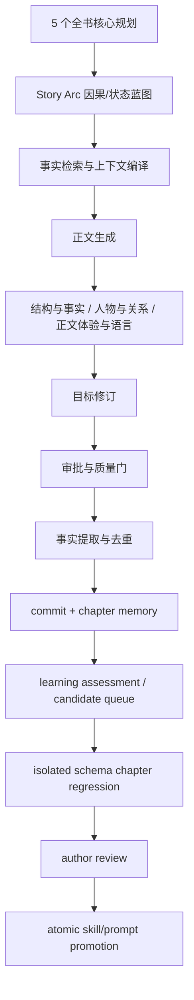

# Novel V2 小说创作工作流

> 当前活动契约：2026-08-04。本文以源码和当前 workflow 行为为准；历史 artifact、已完成旧审校记录和旧 reflection 数据只读保留，不被新运行消费；不兼容的活跃审核运行可直接终止并废弃未提交候选。
>
> 当前工具面：49（真值 `src/novel-v2/mcp/tool-metadata.ts` 的 `TOOL_COUNT`，由 `__tests__/mcp-tool-face-single-source.test.ts` 强制本文与各 skill 的声明一致）。下文按批次记录的历史增量（如"50→52"）是当时事实，现行值只看这一行与代码。

运行数据卷、仓库更名后的恢复步骤、正式审校边界和质量 A/B 产物契约见 [data-recovery-quality-validation.md](./data-recovery-quality-validation.md)。混合开发模式使用稳定命名的 `creative_studio_novel_*` 卷；卷不存在时由 Compose 创建，不能通过切换到另一组卷来伪造空库。全 Docker profile 使用隔离的 `creative_studio_container_*` 卷，不连接混合模式当前数据。

## 1. 目标流程



Web、HTTP、MCP、CLI 都是可替换客户端。PostgreSQL 保存结构化真源，Temporal 持有 durable execution，正文对象通过对象存储保存，Qdrant 只承担可重建索引。

章节正式链路固定为：

review → revise → manuscriptApproval → extractFacts → approveFacts → commit → enrichCharacters

没有新的 reflection activity、reflection schema 或 reflection artifact 消费路径。旧 reflection 产物可以查看和审计，但不参与新 draft、review、revision 或 commit。

## 2. Foundation 全书规划

活动阶段只有五个：

| taskKey             | 职责                   |
| ------------------- | -------------------- |
| project-positioning | 项目定位、读者方向、核心承诺与作者边界  |
| architecture        | 全书结构、卷级层次、长期状态与收束方式  |
| characters          | 主要人物、动机、声部、知识边界与关系可能 |
| worldview           | 世界事实、规则、代价和可验证边界     |
| plot-design         | 长程主线、支线、信息释放、伏笔和终局策略 |

依赖关系：project-positioning → architecture / characters / worldview → plot-design。旧 relations、plot-threads、foreshadowing、timeline、story-control 不再生成独立 task；相关信息可作为上述五阶段 payload 的可选结构存在。

每个 Foundation artifact 保留 artifact id、fingerprint、source provenance、审核和作者确认状态。可选结构不转换为固定数量、逐章字段或每章质量门。生成失败、编辑、重生成和上游 stale 仍由原有 section 生命周期和审计记录管理。

provider 端 `foundationSchema` 只校验 `structuredData` 是 JSON 文本字符串，无法表达 task 级容器键（如 `architecture` / `worldview`）。`structuredData` 根形态采用平铺契约：对象型 task（project-positioning / architecture / worldview / plot-design / plot-threads / timeline / story-control）的根直接承载 task 数据，不再包一层与 task 同名的容器键；数组型 task（characters / relations / foreshadowings）的数据本质是数组，但 `structuredData` 根必须是对象，因此保留 `{ [collectionKey]: [...] }` 集合容器（provider 与解析层都要求根为对象）。`normalizeFoundationModelOutput(value, taskKey)` 在最低共享层做形态归一：对象型 task 根含 `dataRoot` 容器键（历史容器或模型遵守旧契约）时解包为平铺，已平铺则保持不变；数组型 task 保持集合容器。判定基于纯结构特征（dataRoot 键与 schema type），跨 provider/题材复用；根是其他 task 容器或内容确实缺失时不误解包，契约校验仍如实报告，避免掩盖内容问题。该归一化在生成与 external-mcp 物化两条路径同时生效，保证落库 artifact 始终是规范平铺形态，历史容器数据在读取侧（全书审计、书名读取）同样被解包。

### 2.1 角色身份与展示投影

Foundation `characters[]` 中的 `id` 是项目内规范人物 ID，`name` 是作者可读的展示名。`entities.id` 只保存稳定关联键，`entities.name` 与 `payload.displayName` 保存展示名；角色富化和关系写入必须先通过项目内身份映射解析规范 ID、中文/原文名称和实体 ID，不能把模型返回的稳定 ID直接当作展示名。已有 Foundation 映射优先于自然语言别名，未知的关系目标创建为 `pendingEnrichment=true` 的待补全实体，不推断或伪造正式角色名。知识工作台读取角色时合并 Foundation 基线与实体增量，展示名优先，规范 ID 只作为可追溯副信息。

### 2.2 全书架构审计与正文审校分层

全书架构审计发生在 Foundation 与 Story Arc 之间，审计对象是跨阶段结构数据，不是当前章节正文。`auditFullBookArchitecture` 只检查以下共享契约：

- architecture：每卷的入口状态、阶段压力、退出状态和承诺窗口；

- characters：重要人物的限制/恐惧、独立行动与选择代价；

- worldview：规则陈述、调用代价和不可越过的边界；可选资源/技术分配（resourcesAndTechnology）与价值/冲突（valuesAndConflicts）压力层；

- plot-design：人物终点引用、长线阶段责任/下一次推进和信息边界。

长线（longHorizonThreads）可携带可选的 `coupling`（与主线的耦合机制：改变人物选择/资源/认知/关系/世界规则之一）和 `mergePoint`/`exitPoint`/`transformPoint`（交汇/退出/转化条件）。缺方向、结局、阶段责任等必需契约仍产生 major；只缺耦合机制或生命周期条件的线产生 `long-horizon-thread-coupling-incomplete` warning，不阻断审批，旧数据不因缺少这些可选字段失效。`architecture.structureType` 是可选的 `linear | tree | network` 枚举，只描述结构与承诺的匹配理由，不作为质量门。

故事弧只持久化 `threadResponsibilities`，每条责任的 `threadRef` 同时承担剧情线引用和本弧的下一次可验证推进条件。不存在可独立维护的 `plotThreadRefs` 名单；暂缓的剧情线可以记录保持/观察责任，不把长线变成逐章兑现清单。

重基线 envelope 携带符合当前契约的 `approvedArc`、历史章节提交包和事实证据。章节冻结权威仍来自章节提交包、`chapterMemory` 和事实证据。缺少可验证责任的旧弧在迁移中标记为 stale，不能由运行时静默推断或投影为新契约，必须重新生成并审核故事弧。

审计报告以 `fullBookArchitecture` 独立返回，保留 volumeCount、estimatedChapterCount、characterCount、longHorizonThreadCount 和结构问题列表；缺少或为空的 architecture.volumes、characters.characters、worldview\.rules、plotStrategy.characterDestinations 或 plotStrategy.longHorizonThreads 会产生 major。卷级 `promiseWindows` 除数组存在性检查外，还做内容软诊断：条目缺少可解析引用（promiseRef/id/description）或阶段窗口（windowOrdinals/window/payoffWindow）时报告 `promise-window-ungrounded` warning，不阻断审批。它不读取正文质量分，也不要求每章出现事件、钩子、反转、主题、感情或幽默。`architecture/health.issues` 继续负责批次重叠、已提交剧情线和伏笔引用等硬完整性问题。

两类问题的处理入口不同：Foundation 契约缺失先修 Foundation 并使受影响故事弧 stale，再通过弧级 rebase 重新编译阶段计划。rebase 先严格校验新候选，再覆盖已提交章节的冻结蓝图；历史章节以 `revisionId` 或 `chapterMemory` 的生命周期身份识别为冻结权威，不依赖新旧 JSON 完全相等。只有当架构契约已经成立、问题仍具体表现为当前段落的场景因果、视角、人物行为或语言时，才进入 `chapterReviewWorkflow`。章节正文审校不能替代全书架构审计。

Foundation 审核（`foundation.book-plan` 执行点，`foundation-reviewer` 角色）在既有契约完整性、层级因果、多线耦合与不确定性检查之外，以目标读者视角加查十项基线（由 `review-gate` Skill 与 foundation-review prompt 共同承载）：承诺可兑现（卖点是可体验的冲突组合而非名词堆）、主题进入选择（主题落在人物利益/关系/责任/代价的具体选择上）、欲望-阻力-选择-代价闭环、配角独立欲望与关系网络、世界观规则改变人物可选集合（删掉设定名词后选择是否不变）、感情线靠行动累积而非宣言、重复与升级是否改变层级/意义/代价、读者不确定性是否有可推断证据、表层大众化（卷名/章节名/概念与术语命名面向大众读者，专业概念出现在表面时须转译且全篇同译名）、揭示物分层（核心创意与世界观真相是剧情揭示物而非开篇设定，规划区分世界表面事实/异常现象/底层真相，删除真相后开局仍须成立）。十项是检查方向与证据类型，不是必须全部成立的硬门：按当前 taskKey 的适用性选择，不适用项跳过，不因缺少某项扣分，只有缺失确实损害已承诺功能时才产出审核意见并驱动修订。审核仍不要求每章事件、钩子、反转、主题、感情或幽默，也不通过增加固定章节数量、固定爽点密度或强制感情线来修复问题。

规划级审核（Foundation 与 Story Arc）采用文本意见契约（`src/novel-v2/text-review.ts`）：通过时模型只输出单行 `PASSED`，不通过时输出可执行审核意见全文，意见本身即「不通过」信号；verdict 只保留 `passed`/`revise` 二值，不再有 `blocked`。设计依据：规划级审核产出本质是指导意见，强结构化枚举（维度分数、逐章校验账本、authorityChecks）依赖 provider 真正执行 strict json\_schema，第三方中转站可能忽略该字段导致模型自由发挥、修复循环仍失败；文本契约对任何 provider 零依赖。审核不通过时，意见作为重新生成的 `instruction` 回流（Foundation 经 `reviseWork` 写入 work item instruction 由 `buildFoundationPrompt` 消费；Story Arc 经 `buildStoryArcRevisionPrompt` 注入修订 prompt），learning 评估以同一意见为输入。解析基于结构特征（单行标记/围栏剥离），跨题材与模型复用。

## 3. Story Arc 与章节蓝图

Story Arc 按故事弧和批次滚动生成，不在开篇冻结整部长篇章节表。章节蓝图的活动字段是：

| 字段                    | 用途                               |
| --------------------- | -------------------------------- |
| index / title         | 叙事顺序和工作标题                        |
| narrativeFunction     | 当前章节的叙事功能，可为空或由模型选择              |
| povCharacterId        | POV 边界                           |
| stateTransition       | before、after、evidence，允许外部状态保持稳定 |
| scenes                | 当前执行场景                           |
| continuityConstraints | 冻结事实和连续性边界                       |
| unresolvedAtClose     | 章节结束后仍未解决的事项                     |

场景只保留 title、participants、situation、observableActions、opposition、decision、outcome、cost。opposition、decision、cost 允许为空；安静、关系、背景、等待、恢复、内省和余波章节不必被改造成冲突升级。

删除的章节级编辑字段包括 summary、chapterPurpose、readerExperience、thematicTreatment、romanceTreatment、humorTreatment、dramaticQuestion、emotionalMovement、stateDeltaBudget、narrativeScale、optionalBeats、setupRefs、payoffRefs、closingForce、freedom、participantStakes，以及旧版 goal/turn。041 迁移清理这些 JSONB 字段，新的生成、编辑和正文 prompt 只读取 `chapters.payload` 的 canonical blueprint。

Story Arc 审核只检查状态连续、场景因果、事实权威、章节功能与长篇位置是否相容：审核 prompt 要求按整弧与逐章清单完整覆盖（每章的状态连续、场景因果、章节功能、权威边界，整弧的阶段边界/窗口节奏/长篇层级），输出为文本意见而非结构化账本（见上文规划级审核文本契约）。它不要求每章新事件、外部压力、强钩子、反转、爽点、主题表达或不可逆变化；审核完整性不等于正文创作约束。

**规划端人物登记表与群像结构信号**（2026-09-16 全书审核确诊根因的系统端落点，`content-audit-20260916.md`）：126 章蓝图 44% 全部场景参与者≤1（正文对白占比从 6.7% 崩至 0.26%）与 povCharacterId 四形态漂移（char_chu_heng/char_chu/chu-heng/char_hu_cheng，POV 作用域记忆召回在漂移章节静默失效）共享同一根因——规划模型上下文从未有合法人物名册、也没有任何一面把"独处编排"变成看得见的数字。修复三接线：①`getStoryArcPlanningInput` 投影 entities 人物表（短 id=实体 URI 末段+显示名，上限 80 行）为 `arc-context-cast` required 段并在 `context()` 面渲染，povCharacterId 契约="只能填登记表 id 精确值、不附名称不截短不自造变体"；②纯函数 `inspectStoryArcEnsemble`（参与者按去重名≥2 判群像章、批次配额 ceil(n/3)、最长独处游程）——近 6 章窗口的独处游程并入 `serial-signals` 段（serialFunctionRuns 同型：只呈现描述性统计），章节蓝图生成契约注入群像配额指引（每批≥1/3 章两人同场互相施加代价、纯独处章每批≤1 且 planningRationale 声明"这章的静在与不在场的谁对话"；重基线面不注入，历史冻结），弧审核 prompt 注入本批确定统计与判定契约（配额未满足或游程≥4 且读者体验受损才报，个别功能静章不构成问题；同时核对 povCharacterId 命中登记表，变体按 major 报告给出正确 id）。边界声明：全部为统计与审核证据面，不是正文句式硬门、不判台词质量（对手戏的活人度仍归 character-reviewer）；静≠独——安静章两人同场依然合法。待排：既有 43 章漂移 payload 的一次性迁移、到期伏笔账回流规划面（overdueLedger）、逐弧兑付密度投影（见 content-audit §七 P1/P4/P5）。

**正文结构门扩三通道**（同批，warning 级不拦截）：`manuscript.meta-reference`（阿拉伯章序"第\d+章"——编排指令章号被复述进正文，全书命中 94/102/103/104）、`manuscript.latin-residue`（≥3 连拉丁字母，命中 35/104）、`manuscript.paragraph-fusion`（段长中位数≥200 的段制坍缩，fragmentation 的镜像病例，命中仅 88）。判据全部为码位/分布形态（汉字章序、正常段长反例零误伤），全书 120 章回放精确命中审校人肉清单且无额外波；阈值 TODO 进 output-policy 配置。与 `manuscript.syntactic-tic`（92e8f2d）同属"审校确诊→确定性通道"转化，人工整改清单见 `tmp/audit-a-26-60.md`、`tmp/audit-b-61-98.md`、`tmp/corpus-scan.csv`。

**到期伏笔账回流规划面（P1，轮 2）**：`getStoryArcPlanningInput` 计算 `dueLedger`——与 health 同一 `parsePayoffWindow` 谓词，chapter 窗口过期条目按 horizon 升序列 top-12（含描述与埋设章），埋设 40+ 章且窗口不可判定者计入"老化账"汇总不列明细（宁缺毋伪）；渲染为 required 段 `arc-context-due-ledger` 进规划/审核/修订三面。处置契约：每条到期账三选一（本弧兑现/分流改窗/分流放弃），不分担必须在 threadResponsibilities 登记保持责任与触发条件——**静默续期**（既不兑现也不登记）按线索责任缺失报告 major；不设"每弧必兑 N 笔"数值硬门（兑现密度是题材判断，只强制处置动作存在）。本书实测：73 条超界 + 60 条老化——账本第一次被规划者看见。同批 `payoffRhythm`（P5）：近 4 弧"定稿章数→兑付笔数"（payoffs 双 FK 面按兑付 revision 所在章归弧）注入 serial-signals 段，连续≥2 弧零兑付才出读者契约透支提示（真库读数弧 15-18=0/1/5/0，修正审核侧"账本全停摆"误读——断的是题材主线老账，不是全部兑付）。TODO(magic-value)：40 账龄/12 注入预算/4 弧窗口应配置化。

**人物引用归一 character-ref（P4，轮 2 确诊升级）**：漂移审核从"蓝图四变体"深挖为**跨面形态恒不匹配**——claims.knowledge_scope 存短 id 或显示名、chapter_memories.character_states 存显示名、relations.subject_id 存完整实体 URI，POV 章末状态钉挂因此全书从未命中、POV 关系召回恒空、漂移章节 claims 整章饿死（上下文断裂无声于任何报错）。最低共享层 `character-ref.ts`：登记表内任意形态→规范三形态（uri/shortId/name），解析序=精确→唯一 token 包含→唯一编辑距离≤2，歧义/未登记返回 undefined（不发明人物）。消费三面按登记表解析后比对（searchMemory facet、searchGraphMemory ANY(uri,shortId,raw)、pinned claims povCanonical 身份收敛）；写面两处自愈（projectStoryArcBundle 进 payload 前收敛短 id；规划上下文投人物登记表）。数据修复已应用并审计（fix-pov-refs：126/126 收敛；残留登记：scanPovResiduals 以 id 当人名的 hint 通道过度标记，待 display-name 接线）。**关系时效量纲契约（PL-1 量纲族第二例）**：`relations.valid_from` 语义=**叙事序**（读侧 `valid_from<=叙事cutoff` 与 narrativeRange.start 同量纲消费），character-enrichment 曾写 `Date.now()` 使正文来源关系检索恒假全灭——写侧改 `input.narrativeOrder`，量纲守卫测试断言值等于叙事序而非"是个数字"；数据修复 fix-relation-valid-from 已应用（198 行换算，8 行不可换算置 NULL 走规划候选通道）。端到端验证（ch123 真库）：POV 钉挂恢复、关系召回 0→96、词法 32。轮 3 收口三件：`scanPovResiduals` 消费面 POV id→显示名经登记表解析（此前 id 进不了白名单，视角人物内心戏会被误标"他人残留"）；"悬念续费"检查落弧审核 prompt **语义**面——全书 `unresolvedAtClose` 字面复用游程实测为 0（蓝图每轮重述未解项），无信号不建确定性检测器，同一未解问题换措辞不换账由审核器判定。**常驻服务代码版本可见性**：`code-revision.ts` 启动期读 git HEAD 短哈希，API/Worker/MCP 健康端点与 header 暴露 `codeRevision`，`dev-v2` 复用旧实例时对比 HEAD 打显式滞后警告（runtimeFingerprint 只哈希配置身份、代码改了它不变——"修复已合入但静默不生效" failure class 的机制端补刀；unknown 只警告不拒启，是探针不是部署门禁）。

弧规划的 **manual 人工门带作者修订反馈通道**（弧6 实践批，2026-09-12）：`reviewPolicy=manual` 下工作流审核完成后进入 `manual-review-required` 门；审核 verdict=revise 时 `approveStoryArc` 被前置门禁正当拒绝（"审核尚未通过"），此时作者/外部编排者通过 `novel_story_arc_decision`（MCP，与章节门 `novel_chapter_review_decision` 平权）或 REST `story-arcs/:arcId/approve` 携带 `decision=revise + feedback` 把修订指令送进等待中的门——`storyArcApproved` 信号解析 decision 键（无该键的旧载荷=批准，零回归），manual 分支在 approve 与 gateDecision 任一到达前挂起；revise 走与 auto 分支同序的 reviseBundle→project(edited, actor=web-author)→重审→再入门，作者指令与审核意见**合并**进 opinion（审核器已发现的问题不因作者指令丢失），门循环无次数上限（作者驱动，每次重审消耗真实审核成本，与 auto 的 maxRetries 语义不同）。入口分工：MCP/REST 的 approve 只发信号、由工作流醒后单一落库（历史 REST 先落库再信号的顺序在两弧实践中未触发冲突，但双写面保留在工作流一处）。已知缝隙（登记未修）：外部编排输入持久化在 run payload 后不可修订，弧蓝图与编排文本口径分叉时审核器会按"编排 vs 蓝图"冲突反复报（本轮第3条即此型），当前以 plotNotes 登记偏差绕过，编排修正案通道列为演进项。

**伏笔账本同章变体归并**（同批追加）：分流面首跑实测暴露 overdue 101 中约四成是同事件重措辞变体（锚点身份 PL-5③ 之前的老行退描述内容键，"树洞蓝光"六变体）——作者逐条对账扛不动噪声，故 migrate 尾 `repairForeshadowingLedgerDuplicates` 做确定性预处理：只并"同章 + 描述 bigram（去标点后）Dice ≥0.45"的保守面，keeper=章内字典序首行（账表无时间戳，内容派生 id 稳定），变体 `status='merged'` + `mergedInto` 指回（非破坏，open 消费面出局），描述进 keeper.mergedFrom、keywords/possiblePayoffs 并集；跨章同文与同章异事件双向不并，复跑零改动。归并后剩下的才是真债，进 `novel_foreshadowing_triage` 作者三选一。阈值 TODO 可配置（措辞漂移率随模型变，须重校准）。

**伏笔账本作者分流面**（弧6 收口实践抓出的工具缺口，2026-09-12）：架构健康的 `foreshadowing-overdue` 告警从 B 期起就指示"兑现/改写窗口/放弃"三选一，但系统只提供兑现通道（正文 payoffs 账驱动），后两者全库无入口——告警在指挥作者做不存在的操作。补最小分流面：MCP `novel_foreshadowing_list`（三态视图 + overdue 判定与 health 同一谓词 `parsePayoffWindow.horizonOrder`）与 `novel_foreshadowing_triage`（abandon：status 翻 `abandoned`，全部 open 消费面〔规划注入/审校上下文/health/账本查询按 status='open' 过滤〕自然出局、数据与埋设账不删；rewrite-window：只重写 payload.expectedPayoffWindow 为结构化 `{scope:'chapter',from,to}`，重抽取合并 `existing || incoming` 语义保证改写不被后续措辞漂移覆写）。两者都强制 reason（审计 `foreshadowing.triaged.*` outbox 事件）、逐条幂等 skip 不炸整批、仅 open 可分流。工具面 50→52（该批增量为当时事实；09-17 独立短剧浏览器化移除 10 个工具后现行值 49，见文首声明）。集成测试接线教训同批收口：`postgresAvailable ? describe : describe.skip` 在收集期求值恒 skip——真库块在数据库可用的开发机上从未跑过（本批 itDb 运行期 ctx.skip 修复后，两条旧 happy-path 立刻暴露 premise 必填漂移与断言错误，DB 套件禁空过纪律的又一实证）。

弧规划由 `story-arc-design` Skill 提供设计契约（execution points：arc.plan / arc.review / arc.revision / chapter.blueprint），把弧视为"一个读者问题被逐级回答并升级"的叙事单元而非章节状态序列。五项设计契约：问题阶梯（主线推进弧的核心读者问题在 development 中逐级被回答并升级）、压力类型轮换（连续同类压力必须升级规模、代价或牵连）、场景因果链（场景 outcome 成为下一场景 situation 的触发条件；不推动外部因果的场景必须承担关系温度/理解修正/余波承载或独立体验功能，否则视为赘余）、安静章功能（无外部事件章节必须让读者获得可感知的新东西——关系温度变化/风险判断改变/物品易主/理解修正/情绪确认/余波承载之一；确认规则的陈述若改变角色后续选择或风险判断即算功能）、不可逆出口（推进型弧 exitState 相对 entryState 至少一项不可逆变化；铺垫/过渡弧出口可稳定但须说明静态功能）。弧审核另加读者回报检查：本弧 entryState/objective 承诺的体验（解决问题、关系升温、世界揭秘、认知落差、情绪确认）是否在 exitState 与 development 中真正交付；弧结束时读者只经历过程而无解决、成长、理解、情绪或新问题中的任何回报时报告为节奏问题，安静弧的回报可以是理解修正或关系温度。这些契约是弧级检查方向与证据类型，不是必须全部成立的硬门：安静、关系、背景、铺垫和余波弧与行动弧同样合法，只要功能有可感知证据；只有契约缺失且确实损害本弧承诺功能时才按 major 报告。规划 prompt 同步承载同一契约的压缩表述；章节级 quiet chapter 仍可通过关系温度、理解、信息分布、情绪或余波完成功能，不必被改造成冲突升级。

**外部编排模式（模式 B）**：故事弧规划另有外部编排入口 `novel_story_arc_orchestrate`，由外部大模型或用户提供剧情编排（plotOutline：objective 必填，其余为弧级设计意图——entryState/centralConflict/development/resolution/exitState/threadResponsibilities/expectedChapterCount/phases/chapterHints/plotNotes），系统负责完善：把编排作为 `arc-context-plot-outline` required section 注入 arc.plan / chapter.blueprint / arc.review / arc.revision 执行点，对照冻结事实与叙事状态账本做事实梳理，补全场景因果、章节状态转换、连续性约束与责任承接，再走正式弧审核 → 修订闭环。编排是设计意图基线，权威低于已定稿事实、叙事状态账本与作者边界：冲突时以事实为准，不得为了贴合编排虚构事实、提前消费后续答案或改写人物知识边界；空编排（只有 objective）被拒绝，提示改用普通模式。编排输入持久化在 `workflow_runs.payload.plotOutline`（`arcs.payload` 在项目蓝图投影时会被 bundle.arc 覆盖，不能作为编排持久化位置），并写入蓝图 artifact structuredData 提供 provenance；后续批次与审校通过 `getStoryArcPlanningInput(projectId, arcId)` 按弧精确读取同一份编排。外部任务降级路径在 contextRefs 中携带 outlineJson，物化时写回 artifact。编排含 threadResponsibilities 时沿用 threadRef/responsibility/nextAdvance 契约，未解析引用仍按提交边界阻止批准。

审核 pass 之间相互隔离，并受 `NOVEL_ARC_REVIEW_PASS_TIMEOUT_MS` 的单 pass 超时预算约束（默认 120000ms；TODO：迁入持久化模型路由合同）。单个 provider、视角或结构结果失败时记录丢弃视角元数据；若仍有完整审核结果则继续聚合，只有零个完整结果才失败。已有 blueprint 的失败弧按批次状态自动恢复，`awaiting-review` 批次的语义统一为"引用当前蓝图的批次"（`source_artifact_id = blueprint_artifact_id`，与 `prepareStoryArcReviewRetry` 前置条件一致）：存在引用当前蓝图的 `awaiting-review` 批次时通过正式 retry 状态转换重新进入审核（重审原蓝图，不重新生成）；无引用当前蓝图的 `awaiting-review` 批次（批次已 approved，或批次引用旧蓝图属过期残留）时通过 `prepareStoryArcRebase` 恢复为 `awaiting-review` 并保留蓝图，由入口的 rebase 判定（无待审批次 + 覆盖已提交章节）进入冻结历史 rebase 路径。两类恢复前置条件精确互补，修复了 failed 弧 + approved 批次永久死锁及批次引用错位使 retry/rebase 双双拒绝的死锁边角；`prepareStoryArcRebase` 只负责把 failed 弧恢复为 `awaiting-review`（审计 `story-arc.review-recovered`，recovery=rebase-prepare），无已提交章节时入口的 rebase 判定为 false，工作流实际对旧蓝图做普通复审（修订仅在审核失败时触发，蓝图保留），真正 rebase 决策记录在 workflow run payload 的 rebase 字段。MCP 通过 `novel_story_arc_review` 暴露统一恢复入口，客户端不能用“启动下一故事弧”替代失败弧恢复。若当前弧已有前批次定稿章节但还存在待审核的后续批次，审核只针对该新增批次走普通审核路径；只有没有待审核批次且审核对象确实覆盖已提交章节时，才进入冻结历史 rebase，避免把前批次位置误套到后续批次。

rebase 重基线时，已定稿（committed）章节的蓝图严格对齐已提交版本、只修正 index；planned 章节（只有已批准的未来蓝图、尚无正文）允许以模型新生成内容为准更新标题/场景/证据等读者可见字段，但 `unresolvedAtClose` 必须保留自已批准蓝图，防止修订悄悄改变跨章承诺，`validateStoryArcRebaseBundle` 仍要求该章节有 plannedBlueprint。MCP 模式下 rebase 自动 approve，因此已批准 planned 章节的读者可见字段可被重基线静默改写；这是"宏观规划变更后重基线"的既定语义，作者若已认可旧蓝图内容需在重基线前显式保留。重基线的**逐章对应硬契约在生成面承载**（2026-09-11，arc2 重生成首跑失败根因）：`buildStoryArcChaptersPrompt` 与修订面在 rebaseTarget 存在时显式注入"chapters 数量必须等于目标章数、序号按目标 `globalOrder` 完整覆盖、不得只输出单章或窗口子集；历史已定稿章节仍须各返回一条对应条目（内容由系统按冻结蓝图保真）"——此前该契约只存在于 validator 与已死的 `buildStoryArcRebasePrompt`（仅测试引用、从未进生产路径），模型按"下一批次"语义输出单章被校验拒绝，属文档-代码盲区实证。

**阶段归属数据绑定（PL-6）**：章节"所属阶段"投影只认 `phases[].chapterOrdinals`（弧内 1-based 落籍序号，1..expectedChapterCount 连续覆盖、互不重叠），旧"按阶段数等分章节区间"的算术推断已删除——批量是合法模式，等分对不等长阶段系统性出错且不可诊断。绑定契约的承重面（审核 D3/N5 对齐实形）：`storyArcPlanBatchSchema.arc`（弧结构段，batch 首跑）与 `storyArcBundleSchema.arc`（修订/external 面）的 phases 项 required `chapterOrdinals`；`storyArcChaptersOutputSchema` 只含 chapters、无弧对象不涉及绑定。生成面契约（prompt 指令"不重叠、不遗漏、连续覆盖"）之下另有**校验面兜底**：`validateStoryArcPlanContracts` 对存在绑定的弧强制互斥、≤expectedChapterCount、全量覆盖（部分绑定=半真源比不绑更糟，拒绝；全不绑=旧弧形态，放行给 health），双向测试覆盖。弧有阶段但全部未绑定时架构体检报 `phase-binding-missing` warning（不阻断，指引 rebase 或回写）。存量回填走作者回写通道：`tmp/apply-arc-phase-bindings.ts` 式幂等脚本，带全覆盖/互斥/标题锚点漂移三重守卫，审计 action `story-arc.phase-ordinals-backfill`（本项目 4 弧 14/14 阶段已绑定）。

故事弧规划、审核和下一批次入口在同一项目/故事弧范围内持有 PostgreSQL advisory lock，锁覆盖状态检查、workflow\_runs 登记和 Temporal 启动，避免重复请求绕过状态检查并产生并行工作流。入口在状态变更或 Temporal 启动失败时把已登记运行标记为 failed，并通过正式恢复状态转换回收 generating 故事弧或 generating 批次；锁只保护 admission，不替代工作流自身的状态机。放弃故事弧也在同一锁内读取活动运行，先持久化弧的 abandoned 状态，再取消对应 Temporal workflow、标记运行 cancelled 并过期其外部模型任务；取消失败只保留警告，不阻塞故事弧的本地放弃。

已批准且仍在执行的故事弧按批次继续规划；MCP `novel_story_arc_batch_start` 先通过 `prepareNextStoryArcBatch` 分配不重叠的下一章节区间，再复用同一套故事弧规划、审核、修订和提交工作流。**批次窗口是系统分配事实，生成侧无裁量权**（弧 5 实践根因修复，2026-09-12）：窗口 = 弧内剩余未规划章数按 `MAX_STORY_ARC_BATCH_WINDOW`（16，与重基线窗口上限、chapterHints 上限同源收敛）截断——纯函数 `storyArcBatchWindow/assertStoryArcBatchWindow` 最低共享层承载，三面接线：章节段 prompt 注入"窗口由系统定为 N 章、完整覆盖序号 X..Y"（正常批次分支，与重基线契约互不泄漏）、内部生成与外部物化两路提交守卫（章数≠窗口即拒绝进审核）、修订面保持候选窗口章数不变量；expected 缺失的旧弧返回窗口 0 ⇒ 契约与守卫双跳过（零回归）。根因实证：弧 5 首跑模型把"保留后续发展的空间"读作"本批只出 1 章"（7 章弧静默坍缩，弧 1-4 全弧一批是既有惯例，无任何机制拦截）；同场现形的还有 `prepareNextStoryArcBatch` 完成门槛的**量纲错配**（拿批次的全局 end_chapter_index 对照弧内 expectedChapterCount——弧 1 恰好从 1 起编号蒙混过关，此后每个多章弧必误报"已达到预计章节数"，PL-1 同型错误在推进面的又一实例；改为弧内已投影章数对期望）。若模型服务失败，调用方必须以 `retryFailed=true` 走同一工具的正式重试状态转换；`prepareStoryArcBatchRetry` 只恢复没有章节投影的最近失败批次，并保留失败原因和重试审计，不创建伪造的后续批次。它不绕过当前弧的 `exitState`、已定稿章节冻结和批次完整性校验，也不允许客户端直接伪造下一批章节蓝图。**批次 `complete` 旗与窗口同族收口（2026-09-12 弧5 实践批）**：它曾同为模型自报值——弧 1 满覆盖却存 false（完成判定只剩维度守卫兜底），弧 5 重编排批存量 false 而派生应为 true；`projectStoryArcBundle` 投影时在 `expectedChapterCount` 存在的一侧忽略自报、按"投影后弧内不同章序数 ≥ expected"覆写（expected 缺失旧弧保留自报，不发明事实），migrate 尾 `repairStoryArcBatchCompleteFlags` 对每弧末批双向回补（漏报 false→true、谎报 true→false、无声明弧不动、幂等）。该旗是弧完成谓词（PL-1）的高优先分支与 `prepareNextStoryArcBatch` 短路输入，系统可推导的事实不得留在生成侧裁量权里。**读侧同契约**（2026-09-12 弧6 恢复环实证）：artifact 里的 batch 坐标是模型自报 echo（新弧常写局部 1 基），历史 artifact 带病回读会让重基线守卫与投影对账各信一边——`loadStoryArcBundleArtifact` 读到引用批次行（sourceArtifactId 精确匹配；单批弧唯一兜底）时以批次行的 `batchIndex/startChapterIndex/complete` 覆写 bundle.batch，多批次无匹配不猜、无批次行（首次生成未投影）原样放行。failed 弧恢复的 rebase 判定同步纠偏：spec 定义"覆盖**已提交**章节"此前被代码弱化成"挂过 document_id"，批次 approved+章节全 planned（投影出文档、零正文活动）的弧被误标 rebase，修订物化撞"保持原批次位置"守卫自锁；谓词改 `documentId && status!=='planned'`（弧 completed 分支不变）。

故事弧模型 activity 的 Temporal 重试上限为 1，因为一次 activity 内的 gateway 已按 routing snapshot 完成候选切换和失败审计；activity 级重复会再次消耗全部候选并掩盖“路由耗尽”的终态。失败批次不会自动伪造新窗口，作者/客户端必须通过 `retryFailed=true` 显式恢复，确保重试有边界且可追溯。

审核 prompt 还对相邻章节的持续状态做通用反向核对：物件、伤势、资源、关系、知识和限制的身份变化必须有可验证的丢失、转移、消耗、恢复或新证据。对未知物质、装置、痕迹或局部反应，湿度、颜色、气味、声音、光亮或接触变化只能支持当下现象，不能单凭一次反应推出用途、成分、机制或功能；越过这条边界的蓝图主张必须在审核意见中明确指出并要求修订保留未知状态。故事弧按批次滚动审核；未完成批次不要求当前章节证明未来 `exitState`，弧级审核检查的是当前窗口与阶段边界、长线责任和后续空间是否相容。审核完整性（逐章覆盖、证据边界、确定性升级防越界）由审核 prompt 的检查清单要求模型逐项覆盖，不再以机器账本强制；审核意见中的问题必须引用实际蓝图字段或章节证据，并在修订中最小化修复。它是弧级状态契约，不是正文句式黑名单，也不将每个名词变成逐章必填项。

## 4. 上下文编译

ChapterPlanningContext 只保存：

- 当前章节执行合同和 artifact 引用；

- 当前章节状态边界、场景执行材料和连续性约束；

- 相邻章节的 narrativeFunction 与状态边界；

- fingerprint、source provenance 和必要的事实投影。

它不保存完整宏观规划 payload。正文阶段通过 memory claims 获取冻结事实，不通过蓝图重复注入世界观、主题和人物标签。draft、review、revision 共用 renderChapterExecutionContract，避免三套 prompt 对同一蓝图各自解释。

章节工作区的 `chapter_production_specs` 只保存作者明确输入的 `chapter_goal`；蓝图、来源 artifact 和指纹统一从 `chapters.payload` 及其来源 artifact 投影。`NarrativeStateSnapshot` 只保存弧阶段、开放线程、伏笔、承诺、兑现节点和提前消费边界；summary、keyEvents、characterStates 只由 `ChapterMemory` 持有。开放伏笔记录可携带 readerQuestion、possiblePayoffs、meaningDelta、cost 四个可选规划字段（缺失按未指定处理，不作为逐章必填），供故事弧把兑现方向与代价作为可排序候选；这些字段来自 fact-extraction 的结构化提取，属于设计态而非叙事事实。

NarrativeRhythmEntry 只保留 documentId、revisionId、narrativeOrder、title、narrativeFunction。summary、keyEvents、emotionalArc、主题字段和 issue families 不再作为章节节奏输入。

跨章序列证据（`SerialContextSnapshot`，`MemoryBundle.serialContext`）把最近 N=6 章的结构化统计投影给 draft/review/revision/learning，弥补单章审核结构上看不见跨章模式的问题（状态等幅重述、连续同功能章节、物件/主题跨度）。它由 `getSerialContextSnapshot` 确定性计算（无 LLM），只输出描述性统计信号，不输出短语黑名单："角色状态跨度"来自各章最新 `ChapterMemory.characterStates`，"连续同类功能"来自 `chapters.payload.narrativeFunction` 的连续游程（≥3），"物件/主题跨度"来自 memory\_claims 中出现在 ≥2 个窗口章节的 subject\_refs。"母题还是疲劳"的判断（重复必须改变层级/意义/代价）由 reviewer 依正文证据作出；窗口与游程阈值为魔法值，标注 TODO 可配置意图。该投影与 narrative rhythm 同级（priority=normal，可被预算淘汰），不影响事实可靠性边界。快照另含 `openPromises`（2026-09-07 补入）：项目开放承诺/期限账本（status=open，LEFT JOIN source revision → document 取建立章叙事序，孤儿修订如实标 null，LIMIT 40、按建立章排序），不随窗口截断——期限类事实的建立章可能远早于窗口起点。机制根因：期限/承诺类事实在其建立章之前出现（跨章时序矛盾）是单章三审的结构盲区，投影后 draft/review/revision 可对照「引用不得早于建立章、时限与条件不得与陈述矛盾、已兑现承诺不以未决语气出现」；渲染层同样给出对照指令而非硬禁令。
**可数资产数量账本（2026-09-08，`asset-ledger.ts`）**：`SerialContextSnapshot.assetSpans` 对窗口各章正文做确定性扫描（数字词/指代词+量词+名词的正则，零模型调用），同一实体在 ≥2 章被提及数量时生成逐章对照信号——实证根因：可数资产数量在各章间漂移（ch1 结尾两块灵石、ch2 开头单数；云纹草 ch13 一株、ch14 回述两株），读者可直接追踪而审校上下文没有对照输入。分组键取名词尾 2 字（中心语后置：下品灵石→灵石），展示取组内最短形态；模糊量词（几/些）与回指形态（那块）登记为 null 不参与精确对照。渲染层给出对照指令：同实体数量应连续一致、获得/消耗/被夺须有交代、无交代的增减报连续性问题。边界：只做提及登记不做状态解算（不推理存量加减）；名词边界无分词（修饰形态可能吞尾字，hints 级可接受，TODO P2 接入分词）；扫描在 `retrieveMemoryForReview` 执行、失败降级为无资产对照，不阻塞审校。

上下文编译仍保留 required/normal/critical 优先级、输入预算、manifest、prompt fingerprint、source artifact id、Skill provenance 和可审计排除记录。事实、人物知识边界、当前 POV、起始状态、结束状态和场景因果是可靠性边界；文学偏好不转成必填字段。记忆选择区分两层：叙事状态账本和 required facet 是当前阶段的硬上下文，开放伏笔/承诺是可排序候选；它们仍可被检索和回收，但不会因为“开放”就全部挤占 pinned 预算或把局部正文变成清单执行。

文风契约（`style_contracts` 表）是书级、可版本的叙述声音约束：十二维滑杆（POV、叙述距离、时间方式、句式节奏、词汇层级、感官重心、比喻密度、对白比例、留白程度、叙述态度、计量表达多样性、章末收束方式）以 JSONB 按版本保存，同一项目至多一个 `active` 版本。draft/review/revision 通过 retrieveMemory 读取 active 契约，作为 `style` facet 的可排序候选注入（ranked-fill，可被预算淘汰，不冻结）。契约是 prose-reviewer 与写作者的对照参考基线，不强制每章逐维满足，也不把任何取值变成质量门；缺失维度按未指定处理，旧项目无契约时静默降级。

Story Arc 的规划输入使用结构化反馈投影，而不是把 narrative state 原样 JSON 倾倒给模型。投影包括开放剧情线 payload、开放伏笔/承诺的规范 ID、最近定稿章节状态和与规划/连续性/因果相关的 RuntimeLearning underlyingMechanism、affectedInputClass、边界。模型输出契约不再包含 `authorIntent`、`thematicQuestions` 或 `phases[].exitCondition`；`authorIntent` 只作为请求上下文参与规划。review/revision 使用独立的 context sections，并在 manifest 中记录 `narrativeCutoff`、来源 artifact/revision、section fingerprint 和总 fingerprint；旧 planning 数据标为 legacy provenance。反馈只提示共享机制风险，已定稿事实、叙事账本和作者边界仍具有更高权威，开放线索也不等于本批次必须兑现的事件。

模型请求的结构化契约由 gateway transport 统一投影：Responses 使用 `text.format`，Chat Completions 使用 `response_format.json_schema`。发送前的 native schema 预检拒绝 optional properties、动态或空 object、`additionalProperties: true` 及 `anyOf/allOf/oneOf` 等不稳定组合关键字；失败分类为 schema incompatibility，只切换下一个原生候选。Schema 不再注入 prompt，所有返回仍经过同一 AJV、业务语义校验和修复循环。故事弧规划拆为 arc+batch 与 chapters 两个原生请求，只有两段均完成并通过业务校验后才组装并创建 artifact；draft、review、revision 统一使用 `StagePromptPackage`，三个 reviewer 并行启动。

调用链契约（2026-09-07 机制调整）：候选链只承载 API provider 候选，外部 MCP 不再是调用位置（设置页）的可选执行者，而是所有文本/结构化调用链的隐式链尾兜底——显式 API 候选全部失败（含传输失败、空响应、schema/业务校验失败）或链为空时，gateway 在虚拟兜底位（`candidateIndex = candidates.length`）执行路由级预算检查并记录 `waiting-external` 调用留痕，抛出 `ExternalMcpRequiredError` 交由 activity 物化为可认领的外部模型任务（`externalTask` 的 candidateIndex 即兜底位）。历史运行快照中冻结的显式外部候选按原语义在原候选位执行，在途工作流不受影响；新配置（含设置页保存）不允许再写入显式 external-mcp 候选，载入时剥离并等价于空链。空候选链即「未配置 API 模型、全部由外部 MCP 兜底」（初始配置形态）。权衡与边界：原 `exhaustedRouteError` 快速失败语义移除，无外部 worker 认领时任务保持 waiting-external 而非 workflow failed——这是「兜底优先于快速失败」的既定取舍；`memory.embed / memory.rerank` 向量链路没有外部任务物化路径（外部产出无法承载向量），兜底不适用，候选耗尽后按原样失败。**同步链路的兜底语义（2026-09-07）**：进程内同步调用（创意短剧、章节剧本直出等 REST 直返路径）没有外部任务物化通道，`ExternalMcpRequiredError` 冒泡时经 `syncExternalMcpHttpStatus` 映射为 503 Service Unavailable（含义=候选全部失败且可行动：补充 API 候选或由外部编排者走 `*_submit` 双轨），不再以裸 500（系统内部错误语义）暴露给调用方。

网关修复循环（repair）在修复轮抬温重发（`REPAIR_TEMPERATURE=0.7`，首轮保持请求方默认）：根因是确定性 provider（temperature=0 或路由默认低温）在修复轮原样重发同一 prompt 时逐字节复现同一非法输出，修复循环退化为空转并消耗预算——抬温打破确定性，对所有 purpose 通用。结构化校验失败诊断区分「JSON 无法解析」与「Schema 校验失败」：解析候选（全文 / 围栏块 / 平衡对象）全部无法 parse 时，报告首个解析错误（含 position 与附近原文），不再用 AJV 对 undefined 校验得出的缺字段错误掩盖输出结构性断裂的真实失败模式。

`model_invocations` 同时保存 provider input/output tokens 与 provider 返回的 cached input tokens（若供应商提供）；没有 provider 用量时仍保留估算值并标记 `usage_source`，不把估算值伪装成真实计费数据。每次调用还保存 `config_revision`，章节审校和故事弧工作流都在进入模型阶段前冻结 `routingSnapshot.id` 并写入运行 payload；因此可以区分“当前配置”与已启动运行使用的“历史路由快照”。路由解析优先使用显式 purpose（如 `review.structure`），再回退到同前缀通配路由（如 `review.*`），最后才回退到 `*`；设置页必须显示解析来源和快照短 ID。provider 能力探测会临时固定单个 provider，只证明该 provider 的传输/协议契约，不代表真实候选链的顺序或 fallback 结果。候选链表示有序尝试计划，实际 provider/model 必须以调用审计为准；一次成功请求或最终失败前，网关可能已经按候选序号逐个留下失败记录。每次失败调用还保存 `provider_label`、`error_category` 和截断后的 `error_message`，总览通过 `/v2/projects/:projectId/model-invocation-errors?limit=50` 展示该项目最近 50 条失败，按 `created_at DESC,id DESC` 排序；工作流页通过 `/v2/runs/:workflowId/model-invocations` 展示该次运行的实际 provider/model/protocol、候选序号、状态和路由快照短 ID，不再从当前配置反推历史请求。`workflowId` 是数据库/Temporal 工作流标识，Temporal `runId` 只是一次执行尝试，不能混用；历史记录若没有响应正文，只显示“历史记录未保存 provider 返回正文”的明确占位说明。**估算↔provider 比值报表（E5，2026-09-11）**：估算器是预算与段落淘汰的决策依据，其系统性偏差必须可见。观测根因：`context_manifests` 仅 25 份对 1,523 次调用——上下文收据只在蓝图主链路落库，评审/修订/抽取等高频 purpose 的上下文膨胀完全不可见。`context-manifest-sampling.ts` 按 `NOVEL_CONTEXT_MANIFEST_SAMPLING`（默认 0.05；0=关闭、1=全量）对调用做**确定性哈希抽样**（sha256(purpose:promptFingerprint) 前 8 hex 阈值判定——同一 prompt 重放同一决策，purpose 入哈希使各膨胀面按 purpose 独立），命中时幂等物化 manifest 并回填 `prompt_executions.context_manifest_id`（migration 087 加列）；manifest JSONB 本就逐次随行留痕，采样只决定"规范化可 JOIN 面"的写入量，未命中不丢数据、物化失败不阻塞留痕主链路。执行位置（审核 N1 下沉）：判定与物化住在 **`repository.recordPromptExecution` 本体**——留痕表写入与采样决策天然同函数，REST 外部任务 submit 直连等一切消费面自动同源，不存在"某进程漏接 wrapper 即绕过"的接线漂移面；model-runtime 只把 gateway recorder 回调接到 `(execution, objects) => recordPromptExecution`，objects 缺失时整个 prompt_executions 留痕在 createRuntimeModelGateway 处为 undefined=no-op，api/worker/mcp 三消费面必须同参构造——MCP server 曾漏传 objectStore 致该进程调用完全无 prompt 留痕，2026-09-11 已对齐。`getEstimatedVsProviderRatio({sinceDays})` 聚合估算>0 且 provider 有上报的调用，按 (purpose, model) 输出 provider 实测/估算比值的 p50/p95/min/max 与 `manifest_linked_calls`（比率用实测定口径，估算文本长度只是比较分母）；**非测量用量剔除**（2026-09-12，运行库实证；判据经复验泛化）：与同一请求的独立估算偏离两个数量级以上（`provider_input*100 < estimated`）的行判为非测量——占位 1/1（glm 系文本 purpose 整批实测且 cached 列 NULL，非缓存差值语义）与"只报增量/未展开缓存"（provider=20 对 est=90000）等协议形态同带，真实分词器口径差异只在数倍内，不误伤真·小调用与真·低比值测量；伪测量混入会把 p50 拉塌到 1e-4，恰摧毁报表目的。被剔行经 `artifactCalls` 透明计数不静默丢账，占比本身是 provider 上报质量的观测面；聚合方法是 repository 只读契约，展示位（REST/报表页）待运维需求再挂。运行库首跑实证该报表的暴露能力：memory.embed/rerank p50≈1.04/1.52（估算口径正常），而 glm-5.3 responses 协议的全部文本 purpose p50≈0——provider 对完成调用回**占位 1/1 usage**（响应体本身完整），属 provider 侧上报缺陷，报表是当前唯一使其可见的通道；消费比值分布时须按 model×purpose 甄别上报可信密度。**估算器单一真源（E5 收尾，2026-09-19）**：报表分母自身此前是**多口径**的——同一个 token 量纲有 7 份实现（flat `ceil(length/2)` 5 处：cognition 本地函数、stage-context `estimateStageTokens`、model-gateway 调用前预算闸×2、activities 记忆选择收据；CJK 感知的留痕估算 1 处；`src/lib/model-capabilities` 硬上限闸的悲观估算 1 处），于是 `selectionReceipts[].tokenCost` 由两条路径按不同公式写入（一处带 `\n` 分隔一处不带），`estimated_input_tokens` 一列混装两种系数——报表会把"两处估算本来不一样"误读成"provider 上报异常"。现收敛为 `src/novel-v2/token-estimate.ts` 的**一份实现 + 三条具名 basis**（`AUDIT` 0.75/4 已被 provider 实测校准，`BUDGET` 0.5/2 与 `computeTokenBudget` 阶梯及各 purpose `maxInputTokens` 共同标定，`HARD_GATE` 1.1/4 供"绝不截断必带资料"的悲观闸）。**刻意未合并口径**：预算常数是贴着 flat 估算的历史分布调出来的，只换估算不换常数会作废该轮标定、让边界章节批量抛 `context-budget-exceeded`；合并前置条件是在一次真实长篇运行里同时留两口径的估算值并用 provider 实测校准偏差比，再整批重标常数。守卫：`token-estimate.test.ts` 双向锁定三条口径与合并前实现逐样本数值等价（换口径即红）、折算式与口径常数只允许出现在单一真源、留痕侧与预算闸各挂对口径（写反即红）、两条收据路径的 `tokenCost` 同式。已知残留：预算闸拒绝行仍按 BUDGET 口径写该列（判据与报错须引用同一个数），这类行无 provider 上报故被报表的 `provider_input_tokens IS NOT NULL` 天然排除，但按 `usage_source='estimated'` 汇总用量时须再按 status 过滤。另注：`assertModelContextLimit`/`estimateTextTokens`/`resolveModelContextWindow`/`estimateNovelTokens` 目前全仓零调用点（只有 `recordModelContextWindow` 被 `src/lib/api.ts` 写入，其读取方已不存在），该硬上限闸事实上未接线。**口径合并的取证尝试与结论（2026-09-19）**：本想直接用运行库存量数据校准 AUDIT/BUDGET 两口径（省掉一次新增长篇运行），跑 426 行"同一请求既有 provider 实测又带 context manifest"的三元组后被**证伪**：`provider/audit` p50=1.321（p95=1.399）、`provider/budget` p50=1.233（p95=1.714），而 `audit/budget` p50=0.895 且按 purpose 在 0.57–1.87 间摆——若两数覆盖同一段文本，中文为主的载荷上 `audit/budget` 应接近 1.5。原因结构性：manifest 的 `estimatedInputTokens` 是 system+schema+装配 sections（BUDGET 口径），网关的 `estimated_input_tokens` 是 system+transportPrompt（AUDIT 口径），**两个估算来自不同字符串**，比值被文本覆盖差支配而非口径差。据此不做任何常数重标（无干净判据），改为补上缺失的观测面：`PromptContextManifest.estimatedInputTokensAuditBasis` 与 `estimatedInputTokens` 逐部分同形、只换折算系数（同一段装配文本两口径并记，JSONB 无需迁移），其比值才是口径因子；provider 实测经 `prompt_fingerprint` 关联即成三元组。该字段是 manifest 指纹的一部分（记录的事实变了即不同 manifest，符合既有幂等语义），历史 manifest 缺键按可选处理。守卫：`stage-context.test.ts` 双向锁（中文载荷 audit>budget、拉丁载荷 audit<budget），`token-estimate.test.ts` 由"文件级禁用审计口径"升级为**逐字段绑定**（三处判据 usableTokens/requiredInputTokens/estimatedInputTokens 必须走预算口径，只有观测字段走审计口径，写反即红）。副产物观测结论：文本类 purpose 在"provider 上报可信"子集上系统性低估约 32%（`provider/audit` p50 1.32），与 glm responses 协议回占位 1/1 的那批不在此子集内（已按 `provider_input_tokens>100` 与非测量带剔除）。
事实抽取的模型契约顶层只返回 `facts` 与 `narrativeElements`；事实对象的 `value` 始终是字符串，数字、布尔值和 JSON 通过规范化 JSON 文本传输，再由应用层按 `object.kind` 解码。`ChapterMemory` 与角色富化继续使用独立流程，章节状态快照不再复制摘要、事件和角色状态。模型路由耗尽错误同时登记 `NonRetryableModelTransportError` 与其可能的 Temporal 序列化类型 `ModelTransportError`，确保运行进入失败/人工可见状态而不是长时间停留在 `running`。

开放伏笔/承诺的账本去重在共享层 `narrative-elements.ts` 完成，分两层：写入层 `recordNarrativeElements` 的元素 ID 为**纯内容派生键**（伏笔=规范化描述的哈希，承诺=规范化"承诺者+受诺者+陈述"的哈希，12 hex），同一伏笔/承诺跨修订重提取时复用同一行，由 ON CONFLICT 合并——只更新 payload，`planted_revision_id`/`source_revision_id` 保留首次埋设来源，`narrative_order` 用 COALESCE 保留首次登记值；此前 ID 含来源 artifact ID，导致每个新修订都生成新行、开放账本膨胀。读取层 `getOpenForeshadowingAndPromises` 对存量重复行按规范化文本去重（保留最早一条，查询已按叙事顺序排序），历史数据无需迁移即让记忆注入与弧规划看到干净账本。边界（刻意不覆盖）：LLM 对同一观察的同义改写描述不参与机械去重（无法可靠判定语义等价），由弧规划的事实梳理与人工审核处理；规范化后为空的条目不去重，交由上游校验。

**人物身份注册表共享契约与事实指纹统一（2026-09-09，记忆治理审计 `memory-governance-audit-20260909.md`）**：此前人物身份解析只服务 character-enrichment 路径，fact-extraction 的 subject.id 由模型即兴生成（显示名/拼音转写/自造 ID 并存），同一人物多种主体键使 identity 槽位、跨章去重与所有按主体键过滤的消费方（知识边界、图检索、资产对照）失明；同时 character-enrichment 与 fact-extraction 两条管道对同一章正文重复提取"谁知道什么"，前者声明无 identityHash 且谓词体系独立，存储层与检索层去重全部失效。修复在最低共享层：① `buildFactExtractionPrompt` 注入规范人物名册（canonicalId｜显示名，与 enrichment 同源 `loadCharacterIdentityRegistry`），要求已注册人物必须用规范 ID；② 提取结果（内部与 external-mcp 物化、chapter-state-rebuild 三条路径一致）在指纹计算与批内去重**之前**经同一身份索引归一——仅精确命中别名（canonicalId/displayName/entityId/实体名）才重写为规范 ID，未命中键原样保留，不在机械层发明第三种键形态或猜测语义等价（同义改写交由外部事实梳理审核）；③ character-enrichment 知识声明改用与 fact-extraction 同构的 `factIdentityHash`/`factValueHash`，`character-knows` 纳入"知晓"谓词别名集，双管道对同一"谁知道什么"落入同一 identity 槽位，检索层 `value:` 合并键恢复跨管道对账能力（contentHash 保留原算法作写入幂等键）。降级边界：注册表读取失败时提取退回无归一模式（仅影响新行键一致性，不产生错误数据）。

**Foundation 投影代际退役（2026-09-09）**：`recordFoundationClaim` 取代 Foundation 投影的直写 `recordMemoryClaims`（内部生成、external-mcp 物化、`ensureFoundationMemoryClaims` 回填三处同契约）：同一 taskKey 只有最新 foundation artifact 的投影按 active 落库并 supersedes 其余 active 同槽位投影；更早代际的缺失回填按 staged 落库只作审计。supersedes 退役由既有检索机制消费（`searchMemory` SQL 的 NOT EXISTS 过滤、Qdrant 检索过滤 + upsertClaims 删除被退役点），历史行保留。存量治理由 `scripts/novel-v2-memory-governance-backfill.ts` 完成（dry-run 默认，`--apply` 写回）：subject_refs 别名归一、knowledge 声明 identity/value 指纹回填、Foundation 代际退役、**别名实体归并**（payload 并入规范行 + `mergedInto` 标记退役，与运行时同用 `mergeRetiredEntityPayload`），幂等可重跑。配套 `getFactExtractionContext` 新增同主体同谓词历史槽位聚合（累计条数 + 最近值，槽位数魔法值标注 TODO 可配置）与明细截断提示——LIMIT 200 近期明细对更早历史不再静默盲区，截断时明确指示模型对不可判历史输出 new 而非猜测 duplicate。

**双管道职责收敛·方案 A（2026-09-09）**：角色知识/信息边界（"谁知道什么"类认知事实）单一来源 = character-enrichment（按人物 `knowledgeScope={characterId}` 落库，承载 POV 知识边界过滤）；fact-extraction 提取规则移除"角色知识变化"类目、不再输出"知晓"类认知事实，物件获得/位置/伤势等状态事实仍按"持有/位于/状态变化"正常提取。这消除了两条管道对同一章正文重复提取认知事实的语义重叠区（实测同章 `知晓×character-knows` 共现 194 对的来源），去重需求归零；`character-knows`→"知晓"谓词别名保留，使两类历史数据在同一身份槽位可对账。边界：无对白/心理描写的沉默角色的认知通常已按可观察行为事实提取；POV 过滤消费方依赖 enrichment 通道的 characterId 作用域。

**实体归并对账与检索槽位配额（2026-09-09）**：① `persistCharacterEnrichment` 主体回写时，把身份索引映射到同一规范身份的别名实体行（早期以显示名建行的 pendingEnrichment 行）payload 并入规范行（声部历史拼接去重、动机兜底，`mergeRetiredEntityPayload`）并标记 `payload.mergedInto` 退役——行保留满足 relations 外键与审计，但身份索引（`buildCharacterIdentityIndex` 跳过 retired 行）、知识工作台实体读取、H3 角色基线等所有消费方均不可见。② `buildMemoryBundle` ranked-fill 增加**同 identity 槽位配额**（每 identityHash 最多 3 条入选，魔法值标注 TODO 可配置）：pinned/required 先于配额占位不受阻断，同槽位超出部分按 `identity-slot-quota` 原因排除——防止单一槽位（如主角"知晓"账本）以数量垄断记忆预算。

**外部事实梳理审核通道（2026-09-09，`memory-grooming.ts` + MCP `novel_memory_grooming_report`）**：只读诊断投影——把 active、未被 supersedes 退役、非 rejected 且有谓词的声明按（规范化主体 × 规范谓词）身份槽位分组（Foundation 投影 predicate 为空不参与），组内以字符二元组 Dice 系数（纯 TS，不依赖 pg_trgm 等环境扩展）给出近重复候选对排序。外部编排 LLM 作为**事实梳理审核者**消费报告：通过时单行 `PASSED`，不通过时输出可执行梳理意见（哪对是语义重复应 supersedes、哪对是状态演化应保留为 update、哪对是误提取应 rejected），意见经作者确认后走既有 claim 生命周期——机械层不做语义等价判定，不提供绕过质量门的直接改库工具。阈值与分组上限为魔法值，标注 TODO 可配置意图。

### 架构体检与引用边界

`GET /v2/projects/:projectId/architecture/health` 是只读诊断入口。它汇总 Foundation 批准状态、故事弧批次区间、章节定稿状态，以及剧情线/伏笔引用的规范 ID、兼容别名、未知项和歧义项；同时返回独立的 `fullBookArchitecture` 结构审计。章节 `planned` 表示蓝图尚未关联正文，或已关联但正文仍为 planned；`orphaned` 只表示无故事弧、关联正文不存在，或已批准故事弧仍缺正文。审批前故事弧下的正常蓝图不计为 orphaned。诊断不会改变正文或章节蓝图。

章节生命周期有两个持久化投影，但权威只有一处：`manuscript_documents.status='final'` 且存在 `current_revision_id` 表示正文已经定稿；`chapters.status` 是故事弧查询和规划索引使用的反规范化标记。正文 commit、手工保存、版本恢复都必须在同一事务中把关联 `chapters.status` 回填为 `final`；故事弧重基线不得让受保护的已定稿章节回退为 `planned`。人工稿审批门的 `manual-review-required` payload 由 `buildChapterGatePayload`（application 层纯函数，workflow 文件 vitest 不可驱动）统一构造：**reasonCode 直通 lifecycle 真值**（targeted-manuscript-approval/memory-coverage-incomplete…，仅缺失时回落 quality-gate-not-passed），**stage 显式覆写为 manuscript-approval**（run payload 为 merge 语义，不声明会残留上一 progress 阶段名）；初版把 targeted-manuscript-approval 改写成 quality-gate-not-passed 的"统一看板口径"已废除——那会让四维全绿 4.83 的等批稿显示为质量门未过，误导外部编排者（弧5 ch29 实证）。读取 Story Arc 时还要从关联 manuscript 投影出 `final`，作为历史脏数据和失败重基线的防御性兜底。迁移 `037_chapter_status_projection.sql` 修复章节状态不一致，迁移 `039_story_arc_completion_projection.sql` 修复“最后批次已完成且所有章节已定稿、但故事弧仍为 active”的生命周期投影，迁移 `040_story_arc_completion_projection_failed_attempts.sql` 进一步处理后续失败尝试覆盖已批准完成批次的情况；完成判定必须排除未关联或无当前 revision 的章节，并允许最后批准批次的 `endChapterIndex` 已覆盖 `expectedChapterCount` 时修正模型遗漏的 `complete=false`。生成入口以 `manuscript_documents` 的正文状态决定是否可生成，不能仅依据蓝图状态；MCP、HTTP `/v2/intents` 与 `novelIntentWorkflow` 统一调用 `assertChapterGenerationAllowed`，定稿章节必须转入 `chapterReviewWorkflow`，不得创建新的生成工作流。

历史 schema 收敛由 append-only migration 完成：可验证的旧 artifact 映射为 `review` 或 `chapter-blueprint`，无法判定的记录失效；旧活动 workflow 标记为 `needs-restart`，缺少责任契约的故事弧标记为 `stale`。运行时的 `normalize-references` 只处理当前 `threadResponsibilities` 和伏笔规范引用，遇到已删除的 `plotThreadRefs` 直接拒绝，不再提供旧字段兼容读取。

批次区间和明确的剧情线/伏笔引用属于提交边界：新批次不得与活动批次重叠，`failed` 历史批次不占用活动区间；故事弧批准时必须同时满足 Foundation.required 的阶段批准、`fullBookArchitecture` 无 blocker/major、明确引用解析为当前项目对象，未知或歧义引用都必须先通过规范化/作者消解。未解析引用不能以警告状态进入已批准故事弧，但这不把逐章兑现变成必填字段。章节功能、场景数量、篇幅和钩子仍属于作者创作空间。

故事弧引用审批和批次修复都以持久化状态为准：`approveStoryArc` 按 blocking integrity issue 拒绝未解析引用；`reconcile-batches` 只处理活动批次之间、后者没有章节归属的历史重叠。一个空重叠批次被标记 failed 后，后续区间继续与最后一个仍存活的活动区间比较；已有章节的重叠保留为作者可见阻塞问题。

## 5. 正文生成

正文 prompt 的硬边界只有：

1. 只输出正文；
2. 遵守冻结事实、当前 POV 和人物知识边界；
3. 完成当前章节的因果、场景和状态合同；
4. 不输出作者说明、审核意见、指令回显或元注释；
5. 在体验自然完成的位置收束。

**篇幅欠量 commit 门**（弧7 ch49 与弧5 ch32 成对实证）：reject→重出路径两次产出 1.4k 字骨架稿且三审全绿静默定稿——审校面对叙事质量敏感、对**计划兑现**失明（prose 契约明令"不用字数判定"，正确分工但留下空档）。目标字数是系统可推导事实：`evaluateCommitGate` 新增 length 输入，`plainTextLength < 0.6 × 有效目标` 时 qualityFailure=`length-under-target` 拦进人工门（拦而不杀，作者可批准留痕）。**有效目标与写作契约同一源**：章蓝图 `targetWordCount` 优先、缺省回落 `DEFAULT_TARGET_WORD_COUNT`（draft prompt 对模型播报的同一个数，门与指引一本账）；未加载规划上下文（如纯 review 流）不检查。gate payload 的 reasonCode 真值优先链同步扩为 `commitBlocked.reasonCode > qualityFailure > structuralFailure > 泛化回落`（buildChapterGatePayload，双向回归）。

**计长口径修复（2026-09-16，ch151/ch165 贴线放行根因）**：门最初接收的是 raw `draft.text.length`（含空白、换行与全部标点），而结构门自检与人工验收按**可见字数**计——实测同章 raw 比可见字数高 10-20%（r22 样本：raw 2742 / 去白 2626 / 仅字母数字 2384），60% 底线因此在 raw 口径下被虚高满足。修复=**单源计量**：`chapter-lifecycle` 三处 commitGate 调用改传 `countNovelCharacters(draft.text)`（`src/novel-v2/word-count.ts` 叶子纯模块，与 `DEFAULT_TARGET_WORD_COUNT` 同住、Temporal workflow bundle 安全；该模块的契约即"字母与数字计入，标点/空白/符号不计"）。校准证据（新增用例，`__tests__/chapter-lifecycle.test.ts`）：raw 2500 字符但可见仅 1000 字 → `length-under-target` 拦截（原缺陷形态）；可见 2100 字 → 放行。**接线锁**（同文件）：lifecycle 必须从 `../word-count` 取值、三个调用点全部使用 `countNovelCharacters(draft.text)`，并禁止 `plainTextLength: draft.text.length` 回潮——口径分裂一旦复发，短稿会重新静默过门。注意与结构门内部 `novelCharacterCount`（段落融合/重复块等启发式的量纲）**刻意不同**，两者不可互换。

正文不包含固定字数、3000 字目标、最小段落数、篇幅等级、固定钩子、强制反转、强制新鲜贡献、持续施压规则，以及主题、感情线、幽默或卖点的逐章检查。章节长度由当前功能、过程展开和自然收束决定。

## 6. 三类章节审校

| role               | identity    | 执行点                       | 职责                                             |
| ------------------ | ----------- | ------------------------- | ---------------------------------------------- |
| structure-reviewer | internal    | chapter.review\.structure | 结构、事实、因果、世界规则、人物知识边界                           |
| character-reviewer | independent | chapter.review\.character | 人物能动性、关系、对白和情感变化                               |
| prose-reviewer     | independent | chapter.review\.prose     | 场景体验、语言、节奏、具体性、情绪和幽默；识别专业化/制度化/理论化抽象表达替代现场感的情况 |

schema 只要求：

```text
verdict
score: 0-5
issues[]
```

issue 保留 severity、title、description、excerpt/evidence、revisionRanges、rule、suggestion，以及可选 paragraph/sourceId。审核记录保留模型提供的审校说明，不再把 excerpt/evidence 与当前正文做逐字匹配或作为丢弃条件；当前 artifact fingerprint 和最小修改范围仍用于审计与修订边界。不强制 rewriteExample，不强制 14 维度逐项评分。

REVIEW\_COVERAGE 只作为内部完整性映射，覆盖 D1 世界观、D2 故事性、D3 群像、D4 感情线、D5 幽默；这些维度不是模型必须逐项填充的输出字段。

三个 reviewer 的职责在注入「跨章序列证据」（`serial-context` section）时扩展跨章机制检查，但只报告有序列证据与正文共同支持的问题，不把单个安静章、单次状态保持或母题式重复当作问题：structure-reviewer 检查连续同类功能章节（≥3）是否缺少压力推进或回报，以及同一状态/物件跨章以相近措辞重述且无恶化/愈合/消耗/转移等可观察增量时的状态重述；character-reviewer 检查同一配角连续多章仅以功能声部出现（无独立欲望、关系、秘密、工作或代价增量）时的群像单薄；prose-reviewer 把技术认知删除测试扩展为跨章重复命名——同一抽象命名（技术/制度比喻）跨章重复出现且本次未承担新选择/新因果/新世界观信息时报告，不因单个陌生术语重复报告。这些检查是机制描述，不嵌任何词表、角色名或题材样本。

commit gate 仍要求三个 reviewer 针对当前 artifact，三个 verdict 均 passed，结构检查通过，不存在 blocker/major，且满足总体分数和局部 reviewer 分数守卫。局部退化上限与整体改善阈值用于质量回退保护，不用于规定文学内容。

审校 issue 落库时对 evidence 做正文包含性软校验（`isEvidencePresentInText`）：evidence 在正文零命中（按省略号分段取最长连续片段匹配；省略号形态覆盖 U+2026 与 ASCII 点号）时，在 dimension 字段附 `evidence-unverified` 机器标记；不删除 issue、不改变指纹，供人工决策识别审校模型对指令示例词/修订前文本的回显误报。作者来源 issue 不做该校验。标记基于被审 artifact 自身的正文计算：内部审校路径传候选正文、外部 MCP 审校路径从被审 artifact 的 objectKey 解析正文、commit 后刷新快照时传提交正文。快照刷新是 DELETE 后全量重插，标记随每次刷新按当前正文重算；存储不可用（外部路径降级）或调用方未提供正文的刷新（如 backfill 只补建缺失快照、不触碰已有快照）不会保留既有标记——该降级仅影响软标记，不影响 issue 本身与指纹。

**Evidence 闭环校验与批准机器核验清单（2026-09-08，`targeted-machine-check`）**：targeted 修订的 issue 证据在三个时点做机器核对，把「该删的删了吗」从人因核对变为机器信号——实证根因：ch15 互斥结局（旧结局段落在修订窗口外残留）通过了三轮评审与作者批准，「逐行 diff 无删改」在合同变更场景下恰恰是失败信号；ch6×5 与 ch2 期限条目则证明陈旧意见会在消费时复活已修复的矛盾。① **消费时**（`loadTargetedReviewIssues`）：传入当前正文，evidence 零命中的 issue 在 description 追加 `[evidence-stale]` 标记（不改变状态——是否忽略由编辑者决定，但标记随修订窗口进入提示与审批链路）；② **解决时**（修订完成后、进入审批门禁前）：对每个 directed issue 按 `buildTargetedIssueMachineCheck` 核对「evidence 是否仍留在候选正文」（仍是 → `evidenceStillPresent=true`，疑似未修或改错位置——ch6 首轮候选放置错误即可由本项拦截）；③ **批准门禁**：`summarizeTargetedMachineChecks` 汇总为 `targetedMachineCheck`（ok + 逐 issue 的 revisionRanges/标记）随 `manual-review-required` payload 落库，批准者对机器结论签字，语义质量仍走评审。边界：只做包含性软核对，不判定语义是否修对；suggestion 是给修订模型的指令语气、字面不出现在正文中，故不做短语匹配（实测指令措辞与成文措辞天然不同，短语匹配恒假）；机器清单是核对辅助不是替换判断。

**POV 同类残留扫描与批量规范化维护通道（2026-09-08，P2）
**文笔纪律 skill 升级（prose-craft v1.4.0，2026-09-08）**：弧 3 顺序阅读暴露三类三审未覆盖的品味失败——同章同义比喻堆叠（棋盘/账册/棋局连环重命名同一认知）、章尾收束叙事距离漂移（连续短句宣告同一结论/滑入概括议论）、对手戏群像回声（随从全员只对主角反应）。三项机制已写入 prose-craft 的 drafting/review/revision 三段 promptSections（同认知单比喻、章尾三选一钩子/余波/状态落点+删三段检验期待、具名角色独立可观察反应），并同步 novel-writing CRAFT.md §7.2/7.3.1/7.3.2 方法论条目。skill 经 novel:skills:sync 落库（version 1.4.0）后由运行时自动注入。配套实证修复：ch2 复述 3→1+物件间隔、ch8 术语统一+概率性判断、ch18 账册去重+随从独立反应、ch20 叶颤双锚点（方位+时序）。**：targeted 修订完成时，对候选正文按「非视角人物名 + 内心标记词（功能词表）」同句共现列候选清单（scanPovResiduals，povResiduals 随审批 payload 交付，≤5 条）——修一漏一的同类位置在批准前可见（ch6『疯狗』体感句实证：登记窗口外残留直至下一轮才发现）；命中为 hints 级不阻断，边界：视角人物内心描写合法、共现不等于违例，由批准者复核。全章性机械变换（引号规范化、内嵌标题行清理）走 scripts/novel-v2-style-normalize.ts 维护工具：确定性变换 → 作者修订稿（proposedText）→ 串行 full review → 确定性变换自动批准（纯标点/标题行无语义变化）——实证：targeted 窗口无法承载全章变换（两次候选均只转窗口附近），并行提交撞基线必须逐章串行。

**Evidence 闭环校验与批准机器核验清单（2026-09-08，`targeted-machine-check`）**：targeted 修订的 issue 证据在三个时点做机器核对，把「该删的删了吗」从人因核对变为机器信号——实证根因：ch15 互斥结局（旧结局段落在修订窗口外残留）通过了三轮评审与作者批准，「逐行 diff 无删改」在合同变更场景下恰恰是失败信号；ch6×5 与 ch2 期限条目则证明陈旧意见会在消费时复活已修复的矛盾。① **消费时**（`loadTargetedReviewIssues`）：传入当前正文，evidence 零命中的 issue 在 description 追加 `[evidence-stale]` 标记（不改变状态——是否忽略由编辑者决定，但标记随修订窗口进入提示与审批链路）；② **解决时**（修订完成后、进入审批门禁前）：对每个 directed issue 按 `buildTargetedIssueMachineCheck` 核对「evidence 是否仍留在候选正文」（仍是 → `evidenceStillPresent=true`，疑似未修或改错位置——ch6 首轮候选放置错误即可由本项拦截）；③ **批准门禁**：`summarizeTargetedMachineChecks` 汇总为 `targetedMachineCheck`（ok + 逐 issue 的 revisionRanges/标记）随 `manual-review-required` payload 落库，批准者对机器结论签字，语义质量仍走评审。边界：只做包含性软核对，不判定语义是否修对；suggestion 是给修订模型的指令语气、字面不出现在正文中，故不做短语匹配（实测指令措辞与成文措辞天然不同，短语匹配恒假）；机器清单是核对辅助不是替换判断。

章节审校启动受项目级串行约束：同项目其他章节存在活跃 chapter-review 工作流时拒绝启动（并发审校会因前一个工作流 commit 提升项目基线导致本工作流提交失败）；preflight 返回 `projectActiveReviewWorkflowId` 供调用方识别。

审校快照的 `verdict` 是三审聚合的 **reviewer 判定**，作者决定是另一个独立事实（`approval_evidence` 表）：定向修订作者批准覆盖后 verdict 保留原判（可能是 revise），两者并存不冲突。为防消费方把「reviewer 判 revise」误读为「仍有未解决问题」，项目详情与章节工作区投影按当前修订内容哈希对齐 `approval_evidence`，暴露 `authorDecision`（approve/revise/reject/abandon，按 created_at 取最新；无作者表态时为空）；工作台在 verdict=revise 且 authorDecision=approve 时以覆盖标记呈现（「分数✓」+ tooltip）。verdict 语义本身不被作者批准改写——审校记录与作者裁决分轨留痕。

**评审面档位（E4 changeScope，2026-09-11）**：intent 可选 `changeScope: mechanical-format | local-text | narrative`（缺省 narrative=现行为全量三审，零回归），经 preflight 归一并投影到蓝图，`reviewExecutionsForScope`（`application/review-concurrency.ts`）据此**收窄评审角色面**：两个收窄档（mechanical-format 与 local-text）当前**共享同一裁剪集——只裁 character-reviewer，保留 structure+prose**（机械格式与局部改写不改变人物行为/关系/动机面，人物审受影响最小；structure 仍跑以拦截"局部改动伤及全局结构"，prose 正是这两档的主改动面）。两档语义**独立声明**（格式档=标点/错别字/排版、局部档=段落内文本改写），共享裁剪集是当下的实现交叠而非定义合并——未来任一档语义扩展可单独调整。门禁语义（审核 O4 精确化）：**机械门禁任何档不绕过**（结构校验、blocker 拒收、verdict 记录全量执行），变化的只是"期望 reviewer 集合"与评审执行面同源。反向恢复零迁移：不带 changeScope 即回全量三审。语义守卫：changeScope 只对 drafting/revision 任务类有意义，规划/复盘等非正文 taskClass 携带非 narrative 在 `createPreflightPlan` 纯函数层直接拒绝（最低共享面=REST/MCP/workflow 全入口经此归一，审核 N6 自 activities 下沉；双向测试锁两向）。入口枚举校验面：REST `/v2/intents` 与 MCP `novel_chapter_generate`（changeScope 参数所在工具）同界校验，共用 `CHAPTER_CHANGE_SCOPES` 单一真源。评审快照聚合同源（审核 S1 修复）：`refreshChapterReviewSnapshotTx` 的 complete 判定按档收窄——subject 查询经 workflow_run → `execution_blueprints`（blueprintId 直连或 intent_id 反查两条通道）取该 run 的 changeScope 传入 `aggregateChapterReviews`；此前恒按全量三审判完整，窄档章节（两审即完整）快照永远不落，E4 在快照面静默失效。根因实证：98 条 chapter-review 中 29 条黑话降噪 + 8 条引号/错别字 + 6 条 dedupe 类机械微修也走全量三审+事实抽取+学习评估（≈8–10 次调用/章），4.77 轮/章均值被人工噪声主导、自动收敛信号被稀释。

## 7. 修订、事实与学习

修订以审核 issue 和 `revisionRanges` 为入口，只改变问题机制相关范围；`revisionRanges.start/end` 统一表示从 1 开始的正文段落编号，不接受字符或 token 偏移。issue 不因 excerpt/evidence 无法与正文逐字匹配而删除或跳过；无法形成安全局部窗口时按既有策略转为整章修订或报告契约错误。定向修订只执行一次，不自动把完整审核中的同机制问题扩展进作者选定范围；作者 issue 支持 `revisionRanges` 多段落数组（`paragraph` 与 `revisionRanges` 二选一），同机制多处必须一次覆盖全部位置，避免只修首段导致同一问题反复残留。章节规划的 `unresolvedAtClose` 是冻结未解边界，局部修订不得删除、回答或合并其中的问题，只能在保留未解状态的前提下具象化表达。修订契约允许保留人物的专业认知声部，但当抽象术语连续替代身体、环境或即时判断时，要求把重复解释收束为可观察依据，不通过同义术语替换制造表面修复。`sanitizeRevisionOutput` 使用代码围栏、标题行、冒号前缀等结构特征清理元注释，不使用 prompt 短语黑名单；它只折叠相邻的完全重复段落，保留非连续复沓和有实际变化的重复，避免误伤正常修辞。窗口应用层（`applyRevisionWindows`）额外做替换边界重复检测：修订模型把相邻原文段落复制进替换文本时（整段完全重复，或"前邻段全文 + 追加"的前缀复制），在应用窗口时剔除，防止修订拼接产生硬重复段。

章节执行合同版本 `reader-grounded-v1` 将规划器内部分析与写作者执行材料分离。场景蓝图可选的 `planningRationale` 在完整蓝图和规划上下文读取投影中保留，但不进入正文 draft、prose review 或 revision；执行投影只包含处境、可观察行动、阻力、选择、结果和代价。三处章节 prompt 共用读者复原契约：技术认知不能成为当前动作的唯一主语、原因或结果；同一局部节拍中重复命名同一体验的标签应删去多余部分；删掉技术句后事实、选择和因果都不变时，不保留它。身体危机和动作场景先让必要的身体或物理反应成立，再让技术判断服务下一步选择。该边界不使用术语、句长或抽象词数量判定失败。`ReviewIssue.readerReconstruction` 保存 `impact`、缺失证据类型和 blocked question；它不参与 issue 身份指纹，历史 issue 缺少该字段时按 null 处理并继承既有状态。

当同一轮修订可以定位到多个彼此分离的安全窗口时，内部 API 路径使用一次 `targetedRevisionBatchSchema` 结构化调用，把冻结事实、章节规划、Skill 和修订契约作为共享上下文只注入一次；每个窗口仍独立保留前后邻段、审核证据和原章段号。单窗口继续使用局部文本调用；批量上下文无法通过现有输入预算，或批量结果缺失、越界、重复、漏项、空修改时回退到逐窗口调用。外部 MCP 使用相同 schema 和业务校验，只有完整结果通过后才创建 artifact，避免 token 优化改变修订边界。

commit 前仍执行事实提取和 novelty 去重。commit 使用当前 artifact、revision 和 source provenance 更新正文、事实和 chapter memory。成功章节只在 commit/enrich 后生成一次 RuntimeLearningAssessment；质量门失败的终态尝试可保留一次失败证据，事实审批挂起不创建候选。若同一 assessment 因模型重试或 execution-point 校验回退为 `no-shared-learning`，仅清理其仍处于 `proposed` 的未审核候选；已进入 evidencing/reviewing 或已晋升的候选保留审计轨迹，避免 assessment 与候选状态分叉。propose-improvement 必须记录 underlyingMechanism、affectedInputClass、边界和回归风险。

learning 评估输入在每章 commit 后聚合跨章模式（持续模式证据），不只分析当前章 issue：`getRecentReviewIssueClusters` 按 rule/title 聚类近 N=6 章的章节审核 issue（同规则类出现 ≥2 章即构成持续模式），并注入 `serialContext` 序列信号。`serialContext` 查询的 documentId 必须由调用方透传（章节生成取 `intent.target.id`，章节审校取 `params.documentId`），不能使用 artifact 的 taskId——taskId 形如 `blueprint:<intent-uuid>:draft`，与 `chapters.document_id` 永不匹配，会导致序列信号恒空；documentId 缺失时跳过查询而不是发起必然为空的查询。决策规则扩展：同 rule 类近 N 章出现 ≥2 次，或连续同类功能章节缺少压力推进时，即使当前章无 blocker/major 也触发 propose-improvement 评估；单章偶发且序列信号无持续证据则 no-shared-learning。状态/主题跨度（characterSpans/subjectSpans）只作为有 issue 时的持续模式证据注入 prompt，不参与零 issue 触发——它们只是"同一角色/物件在窗口内出现 ≥2 章"的在场统计，POV 主角与核心物件在长篇中段必然满足，作为触发信号会让零 issue 短路径恒真失效。连续低行动/观察型章节密度类问题，failingLayer 优先定位到 story-arc planning 层，candidate 指向规划类 skill 的 planning 执行点（或规划相关 system-prompt），而不是只修 drafting——根因在规划批准了被动功能序列，正文修订只能事后补救。

伏笔/承诺兑现优先使用 fact-extraction 提取阶段可见的 `matchedForeshadowingIds` / `matchedPromiseId` 精确关联。兼容旧输出时，关键词或承诺者只在恰好命中一个仍开放、且处于叙事截止点之前的对象时自动兑现；多候选只保留未关联记录，不猜测关闭对象。这样既保留旧 artifact 的可读性，也避免同名角色或共享关键词造成错误回收。

Learning assessment 与 skill iteration 是两个不同的边界：assessment 只分析机制并创建 `craft_rule_candidate`，不直接改正式 skill，也不自动运行 `runSkillIteration`。项目级 learning 查询同时返回 assessment、来源章节、候选目标和候选状态；看板的“经验沉淀”属于 commit 后沉淀区，不增加创作阶段。

skill iteration 的触发门禁与 learning 打通：存在 blocker/major issue，或 learning assessment 判定 `propose-improvement`（含仅由跨章模式触发、当前章无 blocker/major 的情况）时都会运行迭代；两者都没有时跳过。这样 learning 提出的改进不会停在候选队列，跨章模式聚合的 propose-improvement 能实际进入 skill 迭代。

候选状态按 `proposed → evidencing → reviewing → promoted / rolled-back / rejected` 流转。`afterText` 的 JSON 对象被视为 execution-point patch，历史普通文本兼容映射为 drafting；新 learning 候选必须从目标 Skill 声明的 execution point 中选择与失败层相符且会实际执行的 key。实验隔离库和正式晋升都把 patch 合并到现有 `prompt_sections`，不会删除未被 patch 覆盖的执行点。`system-prompt` 仍使用完整文本，rollback 使用候选保存的完整 beforeText。`POST /v2/projects/:projectId/craft-rule-candidates/:candidateId/experiment`（也兼容 body `operation=experiment`）从当前正式快照创建独立 Postgres schema；原失败章节由候选的 learning assessment provenance 唯一反查，调用方只能选择异构章节。before/after 分别调用正式章节生命周期，候选通过条件是其具体规则文本指纹出现在 prompt execution 的已包含 Skill section 中，而不是只出现 proposed Skill 版本号；原失败章节和异构章节都通过后才可作者审核。作者审核通过后才允许原子更新 `skill_definitions` 或 `prompt_templates`，晋升在事务内锁定并校验目标版本，rollback 只允许恢复仍保持晋升版本的目标；目标版本漂移、规则未进入实际执行点、回归失败或作者拒绝均保持正式版本不变并留下证据。

章节实验复用 `executeChapterReviewExperiment` 及正式 review → revise → manuscriptApproval → extractFacts → approveFacts → commit → enrichCharacters 链路，不调用独立离线修订器。已进入审核或晋升流程的历史候选保留；与回退为 `no-shared-learning` 的 assessment 绑定且仍未审核的孤儿候选直接丢弃。没有章节实际消费点的 `system-prompt` 候选必须先补齐消费点，不能用基础任务评分冒充章节回归。

## 8. 已定稿章节重审

已定稿章节重审入口仍是 chapterReviewWorkflow，从 review 阶段半截启动并复用正式 review → revise → manuscriptApproval → extractFacts → approveFacts → commit → enrichCharacters activity。入口要求 document.status=final、无活跃 workflow 和历史 blueprint artifact；正文包装为 draft artifact，复用历史 blueprint structuredData 的兼容部分，但新审核只读取当前执行合同。该入口用于正文局部不完美，不用于修复卷级状态、长线责任、人物终点或世界规则边界；后者必须回到 Foundation 审计和 Story Arc rebase。

### 8.1 短剧剧本提示词派生（chapter.script 执行点，只读辅助产物）

`novel_chapter_script_h3(projectId, documentId, instruction?)` 是对已 commit final 正文的只读派生工具（不走 Temporal 工作流、不进正文质量门）：把章节改写为 MiniMax H3 全参考模式（Ref2VA）短剧分镜剧本提示词——按场景节拍拆分为多个 10-15 秒片段，每片段一条自包含六段结构提示词（subject\_definitions / summary / retention\_analysis / detailed\_description / overall\_soundscape / non\_diegetic\_music），片段内可含多镜头；顶层 characters 提供外观基线，各片段 subjectDefinitions 复用同一外形描述保证跨片段角色一致。指引层来自 `chapter.script` 执行点的运行时 Skill（workspace 模式读 `skills/novel-v2/h3-video-prompt.yaml` v1.9.2，database 模式读 `skill_definitions` 行，迁移 043 播种、044/045/046 记录了 library 抽象试验与回滚、048 升 v1.1.0、049 升 v1.3.0、051 升 v1.4.0、052 升 v1.4.1、053 升 v1.4.2、054 升 v1.4.3、055 升 v1.4.4、056 升 v1.5.0、057 升 v1.5.1、058 升 v1.5.2、059 升 v1.5.3、060 升 v1.5.4、061 升 v1.6.0、062 升 v1.6.1、063 升 v1.6.2、064 升 v1.6.3，现行契约（contractVersion 12）以 v1.6.3 为最后契约变更版本；065 升 v1.6.4、066 升 v1.6.5、067 升 v1.6.6、068 升 v1.6.7、069 升 v1.6.8、070 升 v1.6.9 均为纯文本修订（反原型默认态加强 / 展示型契约加固 / 反原型支点美学崇高闸门 / 天光裂缝通用震撼钉根因消除），契约语义不变、contractVersion 不递增；071 升 v1.7.0——short.script 分段契约增补「不限时长」模式编排指引（chapter.script 不变，见 8.2 不限时长模式段）；072 升 v1.7.1——剧作层纯文本修订（两执行点同契约：情绪节点补压抑→释放回路与释放类型轮换、出口钩子五型轮换与「钩子即承诺」回应规则、重大反转三处伏笔前中后段分布与单伏笔降级、对手压力三问（动机/实力/节制）与不虚构压力来源边界）；073 升 v1.7.2——剧作层体量适配修正（用户反馈 072 把系列级装置无差别套进短体量：本项目短剧产物为 10-180s 单支竖屏短视频，默认 30s≈2-3 片段——short.script 情绪闭环 ≤5 片段收敛为「开场即冲突→一次主释放→最强钩子收尾」、删除多轮压抑→释放/类型轮换/三伏笔分布强制，chapter.script 剧集剧作层按 ≥6/3-5/≤2 片段三档缩放并删除「更强威胁登场暗示」，跨片段钩子承诺回应规则保留），；074 升 v1.7.3——两执行点任务行追加定位句（用户定位校准：短剧创作不创作故事——chapter.script 定位为「镜头艺术转译」，剧作层是开画/进画面/切点的取舍叠加层；short.script 定位为「几十秒短镜头不需要连贯剧情」，默认以震撼画面与镜头美学组织、创意写明冲突时仅作画面张力呈现不展开情节），不新增硬性装置、契约语义不变、contractVersion 不递增；075 升 v1.7.4——冲击场面细节契约条目编辑残留去重（v1.6.x 改写「以人为尺」句时旧句尾未替换干净，同一句「让主体占据并主导画框…主体自己要先够震撼」之后残留旧版半截句，两执行点各一处；仅删残留句尾、其余内容逐字节不变，契约语义不变、contractVersion 不递增）；076 升 v1.8.0——两执行点新增「片段时间预算分配」契约（根因：实测语音主导型产物 13s 片段塞 139 字台词≈31s 口播、同片另有多段 12-14s 完全无语音，10-13s 段切 4 镜单镜 2-3s 叠加口播超载——节拍承载/镜头切分/语音口播三层共享同一个 10-15s 时间池，却无任何一层在管池内分配；契约三层：节拍层——单段以一个主节拍为主一般 1-3 节拍，超载拆段或压缩并入相邻段；镜头层——单镜平均预算=段时长/镜头数，10-15s 段以 2-3 镜为常态，长台词优先连续运镜承载；语音层口播守恒——中文约 4-5 字/秒、英文约 2.5-3 词/秒折算口播时长，段内台词总口播时长不得超过段时长并留约两成给动作反应与画面呼吸，超预算压缩台词（保留信息点与因果语义）或移交相邻段，整段无台词须是画面自足设计不得静默空转；结构观察层同步新增语音口播预算提示级观察——`computeCinematicHints` 按中英文平均语速折算段内台词口播时长，超出段时长进 cinematicHints 供人工复核不阻断；指引层演进、contractVersion 不递增；077 升 v1.8.1——语音预算按句自检指引（迁移 076 的修订，两执行点同步。根因：v1.8.0 语音层只给语速折算规则，但 LLM 流式生成时没有字数计数器、无法按字自检，按秒折算只是软倾向——实测复现「片段 3 台词口播估算 14.7s 超出片段时长 13s」。变更：① skill 语音层补「以句为单位自检」——一句台词约 2-4 秒、段内台词句数不超过「段时长 ÷ 3 秒」，并明确告知模型按句计数才是可执行自检；② 代码侧 staged-script-generation 两阶段批次任务行为每段注入可执行预算「语音预算：台词合计 ≤N 字（≈M 句台词）」（N=段时长×4 字/s、M=段时长÷3s 取整保守口径）——折算依赖规划阶段定死的每段时长，属 skill 不掌握的运行时事实由代码计算；单次路径 prompt 组装不变，契约语义不变、contractVersion 不递增；078 升 v1.8.2——时长分配优先原则（用户校准核心目的：给镜头和语音留足时长预算——076/077 的机制是"先定时长再填内容、事后提示"的上限约束，留足要求分配发生在撰写之前。变更：① skill 两执行点片段时间预算分配契约补总原则「分配优先」——先估算节拍口播量（一句台词约 2-4 秒）与镜头动作量（一个完整动作与运镜约 3-5 秒）把节拍分到装得下它的段，对白密集与宏大场面取 12-15s、纯画面节拍可 10-12s；② staged-script-generation 两阶段规划 prompt 注入同源 SHORT_SCRIPT_PLAN_ALLOCATION_GUIDE——规划阶段是时长分配决策点，指引须在决策点生效；③ 结构观察层补两个"留足"方向提示级观察——单镜平均 <3s（镜头没分到足时，一镜到底不受限）、承载 dialogue 节拍的片段完全无台词（语音没分到足时，展示型天然低台词属合法形态）；零阻断契约不变、contractVersion 不递增）；079 升 v1.9.0——short.script 新增「吸引力设计契约」（承诺单一主吸引引擎 awe 震撼/humor 搞笑/conflict 剧情 + 一处预期→反转 + 唯一记忆镜头，输出为顶层 creativeStrategy 三字段，见 8.2 契约 v10 段）与「喜剧机制契约」（错位三型、一本正经、setup→payoff 三步一断、包袱落镜头+冷面反应帧、音画错位）；两执行点反原型支点从「必须是巨构」泛化为「单一、有清晰剪影、可辨识的视觉/空间载体」（awe 载体五族：巨构/天体/巨形生灵/自然现象/空间法则；humor 为承载错位的具体器物/空间/仪式），并删除契约内具象示例（「倒悬的万丈巨钟」系自教母题——v1.6.8 起产物逐字照抄示例，brainstorm 亦反复塌缩回该形态；prompt 示例回归通用叙事模式）；剧作层契约头声明仅主引擎 conflict 时约束对抗性装置；震撼强度契约补引擎边界条（humor 的 punchline 镜头不再叠加尺度对比句与高反差光效事件）。chapter.script 侧仅支点句泛化与示例去具体，契约语义不变、contractVersion 不递增（skill 版本入幂等指纹，章节旧产物自然失效重生成一次）；short 侧配套 SHORT_SCRIPT_CONTRACT_VERSION v9→v10；080 升 v1.9.1——吸引力设计契约「承诺主引擎」选型判据修正（真实链路验证回归发现：悬疑反转型创意因题材含超自然元素被误归 awe；判据从「创意表面含什么」改为「创意主要靠什么让观众看完」，明确解谜/反转型的目标与阻碍可以是规则或未知本身、无需具名敌手——泛化表述不绑定题材；schema 与契约语义不变，SHORT_SCRIPT_CONTRACT_VERSION 不递增，skill 版本入指纹自然失效重生成）；081 升 v1.9.2——两执行点整片风格句契约纯文本修订（用户反馈：产物每段都描述长宽比 9:16。根因链：① 指引层把「画幅与焦段」列为风格句必含项且示例锚定「竖屏 9:16 广角」，模型照抄；② 两阶段生成的 styleLine 在规划阶段一次写好、批次 prompt 要求每段 detailedDescription 以其开头逐字复用，一次锚定即全片每段复读同一比例；③ 画幅由生成参数决定，提示词里的比例数字与「竖屏/横屏」字样不改变成片画面，只复述容器规格并占掉段内最稀缺的阅读时间。修订：必含项「画幅与焦段」改为「焦段与镜头感」（广角透视形变 / 长焦空间压缩 / 微距浅景深），介质质感、光影体系、色彩基调、时代感四项不变；新增禁止行「画幅与朝向不进风格句，也不进任何字段」，同时写明竖画幅取向的替代承载（竖向层次 / 上缘垂落前景 / 纵向引导线 / 机位高低），禁止行本身不复述任何比例数字示例（沿 v1.9.0「契约文本自教母题」教训——写进指引的具象示例会被产物逐字复制）。配套：两阶段规划 styleLine 行同步声明不写画幅；`.agents/skills/short-drama-writing` 的 SKILL.md 风格句段、quality-checklist 自检项、cinematography §2.1 标题与口径同步（竖画幅构图教学保留，改为「按画幅构图，不声明画幅」）；两执行点守护测试双向锚定（正向 token「画幅与朝向不进风格句」+ 反向断言指引文本不含 9:16/16:9/2.39:1）。schema 与契约语义不变，contractVersion 12 与 SHORT_SCRIPT_CONTRACT_VERSION 10 均不递增，skill 版本入幂等指纹使旧产物失效重生成一次）。skill 当前为 v1.9.2——v1.4.1 给出切点精确格式示例并显式化标签逐段定义规则，配套解析层双写法兼容与风格类时序降级，见 8.2 切点时序契约段；v1.4.2 片段时长上限放宽至 15s、描述语言放开中文（H3 对中文提示词兼容）、新增冲击场面细节契约；v1.4.3 片段时长按信息密度取值，宏大/战斗片段取上沿；v1.4.4 区间收紧 10-15s 并叠加创意意图忠实性契约（见 contractVersion 9 段）；v1.5.0 新增震撼强度契约（见 contractVersion 10 段）；v1.5.1 纯文本修订——动态张力慢镜语义澄清（强度来自镜头内速度对比，蓄力缓推/冲击慢动作仍可用，禁令仅针对高光镜头全程匀速）与冲击细节/震撼强度两契约去重分工（细节契约=内容层参照与后果，强度契约=镜头句法层对比句，见 contractVersion 10 段；产物格式不变，contractVersion 不递增）；v1.5.2 纯文本修订——subjectDefinitions 补"纯环境奇观不豁免标签体系"指引（环境/建筑/自然现象同为合法引用单元，无人物时必须定义 `<Subject N>` 环境主体标签并在 summary/retentionAnalysis/detailedDescription 用标签引用保持跨镜头一致，禁止只写主体清单不建标签，见 contractVersion 10 段）；v1.5.3 纯文本修订——新增一镜到底（长镜头）优先契约：空间连续的运动（穿越/飞行/下坠/深入/升维）与展示型空间巡游优先用单个长镜头承载（一个片段可为单独的 \[Shot 1]，镜头持续全程 10-15 秒不切，镜头内多阶段运镜描述连续推进），切点只留给景别/视角的必需跳变（见 contractVersion 10 段）；该执行点未加入 TASK\_CLASS\_POINTS，只有显式声明它的 skill 会挂载，正文类 drafting 技能不会误入。模型调用走 purpose `writing.script`（structured 能力），输出经 JSON Schema 强制后进入零阻断组装（见下方零阻断契约段）；六段按固定顺序由代码确定性组装为最终 promptText。人物事实输入取自 characters 规划阶段与实体注册表。**剧情覆盖契约（v3）**：生成前按定稿正文字数推导片段数下限（`deriveMinSegments`，CJK 字符数 / 350 向上取整，夹在 6-20 之间，常数带 TODO 可配置标注）。模型先输出顶层 `plotBeats` 穷举剧情节拍（kind=event/dialogue/memory/setup/hook/decision，summary 必须写出节拍携带的具体信息点），片段用 `beatIds` 声明承载关系。**零阻断组装契约（2026-08-31，用户指令：产物不做任何校验，直接显示）**：`normalizeChapterScriptOutput` 对模型输出做零阻断组装——原阻断级（H3 语义必需项：正文引用悬空标签、\[Shot N] 标记缺失/编号断续、`<d>` 标签不配对、Video/Audio 独立条目、durationSeconds 超区间）与提示级观察（节拍未被承载、beatIds 引用错误或为空、memory/setup/hook 承载段缺台词/闪回/屏幕文字呈现手段、覆盖下限不足、title 超长、字段为空、summary 任务前缀缺失、对白缺语言标注、共享主体重复定义、新增编号断续、定义未使用）全部降级为 hints 进 cinematicHints 供人工复核，不回灌 repair、不阻止组装落库；plotBeats 缺失或全无效时容错为空数组继续展示；durationSeconds 非法回退区间中点 `FALLBACK_SEGMENT_SECONDS=12`、越界夹回界内（容错收敛而非拒绝）；仅当 segments 完全缺失/为空/全部非对象时失败（无产物可显示）。演进根因：弱校验器（阻断+提示分级）时代仍有语义必需项阻断把可展示产物整批拒掉（先是展示型创意被呈现手段硬校验阻塞至全链失败，弱化后仍有悬空标签/时序类阻断整批拒产物），质量约束收敛回 prompt/skill 指引层，结构问题交人工复核。**影视镜头语言契约（contractVersion 4，方法论沉淀自** **`.agents/skills/short-drama-writing/`）**：运行时 skill `h3-video-prompt` 升级 v1.1.0（迁移 048），在 chapter.script 执行点注入导演层指引——每 `[Shot N]` 四要素（景别 ECU→EWS + 角度 + H3 三维度运镜 + 光线氛围与空气元素；**v11 起扩为六要素**——新增构图设计与色彩设计，见下方 contractVersion 11 段）、片段节奏范式（establishing → build → climax close-up → exit；每片段一峰一刹车，节奏词表 setup/establish/prepare/impact/brake/settle）、signature shot 递进范式（光效升级 → 高能瞬间 → 物理冲击反应 → 余韵收束；引导不强制）、题材视觉特效具体化（世界观可视元素按颜色/强度/运动/位置写为可拍画面，跨片段同一视觉系统）、整片风格句。**cinematicHints 提示级观察（不阻断）**：做切点时序观察（开场镜头携带时间戳、缺切点、切点超时长、非递增）、语音口播预算观察（段内台词口播估算超出段时长——台词是按时间轴播放的音频而非免费标注，按中文约 4-5 字/秒折算，超出即物理不可交付，v1.8.0 起新增）与结构观察；**镜头四要素（景别/角度/运镜/光线氛围）覆盖检测已移除**——描述语言放开中文后（v1.4.2）英文术语词表无法覆盖中文镜头描述（中文"大远景主观俯视角/中景弧形环绕"被英文词表判为缺失），误报率高、价值低，保留时序、语音口播预算与结构观察；观察结果在 record / API / MCP / 前端弹窗以 warning 列出。agent-facing 方法论文档（SKILL.md + cinematography/adaptation-principles/quality-checklist 三 references）供外部编排 LLM 与人审查使用；与 h3-prompt-writing（输出格式语法）互补分层。产物以 kind=chapter-script 落 artifacts（structuredData 记录本次 minSegments、plotBeats 与 contractVersion），幂等键绑定 documentId+revision 内容哈希+契约版本+共享定义哈希+skill 版本串，契约或 skill 升级自动使同源旧产物失效重生成；Web 前端在章节工作台提供「剧本提示词」弹窗入口（GET 读既有 / POST 同步生成，片段以横向 Tabs 切换查看）；agent 层方法论参考 `.agents/skills/h3-prompt-writing`。

**剧集剧作层契约（contractVersion 5）**：运行时 skill `h3-video-prompt` 升级 v1.3.0（迁移 049），在 chapter.script 执行点追加剧集层剧作指引——开场即冲突（第 1 片段首镜头落在冲突现场或临界点，3 秒内出现钩子形态，核心冲突/对立双方/即时目标前 10 秒可见可闻，铺垫性开场视为失败）、情绪节点节奏（每 2-4 片段一个节点，前 1/3 完成第一次小反转，连续 3 片段无节点视为节奏断裂）、片段出口即钩子（切在揭示/接触/决定瞬间而非落定后）、对白密度（每句确认身份/点燃冲突/陈述后果）、反转须有前置呈现、每集核心人物三角。剧作层问题属提示层契约，零阻断组装下不回灌 repair（见 8.1 零阻断组装契约段）。方法论沉淀于 `.agents/skills/short-drama-writing/references/dramaturgy.md`。

**描述体量契约（contractVersion 6，迁移 051，skill v1.4.0）**：根因是旧 schema 只设描述下限（summary 20 / detailedDescription 80 字符）且 skill 未给体量目标，模型贴下限交付概要化产物，无法支撑视频生成。修复分两层：① schema 描述字段下限抬升（summary≥40、detailedDescription≥600、retentionAnalysis/overallSoundscape≥20 字符，作为硬门兜底触发 repair）；② 运行时 skill v1.4.0 在 chapter.script 与 short.script 两执行点注入字段级体量要求——宁详勿简原则（视频生成器只能依据文字复原画面，凡未写出的细节在成片中不存在）、detailedDescription 每片段约 350-500 英文词（Ref2VA 指南体量）、每个 \[Shot N] 六要素写全（v11 起含构图设计与色彩设计）、summary 点名主体与动作变化、retentionAnalysis 逐标签说明保留的具体内容、overallSoundscape 分层写环境声与动作声、subjectDefinitions 人物定义行写全外观基线。契约升级使同源旧产物指纹失效，重新生成即按新体量标准。

**时长与语言契约（contractVersion 7，迁移 053，skill v1.4.2；时长分布见 contractVersion 8）**：用户需求三项——① 片段时长上限 10s→15s（`MAX_SEGMENT_SECONDS=15`，H3 单片段可承载更长镜头叙事；short.script 分段下限推导随之按 15s 重算）；② 冲击场面细节契约：宏大场景必须有规模参照（纵深层次/数量级/比例对比/大气透视），战斗与冲击必须有物理反馈（碎裂飞溅/位移形变/受力方反应/能量交锋接触面），震撼来自尺度对比与后果具体性——根因是无细节的"宏大"叙述生成结果平淡；③ 描述字段语言放开中文（H3 对中文提示词兼容；对白、歌词与画面文字保留原文语言的既有规则不变，appearanceEn 字段名保留但内容可中文）。同源旧产物指纹失效重生成。

**片段时长分布契约（contractVersion 8，迁移 054，skill v1.4.3）**：根因是 v7 只给区间（5-15s），模型把区间理解为均匀中值——实测 30s 目标交付 \[8,7,9]，冲击场面画面无法充分展开。v1.4.3 在两执行点明确时长按信息密度取值：宏大场面、战斗交锋与冲击性瞬间取区间上沿（约 12-15s），只有快节奏对话交锋与短促反应镜头才用短片段（5-8s），禁止整体贴下限；两侧任务 prompt 同步注入同款分布指引。同源旧产物指纹失效重生成。

**时长区间收紧与创意意图忠实性契约（contractVersion 9，迁移 055，skill v1.4.4）**：用户需求两项——① 片段时长区间统一收紧为 10-15s（`MIN_SEGMENT_SECONDS` 5→10，`MAX_SEGMENT_SECONDS` 15 不变；short.script 分段数上限推导随之按最短单段 10s 重算——180s 目标上限 36→18 段）；② 创意意图忠实性（short.script 专属）：先判定创意类型——创意文本描述人物对抗/危机/目标追求/事件冲突 → 剧情型；只描述场景、世界观、氛围或视觉奇观 → 展示型。展示型按视觉展示模式组织节拍（空间巡游/规模递进/光影氛围变化，节奏感来自视角与规模的递进，出口落在最强视觉冲击），**禁止自行注入追击、打斗、追兵、敌人、危机等对抗事件**（除非创意文本本身写明）；冲突导向剧作契约（开场即冲突等）与 memory/setup/hook 显式呈现手段仅对剧情型生效，展示型的 setup 节拍以画面本身呈现（奇观即信息）。根因：实测「展示修仙界山河」的展示型创意被无条件套进冲突模板，产出追兵/迎敌剧情。任务 prompt 同步注入类型判定段。同源旧产物指纹失效重生成。

**震撼强度契约（contractVersion 10，迁移 056，skill v1.5.0）**：根因是 v9 产物（含展示型奇观短剧）细节充分但生成画面仍平淡——**震撼缺失源于镜头缺强度，而非细节不足**：实测产物运镜全程 slow/gentle（无爆发点）、无尺度对比句（宏大只靠空旷广角）、光效温和（无高反差/逆光剪影/强光柱）、无镜头冲击。v1.5.0 在两执行点新增震撼强度契约（宏大/冲击/展示镜头必须执行的强度层，跨题材可复用）：① 单镜主视觉焦点（一镜只设一个主焦点，其余降级为层次——一镜多焦点稀释成平淡中景，数量堆不出震撼）；② 动态张力（高光镜头先静默蓄力再爆发性释放——冲镜/爆裂/骤升/急坠，禁止全程匀速慢镜；强度动词 violent/burst/explode/detonate/erupt/plunge/lunge/slam/snap 配幅度与速度，如 explosive rush-in、detonating slow-motion shockwave）；③ 尺度对比句（宏大震撼的核心语法：凡写宏/巨大必须给对比句，渺小参照物被压成光点/针尖/细线并与巨物同框）；④ 光效反差（震撼瞬间用逆光剪影/强体积光柱/明暗爆发，光效是主动事件——刺穿/爆开/吞没，而非静止状态）；⑤ 冲击的时间感（慢动作冲击波扩散/碎屑飞溅轨迹/扬尘翻卷，非静止后果）；⑥ 展示型奇观同契约（展示型不做战斗，强度词落自然现象与环境运动——云海暴力翻涌、穿云/升维瞬间光效与运镜爆发、渺小飞行物与巨型建筑同框、大气巨变）。配套：SCRIPT\_CONTRACT\_VERSION v9→v10、SHORT\_SCRIPT\_CONTRACT\_VERSION v6→v7，旧产物指纹失效重生成。**v1.5.1 修订（迁移 057，纯文本不改契约语义，contractVersion 不递增）**：② 动态张力补慢镜语义澄清——强度来自镜头内速度的对比变化（蓄力慢→爆发快→冲击慢动作），蓄力阶段的缓推慢镜与冲击时刻的慢动作冲击波仍可用，禁令仅针对高光镜头全程匀速无变化（根因：v1.5.0"禁止全程匀速慢镜"可能被模型误读为全局禁慢镜，反而削弱蓄力/冲击时间感）；③ 与冲击场面细节契约去重分工——细节契约负责内容层（画面里有什么规模参照与冲击后果），尺度对比句负责镜头句法层（如何把参照写成"渺小被压成光点"的对比句），两契约互引不重复（根因：两段相邻重复强调会稀释模型注意力）。**v1.5.2 修订（迁移 058，纯文本不改契约语义，contractVersion 不递增）**：subjectDefinitions 补"纯环境奇观不豁免标签体系"指引——环境/建筑/自然现象同为合法引用单元，无人物时必须定义 `<Subject N>` 环境主体标签并在 summary/retentionAnalysis/detailedDescription 用标签引用保持跨镜头一致，禁止只写主体清单不建标签（根因：实测无人物产物 subjectDefinitions 直接写中文主体清单、放弃标签体系，破坏 Ref2VA 引用链，环境主体跨镜头一致性只能靠文字、生成画面可能漂移）。**v1.5.3 修订（迁移 059，纯文本不改契约语义，contractVersion 不递增）**：新增一镜到底（长镜头）优先契约——空间连续的运动（穿越/飞行/下坠/深入/升维）与展示型空间巡游优先用单个长镜头承载：一个片段可以是单独的 \[Shot 1]，镜头持续全程 10-15 秒不切，镜头内用多阶段运镜描述连续的空间推进（如 POV 扎穿云层 → 云裂露出仙山 → 继续俯冲穿入山门），H3 支持长 duration 单镜头；切点只留给景别/视角的必需跳变（如 POV 切到特写），连续的空间推进不切；一镜到底与震撼强度契约兼容（镜头内仍执行蓄力→爆发速度对比、尺度对比句与光效反差）（根因：实测展示型"穿越视角"创意被硬切成 4-5 个 shot，POV 穿云→山体显现→进入这类连续运动被切成多段，杀死一气呵成的沉浸感；模型缺"单镜头可承载整段穿越"的心智模型，导演层契约把 \[Shot N] 当基本组织单位诱导逐段切镜）。**v1.5.4 修订（迁移 060，纯文本不改契约语义，contractVersion 不递增）**：新增核心意象保真与概念展开契约（通用机制，不针对特定题材/意象）——① 概念展开：创意/正文中的专有概念（文化特有的驾驭/飞行/移动方式、器物用法、礼仪、职业、术语）对视频生成器是不可解析的名词，必须在 subjectDefinitions 与 detailedDescription 中展开为该概念在其文化语境中的标准物理呈现（身体姿态、接触点、相对位置、构图关系），不得替换为字面直译或近似动作（如"驾驭物飞行"不得默认写成手持该物）；② 核心意象不得降级：点名的核心意象（标志性移动方式、点名景观、标志性场面）必须占据主要篇幅与视觉焦点，氛围元素只作过渡衬托，整条短剧过半时长看不到点名核心意象视为违约；③ 点名景观的地理具体性：点名景观必须展开为该类型的典型地理形态（山河=连绵山系+江河水系的地理全景），不得套用题材通用模板场景（悬浮仙山/空中楼阁）顶替（根因：实测"御剑飞行+山河奇观"创意两次生成分别得到"骑乘者眼高 POV"与"双手抓剑柄"两种互相矛盾的御剑呈现、整条过半时长耗在云层之上山河只露远景——专有概念未被展开为标准物理形态、核心意象被氛围元素稀释，生成端自由脑补导致核心创意被静默替换）。配套：两侧任务 prompt 的边界条款同步补充意象保真语义；章节侧幂等键纳入 skill 版本串（与 short.script 同机制，skill 更新后同源旧产物自动失效重生成）。

**画面设计层契约（contractVersion 11，迁移 061，skill v1.6.0）**：根因是 v10 加了震撼强度契约后生成画面**仍平平无奇**——震撼强度契约的四个变量（动态、尺度、光效、冲击）全部位于**事件层面**（镜头里发生了什么动作），而"画面平淡"是**画面层面**的问题（画框里怎么安排、色彩怎么设计）。全库关键词检索命中：色彩 0、配色 0、主色 0、影调 0、画框 0、引导线 0、景深 0、视觉母题 0——画面设计层此前完全缺失；而**居中构图**与**无色彩设计**恰是视频生成模型的默认出片态，故事件层面的强度再高，成品仍滑回默认平庸态。v1.6.0 在两执行点做三项变更：① **镜头四要素扩为六要素**——新增「构图设计」（主体在画框的位置（居中须有理由：威压/孤立/对峙）、前景遮挡框、引导线、前中背景层次分割、负空间用途、对称或刻意失衡）与「色彩设计」（每场一个主色 + 一个强调色、承载强调色的元素、与主色的对比或呼应关系、色彩随情绪与时空转场）；② **反平庸默认态清单**——裸中景（居中/无前景/无引导线/无层次）、均匀平光、中性画面（无主色与强调色关系）、全程匀速运镜，逐镜自检命中即重写（点名禁止模型默认态，而非只描述理想态）；③ **开场风格句升级**为可复原的具体参照（画幅与焦段 / 介质质感 / 光影体系 / 色彩基调；其中**画幅项已由 v1.9.2 移出必含项并明文禁写**——styleLine 逐字复用到每段会把一个比例放大成全片复读，见 8.1 迁移链 081 条目），"live-action cinematic"一类泛词不再构成风格句。**配套减负（同批次，根因：规则过载）**：代码侧 prompt（`chapter-script-h3.ts` / `short-script-h3.ts`）此前与 skill 指引重复 27%（8-gram 实测，剧作段与体量段逐条重述），12 个契约块 44 条顶层条目挤占注意力预算，长指引被模型做**词汇层合规**（把 big 换成 colossal、给动词加 violent）而非真正执行——删除全部重复段，代码侧只保留 skill 不掌握的运行时事实（节拍映射、共享主体、时长预算、边界），契约语义单点落在 skill 层；两侧测试改为**双向守护**（断言代码侧不再包含 + 断言 skill 侧仍然包含），防止契约迁出后被静默删除。配套 SCRIPT\_CONTRACT\_VERSION v10→v11、SHORT\_SCRIPT\_CONTRACT\_VERSION v7→v8，旧产物指纹失效重生成；skill 体系为 fail-fast（无可用 skill 抛错、required skill 缺记忆抛错），契约单点化不存在静默降级路径。

**画面设计层契约细化（contractVersion 12，迁移 062，skill v1.6.1）**：根因是 v1.6.0（contractVersion 11）落实六要素后画面「不廉价但不够高级」——用户实测 v8 仙侠天庭产物给出三项批评：① 天光刺目廉价（v1.6.0 光效反差段写"强体积光柱/明暗爆发"、强度契约写 violent/burst/explode 类动词，模型逐字照抄成 blinding god-ray 纯白刺眼）；② 快速运镜出戏（v1.6.0 动态张力把"爆发"定义为 explosive/detonating，展示型奇观里也猛拽急甩）；③ 建筑缺乏震撼（v1.6.0 宏大场景只要求"小人对比巨物"、未逼模型设计建筑本身）。三者均非随机方差，而是 v1.6.0 契约文字直接诱导——须契约层修而非单条产物打补丁。v1.6.1 在两执行点做三处修订：① 光效反差：禁止硬爆白天光，体积光/god-ray 须透薄雾柔化漫透（删 blinding 诱导词）；② 动态张力：加沉浸护栏，禁无铺垫猛拽/急甩/瞬切（whiplash/snap），展示型优先缓慢庄严连续运动（majestic/graceful/sweeping），"爆发"=受控势能释放；③ 宏大场景：增「建筑本身的崇高感」——垂直拔升/无尽重复韵律/超验尺度/标志轮廓/细节密度，建筑须主导画框（注：此"建筑"主体限定于 v1.6.3 泛化为「主体自身」，见下段）。配套 SCRIPT_CONTRACT_VERSION v11→v12、SHORT_SCRIPT_CONTRACT_VERSION v8→v9，旧产物指纹失效重生成；dev 环境（NOVEL_SKILL_SOURCE=workspace）自动读取，生产走 062 迁移。

**画面设计层契约通用性修正（迁移 063，skill v1.6.2）**：根因是 v1.6.1 的「宏大场景」条款把仙侠具名实体（南天门/琼台/玉阶/祭幡/盘龙/匾额/飞檐）当成"建筑崇高感"的范本嵌入，违反 AGENTS.md 泛化优先（prompt 示例不得嵌入特定题材/场景），且两执行点条款已不一致（chapter 含南天门、short 删了却保留其余仙侠词）。v1.6.2 删除仙侠具名示例，改用题材中立的建筑崇高感范本（垂直拔升/无尽重复韵律/超验尺度/标志轮廓/细节密度），并统一两执行点为同一段清洗后文本。仅升 skill 版本（契约语义未变，SCRIPT/SHORT 契约版本不递增），旧产物随 skillVersionPart 变更而失效重生成。

**画面设计层契约通用性修正（迁移 064，skill v1.6.3）**：根因是 v1.6.2 仍把"震撼奇观"窄化为"建筑奇观"（"建筑须被设计得令人敬畏"、设备清单全是建筑构件），属更深层的过拟合——用户指出奇观主体应由需求决定（参天巨树/山体/星体/巨型造物皆可作为震撼主体），应让 LLM 据需求发挥想象设计相称形态。v1.6.3 将条款头「建筑本身的崇高感」改为「主体自身的崇高感」，明确"主体由创意/正文需求决定、不默认套某一种、让模型发挥想象而非套模板"，并将崇高感设备清单改为跨主体通用（主体向画框顶端拔升、结构/枝干/列柱/层叠向消失点延展、主体某部分比常见物体大出数个量级、仅凭剪影辨识的独特形态、纹理/浮雕/发光/挂饰/纹样），"让主体占据画框"不再限定建筑。仅升 skill 版本，契约语义仍是"宏大奇观须自身崇高"，SCRIPT/SHORT 契约版本不递增。

**反原型默认态（迁移 065，skill v1.6.4）**：根因是画面设计层契约（v11/v12）只解决了"怎么拍"的摄影默认态（居中/平光/中性色/匀速），从未触及"拍什么"的概念/原型默认态——给定"天庭场景"这类强视觉定式题材，模型会自动还原该题材"最容易被想到的视觉"，产出"正确但毫无记忆点"的通用模板。v1.6.4 在两执行点反平庸默认态之后新增「概念原创性 / 反原型默认态」条款：要求先列出该题材最易被想到的 2-3 种视觉并刻意避开，从核心情绪与视觉目标出发设计有辨识度的非原型形态（反转尺度/替换材质/重组空间/独特符号四手法），目标为"可被一眼认出是哪一个具体实例"。仅升 skill 版本，契约语义扩展为"宏大奇观须自身崇高 + 须非原型"，SCRIPT/SHORT 契约版本不递增。但 v1.6.4 经 xianxia brief 实测仍收敛到原型（floating oriental palaces / white jade pillars / golden roofs / Tianmen，仅语言转英文）——软指令"列出并避开"在与"忠实创意"本能竞争时落败，无法打破最强文化 prior，证明泛化原型 brief 本身封顶原创天花板，软约束不足。

**反原型默认态加强·强制标志性视觉支点（迁移 066，skill v1.6.5）**：针对 v1.6.4 软约束失效，将反原型条款末尾加强为硬约束——"当创意只点名一个泛化原型、未给具体角度时，必须主动发明一个具体、非显而易见的视觉概念作为本片'标志性视觉支点'，重构该设定的根本物理/材质/空间逻辑之一，并以 detailed_description 首句显式写明、全片围绕它展开；可被替换为任意模型通用[原型]产物的结果即为失败"。仅升 skill 版本，契约语义不变，SCRIPT/SHORT 契约版本不递增。但 v1.6.5 经同一 xianxia brief 实测仍产出 textbook 天庭图标（悬浮仙岛/玉柱金顶/石阶）——诊断进一步收敛：模型把"题材名（天庭）"与"该题材最常见视觉符号（南天门/玉柱金顶）"混为一谈，按"忠实创意"本能直接还原默认符号集；仅靠"须发明支点"的硬指令仍不足以让它先做"题材 vs 符号"的剥离，软/硬指令两次实证均失败。

**反原型默认态再加强·题材/符号分层 + 视觉支点推导（迁移 067，skill v1.6.6）**：根因（实证两次失败后的最终定位）：反原型指令失败不是因为不够"硬"，而是因为没教模型区分"要保留可辨识度的题材名"与"要避开的常见视觉符号"，且没要求它在写任何镜头前先 commit 一个具体支点。v1.6.6 把反原型条款重写为"判死线 + 写镜头前的视觉支点推导三步"：① 区分两层——题材名（如"天庭"）须保留可辨识度，该题材最常见 2-3 种视觉符号才是要回避的默认态（由模型按本创意推断，不作主体）；② 写任何镜头前必须——先一句话写清本创意核心情绪/视觉目标（情绪而非符号）、列出本题材最易被套用的符号标"回避"、commit 一个具体可命名非显而易见的"标志性视觉支点"（非常规材质/几何/空间载体承载情绪目标，重构物理/材质/空间逻辑之一，须能一句话讲清形态而非泛称）；③ subjectDefinitions 与该片 detailed_description 首句必须以该支点为主体、全片围绕它，回避符号仅作极次要背景。判死：主体可替换为任意模型通用产物即失败。另明确：创意点名的载体（如"建筑"）是预期方向非唯一解，可用更独特载体替代反而更贴合"避免平庸"。仅升 skill 版本，契约语义不变，SCRIPT/SHORT 契约版本不递增。v1.6.6 经同一 xianxia brief 实测成功打破原型——产出"倒悬钟阵·天庭"（千万枚 200 米倒悬青铜巨钟纵列成遮天回廊、散修如尘埃穿行其间），仍属东方仙侠且保留宏大尺度与渺小人物对比，但形态独一无二、非通用模板可替代。结论：概念原创性的有效抓手是"题材/符号分层 + 强制写前支点推导"，而非单纯"要求原创"或"要求避开"。

**展示型契约加固（迁移 068，skill v1.6.7）**：根因（实证于 v1.6.6 xianxia 产物 d84f8153）：v1.6.6 成功打破南天门原型，却把一条纯展示型 brief（只看奇观+尺度对比）偷偷写成剧情型——summary 出现"master's dying words / bell corridor trial"、两句 (S1) 画外音（师尊遗训、千息一雷得到尽头）、"press forward into the corridor"目标。这违反创意意图忠实性契约（展示型禁止注入对抗事件/危机/目标追求，判定优先级高于剧作契约），偏离 brief 意图（人是尺度参照非主角），并在叙事层重新引入套路（逝去师尊+试炼+抵达尽头）——用 skill 自身判死线检验：场景不可替换（通过），叙事层（散修+遗言+试炼）可替换为通用产物（失败）。诊断三层：① LLM 有"每支短片都需主角+目标"的强先验，展示型判定未压过该先验；② v1.6.6 反原型施压"要独特/memorable"，模型把"独特"表达成叙事转折而非视觉形态；③ 展示型禁止清单（追击/打斗/追兵/敌人/危机/坠落遇险）未显式列"角色目标/试炼/遗言/背景故事"，模型钻空子塞入。v1.6.7 在两执行点同契约做两处修订：① 反原型条款末追加——支点必须是视觉/空间形态（材质/几何/结构/符号），不是角色/台词/剧情转折；展示型尤其禁止"加故事/任务/遗言"制造独特感，独特感只来自视觉支点形态；展示型的人（如有）仅是尺度参照。② short.script 创意意图忠实性条款扩展禁止清单（追加角色目标/试炼/遗言/背景故事/任务/倒计时压力），明确"展示型中若出现人仅是尺度参照（无对白/无目标/无背景故事）不是主角"、反原型支点定义为视觉/空间载体、展示型靠视觉支点形态打破原型不靠加故事，并追加判死线（成品含角色目标/试炼/遗言/危机而创意为展示型 → 整段重写）。仅升 skill 版本，契约语义仍是"展示型禁剧情型要素 + 宏大奇观须自身崇高 + 须非原型"，SCRIPT/SHORT 契约版本不递增。v1.6.7 经同一 xianxia brief 实测通过——产出"万钟天穹"（千万口倒悬青铜巨钟熔接成天庭穹顶回廊、巨钟高逾山岳、向地平线无尽延展），人仅作"全片唯一的人物尺度参照"无声攀爬，零画外音/零任务/零遗言，且模型显式写出"回避金色琉璃宫殿、龙柱大殿、成群仙人祥云三种天庭题材默认符号"——反原型与展示型两契约同时生效；出口落在"此人要登到何处"的视觉悬念钩子上（展示型允许的视觉冲击钩子，非冲突钩子）。结论：反原型支点必须被显式约束为"视觉形态而非叙事"，否则"要独特"的压力会被模型转译为加故事；展示型类型判定须用显式禁止清单+判死线才能压过模型的叙事先验。

**反原型支点美学崇高闸门（迁移 069，skill v1.6.8）**：根因（用户审美批判，实证于 v1.6.7 产物 d05dbcbd）：v1.6.6/1.6.7 打破了南天门原型、且修复了展示型叙事注入，但产物"万钟天穹/倒悬钟阵"（千万枚倒悬青铜巨钟密密麻麻堆满天）被用户判"完全没有震撼感"。诊断（关键元教训）：整轮优化循环只用了两个代理指标（打破原型 + 类型合规）当"够好"判据，**从未判断视觉本身的审美质量**；反原型条款奖励"非显而易见/重构物理逻辑"，模型把"独特"理解成"怪+密"而非"优雅+崇高"，且条款只要求支点"具体/可命名/非显而易见"、从未约束它须"单一可辨识形态 + 留白"——以致"密密麻麻的X堆满天"在条款下合法甚至被鼓励，且违反 skill 自身"标志性正侧轮廓（仅凭剪影即可辨识）"原则（满屏同质单元无单一可辨认轮廓，是纹理噪声不是纪念碑）。v1.6.8 在反原型条款③的支点定义处追加"美学崇高闸门"：支点必须是**单一、可辨识、有清晰剪影的巨构**，而非大量相同单元密密麻麻堆满画面；震撼来自"一个主导形态 + 辽阔负空间"的尺度对照，不来自数量堆砌（"满屏 identical 单元"是 clutter 不是 monument，违反标志性正侧轮廓原则）；若用重复元素须向消失点有呼吸感地韵律延展、留白充足，不得拥挤铺满；明确支点"不得是密密麻麻堆满的同类单元"，并把示例从"倒悬的巨钟阵列构成的回廊"改为"一口倒悬的万丈巨钟、钟腹裂开一线天光、人影悬于钟口下的虚空"（单一可辨识巨构 + 负空间）。仅升 skill 版本，契约语义仍是"展示型禁剧情型要素 + 宏大奇观须自身崇高 + 须非原型 + 须单一可辨识巨构带负空间"，SCRIPT/SHORT 契约版本不递增。v1.6.8 经同一 xianxia brief 实测：产出"倒悬的万丈巨钟形态主殿、钟腹裂开一线天光、主体向画框顶端拔升不交代尽头"，列柱"向地平线无尽重复延展成韵律"（有呼吸感的韵律而非拥挤铺满），白衣人"悬浮在虚空之中"、丁达尔光柱穿云隙（负空间回来），渺小白点→巨构压迫下的孤独剪影（尺度对比强）；不再有满屏同质铜钟。诚实观察：模型几乎照搬了 skill 示例的"倒悬的万丈巨钟、钟腹裂开一线天光"形态——证明闸门生效（把模型从堆阵列推向单一形态+留白），但示例引导力偏强，后续不同 brief 应泛化出各自形态、须观察是否照搬。结论：评估创意/视觉 skill 不能只盯代理指标（原创性/类型合规），必须补一道**审美质量判死**（单一可辨识形态 + 负空间 + 有序浩瀚），否则"非原型+零剧情"的产物仍可能难看。

**天光裂缝通用震撼钉根因消除（迁移 070，skill v1.6.9）**：根因（用户追问"为什么老是出现裂开一线天光的镜头，是提示词的原因吗？"）：v1.6.8 产物（a9ebfe39）仍高频出现"钟腹裂开一线天光 / 体积光柱穿透"镜头，验证是**提示词层原因**而非随机方差，根因两重——① 示例引导力偏强：v1.6.8 为示范"单一可辨识巨构"把示例直接写成"一口倒悬的万丈巨钟、钟腹裂开一线天光"，v1.6.8 产物几乎逐字照搬该示例（"倒悬的万丈巨钟、钟腹裂开一线天光"），属模型复制 skill 示例而非据本创意发明形态；② 结构性诱导：震撼强度契约（contractVersion 10）写"强体积光柱/明暗爆发、光效是主动事件"，v1.6.1 改"体积光须透薄雾柔化"仍保留 god-ray 光柱作为默认震撼手段，"裂开一道天光"成了模型的通用"震撼钉"（awe nail），与用户原始"南天门/天光"批评同源、与反原型支点机制脱钩。v1.6.9 两执行点同契约：① 示例从"钟腹裂开一线天光"改为"钟腹内悬浮着缩微天宫、钟壁流淌星河纹、人影悬于钟口下的虚空"（去掉天光，把震撼机制内嵌到支点自身的材质/空间逻辑——巨钟内部别有洞天）；② 反原型判死线追加——本片标志性震撼瞬间须从支点自身的物理/材质/空间逻辑生长，不得每次都回退到"天光裂缝/体积光柱穿透"这类通用"震撼钉"，若全片震撼只靠"一道光裂开"这种通用手段，判失败回到③重设支点机制。仅升 skill 版本 1.6.8→1.6.9，契约版本不递增。v1.6.9 同 brief 实测（d194b8b8-…0352）：产出「倒悬巨钟」（单一万丈巨钟、钟壁星河纹、钟腹内悬浮缩微天宫、POV 钻入钟腹露出倒悬微缩宫阙），**零"天光裂缝"**，震撼来自"巨构内部别有洞天"的概念内在 macro-micro 反转，非通用光束；展示型合规未退化。诚实观察（未解决项）：模型仍高度复制示例（v1.6.8 抄"天光版"、v1.6.9 抄"缩微天宫版"），证明**示例引导力偏强**是跨版本系统性风险；若多 brief 实证持续照搬，需在支点推导三步处加"不得照搬示例、须据本创意重新发明形态"硬约束（待用户定）。结论：天光裂缝是"模型默认震撼钉 + 示例逐字抄 + 光柱契约"三重叠加产物，消除须从示例与契约两端同时下手；代理指标（原创/类型合规/美学闸门/单一巨构）全过后仍可能出"通用震撼钉"，须补"震撼机制须内生于支点"判死。

**项目级共享定义预设（作者手动编辑）**：作者经前端弹窗（或 `GET/PUT /v2/projects/:id/script-h3/subject-preset`）以 `<Subject N>` 行格式预设共享 subject\_definitions（表 `chapter_script_subject_presets`，迁移 047；空文本=无共享，回退现状）。生成时预设文本注入 prompt 并附带复用规则：共享主体以同编号直接引用、禁止重写/改述，片段 `subjectDefinitions` 只写新增主体且编号从共享最大编号 +1 起连续递增，无新增主体时返回空串（该片段省略 subject\_definitions 区块，五段交付）；共享库以独立块随产物导出（`buildSharedSubjectLibraryText`，前端「复制共享定义库」）。校验：片段不得重复定义共享主体（编号 ≤ 共享 maxLabel 拒绝）、新增编号断续拒绝、引用标签定义集 = 共享 ∪ 本段新增。幂等键绑定 定稿内容 + 共享定义文本哈希——修改预设后「重新生成」即按新定义重生，产物 structuredData 快照当时的 `sharedSubjectsText`。该预设管理仅经 REST/前端（MCP 不暴露编辑入口），外部编排生成时读取同一份项目级预设。

**创意短剧不限时长模式（skill v1.7.0，迁移 071，durationMode 输入维度）**：用户需求——短剧创作增加「不限制时间」的选择，不限时长时由大模型依据核心创意自行编排总时长与片段数。实现为新增输入维度 `durationMode`（fixed 默认 / auto）而非契约版本递增：fixed 路径的 prompt、schema 与指纹逐字节不变（递增会让全部既有产物无谓失效重生成）；auto 模式下 schema 段数下限放开为 1、上限为段数硬顶 `AUTO_DURATION_SEGMENT_CAP=36`（沿用 180s ÷ 最短单段 10s 推导口径，auto 产物输出 token 上界与 fixed 180s 目标一致，不需放宽 32k 输出预算），任务 prompt 时长段改为「先选体量再拆片段，不为省事砍节拍也不为凑长注水」，总时长窗口观察跳过（无外部目标即无偏离，仅保留段数硬顶观察）；产物 `targetDurationSeconds` 回填模型交付的实际总时长（sum of durationSeconds），`durationMode` 随 payload 落库，读取层按该字段恢复语义（旧行缺省 fixed 兼容）；幂等键时长槽位用 `shortScriptDurationKey`（fixed=目标数值 / auto="auto" 占位）隔离两种模式。skill v1.7.0 仅修订 short.script 分段契约（双模式表述：有预算服从预算；「不限时长」先选体量再拆片段、体量与创意信息量相称），chapter.script 不变；070 保持不可变历史。外部提交双轨 `novel_short_script_h3_submit` 同步支持 `durationMode`。

### 8.2 创意短剧脚本（short.script 执行点，独立辅助产物）

`novel_short_script_h3` 【已于 2026-09-17 随浏览器化移除，见本节末 09-17 更正条目；现行入口是单个 stateless 端点 `POST /v2/short-script-h3`，入参 idea / instruction / durationMode / targetDurationSeconds / projectId / materialRefs / avoidMotifs】从一个核心创意生成短剧脚本（如抖音短视频），**契约 v2 起完全独立于小说项目，v3 起叠加描述体量契约，v4 起片段时长上限 15s、描述语言放开中文并叠加冲击场面细节契约，v5 起片段时长按信息密度分布（宏大/战斗片段取上沿 12-15s，见 8.1 contractVersion 8 段），v6 起区间收紧 10-15s 并叠加创意意图忠实性契约（展示型创意按视觉展示模式组织，禁止自行注入对抗事件，见 8.1 contractVersion 9 段），v7 起叠加震撼强度契约（宏大/冲击/展示镜头必执行强度层——单镜主焦点/动态张力/尺度对比句/光效反差/冲击时间感，见 8.1 contractVersion 10 段；旧产物指纹失效重生成），**v8 起叠加画面设计层契约（构图设计/色彩设计/反平庸默认态，见 8.1 contractVersion 11 段；旧产物指纹失效重生成）；v9 起叠加画面设计层细化（天光柔化/运镜沉浸护栏/主体自身的崇高感，见 8.1 contractVersion 12 段；旧产物指纹失效重生成），**v10 起叠加吸引力设计契约（顶层 `creativeStrategy` 必填：主引擎 hookType=awe/humor/conflict 三选一 + 一处预期→反转 subversion + 唯一记忆镜头 signatureMoment，节拍非铺垫即引爆、末段切在记忆镜头；生成时注入近期已产出短剧核心创意作跨作品反同质回避清单；旧产物指纹失效重生成）**；`durationMode`（skill v1.7.0 同批新增输入维度，非契约版本递增——fixed 路径的 prompt、schema 与指纹逐字节不变，递增会让全部既有产物无谓失效重生成）两档：fixed（默认）= 固定目标时长；auto = 不限时长，总时长与片段数由大模型依据核心创意自行编排。auto 模式细节：节拍覆盖完整优先于时长配额——创意需要多少节拍就交付多少片段，只受段数硬顶 `AUTO_DURATION_SEGMENT_CAP=36` 与单段 10-15s 区间约束（硬顶沿用 180s ÷ 最短单段 10s 的推导口径，auto 产物输出 token 上界与 fixed 180s 目标一致，不需放宽 32k 输出预算）；schema 段数下限放开为 1、上限为硬顶；prompt 时长段改为「先选体量再拆片段，不为省事砍节拍也不为凑长注水」；总时长窗口观察不适用——无外部目标即无偏离，仅保留段数硬顶观察。产物 `targetDurationSeconds` 在 auto 下回填模型交付的实际总时长（sum of durationSeconds），`durationMode` 随 payload 落库，读取层按该字段恢复语义（旧行缺省 fixed 兼容）；幂等键时长槽位用 `shortScriptDurationKey`（fixed=目标数值 / auto="auto" 占位）隔离两种模式——同一创意的固定 30s 产物与不限时长产物互不复用。外部提交双轨 `novel_short_script_h3_submit` 同步支持 `durationMode`（auto 跳过总时长窗口观察，指纹时长槽位同规则）。

**两阶段生成（staged generation，2026-09-07）**：单次生成的段数上界随预算增长后（fixed ≥70s、auto 恒为硬顶 36），单次大输出逼近模型输出预算且质量随段数摊薄——`usesShortScriptStagedGeneration(maxSegments)`（阈值 `SHORT_SCRIPT_SINGLE_SHOT_SEGMENT_LIMIT=6`）为真时改走两阶段：① **规划阶段**（purpose `writing.script`，`short-script-h3-plan` schema，`SHORT_SCRIPT_PLAN_MAX_TOKENS` 小输出）只产出 styleLine、plotBeats、characters 与 segmentPlan 骨架（每段仅 beatIds + durationSeconds，段数须落在预算上下限内）；② **批次撰写**：`sliceShortScriptBatchRanges` 把全片 segmentPlan 按 `SHORT_SCRIPT_SEGMENTS_PER_BATCH=2` 段切成连续区间，每批以 `buildShortScriptBatchSchema(batchPlan.length)`（本批段数与规划严格一致，批次不得增删改划分）撰写完整六段内容，批间携带前批尾部摘要（`ShortScriptPreviousSegment`）保接续。批大小=2 的实测依据（2026-09-08）：4 段批单批生成时长方差 54-190s，中转链路（Cloudflare）在 ~190s 返回 524 且抬温重试同批大小无法自愈（反例 short-script:b6d22de0 实测），2 段批单批输出减半稳落窗口内，残余风险与自适应降批列为演进项。审计留痕按阶段拆分 taskId（`:plan` → `:segments:0` → `:segments:1`），同一 workflowRunId 可逐批回读模型调用；批次失败重试与 `ExternalMcpRequiredError` 物化沿用网关既有候选链语义。规划与批次共享 `staged-script-generation.ts` 的契约文本块（覆盖/呈现/体量/边界/时长预算行，与单次生成逐字一致——机制只改输出组织方式，不改内容契约），fixed ≤60s 的单次路径行为完全不变。**：不依赖任何章节定稿，也不依赖项目存在（不走 Temporal 工作流、不进正文质量门）。输入约束：`idea` ≥10 字符且须写清谁/何处/什么（人物冲突或场景奇观均可，类型判定决定后续剧作模式）；`targetDurationSeconds` 10-180s（默认 30s，超界收敛到边界而非拒绝；仅 durationMode=fixed 时生效；`MAX_SHORT_SCRIPT_SEGMENTS=36` 为硬顶，区间 10-15s 下 fixed 实际段数上限按最短单段 10s 推导——180s 目标为 18 段，常数带 TODO 可配置标注）；`projectId` 可选——缺省为独立短剧（不查询 novel\_projects），填写时产物关联该作品作衍生短剧（loadProjectTitle 校验存在性，填错仍报 404 语义）。时长契约：片段数下限按目标时长推导（`deriveShortScriptMinSegments`，全部按最长单段 15s 承载仍需的段数；auto 模式无目标时长，下限为 1、上限为段数硬顶），各片段 10-15s，总时长窗口（目标 ±10s，`SHORT_SCRIPT_TOTAL_DURATION_TOLERANCE_SECONDS=10`，窗口吸收模型近似分配）在零阻断契约下只作为 prompt 预算约束与人工复核观察（`observeShortScriptTotalDuration`，偏离进 cinematicHints），不再抛错或回灌 repair；auto 模式无外部目标时长，窗口观察跳过。指引层来自 `short.script` 执行点的 `h3-video-prompt@1.9.1`（与 chapter.script 共享导演层六要素、剧作层契约、描述体量契约、冲击场面细节契约、时长分布契约、震撼强度契约、一镜到底优先契约与核心意象保真/概念展开契约/反原型支点，另含创意模式专属指引：节拍为设计而非穷举、末段切在钩子/记忆镜头上、吸引力设计契约与喜剧机制契约——其中剧作层冲突导向规则（开场即冲突等）仅对主引擎 conflict 生效，humor 引擎禁注入对抗事件；创意意图忠实性契约见 8.1 contractVersion 9 段、震撼强度契约见 8.1 contractVersion 10 段；任务 prompt 同步注入描述体量与时长分布要求与 creativeStrategy 输出形态要求）；该执行点与 chapter.script 一样未加入 TASK\_CLASS\_POINTS，只有显式声明它的 skill 会挂载。模型调用复用 chapter-script-h3 的结构化管线（purpose `writing.script`、六段确定性组装、零阻断组装与 cinematicHints 观察，见 8.1 零阻断组装契约段）。**切点时序契约（2026-08-31 起）**：切点解析按最近邻配对兼容双写法（后缀式 `[Shot N] At MM:SS.mmm` 为 skill v1.4.1 指定的规范写法，前缀式 `At MM:SS.mmm cut to [Shot N]` 为兼容变体——真实生成验证发现 provider 稳定采用前缀式，旧解析器将其错配给前一镜头产生伪错误并连锁污染节拍覆盖校验）；时序问题（开场镜头带时间戳、缺切点、切点超时长、非递增）与语义类问题（\[Shot N] 标记缺失、镜头编号不连续、引用标签未定义、对白标记不配对）在零阻断契约下全部只进 cinematicHints 供人工复核，不阻断生成、不回灌 repair——依据是 H3 生成器对切点风格差异兼容性好，且硬校验会把可展示产物整批拒掉；剧情覆盖契约按创意模式调整——plotBeats 为设计节拍而非正文穷举，无 memory/setup 类闪回强制呈现约束。**存储（契约 v2）**：产物落独立表 `short_scripts`（迁移 050，`project_id` 可空外键 ON DELETE SET NULL，`source_fingerprint` 唯一索引 + 项目过滤部分索引；artifacts 中 kind=short-script 的历史行一次性复制入新表后保留作审计，不删除不重写），payload 记录 idea、instruction、targetDurationSeconds、plotBeats 与 SHORT\_SCRIPT\_CONTRACT\_VERSION（v2 = 独立存储契约）；幂等键绑定作用域（projectId 缺省为 `independent` 占位，与关联模式隔离防跨模式复用）+idea+instruction+目标时长+契约版本+skill 版本串，改创意、换作用域、升契约或更新 skill 自动重生成。REST 对应项目无关端点 `GET/POST /v2/short-script-h3`（GET 无参读最新、`?scriptId=` 读指定产物；POST 生成，202=新建/200=幂等复用）、`GET /v2/short-script-h3/:scriptId`（详情）、`DELETE /v2/short-script-h3/:scriptId`（删除产物行并同步清理对象存储中的产物文本；对象清理失败不回滚行删除，残留对象属孤儿由审计任务回收；不存在时 404，删除语义幂等）与 `GET /v2/short-script-h3/list`（`?projectId=` 可选按作品过滤，缺省列出全部含独立短剧）；项目级旧端点 `GET/POST /v2/projects/:id/short-script-h3` 与 `/list` 保留兼容（改读新表并校验项目归属，GET 兼容 `?artifactId=` 旧参数）；前端 novelApi 提供 fetchShortScript / generateShortScript / fetchShortScriptList / deleteShortScript。**前端入口（剧本创作板块）**：左侧主导航独立「剧本创作」板块（与小说创作平级，路由 `/script-studio`，页面 ScriptStudio + 面板 ScriptStudioPanel）：顶部「关联作品」选择器可选——未选择即独立短剧模式（历史列表显示全部短剧），选择后为该作品的衍生短剧（列表按作品过滤，选择记忆 localStorage，清除回到独立模式）；创作表单（创意 + 可选指令 + 目标时长滑杆 10-180s）位于页面顶部；下方为「历史侧栏 + 详情主区」双栏布局——左栏为历史剧本摘要卡片（点击加载完整产物，卡片旁删除按钮带 Popconfirm 确认，窄屏退化为上下堆叠），右栏详情区顶部为核心创意卡片（展示完整创意与改编指令，支持一键复制创意文本），下方为六段式片段 Tabs；小说创作内部不再有剧本子视图，章节派生入口仍在章节工作台「剧本提示词」弹窗。**真实生成验证**：`npx tsx scripts/novel-v2-script-validate.ts [--project <id>（章节路径必填，创意路径可选关联）] [--document <docId>] [--idea <创意>] [--duration N] [--json <路径>]` 以真实 LLM 跑双路径生成（创意路径缺省 --project 即独立模式），产出指标报告（repair 触发率 / cinematicHints 密度 / 时长窗口命中；产物内容的 LLM 评审已于 2026-09-03 按用户指令删除，质量以生成指标与人工复核为准）；该脚本是剧本层调优的证据基础。方法论与输出语法分层同 8.1。

**吸引力设计契约与跨作品反同质（契约 v10，skill v1.9.0/080→v1.9.1，迁移 079/080）**：根因（用户反馈）：独立短剧内容缺创意与新意——开放命题下模型塌缩到题材默认母题（且 skill v1.6.8 的具象示例「倒悬巨钟」被后续产物与 brainstorm 逐字复制，契约文本自身成为教母题），产物"正确但无记忆点"、跨作品换皮重复。诊断：创意指引只有"质量规范"（怎么拍好）没有"吸引力设计"（观众为什么留下），且系统无跨作品记忆。修复分三层（schema 层强制 > prompt 恳求）：① **指引层**：skill 1.9.0 两执行点反原型支点泛化（视觉/空间载体五族）+ 删除具象示例，short.script 新增吸引力设计契约与喜剧机制契约（细则见 8.1 迁移链 079 条目与 `.agents/skills/short-drama-writing/references/attention-hooks.md`）；1.9.1（真实链路验证回归修正）把主引擎选型判据从"创意表面含什么题材元素"改为"创意主要靠什么让观众看完"——悬疑/反转型的目标与阻碍可以是规则或未知本身（无需具名敌手），超自然设定仅作背景时不得据此误选 awe；② **schema 层**：单次与两阶段 plan 的 native json_schema 顶层新增必填 `creativeStrategy{hookType(enum awe/humor/conflict), subversion, signatureMoment}`（`buildCreativeStrategySchema`，子树两阶段共享），把"承诺引擎"从软建议变结构硬门；两阶段规划段先出承诺、批次 prompt 以 formatShortScriptStrategyLine 注入"已承诺不可偏离"；③ **反同质注入**：`generateShortScriptH3` 在应用层内读近期产物（`listShortScripts` limit `SHORT_SCRIPT_AVOID_MOTIF_LIMIT=12`，收敛在应用层使 MCP/REST/脚本入口一致生效），剔除与当前 idea 相同条目的核心创意清单注入 plan/单次 prompt 与 brainstorm（`buildShortScriptAvoidMotifLine`，"跨作品反同质"回避清单——差异化要求非内容禁用；同质判定交给模型，代码不维护固定短语黑名单）。零阻断语义保持：`normalizeCreativeStrategy` 对缺失/非法只进 cinematicHints「创意策略」提示、不阻断落库（缺失不提示——外部旧轨产物无该字段属合法）；回避清单不进幂等指纹（历史推移不应让同一输入反复失效）。brainstorm（`novel_short_script_h3_brainstorm`）同步升级：system 去题材硬编码、候选 schema 增 `hookType` 枚举（非法标签兜底收敛 awe，兜底理由见代码注释）、count≥3 要求至少两候选分属不同引擎、注入回避清单。落库与读取：payload 顶层 `creativeStrategy`（record / REST 详情 / MCP 返回回显）；外部双轨 submit 接受可选 `creativeStrategy` 且计入 ext 内容指纹（`cs` 字段——策略不同即不同产物）。幂等影响：`SHORT_SCRIPT_CONTRACT_VERSION` v9→v10 使全部短剧旧产物指纹失效；skill 1.9.0 亦使章节旧产物一次性失效（正常 skill 演进语义）。

**短剧创作台：公用素材库 + 多剧情容器（2026-09-17，postgres 方案已废弃——存储决策被下文「浏览器本地存储」更正取代）**：原方案曾设计短剧创作台容器（`short_drama_workspaces` + `short_drama_materials`，迁移 090）让每个创作台拥有公用参考图片素材库、同一创作台内支持多部剧情（`short_scripts` 行）复用选中素材——`short_scripts` 追加 `workspace_id`（ON DELETE SET NULL）+ `material_refs`（JSONB 快照 `[{materialId, objectUrl, description, subjectTag}]`，自包含，删改素材不影响历史剧情），素材注入为提示词级（`buildShortScriptMaterialLine`，`<Subject N>` 参考帧，不升 `SHORT_SCRIPT_CONTRACT_VERSION`），`ws:`/`mat:` 段**条件性**纳入幂等指纹（无创作台且无素材时退化为 legacy 格式，防存量独立剧情旧行失效重生成）、跨创作台同素材因 `ws:` 差异互不复用。曾配套：REST `/v2/short-drama-workspaces/**`（GET/POST、`:id` GET/DELETE、`:id/materials` GET/POST base64、`:id/materials/:materialId` GET/PATCH/DELETE、`:id/materials/:materialId/image` 二进制短缓存）、MCP 7 工具（`novel_short_drama_workspace_create/list/get/delete`、`novel_short_drama_material_add/list/delete`）、`novel_short_script_h3`/`_submit` 可选 `workspaceId`+`materialRefs`、素材图片二进制对象通道（`putData/getData`）、素材体积上限 `MATERIAL_MAX_BYTES=5MB`（TODO 标运营参数级要全部废弃）。该 postgres 落库方案已被 2026-09-17「独立短剧板块改浏览器本地存储」更正取代：独立短剧（含创作台/素材/剧本）不再落库、改存浏览器 IndexedDB，上述 REST 端点/7 个 MCP 工具/`putData`/`getData` 均移除、`material_refs` 改为前端快照，`short_scripts`/`short_drama_*` 表与迁移 050/090 保留但不再写入（**数据放弃，不作 schema 回退**），细则见下段更正契约。

**更正：独立短剧板块改浏览器本地存储（2026-09-17，取代上文 8.2 相关 DB 契约）**：独立短剧（不含小说派生章节 short.script）不再落 Postgres；创作台（`short_drama_workspaces`）、公用素材（含 Blob 图片）、剧本记录全部存浏览器 IndexedDB（`src/lib/shortDramaStore.ts`，DB `ymcp-short-drama-db`，store：workspaces / materials / scripts）。生成仍走后端**单个 stateless 端点 `POST /v2/short-script-h3`**（提示词装配/LLM 网关不变，但不落库、不复读 DB 幂等——`generateShortScriptH3` deps 收窄为 model/skillProvider），产物由前端存本地并**按本地幂等键 localKey（computeShortDramaLocalKey）去重**；素材与回避清单（avoidMotifs）由前端直传（素材从 IDB Blob 解析为 `<Subject N>` 参考帧）。已移除的 REST：`GET/DELETE /v2/short-script-h3/:id`、`/list`、项目级 short-script 端点、`/v2/short-drama-workspaces/**`。已移除的 MCP 工具：`novel_short_script_h3`、`novel_short_script_h3_brainstorm`、`novel_short_script_h3_submit`、`novel_short_drama_workspace_create/list/get/delete`、`novel_short_drama_material_add/list/delete`。数据库存量独立短剧/创作台/素材按「放弃存量」处理，浏览器端从头开始。**本地存储排序不变式（2026-09-19）**：`shortDramaStore` 的列表必须是全序——写入时间戳由 `nextLocalStamp()` 单调递增（Date.now 只有毫秒分辨率，同毫秒连建会并列，排序随之退化为随机 UUID 主键序，实测五连建得到 `t5,t4,t1,t2,t3`），且三个 list 在时间戳相等时一律以记录 id 作平局判据（创作台/素材/剧本各一处），否则“最新在前”不成立且顺序既不稳定也不可断言；`short_scripts`/`short_drama_*` 表与迁移 050/090 保留但不再写入（数据放弃，不作 schema 回退）。小说派生章节短剧（chapter.script，DB artifacts）完全不变。

**仓储消费面切线表（slice 第一步，2026-09-19）**：拆 `NovelPostgresRepository` 之前先做度量，结果改写了这一项的做法：**34 个文件把整个仓储类当依赖，其中只有 1 个用了本仓自己的 `Pick<NovelPostgresRepository, …>` 接缝写法，而 8 个文件用到的全部是 `repository.pool`**——它们要的是"一条 SQL 通道"，却要了整个 god-object 的类型面。结论是 `pool` 为 public 时把类切成 slices 不降低任何耦合（原始 SQL 消费方从来不需要领域方法），所以第一刀不是搬代码而是**把真实需求写成类型**：新增 `repository-capabilities.ts`（13 条具名能力 = `Pick<…>`，另加"连接面"独立类别；该类别当时叫 `RepositoryQueryClient = Pick<NovelPostgresRepository, "pool">`，已被下文改道为结构类型 `QueryClient`），20 个消费方的注解由整类换成所属能力，构造侧照旧传完整 repository ⇒ **零运行时改动**，tsc 就是清单完整性的判据。度量过程被编译器教育了一次：能力清单必须包含**传递出去的需求**（`model-runtime` 把 repository 交给网关构造器的 `EmbeddingCachePort`、`command-router`/`bootstrap` 把它继续传给 work-item 与连接面消费方），漏项当场编译不过。一个文件被判定为**不可收窄**：`evaluation/craft-rule-experiment.ts` 把 repository 交给 `createExperimentWorkspace`，而后者是返回具体类的工厂——收窄被调方返回值会饿死它的其他消费方，故本轮保持宽依赖并在能力表注释里记账（拆分的顺序约束由此显式：**先收叶子，后收工厂**）。护栏 `repository-capabilities.test.ts` 五条：连接面文件不得出现任何 `repository.<method>(` 调用、已收窄文件不得再声明整类、连接面类别只允许 `pool`（该条现由下文的结构类型锁接管）、单条能力 ≤14 成员（再大就不是 slice 而是第二个 god-object）、每条能力必须有消费方且消费方不得就地内联 `Pick` 造第二份清单；前两条已用临时越界实测咬合。下一刀的前置：`pool` 收口（把 raw-SQL 消费方改为显式接收 `Pool` 或仓储提供的受控查询入口），否则任何物理拆分都只是名义拆分。**该前置的实测与改道（2026-09-19）**：逐个改签名的波及面先量了再动——这 7 个"只要连接"的模块的导出入口在仓外共 **268 处调用**（含约百处测试造桩），不成比例，故不做批量改签名；改为**结构解耦**：`RepositoryQueryClient = Pick<NovelPostgresRepository, "pool">` 换成不从仓储派生的 `interface QueryClient { readonly pool: Pool }`。差别在于 `Pick<..., "pool">` 仍把这 7 个文件在类型上钉在 god-object 上（`pool` 形态将来一变——换受控查询入口或收为私有——268 处要一起动），结构类型则把需求写成匿名形状，传完整 repository 由结构化类型自动满足 ⇒ **29 个注解点改完、268 个调用点零改动**，`tsc` 双项目通过即证明这批文件的完整需求就是"一个 Pool"。真正的终点（把 `pool` 从仓储公开面收掉）仍需先定出受控查询入口的形态，属独立决策项，不在这次顺手做。护栏新增双向锁：`QueryClient` 必须是结构类型且代码本体（不含注释）出现 `Pick<NovelPostgresRepository, "pool">` 即红——负向锁只看代码本体的这条纪律，与此前 092 迁移守卫上踩过的"注释里解释为什么不用某写法被误判"同源，已复用同一做法。

**第一片物理 slice 落地（2026-09-19）**：`workflow_runs` 的受控读写搬到 `src/novel-v2/repository/workflow-run-slice.ts`（`put` / `updateStatus` / `resumeFromHumanGate` / `getByTemporalId` / `listProjectRuns` + 私有的 refusal 归因与事件面），仓储侧改为持有并按名字委托，**公开面与 SQL 文本逐字不变、消费方零改动**（`postgres-repository.ts` 7,787 → 7,734 行；含 slice 与 shared 后总行数 7,881，**比拆之前多 94 行**——收益是边界与可独立测试，不是 LOC 变小，别把这一刀读成"代码变少了"）。切片线由上一条的度量决定：run 写入面同时出现在作品简介 / 章节命名 / 故事弧三个工作流能力清单里，重复出现的方法集就是边界。两条实现约束：① `iso` / `WorkflowRunRow` / `workflowFromRow` 提到 `repository/shared.ts`，否则 slice↔仓储形成循环 import（这些映射被仓储内另外 9 / 16 处使用，不能留在原地让 slice 回头取）；② slice **懒建**（`private get workflowRuns()`）而非构造期注入——本仓的 SQL 形状测试用 `Object.create(prototype)` + 覆写 `pool` 造桩，构造期捕获 `this.pool` 会让那条路数静默失效（拆片后第一次跑全量就是这样暴露的）。安全前提已核：`this.pool` 每实例只在构造函数赋值一次，`forSchema` 另建新实例。**拆片收益当场兑现**：`workflow-run-slice.test.ts` 用假连接 + outbox 记录器直接断言守卫 SQL、refusal 留痕、事件顺序与"无 stage 不产 progress"——这些此前只能靠 DB 集成面间接覆盖，DB 不可用时整组静默失效；负向对照（关掉 refusal 判定）DB 面与假连接面同时变红。接线锁相应升级：`UPDATE workflow_runs SET status` 的三写入者计数改为**跨 slice 与仓储两文件合扫**（仓储侧固定 1 条=对账、slice 侧固定 2 条），并新增反向锁"仓储内不得再留第二份状态 SQL"。本片刻意不含：`reconcileStaleWorkflowRuns`（跨域清名下外部任务）、审批 claim/release（一次事务动 `approval_evidence`+`artifacts`+`reviews`+`workflow_runs` 四张表，见下文"跨片编排"判定）、`listRunArtifacts`/`listRunReviews`（读别的表，只是按 run 过滤）——等各自切片线出现再搬。

**第二片：外部模型任务与租约（2026-09-19）**：`model_tasks` + `task_attempts` 的 12 个方法整体搬入 `repository/model-task-slice.ts`（create / list / get / claim / heartbeat / submit / fail / 私有 reopenExpired / expire / expireForWorkflow / upsertAttempt / recordSignal），两张表的 row 类型与 mapper 本来就**只**被这簇使用，故本片无需再往 `shared.ts` 提东西（只把 `OutboxWriter` 从第一片挪到 shared，避免 slice↔slice 依赖）。选择依据延续上一条的纪律：这是度量到的最干净一片——**生产写入面里这两张表的 SQL 只有这一个家**（全仓复查：除 slice 外仅剩 `lease-integrity.test.ts` 故意直插违规行以证明 086 的 CHECK 会拒，那是 fixture 不是写入者，以及迁移 DDL），而它承载的正是最易被跨域写入破坏的不变式（migration 086 的 `claimed/running ⇒ lease_owner 非空` CHECK、088 的 FK 服从实际写入面、"只对无人认领的任务打 expired 留痕"）。拆分后锁：`INSERT/UPDATE model_tasks` 与 `INSERT/UPDATE task_attempts` 在 `postgres-repository.ts` 中出现 0 次、在 slice 中各自存在，仓储侧只剩 `return this.modelTasks.xxx(input)` 委托。假连接单测 14 条覆盖不变式（非 pending 不得领取并回滚、领取走行锁且 attempt 带 `model_task_id`、心跳要求活租约且属当前执行者、重复交付幂等原样返回、输入指纹不匹配即拒并 ROLLBACK、交付需"任务在+指纹对+租约活"三证、结果缺 text/value 拒绝落库、expire 逐行留 `model-task.expired` 且 `expired:true` 在 payload 而非 SQL 文本、批量 expireForWorkflow 只报总量不补事件、signal→attempt 状态六向映射、每次读先跑 reopen）；关掉领取门禁的负向对照使该条变红后已还原。规模：`postgres-repository.ts` 7,734 → 7,642 行（自拆分起共 -145），repository/ 三文件 343 行。测试基线：124 files / 1135 tests 全绿。

**第三片：调用留痕与观测面（2026-09-19）**：`model_invocations` / `prompt_executions` / `context_manifests` / `embedding_cache` 四张只增观测表的 12 个方法（337 行）整体搬入 `repository/telemetry-slice.ts`。这片是**度量选出来的、不是看着像**：分析显示簇内除 `this.pool` 外零协作者（唯一内部调用指向同片 `putPromptContextManifest`）、不落 outbox、也不需要往 `shared.ts` 提任何映射。反向例证同样来自度量：审批链路（`claimApprovalEvidence` 等）一次事务动 `approval_evidence`+`artifacts`+`reviews`+`workflow_runs` 四张表——那是**跨片编排而非一片**，硬拆只会把别处的表拖进观测片，故审批不列为下一片候选。拆分用脚本做（按方法 span 逐字搬运 + 自动生成 import + 逐个方法生成同签名委托），避免手抄 SQL 的转写风险；tsc 在此处的价值被验证了一次——路径深度写错（`./x` 未改 `../x`）时，`Cannot find module` 会级联成一堆 `Parameter 'row' implicitly any` 与 `unknown[]` 赋值错，看清因果后先修路径，级联噪音自消（残留真错只有 2 条：随消费者一起搬走的 `embeddingFingerprint` / 采样函数 import）。归属锁 `telemetry-slice.test.ts` 四条：四张表的写 SQL 只允许在 slice（仓储侧例外**按方法名点名**——`cleanupExpiredPromptExecutions` 要同时动 content_blobs/snapshots、`deleteProject` 是级联删除、`putCognition` 一次落整组认知包，三者本就是跨片编排；不接受整文件放行，新加一处直写即红，已用临时方法实测咬合并还原）、12 个入口全部只剩委托、懒建 getter 在位、采样判据仍走 `context-manifest-sampling` 单源。锁本身遵新纪律：只扫代码本体（注释里提表名既会假红也会掩盖真漂移），且 `/g` 正则的 `.test()` 会推进 `lastIndex`，两处扫描各用独立实例。规模：`postgres-repository.ts` 7,787 → 7,358 行（三片共减 429 行），`repository/` 四文件 711 行。对 #8 的意义：双口径三元组要读的就是这批表，报表与留痕读写自此有了单一归属地。测试基线：125 files / 1139 tests 全绿。

## 9. 兼容与审计

- 旧 Foundation task、旧章节字段、旧 dimensionScores 和旧 reflection artifact 可作为审计历史保留；旧 review 记录不作为新运行输入，不为不兼容的活跃 Temporal history 提供回放兼容，直接终止并将 workflow\_runs 标记为 abandoned；

- 新 API、repository、workflow 和 active task 列表只生成五阶段、三 reviewer 的活动结构；

- 数据迁移不重写历史正文或已完成审核证据；不兼容的活动审核运行可丢弃其未提交候选，但不得删除或覆盖 manuscript\_documents.current\_revision\_id 指向的定稿；

- artifact、revision、fingerprint、source provenance、结构 schema、证据和 workflow gate 始终保留；

- architecture health、批次区间审计和引用解析只增加可追溯诊断，不把软创作偏好升级为硬门；

- 任何 prompt 示例都必须描述通用叙事机制，不得以标题、角色、章节号或特定短语作为产品契约。

## 10. 维护清单

- 修改 Foundation 阶段、ChapterBlueprint、ScenarioProfile、Skill execution point、reviewer role、commit gate、fact extraction、learning assessment、craft-rule candidate 或 promotion contract 时，先同步协议、workflow、prompt、schema 和相关审计文档，再运行 lint、focused tests、doctor 与 smoke。

## 11. 运行环境与数据一致性契约

唯一标准启动命令是 `pnpm dev`：先等待 PostgreSQL、Temporal、Temporal UI、MinIO、Qdrant，再等待迁移审计、API `/ready`、Worker `/ready`、MCP 健康端点（`GET :7654/`），最后启动 Vite。API、Worker、MCP、Vite、doctor 和迁移脚本都从统一运行时配置读取绝对项目根、迁移目录、模型配置路径、数据库、对象存储、Qdrant、Temporal namespace、Task Queue 和端口。由 `pnpm dev` 启动的 API、Worker、MCP、Vite 纳入进程内监督自愈（`scripts/stack-supervisor.ts`）：子进程退出后按指数退避自动重启，连续快速崩溃触发熔断停止重启（决策规则与阈值依据、边界见 `src/novel-v2/stack-restart-policy.ts` 头注释）；外部启动的实例只按运行时指纹复用、崩溃不自动重启。替代了已删除的计划任务端口探测 watchdog（交互会话必然闪控制台窗、对启动即崩溃进程无条件永远重启——契约原则：自愈不得依赖会弹窗影响用户体验的 CLI 窗口）。默认 Task Queue 为 `creative-studio-novel-v2`（弧10 治理实证：同机另一老迭代检出共享 Temporal default 命名空间时，双方 worker 同 poll 旧队列名 `novel-v2` 会互相劫持任务——本仓活动被异代码执行、activity 挂死撞 StartToClose；队列隔离后同名恢复 run 从 30 分钟挂死变 2 分钟完成。`TEMPORAL_TASK_QUEUE` 覆盖口保留，跨检出隔离由各自默认值承担）。

小说创作 MCP 服务器（`scripts/novel-v2-mcp-server.mjs`）默认走 stdio，兼容 OpenCode `type=local`；`--http [port]` 切换为 Streamable HTTP 常驻模式（默认 `NOVEL_MCP_HTTP_PORT`/7654，GET 用于健康检查并携带运行时指纹头/字段——与 API/Worker 同一复用检测契约，POST /mcp 是协议端点）；`--http` 常驻模式由 `pnpm dev` 统一编排并监督自愈。npm 入口 `pnpm novel:mcp:v2`（`npm run novel:mcp:v2`）、`pnpm novel:mcp:v2:http`（`npm run novel:mcp:v2:http`），进程启动即通过 `loadRuntimeEnv` 把 `.env.example`（基线）+ `.env.local`（覆盖）+ 外层 shell（最高）合并注入 `process.env`，因此无论由 npm 脚本、OpenCode 直接 spawn（`opencode.json` 内 `mcp.novel-v2` 指向同一入口）还是命令行直连，运行时配置（DATABASE\_URL、TEMPORAL\_ADDRESS、模型 API key、NOVEL\_\*）都一致，不依赖外层 shell 预注入。模型 key 不在 `.env*` 明文时仍回退到 `config/model-providers.local.yaml` 的运行时覆盖。MCP 依赖 PostgreSQL、Temporal、MinIO、Qdrant 已就绪（由 `pnpm dev` 或 `docker compose -f docker-compose.v2.yml` 拉起），同类并发 MCP 进程会各自持有连接与 Temporal 客户端；本章节审核互斥等业务约束不受多客户端影响。

当前开发数据边界固定为 PostgreSQL 真源、MinIO/S3 正文对象、Qdrant 可重建索引、IndexedDB/localStorage 视觉工具/MCP 历史/界面偏好。工作流从 active 转为 terminal 后，Web 统一失效项目、运行列表、章节 workspace、正文、artifact、review、fact 和 learning 查询；活动运行统一轮询，终态执行一次完整读模型刷新。API/Worker/MCP 健康响应和请求响应头提供非敏感 runtime fingerprint，用于发现浏览器、API、Worker、数据库和对象存储不属于同一实例。

数据库迁移文件是已应用 SQL 的不可变历史。`pnpm novel:v2:migrations audit` 只读检查缺失、未知、重复/退休别名和 checksum 漂移；正常启动遇到未知历史或 checksum 漂移直接停止。当前数据库保留历史 `014_migrate_v1_skills.sql` 别名，`020_foreshadowing_narrative_order.sql` 只通过显式兼容性校验后归档当前 checksum。

遥测与事件归属（迁移 083）：`model_tasks`、`model_invocations`、`prompt_executions`、`outbox_events` 携带可空 `project_id` 列并对 `novel_projects` 建 ON DELETE CASCADE 外键；写入路径在插入时从所属运行（id 或 Temporal id 两种形态）或事件 payload 的 `projectId` 派生归属，无法归属的行（如 memory.embed）保持 NULL 并由保留策略管理。`deleteProject` 先按运行引用清除 NULL 归属行再删运行；类别守卫测试要求每张带 `project_id` 的基表要么级联外键、要么显式登记豁免（当前仅 `short_scripts` SET NULL）。

Skill 投影溯源不变量（迁移 082）：只有携带溯源的 `skill_definitions` 行可以 enabled——`source_ref` 指向 workspace manifest（`skills/**.yaml`）或声明式数据库种子（`database:*`）。`source_ref IS NULL` 的 V1 时代遗留与测试行被结构性禁用（不按 skill id 列举）；`pnpm novel:skills:check` 的反向卫生门（`skill-hygiene.ts`）对 enabled 且无溯源（SKILL_UNSOURCED）或不属于 workspace manifest 且非数据库种子（SKILL_ORPHANED）的行持续报错，防止新残留静默进入 database 模式 bundle。**新建库自举（2026-09-11）**：082 按溯源停用 v1 遗留后，database 消费面（学习闭环 promote、实验/评估执行）隐含要求"库里已有 v2 技能"，此前只靠人工 `novel:skills:sync` 维持——测试库重建暴露该隐环境依赖（evaluation 集成套件整批空跑后真跑即挂）。`migrate()` 尾部 `seedWorkspaceSkills` 幂等同步 workspace yaml 种子进库：与 sync 同一 SK-2 单一真源护栏（DB 版本高于种子=已晋升，绝不回滚；同版/落后/缺行按种子 upsert），技能目录不存在（纯 SQL 部署）时警告跳过不抛错；刻意不读 `NOVEL_SKILL_ROOT`（那是 SK-2 晋升/测试的显式隔离通道），启动种子恒跟仓库规范目录。

遗留 facts 表收口：事实断言的唯一真源是 `memory_claims`（审批治理、退役可见）。`facts`/`fact_sources` 不再作为任何 knowledge kind 出现在 repository 类型、REST 路由或资料工作台；commit 回滚路径仅保留对历史残留行的删除清理。

**Seed 通道与系统伪项目（2026-09-11，审核 S2/S3 修复）**：`migrate()` 尾 `seedWorkspaceSkills` 把 workspace `skills/novel-v2/*.yaml` 幂等 upsert 进 `skill_definitions`（经 `upsertKnowledgeRecord`，source_ref=workspace 文件路径），保证 database 运行面在任何部署后立即可解析当前 seed。该通道此前的两处结构性代价已治理：① **值短路**——skills 分支的 `ON CONFLICT DO UPDATE` 带全列 `IS DISTINCT FROM` WHERE，行内容全等时 rowCount=0 ⇒ 不翻 `updated_at`、**不写 audit_records/outbox**（幂等必须对副作用成立；否则每次启动灌一轮无效审计，并把依赖 hygiene 审计重放的扫描面同步放大）；② **伪项目治理**——seed 写入需要 `audit_records.project_id` FK 锚，故存在系统项目行 `runtime-skill-seed`（标题"运行时 Skill 种子"）：仅在缺失时创建（不再每次 migrate bump），metadata 打标 `systemKind:"runtime-skill-seed"`（含存量自愈），`listProjects` 以 `metadata->>'systemKind'` 为通用排除谓词——作者项目面（REST/MCP/工作台）不再出现该行，未来任何系统基础设施项目同标记自动豁免。观测/重放面的索引配套见 migration 089（`audit_records(action)`、`prompt_executions(prompt_fingerprint) WHERE context_manifest_id IS NOT NULL`）。`facts`/`fact_sources` 不再作为任何 knowledge kind 出现在 repository 类型、REST 路由或资料工作台；commit 回滚路径仅保留对历史残留行的删除清理。

声明检索可见性不变量（`src/novel-v2/memory-visibility.ts`，product-audit-20260910 FM-1）：一条 claim 检索可见 = `lifecycle_status='active'` 且 `authority ∈ {approved, author, derived}` 且未被**检索可见的**杀手行经 `supersedes` 退役。只有检索可见的声明才有资格退役其他声明——candidate/rejected 杀手是惰性的，候选获批时其退役边自动生效、被拒时被退役行自动复活；退役是查询期派生值，不回写数据。所有装配/检索/梳理/索引路径（searchMemory、listIndexableMemoryClaims、listKnowledgeRecords、getFactExtractionContext 目标侧、Qdrant 服务端 authority 过滤与 upsert 的 supersededIds、grooming 杀手侧）必须复用该模块的 SQL 片段或 TS 谓词，禁止手写变体。supersedes 写入侧配套门控：值槽谓词白名单（`fact-extraction/classify.ts` isValueSlotPredicate）之外的谓词（事件累积类）update 不携带 supersedes，未列入白名单是安全的默认。

Foundation 创作契约投影（FM-6/PL-3）：每个 taskKey 的批准规划在 `memory_claims` 中是**段级单例**——id 固定为 `foundation:<projectId>:<taskKey>`（`foundationClaimId`），重规划原位覆盖（replaceExistingById），旧 per-artifact 代际行被单例的 `supersedes` 收编为查询期退役的归档行；历史原文只存 `artifacts` 表。`migrate()` 尾部 `repairFoundationClaimSingletons` 幂等收敛存量。书名派生真源同面收口（FM-6 延伸，2026-09-11）：`books.title` 收口为 `novel_projects.title` 的投影——books 行历史上只在项目初建时写一次快照，重批书名后永滞旧值（books 是 story_arcs 的 FK 锚且 title 无读消费方，属纯投影面）；派生写面在 `approveProjectPlanSection` 同步刷新，migrate 尾 `repairBookTitleProjections` 幂等收口存量（`IS DISTINCT FROM` 判据，重复执行零变更）。正文/修订/审校三处上下文渲染把单例行从"冻结事实"计数与列表中剥离，合并呈现为独立的只读 **创作契约** 段（priority normal：超预算时降级而非硬失败；正文事实与契约冲突时以正文事实为准），事实提取上下文同样排除 foundation 行，避免规划投影被当作正文派生事实重复裁决。

事实候选队列一等公民（FM-2）：MCP 新增 `novel_fact_candidate_queue`（只读积压面板：按叙事位置分组的 pending 数、最老账龄、占可见事实比例、样例行、staged 残骸计数）与 `novel_fact_candidate_decide`（批量裁决 approve/reject，单条已处理返回 skipped 保持整批幂等，决定落库后 best-effort 同步 Qdrant——向量失败不影响 PostgreSQL 权威，响应带 vectorSyncError）。compileExecutionBlueprint 接受候选积压 facet 并写入 `blueprint.memoryGate.candidateBacklog`（pending/oldestPendingDays/alert，阈值 `NOVEL_V2_CANDIDATE_BACKLOG_ALERT` 默认 10）；REST `fact-candidates/:claimId/decision` 与 MCP 工具共享同一向量同步契约。chapter-state-rebuild 尾部 `reconcileStagedClaimDebris`：与既有可见 active 行精确同文（content_hash 相同）的 staged 残骸物理清理（残骸从未参与检索，仅降噪），模糊近重复仍由 grooming 报告 + 裁决通道处理。

弧引用契约（PL-2）：`normalizeStoryArcReferences` 不再对未解析引用静默物化对象（影子行根因）——未解析引用收集为 blocking 错误回流 planner（错误文本即可执行审核意见）；新建对象唯一通道是引用值显式 `new:<名称>`/`新建:<名称>` 前缀，物化行打 `explicitNew` 标记且原始表达登记为别名。共享层（`story-arc-integrity.ts`）承担结构净化：复合串 `"<id> <显示名>"` 内嵌恰好一个已知 id token 时自愈为该 id（多 id 命中仍判歧义）；`弧3：`/`Arc 2:`/`3、` 等前导序号标签形态剥离（不误吃中文序号标题与小数）；`findEmbeddedInternalIdentifiers` 按通用形态（`kind:` 前缀、≥12 位 hex、`ch\d+`）检测创作文本内嵌机器记号。弧规划 prompt 呈现面 id 与名称分行、引用字段契约入规则；schema 对 threadRef/foreshadowingRefs 加形态 pattern（冒号 id 后不得拖尾文本）。架构体检（getArchitectureHealth）把引用解析分类为 `resolvedExisting`/`resolvedNewlyCreated`（新造对象不再被"自我审批"永久失明），并输出 `embedded-identifier` blocking issue；`migrate()` 尾部 `repairStoryArcReferenceHygiene` 幂等收敛存量影子（title token 命中唯一其他对象 id → 弧引用重定向 + 重复合并 + 影子行删除），无把握形态留给 health 人工处理。2026-09-11 升级为**历史重放**：影子行删除后单看当前库会失明（弧引用仍指向已消失的影子），故合并 `audit_records`（action `story-arc.reference-hygiene`）历史影子集与当轮活动影子，逐个**传递解析**影子链（影子→影子→真实对象；链断裂/成环/终点无实体时该影子不改写不删除，留给 health 可见）；重定向仅发生在引用 token ∈ 当前对象 ∪ 可解析影子；审计行只在真有 shadow 或改写时写入（payload 含 `replayRedirectedArcs`）。实证（生产审计账目，审核归因修正）：账本登记两级链 `85845c2c→fce92edd→90d9ada9`（影子→影子→真身），最新一轮重放事件的 `replayRedirectedArcs=[4c256c40]` 即弧 4 的悬空引用（threadRef 落在已删影子 fce92edd 上）靠历史映射收敛回真身——只走一跳会再次落空；回归测试 story-arc-integrity 覆盖链式端到端 + 三反例（成环不动、无主影子不猜、历史重放修悬空）。重放面历史扫描依赖 `audit_records(action)` 索引（migration 089），且 seed 幂等短路（见 §11 Skill 投影面）消除了每次 migrate 的无效审计 churn。已定稿创作文本的内嵌机器记号不做自动拍平（语义属作者面），由一次性回写通道处理：`tmp/fix-arc-narrative-identifiers.ts` 幂等执行作者手改文本（审计 action `story-arc.narrative-identifier-rewrite`，actor `author-retro-hygiene-<date>`），本项目 arc3/arc4 六处清零、六字段扫描面复扫 0 命中。

弧完成量纲（PL-1）：完成判定单一真源 `arcCompletionPredicateSql`——**弧内落籍章数**（chapters 表 arc_id 计数）对照 `expectedChapterCount`，或人工批次 `payload.complete=true`（优先级更高）；commit 转移与 migrate repair 共用该谓词，禁止用全局章序与弧内期望比较（量纲错配曾把"期望 15 实际规划 8"的弧静默截断标记 completed）。commit 完成转移写 `story-arc.completion-reconciled` 审计；审批入口（approveStoryArc）拒绝"末个待审批次 complete=true 但期望≠已落籍章数"的一致性声明；health 对 completed 弧量纲不符报 `completion-count-mismatch` blocking。

伏笔账本（PL-5）：兑现**单入口**——`payoffs` 泛化为 promise/foreshadowing 互斥目标的统一兑现账（CHECK `payoffs_exactly_one_target`），伏笔 fulfilled 必须与账行同事务写入（084 迁移回填历史"只翻 status"行，回滚按 revision_id 天然清账）。登记**锚点身份**：extraction 输出含 `anchor`（承载伏笔的正文载体短词≤30字），行 id=`(document, normalized anchor)`（`foreshadowingLedgerId`），锚点缺失/句子形态退回描述内容键；同键归并=最早埋设保留+keywords/possiblePayoffs 有序并集+被吸收描述进 mergedFrom；跨文档同锚点刻意不并（词面同≠同一伏笔，近重复交 health 可见）。兑现窗口**双侧结构化**：写侧 schema `{scope,chapters|volume|book|unbounded; count|from|to|note 可空}`（strict 契约可选=可空联合、properties 全 required），读侧 `parsePayoffWindow` 统一新旧形态（解析不出归 unknown 不猜）、投影面 `formatPayoffWindow` 渲染短语文本（下游零感知）。normalize 时弧唯一线程对其引用伏笔共现回填 `thread_id`（多线弧不猜）。health 输出 `foreshadowingLedger` 计数块（overdue/unbound/fulfilledWithoutPayoff/arcOrphan/duplicateClusters）：无账兑现 blocking、超期/近同文簇（字符二元组 Dice≥0.85 保守聚簇）/弧孤儿 warning。**084 一次性回填的持久化补账（2026-09-11）**：084 之后仍出现过"status='fulfilled' 但无 payoff 行"（只翻 status 的旁路写入），故 `migrate()` 尾部 `repairForeshadowingPayoffLedger` 以 084 同一谓词幂等回补（要求 payoff_revision_id 存在且 revision 行可解析，evidence 标 `{backfilled:true,source:'fulfilled-status-only'}` 显式区分机器回补与管线正写，ON CONFLICT 重跑 no-op；回归测试双向守卫：锚定行补齐/无锚定行零伪造）。无 payoff 锚点的历史"已兑现"是数据事实错误而非缺账，回写通道 `tmp/revert-anchorless-fulfilled.ts` 做作者回退（fulfilled→open，审计 action `foreshadowing.anchorless-fulfilled-revert` 携带逐行正文考古依据）。

Foundation 契约强制（PL-8）：`validateFoundationTaskContract` 的 Ajv validator 此前 compile 后从未调用（schema 层校验自落地起为死代码）——修复后 exact 键/类型校验真实生效，批准路径（approveProjectPlanSection）强制跑契约并拒带病批准，批准时落 `contractVersion` 指纹（`foundationContractFingerprint`，契约内容哈希，无手写版本）。共享归一层做**记法级**迁移：`hiddenInformation→hidden`/`notDesignedYet→notDesigned`、裸字符串秘密成员→`{claim}` 对象、卷序 `"V1"/"卷2"/"第3卷"`→整数；真内容缺陷（列表键装错容器等）刻意不自动拍平——由 health `stale-foundation-contract`（实时校验判定）暴露给重审。作者秘密对象化投影：弧规划与蓝图上下文注入"未揭示作者秘密"required 段（plot-design `informationBoundaries.hidden` 派生），弧审核含通用"秘密边界检查"（消费须显式揭示安排，泄漏报 major）。

正文可指认门（PL-4）：enrichment 关系写入只有当两端人物的可指称名（显示名/注册名/登记别名，滤机器标识与单字噪声，`humanMentionNamesFor` 自身份索引派生）命中本章正文才绑 `valid_from` 入正文事实；任一端未出场则关系以 `valid_from=NULL` 落"规划候选"通道（stub entity 带 `planningCandidate` 标记），`searchGraphMemory` 排除"抽取来源且未绑正文位置"行、人工/legacy 关系不受影响，候选经 listRelations 可见供人工裁决——阻断"模型把泛指描述投射到规划专名"产生的零出场人物正文来源关系（调用方无正文证据时保守放行）。名册注入对未命中角色显式标注【未出场】。关系谓词受控：`RELATION_PREDICATE_WORDS`（跨题材人类关系词，单一真源）进 schema pattern，写入侧 `normalizeRelationPredicate` 兜底归 `其他:<标签>` 逃生通道（白名单外短词无损保留标签，句子形态归通用标签），"未知"类占位词不入枚举。存量追溯治理（2026-09-11 作者授权，B4）：可指认门上线前抽取的关系曾全量误绑 `valid_from`，`scripts/novel-v2-relation-retro-audit.ts` 以**运行时同一判定实现**（`humanMentionNamesFor`+`isCharacterMentionedIn`+`normalizeRelationPredicate`，零复刻第二套）追溯仅 enrichment 产物（`source_revision_id` 非空，人工/legacy 不属本面）：两端名未同时命中来源版本正文 ⇒ `valid_from` 置 NULL 降规划候选通道（与运行时写入形态一致），谓词按受控枚举归一；默认 dry-run，`--apply` 才写回，可整轮重放（写回以来源版本正文命中判据为准，非增量状态）。

蓝图执行点归位（SK-5）：故事弧 `chapters` 段（章节蓝图生成）消费 `chapter.blueprint` 执行点 bundle，弧结构段留 `arc.plan`，两段各自 resolve（external 降级 contextRefs.skillBundleId 用实际 bundle）；标题任务从 `chapter.blueprint` 迁至新增轻量执行点 `chapter.title`（只挂显式声明该点的 `chapter-naming` skill，**不进 TASK_CLASS_POINTS 类推导**——蓝图契约等重指引结构性地无法再被挂上命名任务）。skill-runtime"每执行点必有 required skill"守卫保证开点即配指引。

学习闭环真源与重合（SK-2）：候选创建按**合并语义**判重合——`isCraftRuleNoopChange`（afterText 解析成执行点 patch、merge 进当前目标 sections、逐段空白折叠等价且无新增段 ⇒ 无净变化）命中即自动落 `rejected` 候选行 + 系统 review `superseded-by-manual`（进台账，幂等 id 按规范化补丁形态哈希）；语义近义仍归审核/回归。同步方向护栏：`compareSkillVersions` 使 `skills sync` 拒绝旧 yaml seed 覆盖更高版本 DB 晋升行、`check` 将"DB 超前"分类为 promotion-ahead 提示回写 yaml（"promote 后 sync 即回滚"双真源竞态封堵）。workspace 运行模式下的晋升可见性缺口（读 yaml 不读 DB）以 promotion-ahead 显式提示承接，并在晋升后补**待审 yaml patch 通道**（2026-09-11，审计 C1 路线二；同日按审核 N2/N3/N4 修正实现与表述）：`craft-rule/skill-yaml-patch.ts` 的 `renderPromotedSkillYaml` 从 `skill_definitions` 晋升后当前行渲染目标技能完整 yaml（version 取晋升值）——**Document AST 原位 `set`**（yaml.parseDocument）：文档级与未触碰键的手写注释、排版原样保留，被替换键（如 promptSections）块内的旧注释随旧节点消失（值以晋升快照为准，注释不为陈旧内容辩护）；渲染是确定性的且**幂等不动点成立**（对输出再渲染 changed=false），seed 已同步时 `{skipped:already-in-seed}` 真实可达（回归测试覆盖该分支与回滚后重放形态）。与盘上 workspace seed 比对，有差异才在技能目录（`NOVEL_SKILL_ROOT` 可覆盖定位，默认 `skills/novel-v2`）写 sidecar **`<seed 文件名>.promoted.yaml`**（`.yml` seed 即 `x.yml.promoted.yaml`，gitignore 面）——**sidecar 而非直写**：保留"待审"收口点，编排方审阅后 `skills patch --apply` **直写落位**（sidecar 即完整目标文档，无文本合并启发式；seed 版本高于 sidecar 时拒绝防回退，`--force` 显式覆盖）并删工件，再 sync 时方向护栏自然放行；targetId 过格式白名单（挡路径注入形态，不合法记 `{skipped:unsafe-target-id}`）；无盘上 seed 记 `{skipped:no-workspace-seed}`；rollback 成功提交后失效未应用的本次 sidecar 工件（防已回滚内容再被 --apply 写进 seed；seed 若已应用则显式告警"seed 领先 DB，人工回写"——工作区写权刻意不在部署进程）。receipt payload 携带 `yamlPatch` 摘要（seedFile/sidecarFile/fromVersion/version）或 `yamlPatchError`（sidecar 失败不回滚晋升——晋升真源始终是 DB 行）。

承接契约口径（SK-11）："章末未解"清单的唯一权威读法 `UNRESOLVED_THREADS_READING_CONTRACT` 挂在 draft/review/revision 三面共用的蓝图解释器 `renderChapterExecutionContract` 内（三面逐字同源，禁止第二载体复述）：未解清单是留给后续的冻结边界而非逐章必推清单，后续章以推进、保持、侧写或安静章/余波章消化都合法，安静章不触碰不构成违例；可报告的承接问题仅两类——本章蓝图声明承接责任而正文未承载、承接与冻结边界冲突（提前回答/抹平未知/改写悬置）。双向测试覆盖空清单场景（误伤高发面，声明不得挪进列表条件分支）。

候选聚合与关闭（SK-3）：learning prompt 注入未晋升候选队列摘要（pending 三态投影，机制截断成摘要），同机制改进必须输出 `candidate.aggregateToCandidateId` 引用既有候选——`recordLearning` 走聚合通道（`learning_source.aggregateAssessments` 去重追加 + `craft-rule.candidate-aggregated` 事件 + updated_at 重置停滞计时）不新建重复行；聚合目标被状态守卫拒绝（幻觉 id/已出队）时回退新建（证据宁可重复不可丢失）。关闭通道：`detectStaleCraftRuleCandidates` 在 learning 时顺带扫描"pending + 超 30 天 + 零证据"候选，发 `craft-rule.candidate-stale` outbox 事件（提醒不判定，同 memory-gate.blocked 模板语义；幂等=该 updated_at 后只发一次），三态积压计数并入 LearningPanel 项目总览。dedup 从"仅按 assessmentId"升级为机制级可见+引用聚合（C3 实测 17 条重复的根因封堵）。

MCP 只读面 smoke 契约（OR-E1/E6）：只读工具的 SQL 与 migration 一致性由 `mcp-readonly-smoke.test.ts` 结构性守护——按命名形态 `*_(get|list|query|inspect|queue|report)` 自动圈定烟测面（新工具零登记进入，历史坏三件在面内做反向守卫，写动作工具不得入面），fixture 项目上断言无 PostgreSQL schema 漂移错误（列/表/函数不存在、非法输入语法、类型不符），业务性 not-found 为合法诚实输出。`novel_context_get` 两块增强独立降级且失败显式记入 `enhancementErrors[]`（增强字段可达性专项断言）；handlers 禁止裸 `catch {}`，全部降级留结构化 warn 日志。

调度可观测与外部链路自洽（OR-A1/A2/C1/B/D2）：**候选健康度**——`getRoutingCandidateHealth` 按 `(purpose,candidate_index,executor,profile,provider,model)` 窗口聚合，样本≥阈值且零成功判 `neverSucceeded`、失败等待墙钟为常规指标（REST `/v2/routing/candidate-health` + 设置页"从未成功建议摘除"横幅；只读诊断与挪路由运维分离，防配置腐烂）。**终态子类型**——`terminal-outcome.ts` 单一规则：**全部终态**（集合取自 `run-lifecycle.ts` 的词表：completed/failed/cancelled/abandoned/rejected）写 workflow_runs 必带 payload 固定键 `terminalOutcome`（status 枚举不动；业务失败出口显式标注如 `business-revision-exhausted`，其余按状态派生默认，非终态不注入=中间态不当结局）。**守卫事件双写**——`updateWorkflowRunStatus` 凡带 `payload.stage` 即落 outbox `workflow.progress.<stage>`（追加式守卫历史、无阶段白名单，新阶段零登记可审计；run payload 的 stage 保留后写覆盖展示位）。**外部租约自洽**——migration 086：task_attempts 显式 `model_task_id` 关联列 + CHECK "claimed/running 必有 owner"（workflow 业务 attempt 豁免）；claim/heartbeat/submit/fail/reopen 五路径 join 全走 model_task_id（与业务 task_id 语义解耦，claim→submit 全循环实测跑通）；migration 088 把 `task_attempts.workflow_run_id` 的 FK 目标由 `workflow_runs(id)` 改指 `temporal_workflow_id`（ON DELETE CASCADE）——外部任务链路的全部真实写入方（claimModelTask 复制 model_tasks、temporal/workflows 的 upsert、对账回收 join）写的都是 Temporal workflowId，旧 FK 与写入语义从未一致（010 注释"存业务 id"仅对 workflow 内部 attempt 成立），FK 必须服从实际写入面而非注释。**外部回退预算**——`MAX_EXTERNAL_FALLBACK_ADVANCES` 超时推进逐档计账，超限转 manual-review-required + 专属错误类且三处顶层 catch instanceof 保护不覆写 failed（Temporal 历史态与 DB 业务态分离）；waiting-external 超时发 `model-task.expired` 事件（幂等）。**周期对账**——`reconcileStaleWorkflowRuns(nowMs)`：running/accepted 超 6h、waiting-external 超 24h（Temporal retention 窗）收编 failed+reasonCode+`workflow.reconciled-abandoned` 事件并清名下外部任务；manual-review-required/paused 属等人的合法停驻态不收编；乐观守卫防覆写对账期间推进的状态；creative_runs 同语义镜像；触发 `/v2/maintenance/reconcile-runs`（频率是运维决策，无隐式调度器）。**嵌入幂等+归属**——migration 085 `embedding_cache`（PK=sha256(model+text)，model 入键=向量空间隔离正确性边界）经 gateway `EmbeddingCachePort` 短路重复 embed（全命中零 provider 调用、部分命中只嵌去重缺失集按实际模型回填、端口故障退化直连）；`ModelInvocationAudit.projectId` 显式归属 + COALESCE run 派生兜底。
**外部任务等待协议单一化（2026-09-19，编排层根因批）**：`waiting-external → condition(15 分钟) → expire → 回退` 此前在 `temporal/workflows.ts` 内有 7 份手写副本，分裂成两种回退语义（预算推进型：章节主循环 / creative run / 章节审校；候选推进型：弧规划·审核·修订 / 作品简介 / 书名 / 章节命名），且弧学习评估点（`runStoryArcLearning`）落在主 try 内又没有回退分支——一次外部任务无人认领就把**已投影入库的整弧 run** 打成 failed，属"业务性失败伪装基础设施失败"（与 terminal-outcome 同形）。机制现收在 `temporal/external-task-protocol.ts`：`ExternalTaskInbox` 负责 signal 落账判据、等待窗口与三态归一化（`resolved` / `unclaimed` / `rejected`），且**只对无人认领做 expire 关行留痕**——显式失败的 reason 已由 `failModelTask` 落库，再 expire 对任务行是空转（WHERE 只认 pending/claimed/running），却会给同任务下的死租约盖上 `expired:true`、把"干过活但干砸了"污名为"没人领"；`waitWithinBudget` 负责预算逐档推进与超限（先回调 onExhausted 落 `manual-review-required` 留痕，再抛 `ExternalFallbackBudgetExhaustedError`，保住外层 catch 不覆写 DB 态）；`MAX_EXTERNAL_FALLBACK_ADVANCES`、`ExternalFallbackBudgetExhaustedError`、`EXTERNAL_TASK_WAIT_WINDOW`（=15 minutes；窗口应随部署形态可调，列为可配置意图）同住该模块，workflows.ts 再导出以保住既有符号消费面。**约束**：模块只定义"等待与归一化"，**回退策略留在调用点**——同一工作流内不同阶段的正确出路本就不同（换下一候选 / 花一档预算 / 降级跳过），把策略塞进机制会造成跨阶段隐式语义漂移。**弧学习评估降级**由 `patched("story-arc-learning-degrade-v1")` 守护：新 run 非交付即 expire 留痕并跳过学习闭环（学习是定稿后的增值环节，不得反噬已定稿的弧），在途 run 保持原语义。可测性收益：condition 由调用方注入，协议因此首次可被单测直接执行——`external-fallback-budget.test.ts` 十条行为测试覆盖交付 / 超时 / 失败 / 预算逐档 / 耗尽留痕顺序 / **失败不耗预算（双向）** / 信号只消费一次；workflows.ts 侧降为接线锁（无本地 map 副本、无 `"15 minutes"` 字面量、7 个 inbox、3 个 `waitWithinBudget` + 5 个 `wait` 调用点、每个预算型工作流都有对应 catch）。
**活动重试策略表（2026-09-19）**：`proxyActivities` 的超时/重试/非重试错误清单此前以字面量内联在 4 个 workflow 函数里，分叉已造成实际危害——`creativeRunWorkflow` 那份缺 `nonRetryableErrorTypes`，模型传输错误因此被重试 3 次（候选链已耗尽的调用重试不会自愈，只拉长墙钟并重复物化外部任务），而章节主循环同一位置的注释本就写明"两种错误拼写都要列上，好让耗尽的路由落到持久失败态"。策略现收在 `temporal/activity-policy.ts`：`STANDARD_ACTIVITY_POLICY`（10 分钟 / 最多 3 次）与 `HEAVY_MODEL_ACTIVITY_POLICY`（30 分钟 / 1 次），两档都必须带 `NON_RETRYABLE_MODEL_ERROR_TYPES`。**分档依据是任务体量而非阶段特权**：弧的生成/审核/修订在单个 activity 内串行跑 arc plan + chapters 两次模型调用（10 分钟对长弧重基线不够，曾触发 StartToClose timeout 使弧卡在 failed），故放宽窗口并禁自我重试（重试等于把两次模型调用再跑一遍）。`activity-policy.test.ts` 锁两件事：任一档位缺非重试清单即红（反例=历史漏项形状），以及 workflows.ts 不得再出现 `startToCloseTimeout` / `maximumAttempts` / `nonRetryableErrorTypes` 字面量、4 个调用点全部取自策略表；`story-arc-workflow.test.ts` 相应从"扫字面量"升级为"断言策略值"（档位改数值时它会红，文本锁只会假绿）。新增档位须在本文件里加并说明它覆盖的任务体量，不允许在 workflow 就地凑一份。

**run 生命周期词表单源（2026-09-19）**：`workflow_runs.status` 此前只有 `status: string`（`WorkflowRunRecord` 与 `updateWorkflowRunStatus` 都是宽字符串），"哪些值是合法状态""某个状态算活跃 / 人工门 / 终态"三处各写一份：workflows 的写入调用、`putWorkflowRun` 初态、对账 SQL 的 `status IN ('running','accepted')`，以及 `terminal-outcome.ts` 自带的 `["completed","failed","cancelled"]`。词表分叉的实际代价已被这次收口抓到两处：① `abandoned`/`rejected` 是终态却不在 terminal-outcome 的集合里，这两类 run 落库时**没有 `terminalOutcome` 固定键**——恰在"作者放弃 / 作者拒绝"这两种最需要与基础设施失败区分的业务结局上审计失明（新增派生子类型 `abandoned-by-author`，`rejected` 复用既有 `business-review-rejected`）；② 对账的活跃态/等待态判据与词表无机械关联，新增状态必漏。现由 `run-lifecycle.ts` 单源：`WORKFLOW_RUN_STATUSES` 词表 + `TERMINAL_ / ACTIVE_ / HUMAN_GATE_` 三个分类集合 + 由集合派生的 SQL 清单（对账查询直接内插，不再手写状态串）；`updateWorkflowRunStatus` 参数与 `WorkflowRunRecord.status`、`activities.updateWorkflowStatus` 契约同时收窄到该联合，收窄后编译**零违规**（写入侧取值本就全在词表内，说明分叉发生在分类判据而非拼写）。读取侧不做静默改写也不抛错：运行库历史值可能超出词表，`toWorkflowRunStatus` 是唯一可搜索的 cast 点。**边界**：本轮只立词表与分类，**未立转移合法性表**——合法性需在真实历史 run 的状态序列上核对后再加，凭猜测拒写会把在途流程挡死；`run-lifecycle.test.ts` 的穷尽性断言（三分类两两不相交且并集恰等于词表）是它的前置：新增状态不归类即红（已用临时未归类状态实测咬合）。人工门族（manual-review-required / regression-validation-required / rebuild-requested）由该守卫显式断言"对账不收编"。**人工门 → running 的守卫回写（2026-09-19）**：词表收窄后复查发现，人工裁决链路（MCP `novel_chapter_review_decision` 与 REST `human-decision` / `tasks/:id/signal` 三处）在 `signal("humanSignal")` 之后无条件 `updateWorkflowRunStatus(workflowId, "running", …)`——信号一送达工作流即恢复自驱，reject/abandon 这类短路径可能在回写落地前已写完终态，于是成功的裁决把 `completed` 覆回 `running`，而工作流此后不再写自己的终态，该 run 只能等对账把"僵尸 running"收编成 `failed`（一次成功裁决最终以失败收场，且 payload 里的 `decision` 键会污染终态留痕）。修复不是把写序挪前（挪了也只是缩小窗口），而是把判据放进 UPDATE 的 `WHERE status IN (人工门族)`：`repository.resumeWorkflowRunFromHumanGate` 未命中即返回 undefined，状态权交还工作流这一个写入者，事件面（`workflow.<status>` + 带 stage 的 progress 双写）与漏斗共用同一 `announceWorkflowRunStatus`。`workflow_runs.status` 的写入者由此固定为三个（漏斗 / 带乐观守卫的对账 / 带门态守卫的回写），接线锁逐条要求各自带守卫；落库守卫测试双向覆盖（门态回写生效、终态不改状态也不并 payload），删守卫实测两处皆红。转移合法性表仍未立（前置条件见上），本条只是词表分类第一次被用作**写入判据**而不只是查询清单。**终态吸收守卫（2026-09-19，取证替代猜测）**：把 `outbox_events` 当迁移日志用——运行库 ymcp 的 513 个 run、3,725 条 `workflow.<status>` 事件去重成 12 条迁移边：accepted→running 517、running→manual-review-required 368、running→completed 362、**manual-review-required→running 354**（说明上一条那个守卫踩在热路径上）、running→abandoned 56、running→failed 55、running→rejected 24、manual-review-required→completed 8、running→cancelled 4、manual-review-required→failed 4、**failed→accepted 3、completed→accepted 1**（同一 intent 键控 workflowId 被重驱动，走 `putWorkflowRun` 的 intake 路径）。终态→`running` 之类"复活"在全部历史里**零观测**，即没有生产者路径依赖它。据此**只立拒写集**：状态漏斗 `updateWorkflowRunStatus` 的 UPDATE 加 `terminalOverwriteGuardSql`——终态→非终态且目标非 `accepted` 一律不命中（判据在 WHERE 内原子生效，非先读后判），终态→`accepted`（重驱动）与终态→终态（重申业务结局，审计/对账会重写终态行）照旧放行；非终态出发一律放开。**为什么不做完整合法表**：词表里 `waiting-external`/`regression-validation-required`/`rebuild-requested` 在该库零历史事件，以观测集为正集等于禁止一切未观测的合法首用，而写失败只会退化成静默 no-op——故拒写集方向才是安全的（零观测 + 无生产者）。守卫挡下时漏斗写一条 `workflow.transition-refused` 事件（from/to/rule）并返回 undefined，`diagnoseRefusedStatusUpdate` 只做事后归因不参与决策；"无观测即禁止"仅用于终态复活这一有正向理由（复活即 bug 形态）的集合，其余一律不禁止。守卫测试：TS 判据矩阵（终态×非终态除 accepted 全挡、非终态出发全放）+ SQL 片段与 TS 同集合 + 落库双向（复活被挡且 payload 不并、refusal 事件在、重申终态与重驱动放行）+ 接线锁（漏斗缺守卫即红、缺 refusal 留痕即红）；删守卫实测两处皆红。

章节修订将已批准/episodic 事实作为 required，背景记忆和 narrative rhythm 作为可按预算淘汰的 normal/soft sections；`sourceArtifactId` 只用于 provenance，不用于语义去重。未知 Skill execution point 保留诊断并阻断实际 resolution。

迁移源文件原则上保持已应用历史不变；确需修复已应用 SQL 的通用兼容行为时，必须在 migration-manifest.json 登记完整旧 checksum 和原因。017\_migrate\_v1\_skills.sql 的 checksum alias 只兼容旧的覆盖式 seed，不把未声明的 checksum 漂移视为可接受历史。本规则的两个 2026-09-11 后续应用：087（纯头注释纠偏——采样哈希输入漏写 purpose 因子，与实现不符，DDL 未动）与 088（审核 N8：`task_attempts.workflow_run_id` FK 改约束此前**不带内嵌 BEGIN/COMMIT**——`migrate()` 已按文件包事务，文件内 COMMIT 会提前提交、绕过失败 ROLLBACK 记账；现形版本另加机械漂移预修正（`workflow_run_id=runs.id 且两列不同值` 的行改写为 temporal_workflow_id，同一事实两种列值无信息损失）与解析残行计数 `RAISE EXCEPTION` 诊断）。迁移事务纪律由此显式：**迁移文件内禁止自管事务**。089 为观测/重放面补 `audit_records(action)` 与 `prompt_executions(prompt_fingerprint)`（采样命中部分索引）两条通用索引。**092 主链路索引（2026-09-19，取证式）**：先对运行库（545 workflow_runs / 1433 artifacts 时点）跑只读 `EXPLAIN`，六个热形状**全部**顺序扫描——弧并发门禁、弧 run 列表、修订去重、周期对账、项目 run 总览、按 run 列举/级联删除产物；根因是 `artifacts` 只有主键索引、`workflow_runs` 只有主键 + `temporal_workflow_id` 唯一键，而这两张表是每次章节写入与每次运行改态的必经面，行数单调增长 ⇒ 代价随项目寿命线性劣化（"新库不显、老库必崩"）。补四条：`(project_id, workflow_type, created_at DESC)`、`(project_id, updated_at DESC)`、`(status, updated_at)`、`artifacts(project_id)`。**判据与刻意不覆盖**：payload 表达式索引（arcId/documentId/workflowId）不建——三个形状都先被 (project_id, workflow_type) 收到"该项目该类型的 run"这一小集合，payload 只是残余过滤，表达式索引收益低于每次改态的维护成本（若单项目 run 数增长到残余再次变热，按 `(project_id,(payload->>'arcId'))` 补，属可延后第二步）；`outbox_events` 的 workflowId/runId 谓词只服务级联删除且表由 publisher 持续清空，不建；**不带 status 清单的 partial index**——workflow_runs 状态词表在 TS 侧单源（`run-lifecycle.ts`），把状态清单抄进迁移必然漂移，故对账面建全量 `(status, updated_at)`；不用 `CONCURRENTLY`（`migrate()` 按文件包事务，事务内非法）。守卫 `hot-path-indexes.test.ts`：四条索引存在且 `indisvalid`、重复 migrate 幂等，另有迁移文本守卫（DDL 本体出现词表状态字面量或 CONCURRENTLY 即红，注释里的"为什么不用"不计）。索引只落到测试库取证，运行库由下一次正常 `migrate()` 应用。

修改 Foundation 阶段、ChapterBlueprint、ScenarioProfile、Skill execution point、reviewer role、commit gate、fact extraction、learning assessment、craft-rule candidate 或 promotion contract 时，同步更新：

- src/novel-v2/protocol.ts

- **模型 purpose 与能力要求：单一真源** **`src/novel-v2/model-purposes.ts`（无 node 依赖，前端设置界面 NovelModelRoutingSettings 与后端 model-routing 同源导入）——新增 purpose 只改该文件 + 前端标签表两处；禁止在前端再硬编码 purpose 副本（此前两端漂移导致设置界面缺 writing.script 等四项）。`config/model-providers.local.yaml`** **为各 purpose 路由的运行时配置（purpose 路由可经设置界面或直接编辑该文件调整）**

- src/novel-v2/application/project-plan.ts

- src/novel-v2/application/story-arc.ts

- src/novel-v2/prompts/chapter-planning-context.ts

- src/novel-v2/prompts/chapter-draft.ts

- src/novel-v2/prompts/chapter-review\.ts

- src/novel-v2/prompts/schemas.ts

- src/novel-v2/temporal/workflows.ts

- src/novel-v2/temporal/revision-policy.ts

- 本文、quality-standard.md、pipeline-audit.md

